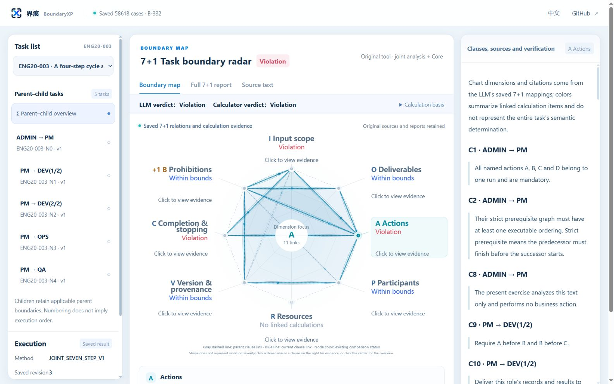
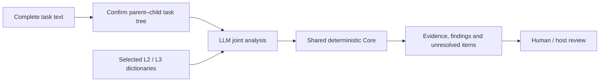

<strong>English</strong> · <a href="README.zh-CN.md">简体中文</a>

<h1 align="center">From source to boundaries, every step is visible.</h1>

  
  
  

  
  
  

Turn complete task requirements into an evidence-linked <strong>7+1 relational representation</strong>, then check it with a deterministic Core. Inspect plans and task decompositions, and trace the evidence for <strong>Violation, Within bounds or Incomplete information</strong>.

<a href="https://boundaryxp-workbench-demo.joinwell52.chatgpt.site/?lang=en#case=ENG20-003&axis=A&view=radar&lang=en"><strong>▶ Try the demo</strong></a>　·　<a href="docs/mcp/INSTALL.en.md"><strong>MCP setup</strong></a>　·　<a href="https://doi.org/10.5281/zenodo.24072738"><strong>Paper</strong></a>

Chinese & English · MCP 0.4.0-rc.9 / B-335 · Research & protocol material · Original Core source private

## Install BXP · Find BXP

**[Install from npm →](https://www.npmjs.com/package/boundaryxp-mcp#installation-and-upgrades)** · **[Codex / Cursor setup →](docs/mcp/INSTALL.en.md)** · **[中文安装 →](docs/mcp/INSTALL.zh-CN.md)**

**21 tools · 17 resources · Windows x64 · Node.js ≥22.18 · rc.9 prerelease.** Default analysis uses your current host LLM; no separate model API key is required.

| Public entry | What you can find there |
|---|---|
| **[npm — install the package](https://www.npmjs.com/package/boundaryxp-mcp)** | rc.9 package, Chinese/English descriptions and installation on the same page |
| **[Official MCP Registry](https://registry.modelcontextprotocol.io/?q=boundaryxp)** | Published rc.9 metadata and npm installation reference |
| **[TensorBlock MCP Index — merged contribution](https://github.com/TensorBlock/awesome-mcp-servers/pull/5989)** | rc.7 listing is merged; [rc.9 update PR #6087](https://github.com/TensorBlock/awesome-mcp-servers/pull/6087) is pending |
| **[MCPServers](https://mcpservers.org/servers/www-npmjs-com-package-boundaryxp-mcp)** | Live listing and npm link; rc.8 remains displayed, documentation refresh requested November 16 |
| **[Serverdex](https://serverdex.io/server/io-github-joinwell52-ai-boundaryxp)** | Live listing with repository and npm links; cached rc.8 snippet omits required data path—use our setup guide |
| **[Glama](https://glama.ai/mcp/servers/joinwell52-AI/BoundaryXP)** | Live information page; cached rc.5 instructions, no Glama-hosted deployable release |

Checked 2026-11-16. Search **BoundaryXP** or **boundaryxp-mcp**. Use npm for the current package; directory caches can lag. “Listed” means discoverable, not a certification. [Full directory status and submission options](docs/mcp/DISCOVERY.md).

MCPwell and ToolCenter also contain directory entries, but no BXP-specific detail URL was verified. Their category/index pages are listed only in the full directory notes, not as direct BXP installation entries here.

**Codex desktop:** Plugins → Add → **Add MCP server**. Follow the [stdio setup guide](docs/mcp/npm/INSTALL.md#codex-and-other-hosts). **Add plugin marketplace** expects a separate plugin-marketplace source; the npm URL, Registry URL and this product repository are not such a source. BXP is not currently listed in the Codex plugin catalog or Cursor Marketplace.

**Plugin contribution:** [OpenAI Community Plugins draft PR #57](https://github.com/openai/community-plugins/pull/57) contains a tested Windows x64 wrapper for the compiled rc.9 package. [punkpeye PR #19484](https://github.com/punkpeye/awesome-mcp-servers/pull/19484) has also been updated to rc.9. Both await review; neither is counted as an approved listing. [Test scope and current submission status](docs/mcp/DISCOVERY.md#rc9-contributions).

To try the contributor fork through **Add plugin marketplace**, use the [candidate plugin installation guide](docs/mcp/PLUGIN-MARKETPLACE.en.md). Its GitHub-to-Codex installation and installed MCP were verified in isolation; official marketplace approval is still pending.

## Start with a real case

In **ENG20-003**, five tasks span several roles. Their combined dependencies form a strict **A → B → C → D → A** cycle. BoundaryXP brings those dependencies into one graph and preserves the original English sources and calculation records for inspection.

<a href="https://boundaryxp-workbench-demo.joinwell52.chatgpt.site/?lang=en#case=ENG20-003&axis=A&view=radar&lang=en"><strong>Click the radar to inspect evidence →</strong></a>　·　<a href="https://boundaryxp-workbench-demo.joinwell52.chatgpt.site/?lang=en#case=ENG20-003&axis=A&view=report&lang=en">Read and export the 7+1 report →</a>

### Different cases, different results

| Result / case | What to inspect |
|---|---|
| **Violation** · [RT044](https://boundaryxp-workbench-demo.joinwell52.chatgpt.site/?lang=en#case=R389-383&axis=A&view=radar&lang=en) | Local orders combine into a strict dependency cycle |
| **Within bounds** · [RT042](https://boundaryxp-workbench-demo.joinwell52.chatgpt.site/?lang=en#case=R389-381&axis=R&view=radar&lang=en) | Adjacent half-open 10–11 and 11–12 bookings release the endpoint |
| **Incomplete information** · [L23-050](https://boundaryxp-workbench-demo.joinwell52.chatgpt.site/?lang=en#case=R389-153&axis=P&view=radar&lang=en) | “Confirmed by him” has no unique owner binding; U1 remains unknown |

Two cases have **original English sources**: [ENG20-001 · Branches and a join](https://boundaryxp-workbench-demo.joinwell52.chatgpt.site/?lang=en#case=ENG20-001&axis=A&view=radar&lang=en) (Within bounds) and [ENG20-003 · Four-step dependency cycle](https://boundaryxp-workbench-demo.joinwell52.chatgpt.site/?lang=en#case=ENG20-003&axis=A&view=radar&lang=en) (Violation).

All five come from saved 58618 records, retaining task trees, exact sources, verdicts and seven-step reports. **Reports and Markdown exports follow the top-right language switch; source evidence keeps its original language.** The demo replays B-332 records without connecting to a local service or running new analysis. B335 upgrades do not regenerate those records. [Demo and saved reports](docs/demo/README.md)

See the English report and original task text

## Connect to your AI workflow

**New in rc.9:** import and validate custom L2 industry and L3 enterprise dictionaries through MCP or the workbench. [Format and English examples](docs/mcp/npm/guides/DICTIONARIES.md). Existing rc.8 installations can upgrade directly using the **rc.9 bootstrap installer once**; the old updater's fixed 18-tool probe cannot accept the new 21-tool catalog. Follow the [upgrade guide](docs/mcp/npm/INSTALL.md#updates) and preserve your existing installation/data paths.

**BoundaryXP MCP** connects through standard stdio to Cursor, Codex and compatible hosts, with **21 tools, 17 resources and a local browser workbench**. The Windows x64 package includes the compiled native Core; no separate 58618 installation or hosted BoundaryXP server is required.

1. **Install from npm:** use `boundaryxp-mcp@0.4.0-rc.9`, available through the `next` prerelease channel. GitHub Releases retain the matching archive and SHA-256.
2. **Install and connect:** follow the guide to configure the host's stdio MCP server.
3. **Use your current host LLM:** the built-in host profile prepares instructions and accepts the host analysis through standard MCP tools. No separate model API key is required; an independent API profile remains optional.
4. **Open the workbench:** import complete task text, preview and confirm the task tree, then analyze and inspect evidence and reports.

[**English installation guide →**](docs/mcp/INSTALL.en.md) · [中文安装](docs/mcp/INSTALL.zh-CN.md) · [Tools and resources](docs/mcp/TOOLS.md) · [Updates, rollback and troubleshooting](docs/mcp/npm/INSTALL.md#updates)

> **Current npm release:** [boundaryxp-mcp 0.4.0-rc.9](https://www.npmjs.com/package/boundaryxp-mcp), B-335 / Windows x64, MIT. Start with the [installation guide](docs/mcp/INSTALL.en.md), [7+1 introduction](docs/mcp/npm/README.en.md), [21 tools](docs/mcp/npm/guides/TOOLS.md) and [directory status](docs/mcp/DISCOVERY.md). This product repository is public. Core implementation source remains in a separate private repository.

## L2 / L3: industry and enterprise semantics

The same term can mean different things across industries and organizations. L2 / L3 provide selected domain context for interpreting tasks alongside the original evidence.

| Semantic library | Purpose |
|---|---|
| **L2 · Industry** | Describes domain actions, entities, roles, resources and related terminology to help interpret requirements in their industry context. |
| **L3 · Enterprise** | Adds organization-specific terminology, organizational and role names, controlled aliases and other context to distinguish local objects and expressions. |

**There is no active L1 layer.** L0 is the BXP protocol and deterministic Core, not a semantic library. L2 / L3 do not replace source text or change the shared 7+1 verification rules. Loading a library, a job title or a reporting relationship does not grant business authority.

### Use through MCP

1. Call `bx_dictionaries_list` to inspect the L2 / L3 resources available in the current installation and their identifiers and versions.
2. Call `bx_dictionaries_bind` to validate the selected resources and obtain version-and-digest references, keeping library snapshots distinct.
3. Call `bx_dictionary_lookup` to look up entries in bound resources. Lookup does not make a semantic ruling or submit analysis.

Ask your host: **“List the available BXP L2 and L3 semantic libraries with their identifiers, versions and digests. Wait for my selection before binding; do not submit analysis.”**

[**Install and connect MCP →**](docs/mcp/INSTALL.en.md) · [Dictionary tool reference](docs/mcp/TOOLS.md) · [Resource and distribution notices](docs/mcp/NOTICES.md)

Available resources are determined by the installed inventory. Manage private enterprise semantic material within its own usage scope. This section documents capabilities and entry points; it does not claim a separate public GitHub library release.

## Method and research evidence

**BXP: A Method for AI Task Boundary Verification Using a 7+1 Relational Representation**  
Wei Zhu · English v1.2 / Chinese r23 · First published 2026-11-06

| Research cases | Task nodes | Calculation items |
|:---:|:---:|:---:|
| **625** | **3,219** | **3,469** |

The paper organizes requirements through 7+1 views and shared relations, uses BXP conventions to establish a common mathematical boundary, and checks whether subtasks and their combination exceed the parent task's boundary. Formal arguments state the conditions for the method. These figures describe research coverage, **not accuracy**. Case-level agreement, item-level differences and incomplete calculations are reported separately.

[**English PDF**](https://github.com/joinwell52-AI/BoundaryXP/releases/download/paper-v1.2-r23/BoundaryXP-manuscript.en.pdf) · [中文 PDF](https://github.com/joinwell52-AI/BoundaryXP/releases/download/paper-v1.2-r23/BoundaryXP-manuscript.zh-CN.pdf) · [**Public research package**](https://zenodo.org/records/24072738/files/manuscript-with-materials.zip?download=1) · [Materials guide](docs/paper/README.en.md)

**DOI: [10.5281/zenodo.24072738](https://doi.org/10.5281/zenodo.24072738)**. Deposited on Zenodo on 2026-11-09, retaining the first GitHub publication date. [GitHub paper release and checksums](https://github.com/joinwell52-AI/BoundaryXP/releases/tag/paper-v1.2-r23)

The `RESEARCH_ONLY_1` supplement contains task sources, annotations, 7+1 reports, operands, results, protocol texts, screenshots and independent research verification scripts. It excludes workbench engineering source, runtime dependencies and production prompt templates. It is maintained separately from the MCP test package.

## How 7+1 connects the requirements

**I Inputs · O Outputs · A Actions · P Responsibilities and division of work · R Resources · V Version / basis · C Completion / stopping, plus independent B Prohibitions.**

Shared relations connect objects, conditions, dependencies and handoffs across task boundaries. Missing information stays missing; a role title does not grant authority.

The B335 workbench makes **one semantic request**, followed by Core checks, with no separate audit request or automatic retry. LLMs interpret source meaning; Core validates submitted structures, source references, bindings and supported finite operands. Core does not call models, access the network or execute task instructions.

B335 capabilities, input limits and evidence boundaries

- **Complete task trees:** whole-document UTF-8 `.txt` / `.md` import, role headings, explicit task and parent IDs, forward references, multiple levels and relationship preview.
- **Inspectable results:** task tree, 7+1 radar, model/calculator conclusions, quotations, unresolved items, saved history and exports. Failed attempts remain distinct from saved results.
- **L2 / L3:** versioned industry and enterprise dictionaries; no active L1 layer. Loading resources does not grant business authority.
- **Chinese and English:** interface, reports and Markdown exports preserve original sources and saved verdicts. First-time translation calls a model and is cached by snapshot.
- **Mathematical input and unknowns:** allowed values, uncertain facts and parent/child plan consistency have distinct meanings. Set identities support strings and safe integers without conflating their types or filling in unknown conclusions.
- **Startup and recovery:** historical jobs load with bounded concurrency under existing recovery rules. Readiness follows HTTP identity verification.

Individual sources and serialized joint input are each limited to **1 MiB**; HTTP request bodies to **8 MiB**. Oversized input is rejected without truncation; there is no 300-code-point ceiling. See the [changelog](CHANGELOG.md) for features and historical validation scope.

Exact quotations do not prove semantic entailment. A completed job does not mean every proof passed. People and host systems retain business decisions and execution authority; `business_decision` and `execution_authorization` remain null.

The reviewed baseline is BXP-0001 `0.4.0-draft.2`; the workbench still uses a recorded draft.1 attachment. Full migration and protocol conformance are not claimed. [Implementation notes](protocol/IMPLEMENTATION.md) · [Research evidence](docs/RESEARCH.en.md)

Host analysis and first-time translation may send selected source and dictionary content to the configured model provider. Review this data flow before supplying private material.

## Explore further

| Looking for | Start here |
|---|---|
| Industry and enterprise semantics | [L2 / L3 overview](#l2--l3-industry-and-enterprise-semantics) · [Dictionary tools](docs/mcp/TOOLS.md) |
| MCP installation and usage | [Setup guide](docs/mcp/README.md) · [Release evidence](docs/mcp/RELEASE.md) |
| Method and citation | [Research overview](docs/RESEARCH.en.md) · [Paper materials](docs/paper/README.en.md) |
| Protocol and implementation differences | [BXP protocol](protocol/README.md) · [Implementation notes](protocol/IMPLEMENTATION.md) |
| Version history and contribution | [Changelog](CHANGELOG.md) · [Contributing](CONTRIBUTING.md) · [Documentation](docs/README.md) |

**Distribution scope:** the Git tree contains paper, protocol, cases, reports, screenshots, independent research verification scripts and MCP documentation. It excludes private workbench implementation source and source-build entry points. Compiled MCP packages are published to npm and mirrored in this repository's Releases. Original Core implementation source is excluded from those packages; adapter, UI and required resources remain readable. [Full scope](docs/PUBLICATION-SCOPE.md)

**Public status:** the owner has made this product repository public. Historical audit notes describe their recorded state; public visibility alone does not confirm that old GitHub references or caches have been cleared. [Audit record](docs/PREPUBLICATION-CHECK.md)

The existing [MIT license](LICENSE) is retained. Paper, case data and third-party materials have their own [usage terms](docs/paper/materials/MATERIAL-ACCESS.md); the MCP package has separate [license and third-party notices](docs/mcp/NOTICES.md).
