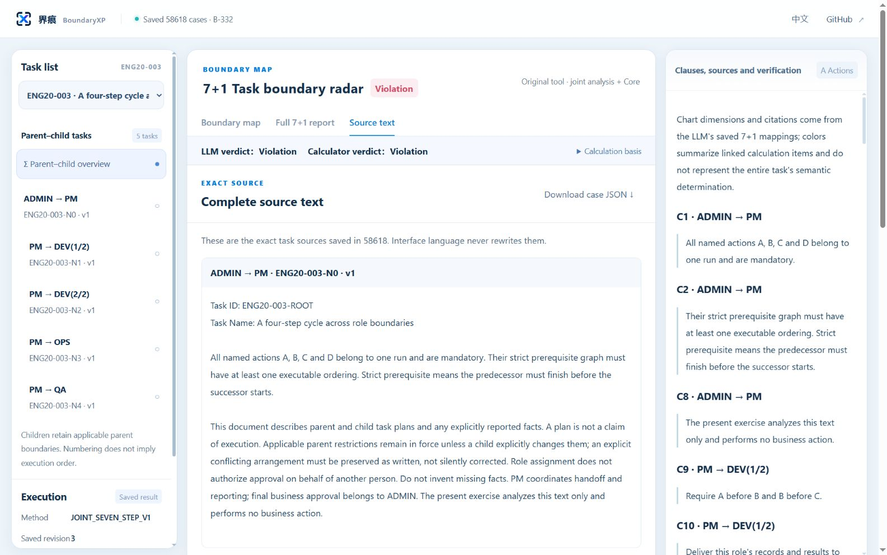
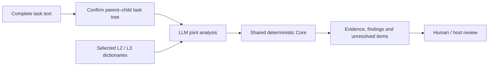

<strong>English</strong> · <a href="README.zh-CN.md">简体中文</a>

<h1 align="center">From source to boundaries, every step is visible.</h1>

Turn complete task requirements into an evidence-linked <strong>7+1 relational representation</strong>, then check it with a deterministic Core. Inspect plans and task decompositions, and trace the evidence for <strong>Violation, Within bounds or Incomplete information</strong>.

<a href="https://boundaryxp-workbench-demo.joinwell52.chatgpt.site/?lang=en#case=ENG20-003&axis=A&view=radar&lang=en"><strong>▶ Try the demo</strong></a>　·　<a href="docs/mcp/INSTALL.en.md"><strong>MCP setup</strong></a>　·　<a href="https://doi.org/10.5281/zenodo.24072738"><strong>Paper</strong></a>

Chinese & English · MCP 0.4.0-rc.2 / B-335 internal testing · Research & protocol material · Original Core source private

## Start with a real case

In **ENG20-003**, five tasks span several roles. Their combined dependencies form a strict **A → B → C → D → A** cycle. BoundaryXP brings those dependencies into one graph and preserves the original English sources and calculation records for inspection.

<a href="https://boundaryxp-workbench-demo.joinwell52.chatgpt.site/?lang=en#case=ENG20-003&axis=A&view=radar&lang=en"><strong>Click the radar to inspect evidence →</strong></a>　·　<a href="https://boundaryxp-workbench-demo.joinwell52.chatgpt.site/?lang=en#case=ENG20-003&axis=A&view=report&lang=en">Read and export the 7+1 report →</a>

### Different cases, different results

| Result / case | What to inspect |
|---|---|
| **Violation** · [RT044](https://boundaryxp-workbench-demo.joinwell52.chatgpt.site/?lang=en#case=R389-383&axis=A&view=radar&lang=en) | Local orders combine into a strict dependency cycle |
| **Within bounds** · [RT042](https://boundaryxp-workbench-demo.joinwell52.chatgpt.site/?lang=en#case=R389-381&axis=R&view=radar&lang=en) | Adjacent half-open 10–11 and 11–12 bookings release the endpoint |
| **Incomplete information** · [L23-050](https://boundaryxp-workbench-demo.joinwell52.chatgpt.site/?lang=en#case=R389-153&axis=P&view=radar&lang=en) | “Confirmed by him” has no unique owner binding; U1 remains unknown |

Two cases have **original English sources**: [ENG20-001 · Branches and a join](https://boundaryxp-workbench-demo.joinwell52.chatgpt.site/?lang=en#case=ENG20-001&axis=A&view=radar&lang=en) (Within bounds) and [ENG20-003 · Four-step dependency cycle](https://boundaryxp-workbench-demo.joinwell52.chatgpt.site/?lang=en#case=ENG20-003&axis=A&view=radar&lang=en) (Violation).

All five come from saved 58618 records, retaining task trees, exact sources, verdicts and seven-step reports. **Reports and Markdown exports follow the top-right language switch; source evidence keeps its original language.** The demo replays B-332 records without connecting to a local service or running new analysis. B335 upgrades do not regenerate those records. [Demo and saved reports](docs/demo/README.md)

See the English report and original task text

## Connect to your AI workflow

**BoundaryXP MCP** connects through standard stdio to Cursor, Codex and compatible hosts, with **18 tools, 10 resources and a local browser workbench**. The Windows x64 test package includes the compiled native Core; no separate 58618 installation or hosted BoundaryXP server is required.

1. **Download and verify:** get the test package from the private draft release's **Assets** and check SHA-256.
2. **Install and connect:** follow the guide to configure the host's stdio MCP server.
3. **Configure a model API:** new analysis uses your own provider/API access. Cursor or Codex subscription allowances are not inherited.
4. **Open the workbench:** import complete task text, preview and confirm the task tree, then analyze and inspect evidence and reports.

[**English installation guide →**](docs/mcp/INSTALL.en.md) · [中文安装](docs/mcp/INSTALL.zh-CN.md) · [Tools and resources](docs/mcp/TOOLS.md) · [Updates, rollback and troubleshooting](docs/mcp/OPERATIONS.md)

> **Distribution status:** 0.4.0-rc.2 / B-335, Windows x64 internal testing. This repository remains private and the prerelease remains a draft; no npm version is published. Authorized maintainers download Assets, not generated Source code archives. External distribution scope and licensing still need confirmation. See [release evidence](docs/mcp/RELEASE.md) and [notices](docs/mcp/NOTICES.md).

## Method and research evidence

**BXP: A Method for AI Task Boundary Verification Using a 7+1 Relational Representation**  
Wei Zhu · English v1.2 / Chinese r23 · First published 2026-11-06

| Research cases | Task nodes | Calculation items |
|:---:|:---:|:---:|
| **625** | **3,219** | **3,469** |

The paper organizes requirements through 7+1 views and shared relations, uses BXP conventions to establish a common mathematical boundary, and checks whether subtasks and their combination exceed the parent task's boundary. Formal arguments state the conditions for the method. These figures describe research coverage, **not accuracy**. Case-level agreement, item-level differences and incomplete calculations are reported separately.

[**English PDF**](https://github.com/joinwell52-AI/BoundaryXP/releases/download/paper-v1.2-r23/BoundaryXP-manuscript.en.pdf) · [中文 PDF](https://github.com/joinwell52-AI/BoundaryXP/releases/download/paper-v1.2-r23/BoundaryXP-manuscript.zh-CN.pdf) · [**Public research package**](https://zenodo.org/records/24072738/files/manuscript-with-materials.zip?download=1) · [Materials guide](docs/paper/README.en.md)

**DOI: [10.5281/zenodo.24072738](https://doi.org/10.5281/zenodo.24072738)**. Deposited on Zenodo on 2026-11-09, retaining the first GitHub publication date. [GitHub paper release and checksums](https://github.com/joinwell52-AI/BoundaryXP/releases/tag/paper-v1.2-r23)

The `RESEARCH_ONLY_1` supplement contains task sources, annotations, 7+1 reports, operands, results, protocol texts, screenshots and independent research verification scripts. It excludes workbench engineering source, runtime dependencies and production prompt templates. It is maintained separately from the MCP test package.

## How 7+1 connects the requirements

**I Inputs · O Outputs · A Actions · P Responsibilities and division of work · R Resources · V Version / basis · C Completion / stopping, plus independent B Prohibitions.**

Shared relations connect objects, conditions, dependencies and handoffs across task boundaries. Missing information stays missing; a role title does not grant authority.

The B335 workbench makes **one semantic request**, followed by Core checks, with no separate audit request or automatic retry. LLMs interpret source meaning; Core validates submitted structures, source references, bindings and supported finite operands. Core does not call models, access the network or execute task instructions.

B335 capabilities, input limits and evidence boundaries

- **Complete task trees:** whole-document UTF-8 `.txt` / `.md` import, role headings, explicit task and parent IDs, forward references, multiple levels and relationship preview.
- **Inspectable results:** task tree, 7+1 radar, model/calculator conclusions, quotations, unresolved items, saved history and exports. Failed attempts remain distinct from saved results.
- **L2 / L3:** versioned industry and enterprise dictionaries; no active L1 layer. Loading resources does not grant business authority.
- **Chinese and English:** interface, reports and Markdown exports preserve original sources and saved verdicts. First-time translation calls a model and is cached by snapshot.
- **Mathematical input and unknowns:** allowed values, uncertain facts and parent/child plan consistency have distinct meanings. Set identities support strings and safe integers without conflating their types or filling in unknown conclusions.
- **Startup and recovery:** historical jobs load with bounded concurrency under existing recovery rules. Readiness follows HTTP identity verification.

Individual sources and serialized joint input are each limited to **1 MiB**; HTTP request bodies to **8 MiB**. Oversized input is rejected without truncation; there is no 300-code-point ceiling. See the [changelog](CHANGELOG.md) for features and historical validation scope.

Exact quotations do not prove semantic entailment. A completed job does not mean every proof passed. People and host systems retain business decisions and execution authority; `business_decision` and `execution_authorization` remain null.

The reviewed baseline is BXP-0001 `0.4.0-draft.2`; the workbench still uses a recorded draft.1 attachment. Full migration and protocol conformance are not claimed. [Implementation notes](protocol/IMPLEMENTATION.md) · [Research evidence](docs/RESEARCH.en.md)

Host analysis and first-time translation may send selected source and dictionary content to the configured model provider. Review this data flow before supplying private material.

## Explore further

| Looking for | Start here |
|---|---|
| MCP installation and usage | [Setup guide](docs/mcp/README.md) · [Release evidence](docs/mcp/RELEASE.md) |
| Method and citation | [Research overview](docs/RESEARCH.en.md) · [Paper materials](docs/paper/README.en.md) |
| Protocol and implementation differences | [BXP protocol](protocol/README.md) · [Implementation notes](protocol/IMPLEMENTATION.md) |
| Version history and contribution | [Changelog](CHANGELOG.md) · [Contributing](CONTRIBUTING.md) · [Documentation](docs/README.md) |

**Distribution scope:** the Git tree contains paper, protocol, cases, reports, screenshots, independent research verification scripts and MCP documentation. It excludes private workbench implementation source and source-build entry points. MCP compiled packages are separate private draft release assets. Original Core implementation source is excluded from those packages; adapter, UI and required resources remain readable. [Full scope](docs/PUBLICATION-SCOPE.md)

**Publication readiness:** this repository remains private. Legacy PR references and historical cache cleanup still await GitHub handling; this homepage update does not complete the publication audit. [Audit record](docs/PREPUBLICATION-CHECK.md)

The existing [MIT license](LICENSE) is retained. Paper, case data and third-party materials have their own [usage terms](docs/paper/materials/MATERIAL-ACCESS.md); the MCP test package has separate [license and third-party notices](docs/mcp/NOTICES.md).
