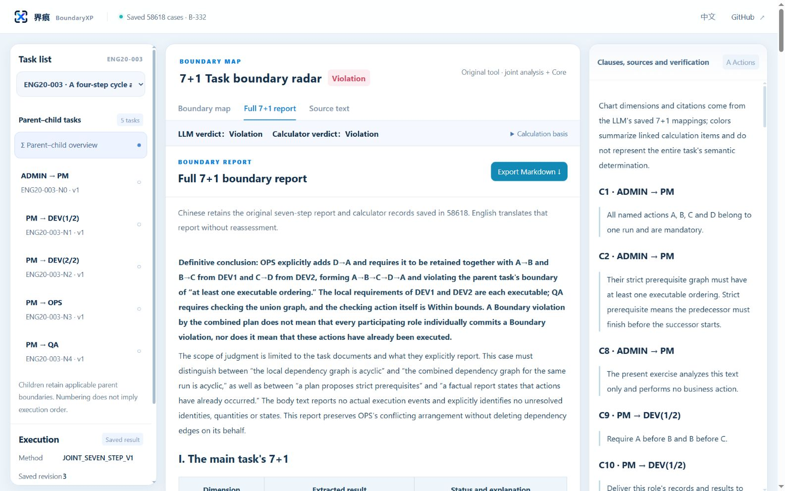
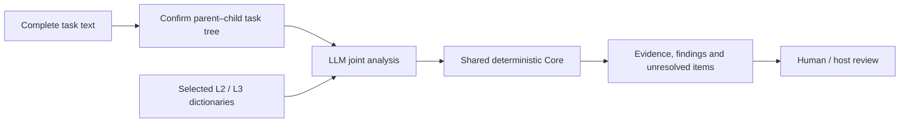

<strong>English</strong> · <a href="README.zh-CN.md">简体中文</a>

<h1 align="center">From source to boundaries, every step is visible.</h1>

  
  
  
  

  
  
  

Turn complete task requirements into an evidence-linked <strong>7+1 relational representation</strong>, then check it with a deterministic Core. Inspect plans and task decompositions, and trace the evidence for <strong>Violation, Within bounds or Incomplete information</strong>.

<a href="https://boundaryxp-demo.vercel.app/?lang=en#case=ENG20-003&axis=A&view=radar&lang=en"><strong>▶ Try the demo</strong></a>　·　<a href="docs/mcp/INSTALL.en.md"><strong>MCP setup</strong></a>　·　<a href="https://doi.org/10.5281/zenodo.24072738"><strong>Paper</strong></a>

Chinese & English · MCP 0.4.0-rc.12 / B-353 · Research & protocol material · Original Core source private

> **Questions, counterexamples and contributions are welcome.** The 7+1 method has assumptions and limits; the research cases do not establish correctness for every task. The MCP implementation, model interpretations and L2/L3 resources can also be wrong. Deterministic calculation does not guarantee correct semantic interpretation. Help test and improve the approach with questions, counterexamples and reproducible evidence.
>

| Purpose | Document or page |
|---|---|
| General questions | [Questions and ideas form](https://github.com/joinwell52-AI/BoundaryXP/issues/new?template=04-question.yml) |
| Method feedback | [7+1 counterexample form](https://github.com/joinwell52-AI/BoundaryXP/issues/new?template=01-method-counterexample.yml) |
| MCP feedback | [MCP installation and usage issue form](https://github.com/joinwell52-AI/BoundaryXP/issues/new?template=02-mcp-problem.yml) |
| Semantic feedback | [L2/L3 semantic resource issue form](https://github.com/joinwell52-AI/BoundaryXP/issues/new?template=03-semantic-resource.yml) |
| Contribute | [Contribution guide and PR process](CONTRIBUTING.md) |

## Install BXP · Find BXP

**Current release: rc.12 / B353 · 21 tools · 17 resources.** Use the current host LLM through standard stdio MCP; a separate model API key is optional. Core implementation source stays private.

| Main entry | Purpose and verified version |
|---|---|
| **[npm — install BXP](https://www.npmjs.com/package/boundaryxp-mcp)** | Windows `0.4.0-rc.12` on latest/next; Linux `0.4.0-rc.12-linux.1` on linux. English/Chinese descriptions and installation on the same page |
| **[Official MCP Registry](https://registry.modelcontextprotocol.io/?q=boundaryxp)** | Active/latest rc.12 metadata and npm installation reference |
| **[GitHub releases and guides](https://github.com/joinwell52-AI/BoundaryXP/releases)** | Compiled archives, SHA-256, bilingual installation, upgrade and release evidence |

**Install:** [Windows English](docs/mcp/INSTALL.en.md) · [Windows 中文](docs/mcp/INSTALL.zh-CN.md) · [Linux/Docker English](docs/mcp/linux/INSTALL.en.md) · [Linux/Docker 中文](docs/mcp/linux/INSTALL.zh-CN.md) · [Upgrade and rollback](docs/mcp/npm/INSTALL.md#updates).
Windows requires x64 / Node ≥22.18; Linux requires x64 / glibc ≥2.36 / Node ≥22.19. These are prerelease packages. Fixed version configurations do not automatically switch versions; preserve old data and follow the copy-migration guide.

B353 conservatively repairs omitted operation kinds, extra path escaping and missing shared budget fields, preserving raw responses. Native Core reports remaining complete fixed budgets. [Release changes and acceptance](docs/mcp/RC12.md) · [Publication readback](docs/mcp/RC12-PUBLICATION.json).

### Other directories and review status

Checked November 28, 2026. Listed, update submitted and review approved are different states.

| Entry | Current state |
|---|---|
| [TensorBlock](https://tensorblock.co/mcp/servers/github-joinwell52-ai-boundaryxp-16b09093) | rc.11 #6302 merged; [rc.12 update #7184](https://github.com/TensorBlock/awesome-mcp-servers/pull/7184) submitted |
| [punkpeye #19484](https://github.com/punkpeye/awesome-mcp-servers/pull/19484) | Entry and PR updated to rc.12; maintainer review pending |
| [OpenAI community plugin #57](https://github.com/openai/community-plugins/pull/57) | Candidate wrapper update and separate tests recorded in [directory status](docs/mcp/DISCOVERY.md); not approved for the official plugin catalog |
| [Glama](https://glama.ai/mcp/servers/joinwell52-AI/BoundaryXP) | Public README points to rc.12; last completed platform validation is [rc.11](docs/mcp/GLAMA-RC11.md). rc.12 rebuild requires renewed owner login |
| [Serverdex](https://serverdex.io/server/io-github-joinwell52-ai-boundaryxp) | rc.12 bilingual description saved and publicly verified. Automatically generated version/install commands still cache rc.11; use npm setup above |
| [MCPServers](https://mcpservers.org/servers/www-npmjs-com-package-boundaryxp-mcp) | Refresh requested November 28; summary rc.8 / 18 tools and README rc.11 are still stale |

**Codex desktop:** Plugins → Add → **Add MCP server**, following the stdio setup guide. **Add plugin marketplace** expects a separate marketplace repository; this product repository, npm URL and Registry URL are not marketplace sources. [Candidate plugin setup](docs/mcp/PLUGIN-MARKETPLACE.en.md) is separate from official catalog approval. Cursor Marketplace submission remains paused at the owner's request.

Search **BoundaryXP** or **boundaryxp-mcp**. Third-party caches may lag; use npm for the current package. Directory listing is not certification. MCPwell/ToolCenter category pages are not presented as verified BXP detail links. [Full dated directory and PR history](docs/mcp/DISCOVERY.md).

## Start with a real case

In **ENG20-003**, five tasks span several roles. Their combined dependencies form a strict **A → B → C → D → A** cycle. BoundaryXP brings those dependencies into one graph and preserves the original English sources and calculation records for inspection.

<a href="https://boundaryxp-demo.vercel.app/?lang=en#case=ENG20-003&axis=A&view=radar&lang=en"><strong>Click the radar to inspect evidence →</strong></a>　·　<a href="https://boundaryxp-demo.vercel.app/?lang=en#case=ENG20-003&axis=A&view=report&lang=en">Read and export the 7+1 report →</a>

### Different cases, different results

| Result / case | What to inspect |
|---|---|
| **Violation** · [RT044](https://boundaryxp-demo.vercel.app/?lang=en#case=R389-383&axis=A&view=radar&lang=en) | Local orders combine into a strict dependency cycle |
| **Within bounds** · [RT042](https://boundaryxp-demo.vercel.app/?lang=en#case=R389-381&axis=R&view=radar&lang=en) | Adjacent half-open 10–11 and 11–12 bookings release the endpoint |
| **Incomplete information** · [L23-050](https://boundaryxp-demo.vercel.app/?lang=en#case=R389-153&axis=P&view=radar&lang=en) | “Confirmed by him” has no unique owner binding; U1 remains unknown |

Two cases have **original English sources**: ENG20-001 · Branches and a join (Within bounds) and ENG20-003 · Four-step dependency cycle (Violation).

All five come from saved 58618 records, retaining task trees, exact sources, verdicts and seven-step reports. **Reports and Markdown exports follow the top-right language switch; source evidence keeps its original language.** The demo replays B-332 records without connecting to a local service or running new analysis. B335 upgrades do not regenerate those records. Demo and saved reports

See the English report and original task text

| Purpose | Document or page |
|---|---|
| English case · Within bounds | [ENG20-001 · Branches and a join](https://boundaryxp-demo.vercel.app/?lang=en#case=ENG20-001&axis=A&view=radar&lang=en) |
| English case · Violation | [ENG20-003 · Four-step dependency cycle](https://boundaryxp-demo.vercel.app/?lang=en#case=ENG20-003&axis=A&view=radar&lang=en) |
| Demo and reports | [Demo guide and saved reports](docs/demo/README.md) |

## Connect to your AI workflow

**New in rc.10 / B345:** import complete L2/L3 directories through the five-step workbench UI or MCP. Read the [format specification and complete English examples](docs/mcp/npm/guides/DICTIONARIES.md). Model settings save separately from dictionaries. Existing tasks, failed jobs and rc.9 dictionaries are retained; the calculator algorithm is unchanged.

**BoundaryXP MCP** connects through standard stdio to Cursor, Codex and compatible hosts, with **21 tools, 17 resources and a local browser workbench**. The Windows x64 package includes the compiled native Core; no separate 58618 installation or hosted BoundaryXP server is required.

1. **Install from npm:** use `boundaryxp-mcp@0.4.0-rc.12`, available through the `next` prerelease channel. GitHub Releases retain the matching archive and SHA-256.
2. **Install and connect:** follow the guide to configure the host's stdio MCP server.
3. **Use your current host LLM:** the built-in host profile prepares instructions and accepts the host analysis through standard MCP tools. No separate model API key is required; an independent API profile remains optional.
4. **Open the workbench:** import complete task text, preview and confirm the task tree, then analyze and inspect evidence and reports.

| Purpose | Document or page |
|---|---|
| Windows setup | [Windows installation guide · English](docs/mcp/INSTALL.en.md) |
| Windows setup | [Windows installation guide · 中文](docs/mcp/INSTALL.zh-CN.md) |
| Tool reference | [21 MCP tools and resources](docs/mcp/TOOLS.md) |
| Updates and maintenance | [Upgrade, rollback and troubleshooting guide](docs/mcp/npm/INSTALL.md#updates) |

> **Current npm release:** boundaryxp-mcp 0.4.0-rc.12, B-353 / Windows x64, MIT. Start with the installation guide, 7+1 introduction, 21 tools and directory status. This product repository is public. Core implementation source remains in a separate private repository.

| Purpose | Document or page |
|---|---|
| Custom semantics | [L2/L3 dictionary format and English examples](docs/mcp/npm/guides/DICTIONARIES.md) |
| Updates and maintenance | [Upgrade, rollback and troubleshooting guide](docs/mcp/npm/INSTALL.md#updates) |
| npm release | [boundaryxp-mcp 0.4.0-rc.12](https://www.npmjs.com/package/boundaryxp-mcp) |
| Windows setup | [Windows installation guide · English](docs/mcp/INSTALL.en.md) |
| Product overview | [MCP 7+1 product introduction · English](docs/mcp/npm/README.en.md) |
| Tool reference | [21 MCP tools and input reference](docs/mcp/npm/guides/TOOLS.md) |
| Directory listings | [MCP listings and review status](docs/mcp/DISCOVERY.md) |

## L2 / L3: industry and enterprise semantics

The same term can mean different things across industries and organizations. L2 / L3 provide selected domain context for interpreting tasks alongside the original evidence.

| Semantic library | Purpose |
|---|---|
| **L2 · Industry** | Describes domain actions, entities, roles, resources and related terminology to help interpret requirements in their industry context. |
| **L3 · Enterprise** | Adds organization-specific terminology, organizational and role names, controlled aliases and other context to distinguish local objects and expressions. |

**There is no active L1 layer.** L0 is the BXP protocol and deterministic Core, not a semantic library. L2 / L3 do not replace source text or change the shared 7+1 verification rules. Loading a library, a job title or a reporting relationship does not grant business authority.

### Use through MCP

**rc.10 / B345 folder standard:** L2 contains **8 JSON files + README**; L3 contains **3 JSON files + README**. The workbench has **Installed dictionaries** and **Import semantic library** tabs. Import in five steps: select L2/L3 → choose the full folder → validate → name → save. Validation must pass before saving; names and selections persist after refresh. Model settings save separately. Older rc.9 dictionaries and their bindings remain readable.

For MCP import, call `bx_dictionary_format` (language `en` or `zh-CN`) for the full directory envelope and example; call `bx_dictionary_validate`, then `bx_dictionary_import` with the returned digest. Follow the returned schema; a folder is not a single dictionary JSON file. Legacy JSON tool imports remain compatible.

**[Format and file requirements](docs/mcp/npm/guides/DICTIONARIES.md)** · **[L2 English folder ZIP](docs/mcp/npm/examples/dictionary-directory-L2-en.zip)** · **[L3 English folder ZIP](docs/mcp/npm/examples/dictionary-directory-L3-en.zip)**

1. Call `bx_dictionaries_list` to inspect the L2 / L3 resources available in the current installation and their identifiers and versions.
2. Call `bx_dictionaries_bind` to validate the selected resources and obtain version-and-digest references, keeping library snapshots distinct.
3. Call `bx_dictionary_lookup` to look up entries in bound resources. Lookup does not make a semantic ruling or submit analysis.

Ask your host: **“List the available BXP L2 and L3 semantic libraries with their identifiers, versions and digests. Wait for my selection before binding; do not submit analysis.”**

| Purpose | Document or page |
|---|---|
| Windows setup | [Windows installation guide · English](docs/mcp/INSTALL.en.md) |
| Tool reference | [21 MCP tools and resources](docs/mcp/TOOLS.md) |
| Licensing and distribution | [MCP licenses, resources and third-party notices](docs/mcp/NOTICES.md) |

Available resources are determined by the installed inventory. Manage private enterprise semantic material within its own usage scope. This section documents capabilities and entry points; it does not claim a separate public GitHub library release.

## Method and research evidence

**BXP: A Method for AI Task Boundary Verification Using a 7+1 Relational Representation**  
Wei Zhu · English v1.2 / Chinese r23 · First published 2026-11-06

| Research cases | Task nodes | Calculation items |
|:---:|:---:|:---:|
| **625** | **3,219** | **3,469** |

The paper organizes requirements through 7+1 views and shared relations, uses BXP conventions to establish a common mathematical boundary, and checks whether subtasks and their combination exceed the parent task's boundary. Formal arguments state the conditions for the method. These figures describe research coverage, **not accuracy**. Case-level agreement, item-level differences and incomplete calculations are reported separately.

| Purpose | Document or page |
|---|---|
| English paper | [English paper PDF · v1.2](https://github.com/joinwell52-AI/BoundaryXP/releases/download/paper-v1.2-r23/BoundaryXP-manuscript.en.pdf) |
| Chinese paper | [Chinese paper PDF · r23](https://github.com/joinwell52-AI/BoundaryXP/releases/download/paper-v1.2-r23/BoundaryXP-manuscript.zh-CN.pdf) |
| Research supplement | [Public research package · ZIP](https://zenodo.org/records/24072738/files/manuscript-with-materials.zip?download=1) |
| Research material | [Paper and materials guide · English](docs/paper/README.en.md) |

**DOI: 10.5281/zenodo.24072738**. Deposited on Zenodo on 2026-11-09, retaining the first GitHub publication date. GitHub paper release and checksums

The `RESEARCH_ONLY_1` supplement contains task sources, annotations, 7+1 reports, operands, results, protocol texts, screenshots and independent research verification scripts. It excludes workbench engineering source, runtime dependencies and production prompt templates. It is maintained separately from the MCP test package.

| Purpose | Document or page |
|---|---|
| Paper citation | [Zenodo DOI · Paper record](https://doi.org/10.5281/zenodo.24072738) |
| Paper release | [GitHub paper release and checksums](https://github.com/joinwell52-AI/BoundaryXP/releases/tag/paper-v1.2-r23) |

## How 7+1 connects the requirements

**I Inputs · O Outputs · A Actions · P Responsibilities and division of work · R Resources · V Version / basis · C Completion / stopping, plus independent B Prohibitions.**

Shared relations connect objects, conditions, dependencies and handoffs across task boundaries. Missing information stays missing; a role title does not grant authority.

The B348 joint workflow uses **one semantic analysis**, followed by Core checks, with no separate audit request or automatic retry. LLMs interpret source meaning; Core validates submitted structures, source references, bindings and supported finite operands. Core does not call models, access the network or execute task instructions.

B348 capabilities, input limits and evidence boundaries

- **Complete task trees:** whole-document UTF-8 `.txt` / `.md` import, role headings, explicit task and parent IDs, forward references, multiple levels and relationship preview.
- **Inspectable results:** task tree, 7+1 radar, model/calculator conclusions, quotations, unresolved items, saved history and exports. Failed attempts remain distinct from saved results.
- **L2 / L3:** versioned industry and enterprise dictionaries; no active L1 layer. Loading resources does not grant business authority.
- **Chinese and English:** new B348 analyses save complete reports in both languages with shared verdicts and calculation receipts. Switching languages reads the saved report; Markdown exports support the current language or both languages. Historical reports retain their original versions.
- **Mathematical input and unknowns:** allowed values, uncertain facts and parent/child plan consistency have distinct meanings. Set identities support strings and safe integers without conflating their types or filling in unknown conclusions.
- **Startup and recovery:** historical jobs load with bounded concurrency under existing recovery rules. Readiness follows HTTP identity verification.

Individual sources and serialized joint input are each limited to **1 MiB**; HTTP request bodies to **8 MiB**. Oversized input is rejected without truncation; there is no 300-code-point ceiling. See the changelog for features and historical validation scope.

Exact quotations do not prove semantic entailment. A completed job does not mean every proof passed. People and host systems retain business decisions and execution authority; `business_decision` and `execution_authorization` remain null.

The reviewed baseline is BXP-0001 `0.4.0-draft.2`; the workbench still uses a recorded draft.1 attachment. Full migration and protocol conformance are not claimed. Implementation notes · Research evidence

Host analysis, or an explicitly selected API profile, may send selected source and dictionary content to its model provider. Switching between saved B348 report languages does not request another translation. Review the analysis data flow before supplying private material.

| Purpose | Document or page |
|---|---|
| Version history | [Workbench changelog](CHANGELOG.md) |
| Protocol implementation | [BXP implementation and migration notes](protocol/IMPLEMENTATION.md) |
| Research evidence | [7+1 research and validation scope](docs/RESEARCH.en.md) |

## Explore further

| Looking for | Start here |
|---|---|
| Industry and enterprise semantics | [L2 / L3 overview](#l2--l3-industry-and-enterprise-semantics) · [Dictionary tools](docs/mcp/TOOLS.md) |
| MCP installation and usage | [Setup guide](docs/mcp/README.md) · [Release evidence](docs/mcp/RELEASE.md) |
| Method and citation | [Research overview](docs/RESEARCH.en.md) · [Paper materials](docs/paper/README.en.md) |
| Protocol and implementation differences | [BXP protocol](protocol/README.md) · [Implementation notes](protocol/IMPLEMENTATION.md) |
| Version history and contribution | [Changelog](CHANGELOG.md) · [Contributing](CONTRIBUTING.md) · [Documentation](docs/README.md) |

**Distribution scope:** the Git tree contains paper, protocol, cases, reports, screenshots, independent research verification scripts and MCP documentation. It excludes private workbench implementation source and source-build entry points. Compiled MCP packages are published to npm and mirrored in this repository's Releases. Original Core implementation source is excluded from those packages; adapter, UI and required resources remain readable. Full scope

**Public status:** the owner has made this product repository public. Historical audit notes describe their recorded state; public visibility alone does not confirm that old GitHub references or caches have been cleared. Audit record

The existing MIT license is retained. Paper, case data and third-party materials have their own usage terms; the MCP package has separate license and third-party notices.

| Purpose | Document or page |
|---|---|
| Distribution scope | [Repository publication scope](docs/PUBLICATION-SCOPE.md) |
| Historical audit | [Pre-publication audit](docs/PREPUBLICATION-CHECK.md) |
| Repository license | [MIT license](LICENSE) |
| Material terms | [Paper and case-data usage terms](docs/paper/materials/MATERIAL-ACCESS.md) |
| Licensing and distribution | [MCP licenses, resources and third-party notices](docs/mcp/NOTICES.md) |

