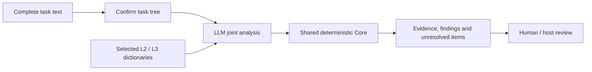

<strong>English</strong> · <a href="README.zh-CN.md">简体中文</a>

# BoundaryXP · 界痕

**Check whether an AI plan preserves the boundaries of its task.**

BoundaryXP turns task requirements into an evidence-linked **7+1 representation**, then checks submitted structures and supported mathematical constraints with a shared deterministic Core. It helps people inspect whether a proposed plan or task decomposition preserves required outputs, responsibilities, limits and prohibitions before execution.

**Research and protocol repository · Bilingual preprint available · Workbench source remains private · MCP integration planned**

[7+1 research](docs/RESEARCH.en.md) · [Protocol](protocol/README.md) · [Changelog](CHANGELOG.md) · [MCP plans](docs/MCP.md) · [Documentation](docs/README.md)

## Research preprint

**BXP: A Method for AI Task Boundary Verification Using a 7+1 Relational Representation**

Wei Zhu · English v1.2 / Chinese r23 · 2026-11-06.

The paper presents a method for organizing task requirements through 7+1 views and shared relations, establishing a common mathematical boundary through BXP conventions, and calculating whether subtasks and their combination exceed the parent task's boundary. Formal arguments establish the conditions for the method; 625 test cases with 3,219 task nodes and 3,469 calculation items provide implementation and application evidence. Case-level agreement is reported separately from item-level differences and incomplete calculations.

[**English PDF**](https://github.com/joinwell52-AI/BoundaryXP/releases/download/paper-v1.2-r23/BoundaryXP-manuscript.en.pdf) · [Chinese PDF](https://github.com/joinwell52-AI/BoundaryXP/releases/download/paper-v1.2-r23/BoundaryXP-manuscript.zh-CN.pdf) · [**Complete research package**](https://github.com/joinwell52-AI/BoundaryXP/releases/download/paper-v1.2-r23/manuscript-with-materials.zip) · [Release and checksums](https://github.com/joinwell52-AI/BoundaryXP/releases/tag/paper-v1.2-r23) · [Materials guide](docs/paper/README.en.md)

**Zenodo:** [10.5281/zenodo.24072738](https://doi.org/10.5281/zenodo.24072738) · [Public record](https://zenodo.org/records/24072738) · [Complete research package](https://zenodo.org/records/24072738/files/manuscript-with-materials.zip?download=1). Deposited on 2026-11-09; the publication date retains the first GitHub release date, 2026-11-06.

The `RESEARCH_ONLY_1` supplement includes task sources, annotations, 7+1 reports, operands, results, protocol texts, screenshots and independent research verification scripts. **It excludes 58618 engineering source, runtime dependencies and production prompt templates.** Zenodo files are publicly downloadable; GitHub repository access remains private. Included materials retain their original usage terms.

## Explore a complete case

[**Open the interactive demo →**](https://boundaryxp-workbench-demo.joinwell52.chatgpt.site/?lang=en#case=ENG20-003&axis=A&view=radar&lang=en) · [**Read the 7+1 report →**](https://boundaryxp-workbench-demo.joinwell52.chatgpt.site/?lang=en#case=ENG20-003&axis=A&view=report&lang=en)

Explore five existing cases saved in the 58618 workbench, including two originally written in English. Their task trees, exact sources, verdicts, 7+1 relations and seven-step reports are retained. Select a case and click the radar to inspect its evidence. The radar, evidence and Markdown renderer reuse the original workbench components. The demo replays fixed saved records; local workbench upgrades do not regenerate them.

| Case | Requirements and plan | Displayed result |
|---|---|---|
| [R389-383 / RT044](https://boundaryxp-workbench-demo.joinwell52.chatgpt.site/?lang=en#case=R389-383&axis=A&view=radar&lang=en) · Cross-team execution chain | Individually satisfiable orders combine into a strict A→D→B→C→A cycle; 7 tasks, 10 checks | Violation |
| [R389-381 / RT042](https://boundaryxp-workbench-demo.joinwell52.chatgpt.site/?lang=en#case=R389-381&axis=R&view=radar&lang=en) · Shared instrument handoff | Half-open 10:00–11:00 and 11:00–12:00 bookings release the instrument at the shared endpoint; 4 tasks, 7 checks | Within bounds |
| [R389-153 / L23-050](https://boundaryxp-workbench-demo.joinwell52.chatgpt.site/?lang=en#case=R389-153&axis=P&view=radar&lang=en) · Ambiguous accountable owner | “Confirmed by him” does not uniquely identify the final owner; unknown U1 remains; 6 tasks, 6 checks | Incomplete information |
| [ENG20-001](https://boundaryxp-workbench-demo.joinwell52.chatgpt.site/?lang=en#case=ENG20-001&axis=A&view=radar&lang=en) · Two prerequisite branches and one join (English source) | P precedes S and G; both S and G precede U. Neither branch substitutes for the other; 5 tasks, 2 checks | Within bounds |
| [ENG20-003](https://boundaryxp-workbench-demo.joinwell52.chatgpt.site/?lang=en#case=ENG20-003&axis=A&view=radar&lang=en) · A four-step cycle across role boundaries (English source) | Role-specific orders combine into the strict A→B→C→D→A cycle; 5 tasks, 5 checks | Violation |

The report follows the top-right language switch: Chinese interface, Chinese report and export; English interface, English report and export. Download case JSON from the source view. The ENG20 cases retain their original English task text and existing saved reports and translations from 58618. Language switching never rewrites source evidence. The public page replays selected development records without connecting to the local service or reassessing them. Accounts, credentials, customer data and personal runtime logs are excluded.

See the report view

[Demo and saved reports](docs/demo/README.md)

## Why task boundaries?

A plan can sound reasonable while adding an unauthorized action, dropping a required deliverable or overlooking a constraint shared by several subtasks. BoundaryXP makes these requirements and their relationships inspectable, preserving source evidence and unresolved questions alongside the calculation results.

It is useful for reviewing an AI-generated plan, checking a parent–child task tree, or connecting a host application to local task validation. People and host systems retain business decisions and execution authority.

## What is 7+1?

| View | What it records |
|---|---|
| **I — Inputs** | Input scope and source material |
| **O — Outputs** | Required deliverables |
| **A — Actions** | Task actions and their stated modality |
| **P — Participants** | Responsible parties, roles and division of work |
| **R — Resources** | Resources and stated quantitative limits |
| **V — Version / basis** | Applicable versions, references and provenance |
| **C — Completion / stopping** | Conditions for finishing or stopping |
| **B — Prohibitions** | Explicitly forbidden behavior, kept independent |

Relationships preserve shared objects, conditions, dependencies and handoffs across views. Missing information stays missing; a role title does not grant authority.

The demo above preserves source quotations and calculation records for these eight views. Actual findings depend on the submitted representation, evidence and supported checks.

## How it works

The B335 workbench uses **one semantic request**, followed by program checks. It has no separate audit request or automatic retry. Core validates submitted structures, source references, bindings and supported finite operands; it does not call models, access the network or execute task instructions.

## Current workbench capabilities (B335)

As of 2026-11-09, the current private workbench is **B335** (`0.1.0-candidate.031-r1.2-ui.335`). The [changelog](CHANGELOG.md) records the latest three upgrades and their historical verification scope.

- **Complete task trees:** whole-document UTF-8 `.txt` / `.md` import, role headings, explicit task and parent IDs, forward references, multiple levels and relationship preview.
- **Inspectable results:** task tree and 7+1 radar, model and calculator conclusions, quotations, unresolved items, saved history and exports. Failed attempts remain distinct from saved results.
- **L2 / L3 resources:** industry and enterprise dictionaries with versioned references. The workbench has no active L1 layer.
- **Chinese and English:** the interface, report translation and Markdown exports preserve original task text and saved verdicts. First-time report translation calls a model and is cached by snapshot.
- **Mathematical input and unknowns:** allowed values, uncertain facts and parent/child plan consistency have distinct meanings. Set identities support strings and safe integers without conflating their types; unresolved interpretations remain unresolved.
- **Startup and recovery:** historical jobs load with bounded concurrency under the existing recovery rules. Readiness is reported only after HTTP identity verification.

Individual sources and serialized joint input are each limited to **1 MiB**; HTTP request bodies are limited to **8 MiB**. Oversized input is rejected without truncation. There is no 300-code-point ceiling.

These capabilities describe the recorded private workbench. This repository distributes research material rather than an installable workbench.

## Repository scope

**Workbench source is not distributed here.** The repository contains the paper, BXP specifications, saved research cases and reports, screenshots, and independent mathematical or statistical verification scripts. It does not provide workbench frontend/backend source, Core implementation, internal prompts, runtime dependencies, or build and installation packages.

The research scripts verify the declared research material; they are not the workbench implementation. See the [publication scope](docs/PUBLICATION-SCOPE.md).

## Research and MCP

The method preprint is available as **English v1.2 / Chinese r23**. See the [research overview](docs/RESEARCH.en.md) for the current title, citation, evidence scope and downloads. The paper develops the method and its conditional mathematical basis; the tool implements the method and supplies experimental evidence.

MCP integration is planned. The private workbench and its adapters are not shipped in this repository, and no installable public workbench MCP implementation is claimed here. See the [MCP scope](docs/MCP.md).

## Evidence and limitations

LLMs interpret source meaning; deterministic calculation checks the representation that was submitted. Exact quotations do not prove semantic entailment, and a completed job does not mean every proof passed. Displayed conclusions are Violation, Within bounds or Incomplete information; technical verification details are retained separately. `business_decision` and `execution_authorization` remain null.

The reviewed protocol baseline is BXP-0001 `0.4.0-draft.2`; the workbench still uses a recorded draft.1 attachment and has not completed migration to every reviewed requirement. No full protocol-conformance claim is made. Historical model results, engineering regressions and protocol tests have distinct scopes: [implementation](protocol/IMPLEMENTATION.md) · [research evidence](docs/RESEARCH.en.md).

Host analysis and first-time translation may send selected source and dictionary content to the configured model provider. Review that data flow before supplying private material.

## Contribute and explore

[Contribution guide](CONTRIBUTING.md) · [Protocol](protocol/README.md) · [Research](docs/RESEARCH.en.md) · [Documentation](docs/README.md) · [Publication scope](docs/PUBLICATION-SCOPE.md)

The existing [MIT license](LICENSE) is retained. Paper, case-data and third-party usage terms are described separately in the [material-access statement](docs/paper/materials/MATERIAL-ACCESS.md). Research publication does not release the private workbench implementation.
