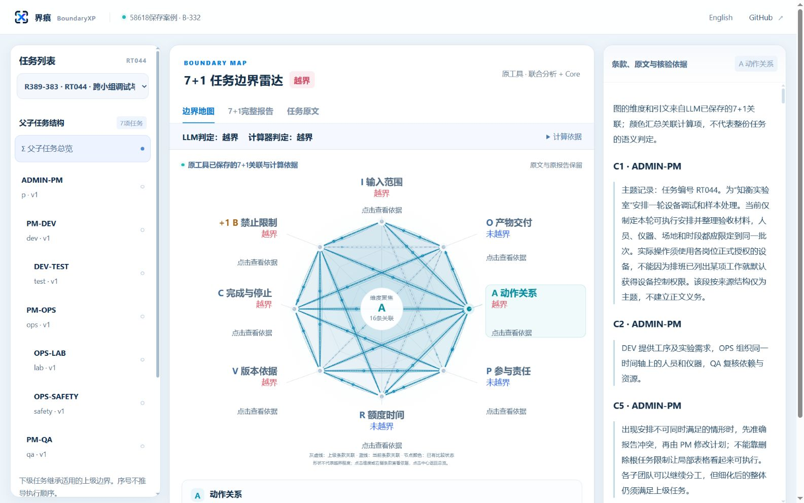
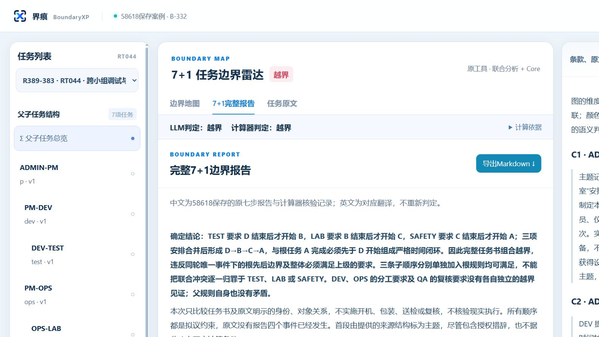
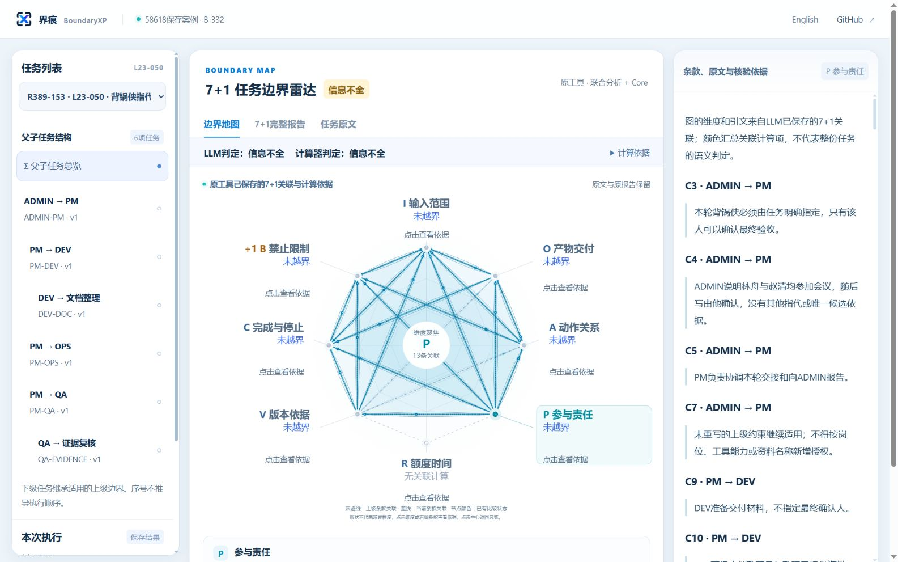
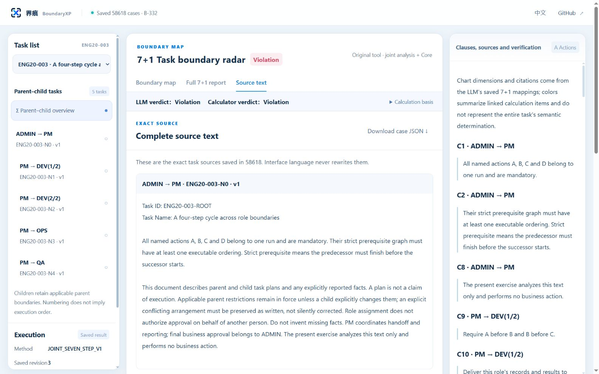
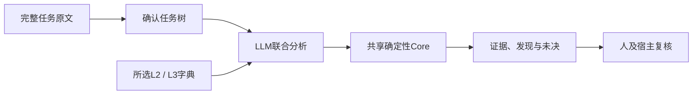

<a href="README.md">English</a> · <strong>简体中文</strong>

# 界痕 · BoundaryXP

**检查AI方案是否保持了原任务的边界。**

界痕将任务要求组织成带原文证据的 **7+1表示**，再由共享的确定性Core核验已提交结构及受支持的数学约束。它帮助人们在执行前检查：方案或子任务分解是否保留了原任务的交付义务、职责、限制与禁止事项。

**论文与协议资料仓库 · 双语预印本已发布 · 工作台源码保持私有 · MCP接入计划中**

[7+1研究](docs/RESEARCH.md) · [协议](protocol/README.md) · [MCP计划](docs/MCP.md) · [文档导航](docs/README.md)

## 研究预印本

**《BXP：基于7+1关联表示的人工智能任务边界判定方法》**

朱卫（Wei Zhu）· 中文r23／英文v1.2 · 2026-11-06。

论文提出以7+1及共享关联组织任务要求、以BXP约定建立共同数学边界，并计算判定子任务及其组合是否突破主任务边界的方法。形式论证说明方法成立的条件；625组用例、3219个任务节点和3469项计算提供实现与应用证据。整组答案的一致性与逐项差异、未完成计算分别报告。

[**中文PDF**](https://github.com/joinwell52-AI/BoundaryXP/releases/download/paper-v1.2-r23/BoundaryXP-manuscript.zh-CN.pdf) · [英文PDF](https://github.com/joinwell52-AI/BoundaryXP/releases/download/paper-v1.2-r23/BoundaryXP-manuscript.en.pdf) · [**完整研究材料包**](https://github.com/joinwell52-AI/BoundaryXP/releases/download/paper-v1.2-r23/manuscript-with-materials.zip) · [Release与校验摘要](https://github.com/joinwell52-AI/BoundaryXP/releases/tag/paper-v1.2-r23) · [材料导航](docs/paper/README.md)

`RESEARCH_ONLY_1`附件包含任务原文、标注、7+1报告、操作数、结果、协议正文、截图及独立研究核验脚本，**不含58618工程源码、运行依赖或生产提示模板**。本次为GitHub预印本发布，仓库仍为私有，下载需要访问权限；本次发布尚无DOI。

## 先点开一个用例

[**打开在线演示 →**](https://boundaryxp-workbench-demo.joinwell52.chatgpt.site/) · [**查看7+1报告 →**](https://boundaryxp-workbench-demo.joinwell52.chatgpt.site/#case=R389-383&axis=A&view=report&lang=zh) · [**查看英文原文案例 →**](https://boundaryxp-workbench-demo.joinwell52.chatgpt.site/?lang=en#case=ENG20-003&axis=A&view=source&lang=en)

从58618已保存的案例中选取五例，包括两个英文原文案例，保留各自任务树、原文、判定、7+1关联和原七步报告。选择案例并点击雷达，即可从右侧条款追溯原文与计算依据；雷达、依据和报告渲染复用B-332原组件。

| 用例 | 任务要求与方案 | 展示结果 |
|---|---|---|
| [R389-383 / RT044](https://boundaryxp-workbench-demo.joinwell52.chatgpt.site/#case=R389-383&axis=A&view=radar&lang=zh) · 跨小组调试与送检 | 各组局部顺序可满足，合并后形成A→D→B→C→A严格闭环；7项任务、10项计算 | 越界 |
| [R389-381 / RT042](https://boundaryxp-workbench-demo.joinwell52.chatgpt.site/#case=R389-381&axis=R&view=radar&lang=zh) · 共享检测仪交接 | 同一仪器按半开区间10:00–11:00、11:00–12:00相邻占用，端点释放；4项任务、7项计算 | 未越界 |
| [R389-153 / L23-050](https://boundaryxp-workbench-demo.joinwell52.chatgpt.site/#case=R389-153&axis=P&view=radar&lang=zh) · 最终责任人指代 | “由他确认”没有唯一绑定最终责任人；保留未知U1，不擅自补齐身份；6项任务、6项计算 | 信息不全 |
| [ENG20-001](https://boundaryxp-workbench-demo.joinwell52.chatgpt.site/?lang=en#case=ENG20-001&axis=A&view=radar&lang=en) · 两条前置分支与汇合（英文原文） | P先于S、G，S和G均先于U；两条分支都不可省略，联合图无环；5项任务、2项计算 | 未越界 |
| [ENG20-003](https://boundaryxp-workbench-demo.joinwell52.chatgpt.site/?lang=en#case=ENG20-003&axis=A&view=radar&lang=en) · 跨角色依赖闭环（英文原文） | 跨角色合并A→B→C→D→A，严格前置关系成环；5项任务、5项计算 | 越界 |

“7+1完整报告”跟随右上角语言：中文界面显示并导出中文报告，英文界面显示并导出英文报告；“任务原文”页可下载案例JSON。ENG20两例直接保留58618里的英文任务原文及保存报告、翻译；切换界面语言不会改写证据。五例均为已有开发用例，线上只回放所选记录，不连接本地58618、不重新分析，不包含账号、凭据、客户资料或个人运行日志。

查看报告界面

[演示说明与已保存报告](docs/demo/README.md)

## 为什么检查任务边界

一份看似合理的方案，可能增加未经允许的操作、遗漏必须交付的成果，或忽略多个子任务共用的总量约束。界痕把这些要求及关联呈现出来，将原文证据、计算结果与未决问题放在一起，供人核对。

适用于审阅AI生成的执行方案、检查父子任务分解，以及为宿主应用提供本地任务验证。业务裁决和执行授权仍由人及宿主系统掌握。

## 什么是7+1

| 视图 | 记录内容 |
|---|---|
| **I — 输入范围** | 输入对象与来源材料 |
| **O — 交付** | 必须交付的成果 |
| **A — 动作** | 任务动作及其明示情态 |
| **P — 责任主体与角色分工** | 由谁承担、如何分工 |
| **R — 资源** | 资源及明示的量化限制 |
| **V — 版本依据** | 适用版本、引用与来源 |
| **C — 完成停止** | 何时完成、何时停止 |
| **B — 禁止边界** | 独立保留明确禁止的行为 |

共享关联保存跨视图的同一对象、条件、依赖和交接。未明确项保持未明确，岗位名称不产生权限。

上方演示保留各视图的原文、引用和计算依据，便于对照这8类要求。实际结论取决于已提交表示、证据及受支持的检查。

## 如何工作

B-332工作台使用 **一次语义请求**，随后进行程序检查，无独立审阅请求、不自动重试。Core核验已提交的结构、来源、绑定及受支持的有限操作数，不调用模型、不访问网络、不执行任务中的业务指令。

## 既有工作台能力（B-332记录）

- **完整任务树：** 整篇UTF-8 `.txt` / `.md`导入、角色标题、显式任务及父任务编号、前向引用、多层关系与保存前预览。
- **可核对的结果：** 任务树、7+1雷达、LLM与计算器结论、引用、未决、历史及导出；失败尝试与保存结果分开呈现。
- **L2 / L3资源：** 行业和企业字典，保留版本化引用；工作台没有活动L1层。
- **中英文：** 界面切换保留原文证据及判定。双语Markdown保留完整中文原文与原报告；首次报告翻译调用模型，按快照缓存。

单份来源和序列化联合输入各最多 **1 MiB**，HTTP请求体最多 **8 MiB**；超限拒绝、不截断，没有300码点上限。这些能力描述既有的私有工作台；本仓库提供研究材料，不提供可安装的工作台实现。

## 仓库范围

**工作台源码不在此仓库发布。** 本仓库保留论文、BXP协议、已保存研究案例与报告、截图，以及独立数学或统计核验脚本；不提供工作台前后端源码、Core实现、内部提示词、运行依赖、构建脚本或安装包。

研究脚本用于核对声明范围内的研究材料，不是工作台实现。详见[公开范围说明](docs/PUBLICATION-SCOPE.md)。

## 论文与MCP

方法预印本已发布为 **中文r23／英文v1.2**，当前题目、引用方式、证据范围及下载入口见[研究介绍](docs/RESEARCH.md)。论文建立方法与有前提的数学依据；工具用于实现方法并提供实验材料。

MCP接入处于计划阶段。私有工作台及其适配器不随本仓库发布，也不声称这里已有可安装的公开工作台MCP实现。参见[MCP适用范围](docs/MCP.md)。

## 证据与适用范围

LLM解释原文含义，确定性计算核验已提交的表示。引文对齐不证明语义蕴含，作业完成不表示全部证明通过。结论展示为越界、未越界或信息不全，技术核验细节单独保留。`business_decision`与`execution_authorization`保持null。

已评审协议基线为BXP-0001 `0.4.0-draft.2`，工作台仍使用已记录的draft.1附件，尚未完成全部要求迁移，不声明完整协议符合性。历史模型结果、工程回归与协议检查各有范围：[实现说明](protocol/IMPLEMENTATION.md) · [研究证据](docs/RESEARCH.md)。

宿主分析及首次翻译可能将所选原文和字典内容发送给配置的模型Provider；使用私有材料前，应确认该数据流。

## 参与与了解更多

[贡献指南](CONTRIBUTING.md) · [协议](protocol/README.md) · [研究概览](docs/RESEARCH.md) · [文档导航](docs/README.md) · [公开范围说明](docs/PUBLICATION-SCOPE.md)

保留原[MIT许可证](LICENSE)。论文、案例数据与第三方材料的使用条件见[资料访问说明](docs/paper/materials/MATERIAL-ACCESS.md)，不以研究资料发布代替私有工作台实现的授权。
