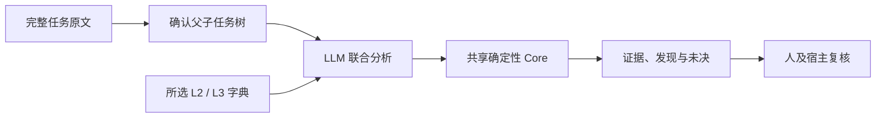

<a href="README.md">English</a> · <strong>简体中文</strong>

<h1 align="center">从原文到边界，每一步都看得见。</h1>

  
  
  
  
  

从完整任务到带原文证据的 <strong>7+1 关联表示</strong>，再由确定性 Core 核验。 检查方案与子任务分解，追溯为什么<strong>越界、未越界，或信息不全</strong>。

<a href="https://boundaryxp-workbench-demo.joinwell52.chatgpt.site/"><strong>▶ 在线演示</strong></a>　·　<a href="docs/mcp/INSTALL.zh-CN.md"><strong>MCP 接入</strong></a>　·　<a href="https://doi.org/10.5281/zenodo.24072738"><strong>论文</strong></a>

中英双语 · MCP 0.4.0-rc.3 / B-335 · npm 首次预发行 · 论文与协议资料 · Core 原实现源码私有

## 先看一个真实用例

七个任务各自看起来可以执行，合起来却有一条 **A → D → B → C → A** 的严格前置闭环。界痕把跨小组依赖放回同一张图，保留原文与计算依据，让冲突可以逐项核对。

<a href="https://boundaryxp-workbench-demo.joinwell52.chatgpt.site/#case=R389-383&axis=A&view=radar&lang=zh"><strong>点击雷达，查看依据 →</strong></a>　·　<a href="https://boundaryxp-workbench-demo.joinwell52.chatgpt.site/#case=R389-383&axis=A&view=report&lang=zh">阅读与导出 7+1 报告 →</a>

### 不同用例，不同结果

| 结果与用例 | 关键问题 |
|---|---|
| **越界** · [RT044](https://boundaryxp-workbench-demo.joinwell52.chatgpt.site/#case=R389-383&axis=A&view=radar&lang=zh) | 局部顺序合并后形成严格闭环 |
| **未越界** · [RT042](https://boundaryxp-workbench-demo.joinwell52.chatgpt.site/#case=R389-381&axis=R&view=radar&lang=zh) | 10–11 点与 11–12 点的半开区间相邻，端点释放 |
| **信息不全** · [L23-050](https://boundaryxp-workbench-demo.joinwell52.chatgpt.site/#case=R389-153&axis=P&view=radar&lang=zh) | “由他确认”没有唯一绑定责任人，保留未知 U1 |

还有两个**英文原文**用例：[ENG20-001 · 分支与汇合](https://boundaryxp-workbench-demo.joinwell52.chatgpt.site/?lang=en#case=ENG20-001&axis=A&view=radar&lang=en)（未越界）、[ENG20-003 · 四步依赖闭环](https://boundaryxp-workbench-demo.joinwell52.chatgpt.site/?lang=en#case=ENG20-003&axis=A&view=radar&lang=en)（越界）。

这些用例来自 58618 已保存记录，保留各自任务树、原文、判定和原七步报告。**报告与 Markdown 导出跟随右上角语言；原文保留来源语言。** 演示回放 B-332 保存记录，不连接本地服务、不重新分析，也不会随 B335 自动重算。[演示说明与已保存报告](docs/demo/README.md)

展开查看中文报告和英文原文

## 接入你的 AI 工作流

**BoundaryXP MCP** 通过标准 stdio 接入 Cursor、Codex 等兼容宿主，提供 **18 个工具、10 个资源和本地浏览器工作台**。Windows x64 安装包包含原生编译 Core，无需另装 58618 或自建 BoundaryXP 服务器。

1. **从 npm 安装：** 使用 `boundaryxp-mcp@0.4.0-rc.3`；预发行渠道为 `next`。GitHub Release 同步保存安装包和 SHA-256。
2. **安装并连接宿主：** 按对应指南配置 stdio MCP 服务。
3. **配置模型 API：** 新分析使用你自行配置的服务商与 API，不继承 Cursor／Codex 的订阅额度。
4. **打开工作台：** 导入完整任务，预览并确认任务树，再提交分析、查看证据与报告。

[**中文安装指南 →**](docs/mcp/INSTALL.zh-CN.md) · [English setup](docs/mcp/INSTALL.en.md) · [工具与资源](docs/mcp/TOOLS.md) · [升级、回滚与排障](docs/mcp/OPERATIONS.md)

> **首次 npm 发行：** [boundaryxp-mcp 0.4.0-rc.3](https://www.npmjs.com/package/boundaryxp-mcp)，B-335 / Windows x64，MIT许可。下载的是包含原生Core、MCP接口和页面的完整安装包，不交付核心源码，也不需要另外安装58618。GitHub仓库目前仍为私有；npm包可独立安装。见[版本与验收](docs/mcp/RELEASE.md)和[许可说明](docs/mcp/NOTICES.md)。

## L2 / L3：行业与企业语义库

同一个词在不同行业、企业中可能有不同含义。L2 / L3 为任务解释提供所选领域的语义上下文，与原文证据一起使用。

| 语义库 | 作用 |
|---|---|
| **L2 · 行业语义库** | 描述行业中的动作、实体、角色、资源及相关术语，帮助把任务要求放回具体业务领域理解。 |
| **L3 · 企业语义库** | 补充企业自己的术语、组织与角色称谓、受控别名等上下文，帮助区分企业内的具体对象和表述。 |

**当前没有活动 L1 层。** L0 是 BXP 协议与确定性 Core，不是语义库。L2 / L3 不替代任务原文，也不改变 7+1 的共同核验规则；加载词库、岗位或经理关系均不自动产生业务权限。

### 在 MCP 中使用

1. 用 `bx_dictionaries_list` 列出当前安装可用的 L2 / L3 资源，核对词库标识与版本。
2. 用 `bx_dictionaries_bind` 校验所选资源并取得版本与摘要引用，避免混用不同词库快照。
3. 用 `bx_dictionary_lookup` 查询已绑定资源中的词条；查询本身不作语义裁决，也不提交分析。

可以对宿主说：**“列出 BXP 可用的 L2、L3 语义库，展示标识、版本和摘要，等我选择后再绑定；暂不提交分析。”**

[**安装并连接 MCP →**](docs/mcp/INSTALL.zh-CN.md) · [词库工具说明](docs/mcp/TOOLS.md) · [资源与分发范围](docs/mcp/NOTICES.md)

可用资源以当前安装实际返回的清单为准。企业私有语义资料按自己的使用范围管理；本页提供能力和使用入口，不表示独立词库已在 GitHub 公开发布。

## 方法与研究证据

**《BXP：基于 7+1 关联表示的人工智能任务边界判定方法》**  
朱卫（Wei Zhu）· 中文 r23／英文 v1.2 · 首次发布 2026-11-06

| 研究用例 | 任务节点 | 计算项 |
|:---:|:---:|:---:|
| **625** | **3,219** | **3,469** |

论文提出以 7+1 及共享关联组织任务要求，通过 BXP 约定建立共同数学边界，检查子任务及其组合是否突破主任务边界。形式论证说明成立条件；上述数字描述研究覆盖范围，**不是准确率**。整组答案一致性、逐项差异与未完成计算分别报告。

[**中文 PDF**](https://github.com/joinwell52-AI/BoundaryXP/releases/download/paper-v1.2-r23/BoundaryXP-manuscript.zh-CN.pdf) · [English PDF](https://github.com/joinwell52-AI/BoundaryXP/releases/download/paper-v1.2-r23/BoundaryXP-manuscript.en.pdf) · [**公开研究材料包**](https://zenodo.org/records/24072738/files/manuscript-with-materials.zip?download=1) · [材料导航](docs/paper/README.md)

**DOI：[10.5281/zenodo.24072738](https://doi.org/10.5281/zenodo.24072738)**。Zenodo 于 2026-11-09 发布，保留首次 GitHub 发布日期。[GitHub 论文 Release 与摘要](https://github.com/joinwell52-AI/BoundaryXP/releases/tag/paper-v1.2-r23)

研究附件 `RESEARCH_ONLY_1` 包含任务原文、标注、7+1 报告、操作数、结果、协议正文、截图和独立研究核验脚本；不含工作台工程源码、运行依赖或生产提示模板。它与 MCP 测试安装包分别维护。

## 7+1 如何把要求连起来

**I 输入 · O 交付 · A 动作 · P 责任与分工 · R 资源 · V 版本依据 · C 完成停止，加独立 B 禁止边界。**

共享关联把同一对象、条件、依赖和交接连在一起，检查跨任务的约束。缺失信息保持未明确，岗位名称不产生权限。

B335 工作台采用**一次语义请求**，随后由 Core 作程序核验，没有独立审阅请求或自动重试。LLM 解释原文，Core 核验提交的结构、来源、绑定与受支持的有限操作数；Core 不调用模型、不访问网络、不执行任务中的业务指令。

展开查看 B335 功能、输入限制与证据边界

- **完整任务树：** 整篇 UTF-8 `.txt` / `.md` 导入，支持角色标题、显式任务及父任务编号、前向引用、多层关系和保存前预览。
- **可核对结果：** 任务树、7+1 雷达、LLM 与计算器结论、引用、未决、历史及导出；失败尝试与保存结果分开呈现。
- **L2 / L3：** 行业及企业字典保留版本化引用；没有活动 L1 层，加载资源不产生业务权限。
- **中英文：** 界面、报告及 Markdown 导出保留原始任务文本与保存判定；首次报告翻译调用模型，按快照缓存。
- **数学输入与未知项：** 区分允许取值、未定事实及父／子方案一致性；集合身份支持字符串和安全整数，不混同两者，不代填未知结论。
- **启动与恢复：** 有界并发读取历史作业，保留原恢复规则；HTTP 身份核对完成后才提示就绪。

单份来源和序列化联合输入各最多 **1 MiB**，HTTP 请求体最多 **8 MiB**；超限拒绝、不截断，没有 300 码点上限。功能及历史验证范围见[升级日志](CHANGELOG.zh-CN.md)。

引文对齐不证明语义蕴含，作业完成不表示全部证明通过。业务裁决与执行权由人及宿主掌握；`business_decision` 与 `execution_authorization` 保持 null。

已评审协议基线为 BXP-0001 `0.4.0-draft.2`；工作台仍使用已记录的 draft.1 附件，不声明已完整迁移或全面符合协议。[实现说明](protocol/IMPLEMENTATION.md) · [研究证据](docs/RESEARCH.md)

宿主分析及首次翻译可能将所选原文与字典发送到配置的模型服务商。使用私有材料前应核对该数据流。

## 从这里继续

| 想了解什么 | 入口 |
|---|---|
| 行业与企业语义库 | [L2 / L3 介绍](#l2--l3行业与企业语义库) · [词库工具](docs/mcp/TOOLS.md) |
| 安装与使用 MCP | [接入指南](docs/mcp/README.md) · [版本与验收](docs/mcp/RELEASE.md) |
| 理解方法、引用论文 | [研究介绍](docs/RESEARCH.md) · [论文材料](docs/paper/README.md) |
| 阅读协议与实现差异 | [BXP 协议](protocol/README.md) · [实现说明](protocol/IMPLEMENTATION.md) |
| 查看版本变化、参与维护 | [升级日志](CHANGELOG.zh-CN.md) · [贡献指南](CONTRIBUTING.md) · [文档导航](docs/README.md) |

**分发范围：** Git 树维护论文、协议、案例、报告、截图、独立研究核验脚本和 MCP 使用说明，不包含私有工作台实现源码或源码构建入口。MCP 编译安装包发布到 npm，并同步到本仓库 Release；Core 原实现源码不随包提供，适配器、UI 和必要资源仍可读取。[完整范围说明](docs/PUBLICATION-SCOPE.md)

**公开准备：** 本仓库仍为私有；旧 PR 引用及历史缓存清理尚待 GitHub 处理，不能将当前首页整理视为已完成公开核查。[核查记录](docs/PREPUBLICATION-CHECK.md)

保留既有 [MIT 许可证](LICENSE)。论文、案例与第三方材料按各自[使用条件](docs/paper/materials/MATERIAL-ACCESS.md)；MCP 安装包另见[许可与第三方说明](docs/mcp/NOTICES.md)。
