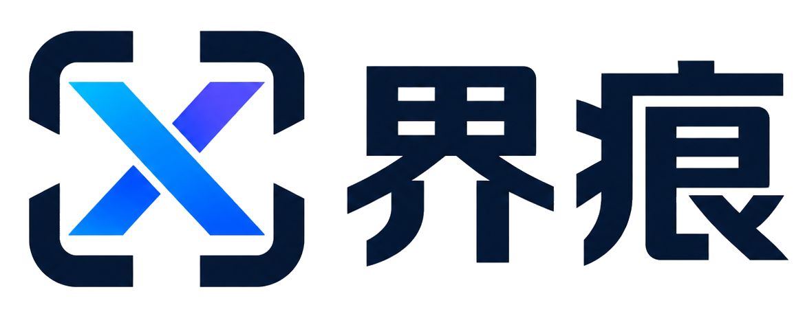

# B-332品牌资产：界痕 · BoundaryXP

更新：2026-11-03。中文品牌为**界痕**，英文品牌为**BoundaryXP**。中文Logo必须实际包含“界痕”，不能把英文字标换个链接名称当作中文版。

## 中文标志

| 用途 | 文件 |
|---|---|
| B-332中文标志与中文首页 | [图标＋界痕](v2/BoundaryXP-logo-zh.png) |
| 先前恢复的中文图片 | [保留原字节的图片](v2/BoundaryXP-logo-zh-CN-light.png) |
| 已修复的v1中文入口 | [transparent命名入口](v1/BoundaryXP_Logo_CN_JieHen_transparent.png) · [white命名入口](v1/BoundaryXP_Logo_CN_JieHen_white.png) |

B-332当前中文入口使用实际安装清单中的图片，本次只核对与引用，没有重新生成或修改图片。先前恢复图片及v1入口按各自历史字节保留，恢复来源见历史提交[f7aae642](https://github.com/joinwell52-AI/BoundaryXP/commit/f7aae6421681be22eb2035504b824f4d169bf90c)。历史文件名不作为透明度或背景颜色已验证的保证；当前预览适用于浅色页面。

## 英文标志与独立图标

| 用途 | 文件 |
|---|---|
| 浅色页面英文标志 | [图标＋BoundaryXP](v2/BoundaryXP-logo-light.png) |
| 深色页面英文标志 | [图标＋BoundaryXP](v2/BoundaryXP-logo-dark.png) |
| 应用图标与favicon | [独立图标](v2/BoundaryXP-icon.png) |

英文v2素材保留2026-10-21版本。原制作记录为imagegen重制：深蓝边界括号包围蓝紫渐变X，英文文字BoundaryXP；深色版使用浅色字标。它们不是中文Logo。本次不替换运行包内图片、不重算安装清单，也不宣称现场UI已改图。

## 历史素材包

[v1 ZIP](BoundaryXP-logo-pack-v1.zip)与[v2 ZIP](BoundaryXP-logo-pack-v2.zip)按历史字节保留，不代表包含当前单独发布的全部图片。需要B-332中文图时使用上方当前入口，不将历史ZIP作为当前完整素材包。

本次只读核对范围见[文档回执](../../docs/workbench/B332-DOCUMENTATION-CHECK.md)。许可保持仓库原条款。
