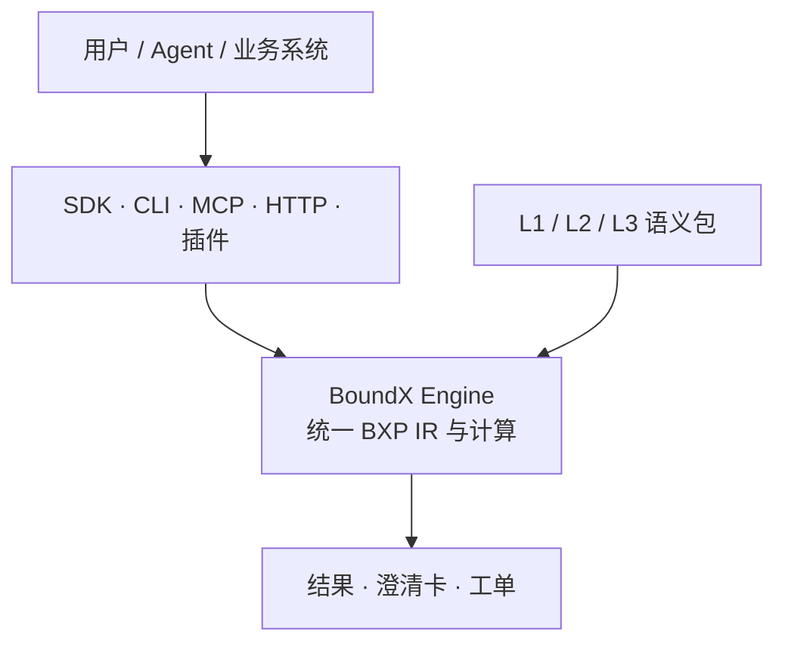

# 界痕（BoundX）产品手册

文档编号：`BX-PRODUCT-MANUAL-001`  
版本：`0.1.0-draft.4`\
状态：`DRAFT_FOR_REVIEW`  
适用产品：界痕（BoundX）  
决定权：ADMIN  
公开授权：`false`  

**当前项目状态：** 独立目录 `D:\boundx`，私有仓库 `joinwell52-AI/BoundX`；源码 `1.2.4-preview.1`、BXP-0001 `0.3.0-draft.1`、BXP-CALC `1.0.0-draft.2`（208 条）。当前能力与验证见 [协议实现说明](../protocol/IMPLEMENTATION.md) 和 [验证说明](VALIDATION.md)。

> 本手册定义 BoundX 的产品定位、集成方式、语义包、FDE 服务和商业边界，区分当前实现与规划能力。仓库保持私有，暂无公开 Release 或 npm/PyPI 包；AGPL 是未生效的发布提案，不授权 BoundX 或宿主执行外部业务动作。

## 1. 产品定义

### 1.1 正式定位

**界痕（BoundX）是一个可嵌入、可服务化的任务边界预检引擎（Task Boundary Preflight Engine）。**

它把准备交给人、脚本、自动化系统或 Agent 执行的自然语言任务，整理为带原文证据的 I/O/A/P/R/V/C+B 结构，检查其中可确定计算的缺项、冲突、越界、交接断裂和依赖异常，再把结果交还给调用者确认或形成工单。

产品口号：

> **执行之前，先把任务边界算清楚。**

工程主线：

> **表单收敛输入，数学把关边界，代码保证执行。**

最后一句中的“代码保证执行”属于宿主系统职责：BoundX 提供结构化工单和预检结果，实际业务系统仍须根据真实身份、授权和审批执行。

### 1.2 部署中立

BoundX 不被定义为“只能本地运行”的工具，也不被定义为“必须连接中央服务器”的 SaaS。相同引擎可以通过以下入口使用：

- Python 包导入；
- `bx` 命令行；
- MCP Server；
- HTTP/API Server；
- Web 表单；
- IDE、协作平台和业务系统插件。

本地、客户内网、私有云和集中服务器是部署选择；插件是集成方式。它们都必须调用同一语义合同和同一计算逻辑，不能各自解释 7+1。

### 1.3 不是什么

BoundX 不是：

- 自动批准任务的权限系统；
- 代替法务、财务、安全或行业专家的合规认证系统；
- 自动执行退款、删除、部署、付款等动作的 RPA；
- 用一个分数判断自然语言“是否安全”的黑箱模型；
- 任何宿主的专属子模块；
- 另一套工作流编排语言；
- 已经获得行业采用的正式标准。

BXP-0001 是 BoundX 内部统一数据合同和计算说明。它帮助不同入口交换同一种任务与结果，但不是首版产品宣传的中心。

### 1.4 独立仓库与许可证状态

BoundX 已作为独立产品维护。当前根目录 [LICENSE](../LICENSE) 为 MIT；拟议的独立开源仓库发布许可为 GNU AGPL v3（候选 SPDX `AGPL-3.0-only`），尚未生效。任何许可证变化必须先明确批准并同步实际许可证文件与包元数据。

- 公开资产必须权属明确，并进入发布清单。
- 客户 L3 包、私有行业资产、密钥、真实工单及未授权材料不得公开。
- 仓库公开、包发布和网站上线须经过第 16 节验收与 ADMIN 的具体确认。
- 商业 Pack 的组合与分发方式在实际发布前另行核对。

## 2. 解决的问题

许多事故不是因为执行程序不会运行，而是因为执行前的任务没有说清楚：

- “清理旧数据”没有说明旧到什么程度；
- “退款处理一下”没有说明金额、审批人和证据；
- “修复并上线”没有说明仓库、版本、测试、时间窗口和禁止对象；
- “Agent 自行处理”没有说明可以执行到哪一步；
- 两个阶段各自正确，但下游需要的文件并不是上游产物；
- 一条规则要求立即执行，另一条规则在相同状态下绝对禁止。

BoundX 在任务进入执行系统之前，把这些问题变成可以看到、填写、计算和追溯的结构。

## 3. 目标用户

| 用户 | 使用目的 | 典型入口 |
|---|---|---|
| 任务发起人、部门负责人 | 写清对象、动作、责任、上限和禁区 | Web 表单、业务系统插件 |
| 运维、仓储、车队、售后人员 | 在提交操作前发现明显矛盾和越界 | Web、CLI、现有工单插件 |
| 软件与 AI 团队 | 在脚本或 Agent 执行前检查任务边界 | MCP、CLI、CI/CD 插件 |
| 系统集成商 | 为客户系统增加统一任务预检 | Python SDK、HTTP、插件 |
| 规则实施工程师/FDE | 把行业规程和企业口语整理成语义包 | Pack 工具、测试套件、管理界面 |
| 审计与管理人员 | 查看原文、映射、计算和版本来源 | 工单、导出报告、宿主审计界面 |

涉及金融、医疗、法律、安全生产等受监管事项时，BoundX 只负责结构化预检，不能替代法定系统或持证人员判断。

## 4. 7+1 任务结构

| 字段 | 含义 | 用户要回答的问题 |
|---|---|---|
| I — Input | 输入、对象与范围 | 处理什么？范围到哪里？ |
| O — Output | 交付物 | 最后产生并交付什么？ |
| A — Action | 允许动作 | 可以读取、修改、生成或提交什么？ |
| P — People/Responsibility | 责任分工 | 谁执行、谁审批、谁接收、谁复核？ |
| R — Resource | 资源限制 | 时间、金额、数量、调用量和容量上限是什么？ |
| V — Version/Provenance | 版本与依据 | 根据哪个制度、版本、数据或提交？ |
| C — Completion | 完成与停止 | 什么证据代表完成？失败或超限时怎样停止？ |
| B — Boundary | 禁止边界 | 哪些动作、对象或状态不能发生？有哪些明确例外？ |

八项内容不是八个自动评分指标。字段齐全不证明语义正确，字段缺失也不证明现实制度中没有相应要求；系统只能评价已经提交并可追溯的表达。

## 5. 标准用户流程

### 5.1 收敛输入

1. 用户输入原始任务；
2. 规则或模型给出 7+1 候选及原文位置；
3. 明确命中的内容进入已解析状态；
4. 缺失内容保持 `absent`；
5. 多种合法解释保持 `unresolved`；
6. 用户只处理具体缺口，不需要把整段任务改写成程序语言。

自然语言抽取不得编造原文中没有的审批、禁止项、产物或完成条件。

### 5.2 确定性预检

| 检查 | 数学对象 | 典型问题 |
|---|---|---|
| 完整性 | 必需字段集合差 | 当前任务缺少哪些必要要素？ |
| 数值范围 | 类型化区间 | 最低 8,000 Token 与最高小于 4,000 Token 是否无解？ |
| 对象越界 | 集合交集 | 清理目标是否包含受保护分支？ |
| 阶段交接 | 集合差 | 下游输入是否未由上游产出或外部提供？ |
| 工步依赖 | 有向前置图 | 必须先执行的步骤是否形成闭环？ |
| 条件逻辑 | 布尔约束/SAT | 强制动作与禁止动作是否在某个状态同时生效？ |
| 原文证据 | UTF-8 文本与位置 | 映射引用是否真实来自提交原文？ |

### 5.3 输出与处置

BoundX 输出三条彼此独立的轴：

- `validation`：数据结构和证据是否合法；
- `completeness`：配置要求的要素是否齐全；
- `consistency`：已提交的约束是否发现不一致。

常见处置：

| 结果 | 调用者应怎样处理 |
|---|---|
| 结构非法 | 修复输入或接口，不进入计算 |
| 要素缺失 | 补充、声明不适用或交授权方确认 |
| 语义未决 | 展示候选和原文，请用户选择或改写 |
| 确定冲突 | 阻止当前工单进入执行入口，修改后重新计算 |
| 未发现结构问题 | 可以进入宿主后续审批；不代表 BoundX 已批准执行 |

所有标准结果继续保持：

```json
{
  "business_decision": null,
  "execution_authorization": null
}
```

## 6. 产品架构



### 6.1 唯一语义主线

所有入口遵循同一流程：

`source text` → `evidence-linked candidate extraction` → `boundx-task/v1` → `deterministic evaluation` → `boundx-result/v1` → `clarification or work-order rendering`

Python、TypeScript、MCP、HTTP 和宿主插件不得创建第二套字段、状态或计算方法。显示语言可以变化，原文、证据位置、字段 ID 和数学结果不能随界面变化。

### 6.2 核心与适配器边界

| BoundX Engine | 入口/宿主 Adapter |
|---|---|
| 校验 BXP 结构和证据 | 接收聊天、表单、文件或 API 请求 |
| 加载并校验语义包 | 选择客户、租户和 Pack |
| 执行区间、集合、图和逻辑计算 | 验证登录身份和真实权限 |
| 输出发现、差异和待澄清项 | 决定是否阻断业务提交 |
| 保持业务决定和执行授权为空 | 保存工单、通知人员、调用执行系统 |

## 7. 五种集成入口

### 7.1 Python / PyPI

#### 目标体验

```bash
pip install boundx
```

```python
from boundx import BoundX

engine = BoundX(
    packs=[
        "core",
        "software-ai",
        "./customer-packs/acme"
    ]
)

result = engine.check(
    text="清理过期分支，严禁删除 main，执行时间不超过十分钟。"
)
```

也应允许直接计算已经确认的 BXP IR：

```python
result = engine.evaluate(task_ir)
```

#### 当前状态

Python 目录已经包含 Lark 文法、自然语言局部抽取、区间、集合、NetworkX 和 Z3 计算及测试，依赖锁定在 `python/requirements.txt`。当前没有 `pyproject.toml`、正式包目录、稳定 Python API、wheel/sdist 或干净环境回装证据，因此仓库目前不能宣称 `pip install boundx` 已可用。

#### PyPI 完成标准

- 包名可用性和冲突完成核对；
- `pyproject.toml`、包元数据和许可证字段完整；
- `src/boundx/` 或等价标准目录形成稳定 API；
- 安装后同时得到 Python API 与 `bx` 控制台入口；
- wheel 和 sdist 均能在干净环境安装；
- 中文原文、规则包资源和 Lark 文法随包正确安装；
- 安装包不包含测试缓存、客户数据、密钥或内部证据。

### 7.2 CLI

#### 当前入口

仓库已有 Node CLI，并通过 `package.json` 注册 `bx`。当前命令为：

```text
bx task <input.json>
bx plan <input.json>
bx decomposition <input.json>
bx responses <input.json>
```

它主要调用现有 TypeScript 审阅和分解内核，尚未统一暴露 Python 自然语言预检、BXP-CALC 和多语义包加载。

#### 目标入口

```text
bx check <task.txt|task.json>
bx validate <task.json>
bx evaluate <task.json>
bx export <task.json> --format json|markdown
bx packs list
bx packs verify <pack-path>
bx mcp
bx serve
```

CLI 是人、脚本和 CI/CD 的最低成本入口。标准输出用于机器读取时必须保持结构稳定；诊断写入标准错误；非法输入返回非零退出码。

### 7.3 MCP Server

#### 当前入口

仓库已有无状态 Node MCP Server，提供：

- `bx_review_task`；
- `bx_review_plan`；
- `bx_review_decomposition`；
- `bx_check_responses`。

它已经明确不保存授权、不作业务决定，但尚未把 Python 自然语言预检和新的 BXP-CALC 统一为完整 MCP 工具面。

#### 目标工具面

| MCP 工具 | 功能 |
|---|---|
| `bx_extract_task` | 从原文产生带证据的 7+1 候选与歧义 |
| `bx_validate_task` | 校验 `boundx-task/v1` 和证据位置 |
| `bx_evaluate_boundary` | 执行确定性边界计算 |
| `bx_render_work_order` | 生成澄清卡或结构化工单 |
| `bx_list_packs` | 返回当前明确加载的 Pack 和版本 |

MCP 是 Agent 生态的一等入口，不是附属演示。宿主必须显式挂载工具、选择 Pack、保存输入输出并决定后续审批；模型不能因为调用成功就取得业务执行权。

### 7.4 HTTP/API Server

#### 当前状态

现有 `ui-server.mjs` 为本机预览服务，固定校验 `127.0.0.1` Host、同源请求和会话 Token。它适合本机 Web 表单，不是生产级多用户服务器，也不应简单地把监听地址改成 `0.0.0.0` 后直接部署。

#### 目标服务

```http
POST /v1/extract
POST /v1/validate
POST /v1/evaluate
POST /v1/render
GET  /v1/packs
GET  /health
```

目标服务器必须补齐：

- 明确身份认证；
- 租户与 Pack 绑定；
- 请求大小、速率、并发和超时限制；
- TLS 或可信反向代理边界；
- 审计记录与敏感字段脱敏；
- 禁止通过请求任意加载服务器文件或执行 Pack 代码；
- 无状态计算与客户数据存储职责分离；
- 相同版本、相同 IR、相同 Pack 得到相同计算结果。

### 7.5 Web 表单与宿主插件

Web 表单既可以由个人电脑上的 `bx serve` 提供，也可以连接企业内网 BoundX Server。页面负责填写、显示证据、澄清歧义和导出工单，不拥有另一套计算逻辑。

宿主插件有两种合法模式：

| 模式 | 适用场景 | 调用方式 |
|---|---|---|
| Embedded | 单机、IDE、桌面工具、离线环境 | 进程内 Python/Node API 或子进程 CLI |
| Remote | 企业服务、多个业务系统、集中维护 Pack | MCP 或 HTTPS API |

IDE、飞书、钉钉和客户工单系统都只实现 Adapter：准备输入、验证身份、调用 BoundX、展示结果、保存记录和控制执行入口。

## 8. 统一产品 API

不同传输入口最终只保留五类产品能力：

| 能力 | 输入 | 输出 |
|---|---|---|
| `extract` | 原始文本、语言、已选 Pack | 7+1 候选、证据、未决项 |
| `validate` | `boundx-task/v1` | 结构和证据校验结果 |
| `evaluate` | 合法任务 IR | 三轴状态、发现和类型化计算 |
| `render` | 任务与结果、语言、模板 | 澄清卡或工单，不增加授权 |
| `packs` | Pack ID、版本或路径 | 清单、校验、依赖和冲突结果 |

CLI、MCP、HTTP 与 SDK 的名称可以符合各自生态习惯，但语义、输入 Schema、错误码和结果字段必须来自这一组统一能力。

## 9. 三层语义包

### 9.1 分层职责

| 层级 | 内容 | 示例 | 维护者 |
|---|---|---|---|
| L0 内核 | 证据、未知、模态、区间、集合、图、逻辑和 7+1 投影不变量 | `resolved/unresolved/absent` | BoundX Core |
| L1 通用包 | 跨行业动作、角色、单位、比较词和条件原语 | 读取、生成、批准、秒、元、不得 | BoundX 社区核心 |
| L2 行业包 | 行业动作框架、实体、岗位、指标、依据和风险类别 | 软件工程、车队、仓储、售后 | BoundX 或行业合作方 |
| L3 企业包 | 单位别名、具体岗位、额度、流程和系统对象 | “王总特批”、内部库名、企业审批限额 | 客户与 FDE |

所有层最终投影到同一 BXP IR，不形成平行语义系统。

### 9.2 Pack 文件结构

建议 Pack 继续采用可校验的数据文件，而不是任意可执行插件：

```text
<pack-id>/
├─ manifest.json
├─ actions.json
├─ entities.json
├─ roles.json
├─ resources.json
├─ references.json
├─ completions.json
├─ boundaries.json
├─ aliases.json
├─ policies.json
└─ fixtures.json
```

当前 `software-ai@0.1.0` 已实现前八类主要资产中的动作、实体、角色、资源、依据、完成和风险边界；多包组合、运行时热插拔、L3 上传和签名校验尚未实现。

### 9.3 加载与冲突

1. Pack 必须由调用者或租户配置明确启用，不能扫描目录后自动生效；
2. 加载前校验 Pack ID、版本、层级、Schema、引用和依赖；
3. L2/L3 不能重新定义 7+1 或绕过 L0 安全不变量；
4. L3 可以显式绑定企业别名、岗位和阈值，但不能暗中弱化禁止项；
5. 同一原文命中多个合法 Frame 时返回 `unresolved`，不能按加载顺序偷选；
6. 每个结果记录 Pack ID、版本、Frame 和原文证据；
7. 卸载一个 Pack 只能移除其候选，不应修改其他 Pack 的既有定义。

### 9.4 Pack 生命周期

```text
draft → reviewed → accepted → active → deprecated → retired
```

- `draft`：编写中，不进入生产选择；
- `reviewed`：结构和测试通过，等待业务责任人确认；
- `accepted`：客户确认语义与适用范围；
- `active`：允许具体租户或系统明确加载；
- `deprecated`：保留历史复算，不接受新工单；
- `retired`：停止使用，历史摘要和版本仍保留。

状态变化必须由宿主或 Pack 管理系统记录；BoundX 不能自行认定某份企业制度已获批准。

## 10. 免费与收费边界

### 10.1 免费部分

建议免费提供：

- BoundX Core；
- Python SDK；
- `bx` CLI；
- MCP Server；
- 基础 HTTP Server；
- 基础 Web 表单；
- BXP、Schema 和 BXP-CALC；
- L1 通用包；
- 软件/AI 等少量 Community Pack；
- 三个可理解的 Demo。

免费核心应允许离线使用，不按调用次数收费，也不秘密回传任务内容。

发布方案拟将 Core、通用入口、协议和明确列入公开清单的 Community Pack 按 GNU AGPL v3 发布；该提案尚未生效。商业语义包和客户 L3 包原则上保持声明式数据资产，通过稳定 Pack 合同加载，并使用单独的商业合同与授权；发布前应确认它们与 AGPL Core 的组合和分发方式满足许可证要求。本手册不是法律意见。

### 10.2 收费部分

| 收费对象 | 客户购买的实际价值 |
|---|---|
| 行业语义包 | 已整理的行业动作、对象、角色、指标、制度类型和风险模板 |
| 企业 L3 包 | 企业别名、真实岗位、额度、审批链、系统对象和流程差异 |
| FDE/实施服务 | 从规程和历史工单提取规则，处理歧义，制作并验收 Pack |
| 系统集成 | 接入 ERP、工单、Agent、审批、日志、身份和现有执行系统 |
| 持续维护 | 制度变化、词条更新、回归测试、版本迁移和支持 SLA |
| 商业增强 | 高精度抽取、管理控制台、Pack 发布治理、企业连接器等候选能力 |

商业价值不在于重复销售一个 `if amount > limit`，而在于准确确定哪个金额、哪类任务、哪个角色、哪个制度版本和哪些例外应进入这条规则。

### 10.3 初始价格验证

以下只是前三个客户的验证假设：

- 小型单独交付：人民币 3,000—5,000 元；
- 已有集成项目增加 BoundX：增价人民币 8,000—15,000 元；
- 复杂行业、多个系统或持续驻场：根据规则量、接口量、FDE 人天和维护范围报价。

价格不写死在软件许可证里，也不在没有真实成交前宣传成市场标准。

## 11. FDE 落地服务

### 11.1 什么时候需要 FDE

满足以下任一情况时，模板式远程配置可能不够，需要 Forward Deployed Engineer；面向中小客户可以称为“规则实施工程师”：

- 制度散落在 Word、群聊、Excel 和员工经验中；
- 同一词语在不同部门含义不同；
- 审批人、执行人和责任人经常混用；
- 规则存在大量例外、临时通知和版本覆盖；
- 需要接入多个现有系统；
- 一次误操作可能产生明显资金、数据或生产损失；
- 客户无法独立回答 7+1 中的关键歧义。

### 11.2 FDE 工作流程

| 阶段 | FDE 工作 | 客户责任 | 交付物 |
|---|---|---|---|
| 发现 | 收集规程、表单、事故和常用说法 | 提供合法材料和负责人 | 来源目录与范围说明 |
| 建模 | 提取动作、对象、角色、指标、版本、完成和禁区 | 解释业务含义 | 术语与规则候选表 |
| 澄清 | 列出冲突、歧义、缺项和例外 | 有权人员作决定 | 决定记录与未决清单 |
| 制包 | 映射 L1，编写 L2/L3 数据 | 核对企业专有内容 | 版本化 Pack |
| 测试 | 制作正例、反例、歧义例和历史回放 | 提供验收样本 | Pack 测试集与报告 |
| 集成 | 接入表单、MCP、HTTP 或业务插件 | 提供测试环境和接口 | Adapter 与部署配置 |
| 验收 | 演示任务从输入到工单的闭环 | 业务负责人签收 | 验收记录与已知限制 |
| 维护 | 处理制度和组织变化 | 通知变更并确认新版 | 新 Pack 版本与迁移说明 |

### 11.3 FDE 不得做什么

FDE 不得：

- 代替客户审批人决定业务规则；
- 把经验猜测写成已批准制度；
- 为了让测试通过而删除真实冲突；
- 将一个客户的原文、数据或 L3 包带给另一个客户；
- 把未确认的模型抽取结果直接激活；
- 在未授权环境运行删除、退款、发布或付款动作。

## 12. 客户集成合同

每个客户接入至少固定以下内容：

| 合同项 | 必须明确的内容 |
|---|---|
| 调用点 | 创建任务、提交工单、Agent 执行前或其他明确事件 |
| 输入来源 | 用户表单、文件、聊天、API 或已有工单字段 |
| Pack | 启用的 L1/L2/L3 ID 和版本 |
| 结果处置 | 哪些结构问题阻断，哪些未决项转人工 |
| 身份 | 谁可以确认映射、激活 Pack 和提交执行 |
| 记录 | 保存哪些原文、摘要、结果和决定 |
| 数据边界 | 是否离线、是否出网、保留时间与脱敏要求 |
| 执行边界 | BoundX 只预检，哪个系统拥有最终执行权 |
| 失败方式 | 超时、依赖缺失和服务不可用时 Fail Closed 还是人工接管 |
| 版本 | 引擎、协议、Schema 和 Pack 的固定版本 |

## 13. 安全与责任边界

1. BoundX 默认不包含通用执行器；
2. Pack 默认是受 Schema 约束的数据，不允许携带任意脚本；
3. 原文、证据和 Pack 可能包含客户敏感信息，日志必须限制内容和访问；
4. MCP、HTTP 和插件必须由宿主验证调用者身份；
5. Server 不允许请求方提交任意服务器文件路径；
6. 自然语言抽取失败必须显式暴露，不能回退成“没有问题”；
7. `business_decision` 与 `execution_authorization` 始终为空；
8. 任何“通过”只描述对应版本检查，没有获得现实审批的含义；
9. 同一任务变化后必须重新提取和计算，旧结果不能继续套用；
10. 客户 Pack 的导出、复制和训练用途必须在合同中分别约定。

## 14. 当前实现状态

### 14.1 产品资产

| 资产 | 入口 |
|---|---|
| 产品首页 | [README.md](../README.md) |
| 产品与发布方案 | [BOUNDX-LIGHTWEIGHT-PRODUCT-PLAN.md](BOUNDX-LIGHTWEIGHT-PRODUCT-PLAN.md) |
| 双语协议与计算合同 | [protocol/README.md](../protocol/README.md) |
| 软件与 AI 领域包 | [领域包说明](SOFTWARE-AI-DOMAIN-PACK.md) |

### 14.2 验证口径

验证必须在本项目独立工作目录运行。[验证说明](VALIDATION.md) 列出命令、测试范围与最近实际结果。产品接口回归、结构化协议计算和自然语言抽取必须分开评价；通过向量不代表获得业务或执行许可。

### 14.3 能力矩阵

| 能力 | 当前状态 | 不能夸大的部分 |
|---|---|---|
| TypeScript 结构化审阅内核 | 已实现并有测试 | 不等于自然语言全部理解 |
| Node CLI `bx` | 已实现四类现有命令 | 尚未统一 `extract/validate/evaluate/render/packs` |
| Node MCP | 已实现四个无状态工具 | 尚未暴露完整 Python/BXP-CALC 产品面 |
| 本机 Web UI | 已实现 | 当前只允许 localhost，不是企业 Server |
| Python 文法与数学检查 | 已实现局部能力，133 项测试曾通过 | 不是完整自然语言编译器 |
| 软件/AI L2 Pack | 已实现 `0.1.0` 单包预览 | 多包、L3 和热插拔尚未实现 |
| BXP-CALC | 208 条结构化计算向量 | 不是 BXP-EXTRACT 准确率 |
| PyPI | 未实现 | 没有 `pyproject.toml` 和回装证据 |
| 生产 HTTP Server | 未实现 | 现有 UI Server 不可直接冒充 |
| 通用宿主插件 SDK | 未实现 | 每个宿主需要独立实现与验证适配 |
| FDE 交付流程 | 本手册定义候选 | 尚无三个真实客户验收证据 |

## 15. 产品化顺序

### P0：统一门面

- 冻结 `extract/validate/evaluate/render/packs` 五类能力；
- 让 TypeScript 与 Python 经同一 BXP IR 交换；
- CLI、MCP 和 Web 不再各自拼装语义；
- 对相同输入、版本和 Pack 做跨入口一致性测试。

### P0.5：发布准备

独立仓库与管理员已经确定。公开发布前仍需：

- 核对发布资产的权属、依赖许可与公开清单。
- 明确是否采用 AGPL，并在批准后同步 LICENSE 与包元数据。
- 排除客户 L3、商业 Pack、密钥、真实工单与未授权材料。
- 固定版本、完整验证和可复核构建结果。
- 未获 ADMIN 明确发布批准，不公开仓库或发布包。

### P1：PyPI 与 CLI

- 建立正式 Python 包；
- 形成 `pip install boundx` 和 `bx`；
- 完成 wheel、sdist、干净环境回装；
- 提供三个 Demo 和十五分钟教程。

### P2：MCP 完整入口

- 暴露五类统一能力；
- 固定工具 Schema、错误和大小限制；
- 在至少两个 Agent 宿主完成真实调用；
- 验证模型不能把检查结果变成执行授权。

### P3：Server 与插件

- 新建生产 Server Adapter，而不是放宽本机 UI Server；
- 完成认证、租户 Pack、速率、日志和部署文档；
- 提供 Embedded 与 Remote 插件示例；
- 在客户测试环境完成端到端工单接入。

### P4：语义包与 FDE

- 完成多包组合和 L3 合同；
- 建立 Pack 制作、验证、激活和迁移工具；
- 选择三个真实小客户；
- 用真实工时、错误减少和付费结果校正产品与价格。

## 16. 首个可发布版本验收

首个公共版本只有同时满足以下条件才可声明可用：

- 安装：干净环境可以安装、卸载和重新安装；
- 入口：Python、CLI 和 MCP 对同一用例输出一致核心结果；
- 示例：退款、保护分支和快照前置三个 Demo 完整跑通；
- 证据：中文、英文与中英混合原文位置不乱码；
- Pack：未启用的 Pack 不产生候选，非法 Pack 拒绝加载；
- Server：若首版包含 Server，认证、限制和无任意文件加载测试通过；
- 安全：无客户数据、密钥、内部账本和测试缓存进入制品；
- 边界：README 明确不自动执行、不认证合规、不保证完整自然语言理解；
- 来源：发布文件具备版本、SHA-256 和可核对来源；
- ADMIN：确认独立仓库、包名、版本、`AGPL-3.0-only` 最终标识和公开资产清单，并明确授权本次发布。

测试通过不替代最后一项发布决定。

## 17. 产品对外表达

### 17.1 首页主文案

> **BoundX — 执行之前，先把任务边界算清楚。**  
> 一个可嵌入、可服务化的任务边界预检引擎。通过 7+1 结构、确定性检查和可装载语义包，在任务交给人、脚本或 Agent 之前发现缺项、冲突、越界和交接问题。

### 17.2 面向开发者

> 免费导入 BoundX Core，通过 Python、CLI、MCP 或 HTTP 在现有系统前增加任务预检。所有入口共享同一 BXP 数据合同和计算结果。

### 17.3 面向客户

> 不替换您现有的业务系统，只在任务提交和执行之间增加一道可解释的防呆检查。通用工具免费，行业规则、企业配置和落地集成按项目服务。

### 17.4 不使用的表述

- “百分之百防止事故”；
- “AI 自动理解全部企业制度”；
- “数学证明任务绝对安全”；
- “已经成为行业事实标准”；
- “测试通过即获得执行许可”；
- “安装 BoundX 即完成企业合规”。

## 18. 产品与商业结论

BoundX 的技术产品是一个统一预检引擎，PyPI、CLI、MCP、Server 和插件只是不同入口；免费核心用于降低集成成本，语义包与 FDE 用于解决客户真正困难的规则落地。

最终商业结构保持简单：

- **BoundX Core**：免费引擎和通用入口；
- **BoundX Packs**：社区包、行业包与企业包；
- **BoundX FDE**：规则梳理、制包、系统接入、验收和持续维护。

先把同一个引擎稳定地送进不同系统，再用真实客户验证哪些语义包和实施服务值得持续投入。

## 19. 当前状态

本手册进入私有仓库只表示形成了产品候选定义。当前继续保持：

```yaml
status: DRAFT_FOR_REVIEW
publication_authorized: false
license_change_effective: false
future_repository: independent-boundx
future_repository_license: AGPL-3.0-only
pypi_published: false
npm_published: false
production_server_ready: false
commercial_pack_released: false
```
