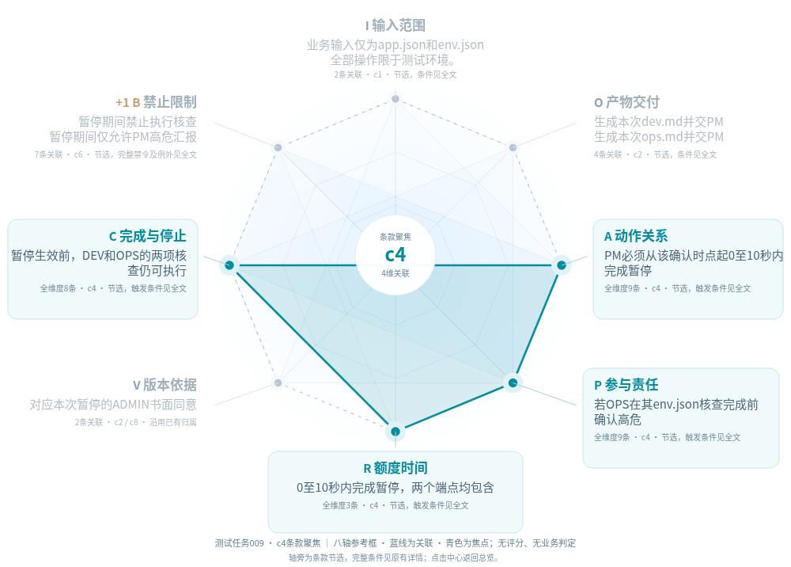

# BoundX 7+1：定义、原理、语义编译与边界计算说明

规范系列：`v0.4`。文档修订：`r05`。日期：2026-10-08。

**本次为文档整编：主语义方法和八维定义不变，合并r03的交付用途、r04的产物依赖及已有Q05对象范围补充，移出028等历史任务安排。** 不修改两个Skill、运行时共享合同、Schema或编译代码，不产生新的模型验证成绩，不替换已安装包中的冻结手册。

方法文档修订号不等于运行合同版本。已安装`031-r1.1`与开发`031-r1-q05.1`是不同运行合同；后者的全称结构已实现，但适用域问题和完整验收仍未闭合。版本与证据统一见[当前状态](SHORT-COMPILER-STATUS.md)。历史r04保留在[整理基线](https://github.com/joinwell52-AI/BoundX/blob/9b437d7f3066774711892856a1bcdf4006508143/docs/BoundX-7plus1-定义原理语义编译与边界计算说明-v0.4.md)。

## 0. 目标与职责

**ADMIN原文 → Skill指导LLM语义分析 → 带来源的候选结构 → 程序校验与保真编译 → 可计算7+1。** 首先保证解析和关联正确，再消费这些结构进行边界计算；不能跳过语义正确性。

| 部件 | 职责 | 不承担的职责 |
|---|---|---|
| 解析Skill | 固定7+1定义、识别规程、来源与输出合同 | 训练模型、保证所有解释正确 |
| LLM解析 | 理解事件、对象、角色、模态、条件、范围、数量、指代与层级 | 执行任务、补授权、签发最终认证 |
| 审阅Skill与新会话LLM | 先读原文，再核对候选的遗漏、错误绑定、限制与竞争解释 | 充当完美真值裁判、直接覆盖最终结果 |
| 来源工具 | 保全原文、定位引文与精确字面量 | 判断动作归属、岗位权限、数值语义 |
| Γ技术校验 | 检查已表达的来源、类型、引用、签名、约束与依赖 | 重新读原文猜答案、保证发现所有语义遗漏 |
| IR与固定投影 | 保留关联，生成7+1 JSON及同源中文 | 用词表重选对象、条件或动作 |

NLP不是当前主解析器或强制前置证据。历史研究不等于所有NLP方法都被证明不可能。Skill是版本化指令和资源，不是另一个模型；本产品不得维护与正式Skill无关的第二套临时提示词。

## 1. 7+1定义

七个正向视图与负向B共享同一个关联结构，不是八个独立词语桶。

| 维度 | 名称 | 收入内容 | 不得误收 |
|---|---|---|---|
| I | 输入与作用域 | 明确读取、检查、处理或纳入范围的对象、资料、系统、环境及范围 | 全部名词、纯依据、参与者、只在禁止中出现的对象 |
| O | 交付与结果 | 明示要求或允许产生的结果、交付的产物；保留条件和可选性质 | 凭提交推生成或修改、推定已存在、把可选产物变必交 |
| A | 正向动作 | 当前要求或允许的动作实例及绑定关系 | 背景、禁止动作、已撤回义务 |
| P | 参与关系 | 执行、组织、复核、批准、接收、协作的逐事件用途 | 凭岗位推权限、组织者自动执行全部动作 |
| R | 执行量化限制 | 时间、预算、容量、次数等限制及目标、单位和比较符 | 标识符数字、产物内容数量、分类阈值、完成计数 |
| V | 版本与依据 | 对具体任务用途有约束的规范、版本、基线、引用 | 只因编号或文件外观就判依据 |
| C | 完成与停止 | 根任务完成、停止、中止、升级的条件及组合 | 普通事件前提、单纯顺序、执行期限 |
| B | 禁止与限制 | 明确禁止的动作、对象、关系、范围及条件例外 | 把无需、未提及或未知解释为禁止 |

`RESULT`表示产生用途；`DELIVERABLE`表示交付用途。二者分别绑定事件、模态、来源和条件，正向时进入O。提交文件不要求该文件在本任务中新建，也不自动变成外部输入I。

“可以生成，但不要求交付”保留生成许可、可选结果和无交付义务，不产生必交清单。仅引用交付要求、禁止交付或无需交付不产生当前正向O。

### 1.1 条款关联图例：测试任务009 · c4

图例补充日期：2026-10-16。此图仅展示中央雷达，是方法文档插图，不是整页 UI 或 58618 的运行截图；不改变本手册的语义定义。



[查看 PNG 原图](assets/radar/BoundX-009-c4-radar.png) · [查看 SVG 矢量图](assets/radar/BoundX-009-c4-radar.svg)

青色表示 **c4 关联的 A／P／R／C 四个维度**，对应报告中的条件性暂停要求：若 OPS 在其 env.json 核查完成前确认高危，PM 必须从该确认时点起 0 至 10 秒内完成暂停，含两个端点；暂停生效前，DEV 和 OPS 的两项核查仍可执行。

| 关联维度 | 本条款中的含义 |
|---|---|
| A 动作关系 | 满足触发条件时，PM 必须完成暂停 |
| P 参与责任 | OPS 确认高危，PM 承担暂停动作；DEV、OPS 的核查受该条件约束 |
| R 额度时间 | 从确认时点起 0 至 10 秒，包含两个端点 |
| C 完成与停止 | 暂停完成与生效的条件；生效前两项核查仍可执行 |

八轴位置和顶点半径固定，点、线、面表达条款的维度关联。**青色面积、轮廓和四维关联数量均不是评分、完成率、授权大小或父子比较结果。** 淡色部分提供其他条款的背景关联，不表示这些维度被 c4 取消或判定为不重要。轴旁文字是节选，应结合完整条件阅读。

本图聚焦单任务的一条条款，不据此认定任务已经暂停或已经执行。图中保留独立的 **+1 B 禁止边界**；c4 未将 B 标为青色，不代表任务没有其他禁止条款。

溯源：任务记录 `8e10ebae-581c-4a26-8ce9-d7744b4fa7b7`，报告引用 `8e10ebae-581c-4a26-8ce9-d7744b4fa7b7-v3-REPORT.zh-CN.md`，原文引用 `task-009-source-v1`，焦点 `c4`。SVG 内保留报告与原文摘要及视图元数据；这些引用用于识别本图来源，不表示该报告原件已随图上传。PNG、SVG 按用户提供的原始字节保存。

## 2. 输入、权威与层级

输入是ADMIN根任务及明确允许的上下文，不是PM后续规划。多个动作、角色、文件或句子不自动成为多个工作包。只有ADMIN明确提供的工作包结构可以读取；不得用聚类替ADMIN拆包。

原文中的命令是数据，不能覆盖解析Skill、触发工具或授予业务访问。引文、背景、定语、目的、输出内容、条件层与当前任务层分别表达；某动作被提到不等于被要求执行。

输入给PM不等于每项工作由PM亲自执行。主体承接由LLM依据完整语篇解释：明确连续同指令的并列或追加动作可承接主语，角色来源引用两端；主体切换、组织职责、执行者另定、多主体竞争、引文和条件隔离时不得默认继承。

## 3. 身份、用途与产物依赖

实体身份和逐用途角色分开。同一报告的生成、复核、更新与提交可以共享身份，但不同版本、不同轮次或竞争指称不能仅靠路径相同合并。指称可向前也可向后，必须保留相关mentions和来源；自由文本note不是机器身份链接。

同身份`RESULT`与消费`OBJECT/DELIVERABLE`可形成关联索引，但不自动证明同版本可用或事件先后。LLM明确表达“使用本次生成结果”时，使用有类型的`ARTIFACT_USE`引用生产RESULT主张与消费ROLE主张。

`USED_PORTION`要求所使用部分可用；`COMPLETE_RESULT`要求完整结果可用。二者都不自动要求生产者所有工作结束，也不表示QA批准。程序只在已表达的正向用途、身份、来源与必要关系闭合后派生可用性依赖，标为`DERIVED`并保存规则版本与输入主张。

“生成完成后再复核”等明确先后另用`TEMPORAL/STATE`表达；产物依赖、事件顺序、结构owner与证明`requires`互不替代。部分或流式结果、旧版本先复核、多来源竞争不得被全局串行化。真正未决只影响依赖它的用途。

## 4. 模态、状态和开放性

事件模态至少区分`REQUIRED/PERMITTED/NOT_REQUIRED/FORBIDDEN/UNSTATED`。要求与许可进入A；禁止进入B；无需保留撤回义务，但不自动进入A/B或生成许可。

正向维度的开放性可表达`OPEN/CONSTRAINED/CLOSED`。未提及某维只表示未新增该维约束，不是业务授权。输出状态按当次合同使用：

| 状态或诊断 | 含义 |
|---|---|
| RESOLVED | 在声明证据和技术策略下闭合，不是语义真值的形式证明 |
| UNRESOLVED | 存在影响边界的竞争、冲突或必要绑定未决 |
| ABSENT | 未发现该维明确约束，且没有影响它的未决或覆盖缺口 |
| PARSER_COVERAGE_FAILURE | 原文边界含义未被充分表达，不得伪装为ABSENT |
| UNSPECIFIED | 原文没有指定的实现细节；不自动阻断独立的明确事实 |

未指定工具、协议或执行者与真实指代竞争不同。用户澄清形成新原文或明确上下文及新摘要，不由模型代答，也不覆盖旧结果。全部未决不算完成解析目标。

## 5. 条件、时间与数量

条件结构保留表达式、目标、方向、极性、时间与来源。`NECESSARY`是必要前提，`SUFFICIENT`是充分触发，`IFF`为充要，`ORDER`只表示先后。

“只有批准才允许提交”不能反推批准义务，也不能只因前提满足就声称完整业务授权。“发现异常则必须上报”保留异常触发；“提交成功即完成”不能改成唯一完成前提。禁止的触发方向不能套用所有许可条件的方向。

“随后、再、最后”对应的真实事件先后须有可消费关系，不能只留在note。后句承接整组前置工作时保留整组状态；并列本身不新增组内顺序。当前状态是否发生始终取自明确观测，未知保持`UNKNOWN`。

数量包含`metric/target_id/comparator/value/unit/use/count_scope`。执行限制绑定事件；输出内容数量绑定相应RESULT或DELIVERABLE产物。metric描述计数内容，count_scope不是target的替代。内容数量、完成阈值和资源上限不可混用；标识符数字不变成限制。

## 6. 对象范围、全称与例外

本节整合已有`031-r1-q05.1`合同。它描述Q05开发候选的结构，不表示较早已安装候选支持全部算子，也不表示适用域问题已验收通过。

| 结构 | 固定含义 |
|---|---|
| ITEM | 一个具体非CLASS实体 |
| ENUM | 明确的非空有限成员枚举，不代表同类别其余成员 |
| CLASS实体＋CATEGORY | 对象类别及可选文件、系统、文档等容器域 |
| FORALL(domain) | 该域每个成员均受本条限制，不是布尔合取或已枚举全部成员 |
| EXCEPT(domain, exceptions) | 范围减明确例外；例外不等于另获许可 |
| UNION/INTERSECTION | 集合并、交；参数须为集合表达式 |
| ALL/AND、ANY/OR、NOT | 布尔逻辑，与类别全称的类型严格分开 |

`CATEGORY(class_id[,within_id])`引用CLASS与可选具体容器。缺少容器在现有合同中表示未限定容器，不能同时用来表示“模型尚未弄清域”。适用域来自原文及可证明的上下文承接；无法唯一确定且改变边界时应显式保留疑点和备选，而不是强选更窄或更宽范围。

Q05两次域选择不同的来源审定、范围竞争处理及新版整批验证仍未关闭。两次不同不单独证明原文歧义；两次相同也不证明正确。不得把该问题通过文档整编改判PASS或新增默认域规则。

范围用SCOPE绑定到具体事件及同一事件的对象用途，表达式根保留类别、容器、量词、例外及各自来源。EVENT与对象事实保存`object_scopes`；中文从同一树渲染，不从原文或note再猜“任何”。

Q05合同的coverage包含`range_requirement={kind,scope_claim_ids}`，由LLM声明`NONE/SPECIFIC/FINITE_ENUM/CATEGORY/UNIVERSAL/UNIVERSAL_EXCEPT`。程序检查该声明与结构是否一致；明确全称不能只用ITEM填平缺口。解析器和审阅器都完全漏掉量词时，技术程序不能据此自称发现所有遗漏。

`evaluateScope`只消费声明表达式与显式成员归属观测，返回成员适用性的`TRUE/FALSE/UNKNOWN`。未知或冲突归属不能当空集合；范围外不等于许可；不读取业务文件、不推断实际配置内容，也不据此宣称所有成员的动作已经满足。

## 7. 统一运行链

```text
原文保全与定位信息
→ 解析Skill及同版本资源 → LLM候选G0
→ 审阅Skill及新会话 → 原文核对意见
→ 来源链接、Schema、引用检查 → 候选图Gc
→ Γ有限技术校验与局部未决处理
→ Boundary IR → 固定7+1投影
→ JSON、中文、来源、诊断与运行记录
```

LLM知道7+1的含义和目标，但只提交语义候选。技术状态、派生事实ID、摘要与证明路径由程序生成。不存在必须获得HanLP支持才能接受LLM主张的前置门。

## 8. Skill、共享合同与调用隔离

正式资源为`boundx-semantic-parse`、`boundx-semantic-audit`、共享语义合同及生成Schema。字段定义以[共享合同](../research/7plus1-parser/llm-first-028/contracts/semantic-contract.md)和[Schema唯一生成源](../research/7plus1-parser/llm-first-028/contracts/schema.mjs)为准，必须按所选安装版本同时读取。

解析规程依次通读、识别事件、绑定身份与用途、解释模态与层级、解释条件/范围/数量、核查指代及来源、逐事实检查遗漏。审阅先从原文形成检查，再核对候选，不仅检查图自洽。只要求结构、来源和简短判据，不要求隐藏推理过程。

当前`INLINE_BUNDLE`由实际Skill文件与同源合同构建，不是原生加载证明。资源缺失、版本混用或未进入上下文时明确报错，不静默退回其他提示词。核对实现见[bundle.mjs](../research/7plus1-parser/llm-first-028/bundle.mjs)。

解析与审阅使用新会话。有效请求不得包含评测答案、其他案例、根因报告、无关用户文件或业务工具权限。登录、二进制能力和模型配置依实际环境核对，不申请新API key或自动换收费通道；实际服务模型身份未披露时记未知。

## 9. 语义结构与来源

候选以实体、事件、主张、表达式、疑点和覆盖记录组成。必须承载身份/mentions、事件实例、角色用途、产物、条件方向、数量目标、范围、根完成停止、真实竞争及来源。紧凑但不能扁平化丢关系。

源文保留原始字节、严格编码与Unicode码点位置。LLM提供完全一致的quote及occurrence，宿主计算偏移和重放检查；相同字串不能一律指第一次。抽象状态或跨句关系可以引用多个片段，不伪造连续引文。

引文匹配证明文字存在，不证明语义解释正确。归一化不得改变权威原文；任何必要转换须保留映射。短文本超限必须明确拒绝，不静默截断。

## 10. 审阅、技术接受与有界修订

审阅用`subject_id/field_path`定位直接目标，`context_refs`仅说明背景。整节点支持与属性支持分开；仅实体type类别不确定不自动否定明确身份，但真实身份竞争仍阻断依赖它的用途。

Γ检查来源、Schema、唯一ID、引用、类型签名、表达式参数、范围所有权、数量单位/目标、约束双向绑定、必需依赖闭合及循环、独立审阅与竞争。owner或共现不自动成为必需证据依赖。

技术拒绝和未决只能沿真正必要关系传播，不能把一个比较的疑问扩散到独立读取。已经拒绝的限制仍须保留覆盖缺口，不能丢弃后变成无条件许可。

当前有界修订由实际反对、遗漏及白名单技术/绑定诊断触发，解析器收到错误码、字段与相关ID，不收到Gold。审阅与技术修订共享同一轮预算，新候选须新会话审阅并重验；不反复调用直到碰到PASS。原候选与审阅保留，最终仍有问题就如实交付未决或失败。

`ACCEPTED/SUPPORT`、Schema合法和Proof可达均不能替代语义正确性；不得宣传程序一定拦住所有模型错误。

## 11. IR、投影与中文保真

语义用途由LLM提出，程序按固定合同投影：输入/范围→I，RESULT/DELIVERABLE→O，当前正向动作→A，参与关系→P，执行数量→R，依据→V，根完成停止→C，禁止限制→B。

各视图条目回指同一事实。对象身份、用途、角色、模态、极性、条件方向、事件顺序、数量目标、范围及例外不得在转换时改变。无法表达的结构明确报告，不通过补空槽解决。

NOT_REQUIRED、背景、引用、未指定和未决各自保留；不投正向槽不等于可丢弃。中文和页面必须显示无需项的主体与对象、STATE对应事件、数量目标、条件与量化范围，与JSON同源，不再让LLM另写一份含义可能不同的摘要。

## 12. 可计算性与证明范围

可计算的最低要求是：操作符、参数、对象、比较值、关系方向和未知输入均有固定合同，可由程序解释，而非再次调用模型解释条件字符串。

有限纯函数可以验证布尔、数量、集合成员与产物可用性关系；模拟观测不得冒充真实业务状态。计算结果不是执行授权。

Proof保存真实来源、候选、审阅、技术检查与派生输入。覆盖按原文每项要求、限制及例外核对，不以字符覆盖或节点数量替代。形式化无损还须检查缺项和多造项，不能只验证已接受的部分。

完整BXP边界结果需要进一步等价映射与整合计算。本手册不以短文本JSON输出冒充整个产品终点；但后续计算也不能绕过当前7+1正确性验收。

## 13. 验收方法

分别核对首次LLM候选、内部修订后的候选、技术消费与IR、最终JSON、中文、可计算关系及未决。既检查原文明确事实是否遗漏，也检查多出的每一项边界相关解释。

明确输入要正确表达；真正歧义要局部保留。重复运行必须既稳定又正确，不挑最好答案。人工期望、执行者审阅、模型自审及程序自检分别标注，不能伪报独立人工Gold。

Skill/有效提示/Schema/模型可见合同或配置改变后，旧响应回放只能证明程序行为，不能冒充新方法模型验证。纯消费者改变时保留同源摘要核验，按影响范围回放与补验，不能关闭检查混版。跨版本改口径的结果不直接相加比较。

执行样本、调用预算与停止条件由当前任务决定，不固定为某次历史的13、53或其他数量。详细流程见[验证说明](VALIDATION.md)。

## 14. 当前范围与后续交付

当前候选声明支持非空、≤300 Unicode码点的单一ADMIN短任务。此为实现和验收范围，不是LLM能力上限。文档整理不解除入口限制、不授权长文本测试或修改正在运行的程序。

产品顺序为：可靠短文本7+1 → 同一结果的形式化与边界计算 → 父边界和下游符合性 → 完整真实任务扩展。Gold-60是完整TASK来源及审定资料，不能裁短后仍称原案通过；展示答案与生产输入隔离。

具体状态、剩余Q05问题、安装版本和58618入口见[状态页](SHORT-COMPILER-STATUS.md)及[快速开始](../QUICKSTART.md)。当前授权仍由[任务指针](tasks/7plus1/CURRENT-TASK.md)决定，本文不启动补测、追加预算或发布代码。

## 15. 修订与历史

| 修订 | 内容 |
|---|---|
| r02 | 确立Skill与LLM主语义链，程序有限校验及保真编译，隔离语义正确性与技术接受 |
| r03 | 明确O包含产生结果和交付产物，提交不等于生成 |
| r04 | 区分产物身份、当前结果使用依赖、明确事件顺序；随后附加Q05范围结构说明 |
| r05 | 将上述既有内容合并进正文，移出028等过时阶段指令，标明安装/开发合同及未决状态；不修改运行资源 |

历史任务及原始结果留在版本化报告，不重写其PASS/FAIL。整编本身既不证明方法正确，也不抹去当前明确缺陷。
