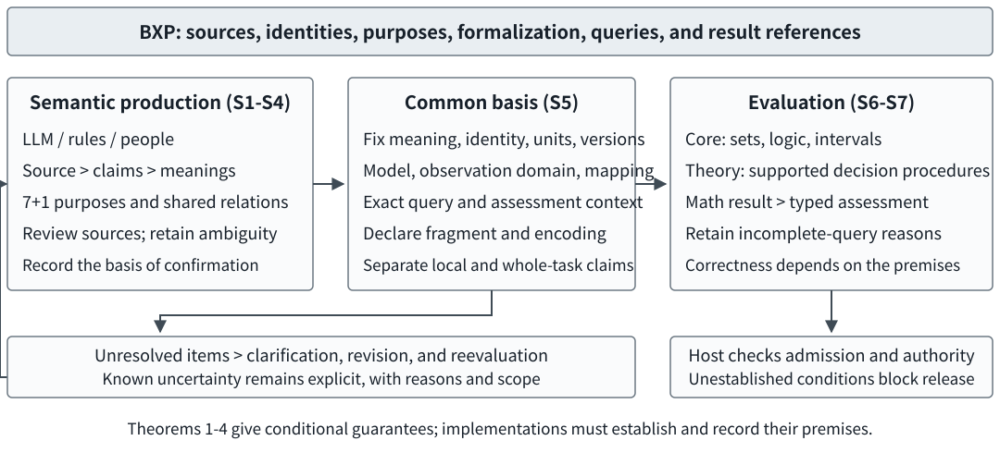
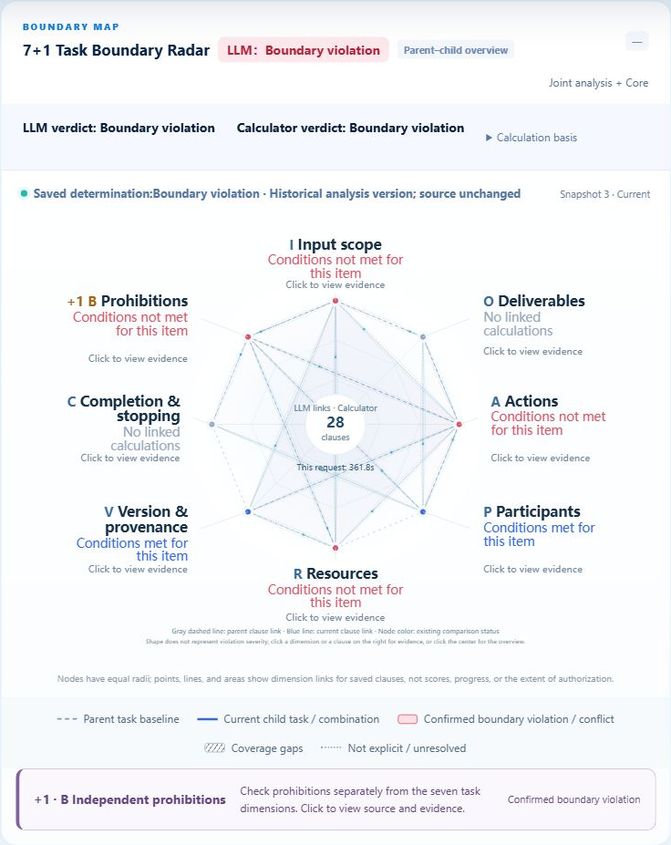
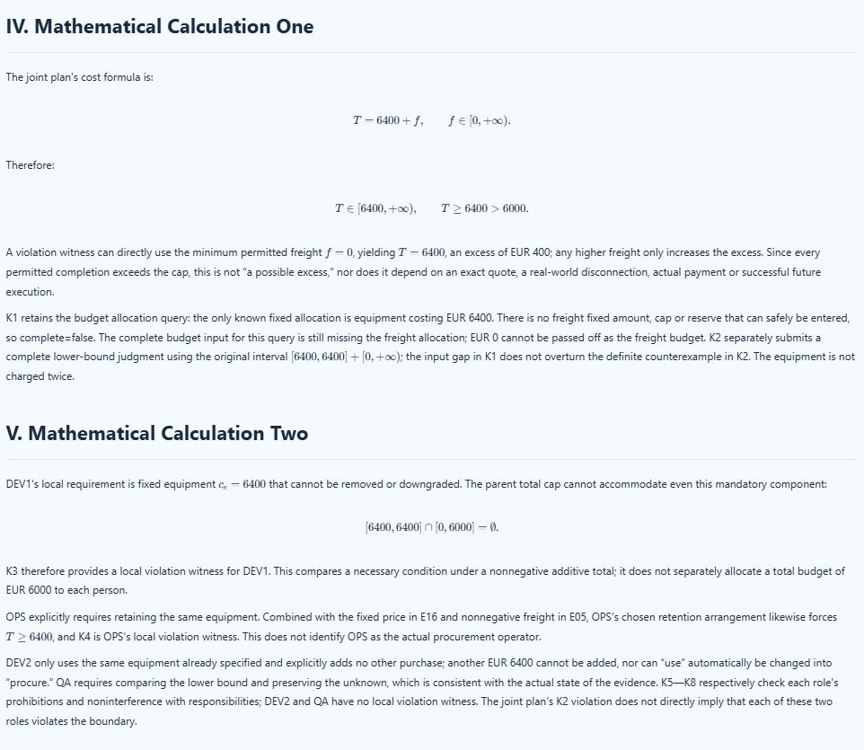
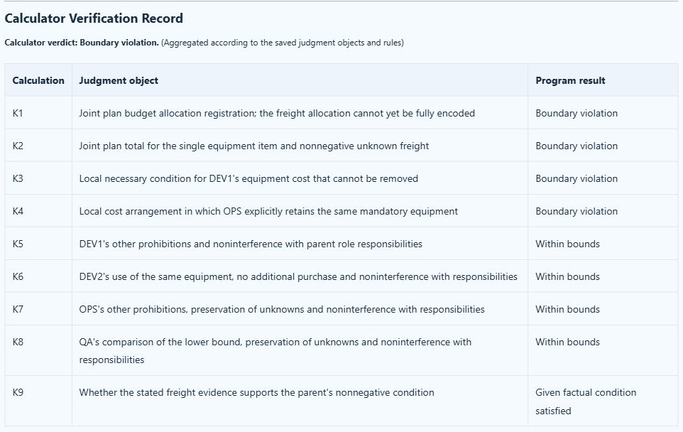

# BXP: A Method for AI Task Boundary Verification Using a 7+1 Relational Representation

**Wei Zhu**  
Independent Researcher · joinwell52@gmail.com

English preprint v1.2 · 2026-11-06 · Based on Chinese research revision r23

## Abstract

When an artificial intelligence system turns a natural-language task into a plan or delegates it to several agents, the resulting arrangements must remain within the original task's requirements. This paper presents a task boundary verification method that organizes requirements through seven semantic views and an independent prohibition view, together with shared relational structure. The Boundary Xplain Protocol (BXP), introduced as the method's common foundation, specifies the interpretation, formalization, mathematical evaluation, and result-reference conventions. Under explicit conditions on sound and complete source correspondence, purpose and relation coverage, structural recovery, atomic interpretation, and exact query encoding, the representation admits an effective translation to a formal model with the same boundary semantics. Consistency, membership, equivalence, and implication are decidable within the declared logical fragments. A preservation criterion extends the method to task decompositions with parent-required environments, branch activation, and shared constraints. BoundaryXP implements the method. Its 625 test cases contain 3,219 task nodes; the current annotations, the final LLM judgments from the joint 7+1 workflow, and the aggregate calculator judgments agree at case level, while 3,469 individual calculations retain nine differences and three incomplete items. Cases demonstrate a shared-budget overrun despite each individual amount being below the cap, conclusive lower-bound violations despite unknown costs, and the distinction between a violating proposal and an inconsistent inherited specification. The formal results establish conditional guarantees; the experiments provide evidence for their application to the tested tasks, without equating aggregate agreement with universal semantic accuracy.

**Keywords:** task boundaries; 7+1 relational representation; BXP; formal methods; mathematical verification; multi-agent systems

## 1 Introduction

An AI-generated plan can appear to complete a task while changing what the task permits, requires, or prohibits. A required deliverable may disappear during delegation; advice in a report may become an instruction to modify a system; an approval condition may be reversed; or individually acceptable subtasks may jointly exceed a shared budget. The question is whether the proposed arrangements satisfy the original requirements, including the relations that connect them.

This research originated in boundary problems encountered during multi-agent task coordination. It independently developed the Boundary Xplain Protocol (BXP), the 7+1 relational representation, and the associated mathematical verification process. BXP establishes common conventions for boundary objects, interpretation, formalization, evaluation, and result review. This paper uses BXP-0001 0.4.0-draft.2, document revision 2026-10-27-r2. Related work is compared to locate overlapping questions and differences in representation and checking responsibilities; it is not presented as the source of the proposed method.

The method takes a mathematical boundary as its common basis. Once a task interpretation has been fixed, its acceptable implementations form a set. Checking a particular implementation is a membership problem. Checking a candidate specification requires asking whether every implementation it permits belongs to the parent's acceptable set, and whether the candidate can handle the external situations it undertakes to handle. These are different questions. In either case, the formula must express the original requirements: correct arithmetic cannot compensate for a missing prohibition or an incorrect artifact identity.

The 7+1 representation organizes boundary-bearing claims into input scope (I), outputs and delivery (O), actions (A), responsibility and division of work (P), resources (R), versioned bases (V), completion and stopping (C), and an independent prohibition view (B). Shared structure preserves identities, argument roles, guards, scopes, order, and handoffs. A view is a semantic responsibility, not an isolated calculation. A shared-budget query, for example, needs quantities, contributing task instances, their common accounting scope, and the applicable aggregation rule. Several views and relations can therefore participate in one mathematical query.

Two questions must be distinguished. One concerns how fully this representation accommodates requirements found in actual tasks. The other concerns whether an already established representation can be translated and compared without changing its meaning. The former requires source-based coverage evidence; the latter is addressed by the representation and query results developed here. The recovery proof does not require exactly eight views, and it cannot establish that arbitrary natural language has been fully interpreted. The method contribution is the explicit path from source claims and shared relations to common mathematical objects and checkable boundary conclusions.

BXP also distinguishes verification from authority. A host is the system that invokes boundary checking and manages a task's lifecycle. Known ambiguities or binding gaps that affect a required conclusion must remain unresolved. Formal admission requires the applicable conditions to be established, while business decisions and execution authorization remain the host's and responsible person's duties. A boundary result is not an authorization to act. This separation prevents a successful local calculation from being treated as proof that the whole task is ready for execution.

The contributions have three connected parts. First, the paper defines a task boundary verification process in which BXP conventions, 7+1 purposes, shared relations, and source correspondence jointly determine the objects submitted to mathematical comparison. Second, it establishes sufficient conditions for recovery, semantic preservation, effective formalization, and terminating queries, then derives preservation checks for guarded task compositions and parent-required environments. Third, it connects those principles to an implementation and to 625 saved task cases, with separate analysis of aggregate outcomes, individual calculations, mathematical mechanisms, and representative witnesses. General claims are supported by proofs; the test material supports the specific constructions and applications examined.



**Figure 1. BXP conventions connect semantic production, a fixed calculation basis, and mathematical evaluation.** The front end may use an LLM, rules, or human interpretation. The back end evaluates fixed objects under declared semantics and supported fragments. Theorems 1-4 state the conditions connecting these responsibilities; the diagram does not claim that the tested implementation establishes every admission condition automatically.

Section 2 defines task boundaries and comparison objects. Section 3 constructs the representation and proves its formal properties. Section 4 derives preservation criteria for task decomposition. Section 5 specifies common calculation and review responsibilities. Section 6 presents mathematical instances and the 625-case evidence. Section 7 compares related research and discusses scope. Section 8 concludes. The appendices and accompanying research material retain the detailed evidence for the study.

## 2 Task boundary semantics and common BXP conventions

### 2.1 Acceptable implementation sets

A boundary must represent permitted scope, required obligations, and prohibited events. These cannot all be interpreted as containment in an allowed-item set. In particular, an empty delivery set is a subset of any allowed set but does not satisfy a mandatory delivery obligation.

Let $S_T$ be the task source, $\theta$ a fixed interpretation, and $\Sigma$ the conventions for identity, units, versions, observation points, and background assumptions. These determine a common space $\mathcal X_\Sigma$ of well-formed implementations. An implementation records relevant events, actor-object relations, artifact states, resource quantities, and bounded order. An obligation is checked at its declared due point; a partial execution before that point is not automatically an omission. The BXP model is

$$
\mathcal M_T=(E,\Sigma,Q,F,K,\mathcal R,\mathcal D,\Phi),
\qquad
\chi_T=Q\land\neg F\land K\land\Phi.
\tag{1}
$$

Here $E$ contains entities and artifacts, $Q$ required obligations, $F$ prohibited behaviors or states, $K$ completion and stopping constraints, and $\Phi$ scope and quantitative restrictions. Role relations $\mathcal R$ and dependencies $\mathcal D$ are interpreted through the predicates; a relation name without its endpoints and direction does not determine a truth condition.

**Definition 1 (Task boundary).** Under fixed $\theta$ and $\Sigma$, the boundary is

$$
\Omega_T=\{x\in\mathcal X_\Sigma:\chi_T(x)=1\}.
\tag{2}
$$

A determined boundary may admit many implementations. An empty boundary means that the requirements are inconsistent in the declared context; it is not an executable safe plan. A natural-language source may have multiple supported interpretations, which are treated separately in Section 4.5.

**Running example: environment inspection.** In the supplied ADM-001 source, PM is the task coordinator, OPS the inspector, QA the reviewer, and ADMIN the report recipient. An English rendering is:

> PM coordinates an environment inspection and assigns OPS to inspect the test machine's operating system, available disk space, and service processes. OPS must generate environment-check.md. After QA reviews the report, PM submits it to ADMIN. The whole task must finish within 40 minutes. System configuration must not be modified.

The Chinese original is retained in the research material. Let $r$ identify the same produced report version throughout generation, review, and delivery; let $t$ be total elapsed minutes and $m$ actual configuration modification. Organization and assignment enter A/P; inspection enters I/A/P; generation and delivery enter O/A/P; review and its order enter A/P and the shared structure; the total deadline enters R; and the prohibition enters B. V and C are absent only after the corresponding source scopes have been checked. A time limit alone does not create a completion equivalence. A 35-minute implementation with all positive obligations satisfied and $m=1$ violates exactly the configuration prohibition. Section 6 reconstructs this comparison explicitly.

### 2.2 Discriminative equivalence and sufficient representations

On a common implementation space, tasks are boundary-equivalent when they accept exactly the same implementations:

$$
T\equiv_\partial T'
\quad\Longleftrightarrow\quad
\forall x\in\mathcal X_\Sigma,\ \chi_T(x)=\chi_{T'}(x).
\tag{3}
$$

**Definition 2 (Discriminative sufficiency).** An encoding $\mathsf E$ is sufficient for a task class $\mathcal T$ precisely when

$$
\mathsf E(T)=\mathsf E(T')\ \Longrightarrow\ T\equiv_\partial T'.
\tag{4}
$$

**Proposition 1 (Discriminative factorization).** Fix $\Sigma$. Suppose each $\chi_T$ is a total Boolean function on the common $\mathcal X_\Sigma$ and $\mathsf E:\mathcal T\to Y$. Equation (4) holds if and only if a function $f:\mathsf E(\mathcal T)\times\mathcal X_\Sigma\to\{0,1\}$ exists such that $\chi_T(x)=f(\mathsf E(T),x)$ for every task and implementation in these domains.

**Proof.** If $f$ exists, equal encodings have the same value for each common implementation. Conversely, every $e$ in the image has at least one representing task. Equation (4) makes $\chi_T(x)$ identical for all tasks with that encoding, so this unique value defines $f(e,x)$. The definition is total on the stated image domain and satisfies the factorization. ∎

Unused elements of $Y$ need no task semantics; an interface receiving them should report an invalid object. Different observation contexts must first be aligned or included in context-tagged encodings. Proposition 1 characterizes the proof objective rather than introducing an encoding or algorithm. If two otherwise identical tasks differ on a prohibition, deleting that prohibition can destroy sufficiency.

### 2.3 Semantic distinctions and relations

The task class $\mathcal T_{\mathrm{fin}}$ has finite object and role domains, or a finite abstraction proved to preserve the relevant observations; bounded event processes; and quantitative constraints in the fragments of Section 3.6. Modality, condition direction, scope, and source level have declared interpretations.

**Table 1. Distinguishing witnesses that motivate representation responsibilities.**

| View | Different explicit requirements | Distinguishing implementation |
|---|---|---|
| I | Inspect only file a / inspect only a and b | Inspect b |
| O | Deliver a report / deliver report and logs | Deliver only the report |
| A | Read only / read and write | Write the same object |
| P | QA reviews / OPS reviews | Only OPS reviews |
| R | Total duration at most 40 / at most 30 minutes | Finish in 35 minutes |
| V | Refer to v1 / v2, resolving to limits 40 / 30 | Finish in 35 minutes |
| C | Delivery is necessary / sufficient for completion | Delivery without declaring completion |
| B | Same positive requirements, with / without modification prohibition | Deliver and modify |

“Only” supplies explicit closure in the I and A rows. The B row does not presuppose a closed positive action domain. A version label affects behavior through resolved requirements: equivalent versions may define the same boundary while remaining different calculation bases. Role requirements derive from the source, not organizational rank.

**Proposition 2 (Insufficiency after information deletion).** For a class containing the task pairs in Table 1, an encoding that makes a pair identical after deleting the stated distinction fails Equation (4).

**Proof.** The witness in that row receives different truth values under the two boundary predicates, despite the identical reduced encoding. ∎

The proposition establishes that these distinctions cannot be discarded unconditionally; it does not establish a uniquely minimal eight-field taxonomy. B gives prohibitions an explicit representation and review responsibility. Under the same guard, scope, and atomic meaning, $\operatorname{Forbid}(g,p)$ and $\operatorname{Require}(g,\neg p)$ both mean $g\Rightarrow\neg p$ in the language used here. This does not add expressive power, erase the source modality, or establish a universal equivalence for other deontic languages.

Classification alone is insufficient. For a developer DEV, a reviewer QA, and files a and b, consider

$$
L_1=\{(\mathrm{DEV},a),(\mathrm{QA},b)\},\qquad
L_2=\{(\mathrm{DEV},b),(\mathrm{QA},a)\}.
\tag{5}
$$

Separate actor and file sets are identical, but the permission for DEV to act on a differs. Likewise, $g\Rightarrow q$ and $q\Rightarrow g$ contain the same propositions and impose different conditions. Shared identity, paired arguments, direction, scope, and expression structure must therefore survive the representation.

### 2.4 Protocol responsibilities and comparison objects

BXP-0001 draft.2 distinguishes mathematical evaluation from assessment of a whole task boundary under fixed context. It also specifies interpretation ranges, source accountability, comparison environments, release conditions, and revision bindings. These are the common conventions under which this paper constructs and verifies mathematical objects.

**Table 2. BXP responsibilities and their mathematical realization.**

| BXP clauses | Responsibility | Realization in this paper |
|---|---|---|
| §§2, 5 | Formal model and boundary predicate | Common implementation space and discriminative equivalence |
| §§3-5 | Purposes, shared structure, sources, identities and order | UseCover, RelCover, root coverage, projection and recovery |
| §6, OPR-001-004 | Exact queries, operator semantics, encoding and evidence | Supported fragments and query-level definition extension |
| §7, SEM-001/002 | Interpretation scope and semantic normalization | Scope-relative uniqueness and normalization soundness |
| §11, CMP-001-005 | Implementations, observations and specifications | Environment coverage, counterexamples and composition |
| §6, EVA-001/002 | Mathematical content and overall assessment | Fixed evaluation basis and typed result reduction |
| §§8-9, ADM-002/003 | Release and revision | Parent-preservation obligations and renewed bindings |

Determining a task boundary and checking a candidate against that boundary are distinct stages. A parent may be clear and consistent while a particular candidate violates it. Structural validity, matching quotation locations, model satisfiability, and correct interpretation are also distinct properties. The following construction connects their responsibilities without identifying them.

## 3 Constructing the 7+1 representation and mathematical queries

### 3.1 Method steps and evidence dependencies

An evaluation begins with a question $q$, complete source $S$, background $\Sigma$, and interpretation contract $\Lambda$. The contract fixes types, atomic meanings, units, and version-resolution rules. A preservation question additionally supplies a candidate decomposition and its composition context. A *claim* is a statement about scope, delivery, action, or another boundary requirement; a *guard* states when it applies. A producer may be a model, rule system, or person.

**Table 3. Method steps, artifacts, and responsibilities.**

| Step | Operation | Artifact and responsibility |
|---|---|---|
| S1 | Fix source, versions, interpretation, observations, and question | The calculation basis; source providers and host identify its scope |
| S2 | Identify claims, modalities, objects, roles, quantities, and ambiguities | Source-linked candidate claims; the producer supplies interpretation candidates |
| S3 | Map types and predicates, assign purposes, assemble shared relations | The 7+1 carrier and graph; preserve identities, guards, and scopes |
| S4 | Check source correspondence, purposes, relations, recovery, and gaps | A confirmed representation or explicit issues; structural checks and semantic review remain distinct |
| S5 | Translate claims, well-formed domains, mappings, and composition | Formal model and exact query; apply the declared translation and encoding contracts |
| S6 | Evaluate or solve the supported query | Mathematical result, witness, or incomplete status |
| S7 | Bind sources, representation, model, operator, result, and evidence | A reproducible record; host and reviewers retain the basis of the conclusion |

S2-S3 implement the conceptual chain *claim extraction → semantic-library mapping → relational assembly*. A suitable semantic library includes versioned types, predicate interpretations, units, and transformation rules. Lexical matches propose mappings; they do not establish semantic identity. Review must not become approval, generation must not become submission, and advice within a report must not become a modification event. Multiple supported referents remain explicit until resolved.

S4 can mechanically check references, type and unit compatibility, positional arguments, closure records, and supported expressions. Source correspondence requires additional evidence that the source has neither been omitted nor strengthened without justification. The review must record both where each source requirement is preserved and what supports each generated constraint. A matching quotation span proves location, not entailment.

BXP uses resolved, unresolved, and absent reduction states. An absent view means that its accounted source scope has been reviewed and contains no relevant requirement or known coverage gap. When coverage accounting is incomplete, a partial carrier omits the view aggregate status and preserves diagnostics and reduction metadata; this is not a fourth semantic state. Known uncertainty affecting a required conclusion cannot be removed by a confidence threshold or unrelated local success.

These steps define when verification is justified. They do not provide an automatic procedure that establishes correct interpretation for arbitrary natural-language sources. A local mathematical question may already be decidable while a whole-task conclusion remains unsupported; its scope must remain local.

### 3.2 Relational objects and shared structure

Fix $\Lambda$, including observation semantics, atomic interpretations, purpose rules, units, and version resolution. Let $G$ be a finite typed graph containing entities, claims, expressions, relations, and source records. Expression references form a directed acyclic graph; general entity and relation sharing may include cycles.

**Table 4. Minimal objects and preserved information.**

| Object | Required semantic payload |
|---|---|
| Entity | Unique identity, type, scope, and relevant version |
| Claim | Predicate, modality, role-labelled arguments, guard, scope, and interpretation state |
| Expression | Operator, ordered arguments, and result type |
| Relation | Typed endpoints, roles, positions, direction, guard, and scope |
| Source | Source identity, exact location, quotation, semantic level, and derivation basis |

For an expression $z$, $\operatorname{args}(z)=(\operatorname{id}(v_1),\ldots,\operatorname{id}(v_k))$ is an ordered tuple. An equivalent edge representation retains $(\operatorname{id}(z),j,\operatorname{id}(v_j))$ for every argument position. Repeated references at different positions remain distinct. Endpoints alone cannot preserve implication, subtraction, or order.

Starting from all boundary-bearing claims, recursively retain their entities, guards, expressions, relation endpoints, and sources. The resulting closure is $G_\partial$, and its starting claims are roots. Pure presentation data may be excluded; every node or relation affecting the boundary must remain. This closure operates on the graph already obtained, so it cannot discover source content omitted before graph construction.

The concrete encoding used here preserves the protocol's eight-view IR and adds its shared structure as part of the complete carrier:

$$
\mathsf E_{7+1}(G)
=\bigl((I,O,A,P,R,V,C,B),S_G\bigr).
\tag{6}
$$

The shared component $S_G$ contains entities and boundary-bearing relation roots, including order, handoff, identity, and guard connections. It is a semantic part of the representation, not a ninth purpose category. O, A, and P can refer to the same submission claim and report. At formalization, entities enter $E$, responsibilities enter $\mathcal R$, and order and dependencies enter $\mathcal D$; their modalities and guards determine the corresponding predicates in $Q,F,K,\Phi$. A relation container alone is not its truth condition.

### 3.3 Purpose, relation, and root coverage

The supported basic claim language $\mathcal A_\Lambda$ has the forms in Table 5. All forms retain source level, modality, guard, and scope. A claim may carry more than one legitimate purpose.

**Table 5. Basic claim forms and interpretation responsibilities.**

| Form | Main purpose | Interpretation responsibility |
|---|---|---|
| Object domain, applicable operations, explicit closure | I | Preserve scope; exclude outside objects only when closure is justified |
| Artifact, delivery, recipient, and modality | O | Distinguish required and permitted delivery; preserve identity and due conditions |
| Event, actor, effect, object, and positive modality | A | Distinguish obligation and permission; quoted content does not create an event |
| Actor, responsibility, and linked event | P | Preserve role endpoints; review, approval, and receipt are different predicates |
| Metric, comparison, accounting scope, and unit | R | Preserve dimension, aggregation scope, and comparison direction |
| Controlling rule or version and its applicability | V | Preserve the chosen basis and apply fixed resolution rules |
| Completion or stopping condition and affected obligations | C | Preserve necessary/sufficient direction and obligation switching |
| Prohibited event or state, guard, and scope | B | Preserve an explicit prohibition; silence does not create one |

A submission can simultaneously belong to A, O, and P. A 40-minute upper bound belongs to R; negative wording does not by itself create an additional action prohibition. Actor and object records associated with a prohibition do not grant permission.

**Definition 3 (Purpose assignment and coverage).** Let $\mathcal V_8=\{I,O,A,P,R,V,C,B\}$ and let $U_{v,\Lambda}(c)$ state that basic claim $c$ meets purpose $v$'s semantic conditions. Define

$$
\begin{aligned}
\kappa_\Lambda(c)&=\{v\in\mathcal V_8:U_{v,\Lambda}(c)\},\\
\operatorname{UseCover}_\Lambda(IR,G_\partial)
\iff{}&\forall c\in\operatorname{Base}_\Lambda(G_\partial):\\
&\Bigl[\kappa_\Lambda(c)\ne\varnothing\ \land\
\{v:\operatorname{id}(c)\in IR_v\}=\kappa_\Lambda(c)\Bigr].
\end{aligned}
\tag{7}
$$

Set equality requires all justified purposes and excludes unsupported ones. Repeated references do not duplicate a claim's predicate. Composite claims use the supported basic forms, interpreted identity and role relations, artifact use, finite order, Boolean connectives, guards, and finite-domain quantifiers. A condition word inside a guard or quotation does not automatically become a current execution claim.

Purpose coverage must be accompanied by relation coverage. Let $\operatorname{Rel}_\Lambda(G_\partial)$ contain all semantically relevant relation records and $\operatorname{RelRoots}_\Lambda(G_\partial)$ their independently constraining roots. Their payloads include typed, role-labelled and positional endpoints, direction, modality, guards, scope, and sources. Require

$$
\begin{aligned}
\operatorname{RelCover}_\Lambda(IR,G_\partial)\iff{}&
\operatorname{RelRoots}_\Lambda(G_\partial)\subseteq\operatorname{Roots}(S_G)\\
&\land\ \forall r\in\operatorname{Rel}_\Lambda(G_\partial):\quad
\operatorname{Read}_{S_G}(\operatorname{id}(r))=\operatorname{payload}_\Lambda(r).
\end{aligned}
$$

Read must return a unique complete record. Root coverage additionally requires every boundary root to appear in a view reference or shared root list. For example, retaining separate review and submission claims while dropping “review before submission” violates relation coverage even when both claims have legitimate purposes.

**Proposition 3 (Constructible purpose and relation coverage).** For a finite well-typed graph generated by the supported basic forms, relations, and composition constructs, generating exactly the justified purpose references and retaining all relation payloads and boundary roots jointly satisfies UseCover, RelCover, and root coverage.

**Proof.** Each basic form has at least one main purpose. Adding exactly all justified purposes satisfies Equation (7). Store each relation by identity and add every independent relation root to the shared root list. Logical, guarded, and finite-quantified compositions preserve ordered references and scopes without deleting existing claims or relations; every added boundary root enters a root list. Induction on the finite construction establishes all three conditions. ∎

These rules impose both inclusion and exclusion responsibilities: submission is not generation; suggested modification is not actual modification; deadlines do not automatically define completion; and absence of wording is not prohibition. They do not prove that mislabelling a view necessarily changes the final boundary. If the full payload and translation are unchanged, the predicate may remain the same; false guards or other constraints may also mask a local difference. Purpose legality is an audit condition, while semantic change is assessed by source correspondence and mathematical comparison.

### 3.4 Projection and recovery

Project retains the closure's identities and payloads, generates the purpose references, and records independent relations and unresolved claims in the shared root and coverage structures. Recover starts at these references and roots, looks up records by identity, and recursively reconstructs their ordered references. Missing references, conflicting identity definitions, or unrecorded roots make recovery fail. Comparison checks payloads, endpoints, positions, and roots; consistent renaming is permitted through a structure-preserving bijection.

**Lemma 1 (Recovery).** If $G_\partial$ is finite, references are complete, identities do not conflict, and Project preserves the closure, roots, argument positions, and repeated references as specified, then

$$
\operatorname{Recover}\bigl(\operatorname{Project}(G_\partial)\bigr)
\cong G_\partial.
\tag{8}
$$

**Proof.** Every boundary root is a recovery starting point. Induct on the shortest reference distance from a root. Roots are present at distance zero. If a node has been recovered, closure retention supplies all its referenced endpoints and their unique payloads, so the next distance is recovered. A visited-identity record prevents infinite traversal of finite sharing cycles. Recovery adds no nodes, giving a bijection by identity. At each expression position $j$, the retained positional record points to the corresponding original endpoint; repeated endpoints are not merged across positions. Types, modalities, roles, directions, guards, scopes, and root membership are retained as payload. The bijection preserves the complete stated structure. ∎

Recovery depends on closure and payload retention rather than the number of views. Purpose classification determines what is reviewed; structural recovery ensures that the confirmed content is not lost during encoding. Neither property establishes that the producer interpreted all source requirements correctly.

### 3.5 Formalization and semantic preservation

Let $\mathcal L_\partial$ contain typed events and role relations, finite set membership, identity, finite order, and linear quantitative comparisons, composed by $\neg,\land,\lor,\Rightarrow$ and finite-domain quantifiers. Completion, stopping, and branch conditions use these constructs; resource terms may use finite sums, min, and max.

The interpretation $\llbracket\cdot\rrbracket_\Sigma$ fixes atomic truth on an implementation. Translation $\tau$ writes a determined graph as a formal expression. Require and Forbid denote guarded obligation and prohibition, while All and Any denote conjunction and disjunction:

$$
\begin{aligned}
\tau(\operatorname{Require}(g,p))&=\tau(g)\Rightarrow\tau(p),\\
\tau(\operatorname{Forbid}(g,p))&=\tau(g)\Rightarrow\neg\tau(p),\\
\tau(\operatorname{All}(c_1,\ldots,c_k))&=\bigwedge_{j=1}^{k}\tau(c_j),\\
\tau(\operatorname{Any}(c_1,\ldots,c_k))&=\bigvee_{j=1}^{k}\tau(c_j).
\end{aligned}
\tag{9}
$$

A permitted action need not occur. An explicitly closed allowed domain translates to a membership restriction on applicable behavior; a positive permission without closure does not prohibit all other behavior. Necessary conditions, sufficient conditions, and biconditionals retain their directions. Unit conversion uses declared exact factors. Version references resolve to fixed rule objects. Advice within an artifact remains content rather than an execution event.

**Source correspondence.** Fix $\theta,\Sigma,\Lambda$. Completeness requires the graph to retain every boundary requirement, its guard, scope, and composition, so every graph-accepted implementation satisfies the source interpretation. Soundness excludes unsupported strengthening, so every implementation accepted by the source interpretation is graph-accepted. Derived constraints are allowed only when entailed by the fixed interpretation and background. Background assumptions cannot be added afterwards to justify a generated restriction. Together these conditions yield

$$
\forall x\in\mathcal X_\Sigma,\qquad
\llbracket G_\partial\rrbracket_\Sigma(x)=\chi_T(x).
\tag{10}
$$

The requirement concerns full guarded expressions in their composition positions, not the separate truth of each disjunct. If the source requires only $p$, the graph $p\land q$ can preserve $p$ and still incorrectly reject $p=1,q=0$. A source span is useful evidence of location but is not proof of the equivalence.

Let $\Theta_T$ be a finite explicit expression record for the established interpretation, with source or fixed-background bases for its leaves, operators, and root composition, and with $\llbracket\Theta_T\rrbracket_\Sigma=\chi_T$. It records the interpretation to be confirmed; it is not an algorithmically obtained truth about arbitrary text. Review fixes this record before comparison with the candidate graph.

**Lemma 2 (Sufficient local source correspondence).** Under common $\Sigma,\Lambda$, suppose: (a) each atom of $\Theta_T$ has a graph expression with the same predicate meaning, argument roles, identities, units, versions, and scope; (b) after expanding shared expressions, the logical, modal, and quantitative constructors correspond, preserving guards, argument order, quantified domains, and bindings up to consistent bound-variable renaming; and (c) all boundary roots, including independent relations, combine in the same way, with no extra constraining roots except logical consequences of the fixed basis. Then Equation (10) holds.

**Proof.** Induct on the finite expression structure of $\Theta_T$. Corresponding leaves agree by (a). Equal constructors preserve equal child values by (b); finite quantifiers expand over the same domains with the same bindings. Expansion of shared expressions preserves value. Condition (c) preserves the root combination, while entailed conjuncts do not change its models. The graph and interpretation record therefore agree on every legal implementation, yielding Equation (10). ∎

**Theorem 1 (Semantic preservation and discriminative sufficiency).** Fix a common interpretation contract $\Lambda$, including observations, atomic meanings, units, and version rules. For a semantically determined task in $\mathcal T_{\mathrm{fin}}$, assume: (i) source correspondence in Equation (10), for example established under Lemma 2; (ii) Lemma 1's recovery conditions; (iii) correctness of every atomic translation relative to $\Lambda$; and (iv) preservation of composite logical and quantitative structure by Equation (9) and its corresponding rules. Then

$$
\begin{aligned}
\forall x\in\mathcal X_\Sigma,\quad
\chi_T(x)&=\llbracket G_\partial\rrbracket_\Sigma(x)\\
&=\llbracket\tau(\operatorname{Recover}(\mathsf E_{7+1}(G)))\rrbracket_\Sigma(x).
\end{aligned}
\tag{11}
$$

The encoding in Equation (6) is discriminatively sufficient under these conditions.

**Proof.** Lemma 1 recovers an isomorphic graph with all semantic payloads. Induct on its expression structure. Atoms agree by (iii); negation, conjunction, disjunction, and implication preserve truth through identical truth functions. Finite quantifiers expand over identical domains, and quantitative operations preserve exact values of corresponding typed operands. Root truth and root combination are consequently preserved. Source correspondence gives the first equality in Equation (11); structural induction gives the second. Equal representations under the common contract produce equal predicates, establishing Equation (4). ∎

The result concerns conditional semantic preservation. It also applies to other lossless encodings meeting the assumptions. The 7+1 organization supplies purpose-specific review responsibilities; it is not established as the unique encoding that can support the proof.

### 3.6 Decidable fragments and the central result

Semantic equivalence does not itself provide a terminating decision procedure. The compiled formula and the parent predicate pulled back to candidate variables must belong to a declared fragment. Finite domains can be enumerated and their quantifiers expanded. Linear integer and real constraints can enter QF_LIA and QF_LRA, respectively [4](https://smt-lib.org/logics-all.shtml). SAT denotes existence of a satisfying assignment and UNSAT its absence.

**Table 6. Supported theoretical fragments and entry conditions.**

| Objects | Fragment | Required conditions |
|---|---|---|
| Finite identities, modalities, sets, conditions | Propositional encoding / SAT | Complete enumeration and determined identity |
| Bounded event order, counts, integer budgets | QF_LIA | Known bounds and units; no variable products |
| Continuous quantities with rational coefficients | QF_LRA | Exact linear semantics; no nonlinear terms |
| Finite min/max terms | Linear definitions with disjunction | Full definitions retained at query level |
| Finite external environment coverage | One satisfiability problem per environment | A complete finite environment domain declared in advance |

Mixed integer/real expressions additionally require a contract for types, conversions, and the combined theory. Listing both fragments does not make every mixed expression supported. Table 6 describes theoretical routes, not a claim that the tested implementation includes a registered general SMT profile. A concrete operator profile must specify exact queries, solver and checker versions, encoding, completion and unknown states, evidence levels, and witness validation. Replaying a solver version is not an independently checked UNSAT certificate; a proof checker or independent complete finite recomputation can provide a stronger basis.

In an effective encoding, $D_\Sigma$ must characterize exactly the legal implementations in $\mathcal X_\Sigma$: neither missing legal records nor admitting spurious ones. Boundary predicates are interpreted on the original observation variables $x$.

For min/max or other declared finite total function terms, form the complete query first. Introduce fresh auxiliary variables $z$ in acyclic dependency order, conjoin their defining constraints $\Delta_Q$, and obtain the substituted query $\widehat\psi_Q$. Require

$$
\begin{aligned}
&\forall x,\quad D_\Sigma(x)\Rightarrow\exists!z\,\Delta_Q(x,z),\\
&D_\Sigma(x)\land\Delta_Q(x,z)\Rightarrow
\bigl(\widehat\psi_Q(x,z)\leftrightarrow\psi_Q(x)\bigr).
\end{aligned}
\tag{12}
$$

The actual solver input is $D_\Sigma\land\Delta_Q\land\widehat\psi_Q$. Definitions needed by both sides of an equivalence or implication are a common background; negation and exclusive-or apply to the substituted boundary predicates, not to their definitions. An encoding that only preserves satisfiability cannot be substituted as a freely negatable boundary predicate.

For example, $\top$ and $\max(t,0)\ge0$ define the same real-valued boundary. With

$$
\begin{aligned}
D_{\max}(t,z)&=(z\ge t)\land(z\ge0)\land(z=t\lor z=0),\\
\Psi_{\mathrm{wrong}}(t,z)&=\neg\bigl(D_{\max}(t,z)\land(z\ge0)\bigr),\\
\Psi_{\mathrm{correct}}(t,z)&=D_{\max}(t,z)\land\neg(z\ge0).
\end{aligned}
\tag{13}
$$

the wrong query admits $t=0,z=-1$, which violates the auxiliary definition rather than the task. The correct query is unsatisfiable because its definition implies $z\ge0$.

**Theorem 2 (Effective formalization and decidable boundary queries).** Fix $\Lambda$. Assume a finite relational representation satisfying Theorem 1; effective identity/reference lookup; terminating, explicit atomic and unit rules; an effectively expressible $D_\Sigma$ that exactly represents the legal implementation domain; and supported primitives whose complete queries, after the definition extension in Equation (12), belong to declared decidable fragments. Then an effective construction $\operatorname{Compile}_\Lambda$ produces

$$
\begin{aligned}
\operatorname{Compile}_\Lambda(IR)&=\varphi_T,\\
\forall x\in\mathcal X_\Sigma,\qquad
\varphi_T(x)&=\chi_T(x).
\end{aligned}
\tag{14}
$$

Consistency, membership of a valid encoded implementation, equivalence, and implication terminate under the common observation space and contract, using

$$
\begin{aligned}
\operatorname{Consistent}(T)&\iff\operatorname{SAT}(D_\Sigma\land\varphi_T),\\
x\in\Omega_T&\iff D_\Sigma(x)\land\varphi_T(x),\\
T\equiv_\partial T'&\iff\operatorname{UNSAT}
\bigl(D_\Sigma\land(\varphi_T\mathbin{\oplus}\varphi_{T'})\bigr),\\
\Omega_T\subseteq\Omega_{T'}&\iff\operatorname{UNSAT}
\bigl(D_\Sigma\land\varphi_T\land\neg\varphi_{T'}\bigr).
\end{aligned}
\tag{15}
$$

where $\oplus$ is exclusive-or. Membership can be directly evaluated or decided with $x$ fixed and all auxiliary definitions retained.

**Proof.** Finiteness and effective lookup make Project and Recover terminate; Lemma 1 retains the boundary-bearing structure. Terminating atomic rules and finite expression traversal construct the formula. Source correspondence and Theorem 1 give Equation (14). Exactness of $D_\Sigma$ and the set definitions give Equation (15). Equation (12) extends every legal original assignment to a valid defining assignment without changing query truth; conversely, every encoded model projects to an original model. This also covers negation and exclusive-or. The encoding is effective and finite, and its resulting fragment has a terminating decision procedure. ∎

The theorem connects established task semantics to computable boundaries. It does not decide whether arbitrary source interpretations are correct or automatically complete the legal observation domain. Such gaps remain semantic obligations.

Finite environment coverage is obtained by substituting every declared environment and leaving execution choices as free satisfiability variables. An abstraction of an infinite domain additionally needs complete, disjoint cells that preserve feasibility and counterexample existence, together with concretizable witnesses. A representative or interval endpoint is insufficient. For $E_{\mathrm{adm}}=[0,1]$, $u\in\{0,1\}$, and $H(e,u)\equiv(u=e)$, both endpoints are feasible while $e=1/2$ is not. Quantified linear-real reasoning may use a separate quantifier-elimination method, but is not the QF route established here. Continuous execution quantities within a fixed environment remain eligible for QF_LRA.

### 3.7 Semantic errors, invariant transformations, and cost

On a fixed observation domain, replacing a top-level requirement $p\land q$ by $p$ enlarges its accepted set; conjoining an unsupported $r$ shrinks it. If the respective differences are nonempty, omission permits false acceptance and unsupported strengthening permits false rejection. These monotonic directions concern top-level conjunction. They cannot be generalized to deletion inside arbitrary negation, disjunction, or implication, or to changes of the observation domain.

The preservation conditions suggest targeted checks: consistent bijective renaming of entities and all references, with the corresponding interpretation, preserves a verdict; logically equivalent substitution preserves boundary semantics; changes to display-only information outside the closure have no effect. Reversing a condition, substituting a handoff object, or dropping a prohibition can change the boundary. Equal semantics need not produce equal normalized objects without the additional normalization conditions in Section 5.2.

Decidability does not promise inexpensive computation. Direct enumeration of $n$ independent Boolean variables may examine $2^n$ assignments. Shared structure avoids duplicated representation, but does not remove worst-case solving complexity. Performance and completion states must be measured at the declared query scope.

### 3.8 Semantic libraries and unknown vocabulary

A semantic library separates recognition, interpretation, and translation. A word or action-frame match proposes an interpretation; an atomic definition states its truth conditions; a translation rule specifies its formal meaning. A generic PROCESS category cannot identify inspection, review, and approval as the same predicate.

A sufficient atomic entry determines a stable identity and version, an ordered role/type signature, scope, truth conditions over the common domain, a translation rule, and its basis. Modality and guard belong to the claim, rather than being inferred from an action name. Quantities additionally need dimensions and exact unit rules; version references need a resolution procedure. These obligations can be distributed across files and dependencies, provided their joint interpretation is recoverable.

Missing predicates, ambiguous referents, unresolved role types, or absent unit rules are retained with their sources and possible interpretations. An unknown predicate is not false. A near synonym cannot supply a new restriction. An independent necessary condition may still establish a local violation, but cannot establish whole-task determination. Unsupported computation and uncertain semantics remain different reasons.

A producer cannot silently register a new meaning during evaluation and retain the old basis identity. New entries require source-supported distinctions, signatures, truth conditions, translation rules, and counterexamples; unresolved entries remain candidates. Confirmed changes receive a new version and digest, and affected tasks are remapped and reevaluated. This states the conditions for library evolution, not an automatic solution to general semantic alignment.

### 3.9 Classification and support boundaries

Classifying a condition, determining its interpretation, and supporting its computation are separate questions. A finite “submit 5-10 minutes after review” condition can combine R with shared event identity and order, provided clocks and units are fixed. A report-error threshold combines O with a quantitative comparison, but needs a defined metric and reference. An unconstrained phrase such as “high quality” supplies no automatic threshold.

Reading or acknowledgement may be observable events, while knowledge and belief cannot be replaced by them without a stated semantics. General epistemic operators are outside the current language. A failure-probability bound requires events, a probability space and model, and conditioning rules; parser confidence is not task failure probability. Finite role changes can be represented only with their effective times and authority sources; role names do not grant authority. Unbounded temporal response, general probability compilation, and unbounded role evolution are not obtained merely by attaching a C, R, or P label.

Source-supported content beyond current interpretation or computation remains visible as a gap. It is neither removed nor recoded as false or inconsistent. Shared relations ensure that order and handoff have a place in the complete representation; they do not by themselves prove universal natural-language coverage.

## 4 Boundary preservation under multi-agent task decomposition

BXP distinguishes complete implementations, partial observations, and candidate specifications. This section derives preservation checks for the latter, using the representations of Section 3. The observations and quantification ranges must be explicit before comparing tasks.

### 4.1 External environments, silence, and branch activation

Separate an external environment $e$, which the task must face, from execution choices $u$, which the candidate may select. Discovery of a high-risk problem is external; organization of reporting is an execution choice. Let $E_{\mathrm{req}}$ be the parent-required environment scope for the comparison and $E_{\mathrm{adm}}$ the candidate's nonempty declared scope. Delegation or refinement first binds the sources, versions, and applicability guards of the parent environment, and establishes $E_{\mathrm{req}}\subseteq E_{\mathrm{adm}}$ under a common domain or meaning-preserving mapping. The candidate cannot narrow that scope to obtain a preservation result.

For a sufficiently observed complete implementation $x$, the question is $x\in\Omega_p$. Absence of a prohibited action in a complete record is not the same as absence of its mention in a natural-language specification; an incomplete log cannot prove nonoccurrence.

**Silence semantics.** Before comparison, declare whether the candidate is a standalone specification, an exhaustive action list, or a refinement explicitly inheriting parent constraints. The standalone default is open: unmentioned observation variables retain their legal values. Closure requires source-supported exhaustiveness and frame conditions. Explicit inheritance conjoins the inherited parent items $I_p$ with the candidate $C$, yielding $C\land I_p$, and then checks feasibility and coverage. These are different comparison objects, not interchangeable ways to obtain a preferred verdict.

The open default is a comparison convention, not evidence that the source's intended silence semantics has been established. Source-supported ambiguity about the mode remains explicit until resolved under the interpretation contract.

In the environment-inspection example, let $W$ contain the positive obligations and a 35-minute schedule, while $m$ denotes actual configuration modification. A standalone candidate stating only $W$ permits both $W\land m$ and $W\land\neg m$ in the declared domain; it does not guarantee the parent's prohibition. A justified exhaustive list or explicit inheritance can supply $\neg m$. A candidate stating $W\land m$ becomes inconsistent if $\neg m$ is then inherited. That inconsistency is not preservation.

For decomposition $\Pi$, let $u_i$ be subtask choices, $a_i$ its activation guard, $\chi_i$ the active requirements, and $Z_i$ its inactive contribution constraint. The context domain and shared composition relations give

$$
\begin{aligned}
H_\Pi(e,u)={}&D_{\mathrm{ctx}}(e,u)\land\Gamma_\Pi(e,u)\\
&\land\bigwedge_i(a_i(e,u)\Rightarrow\chi_i(e,u_i))\\
&\land\bigwedge_i(\neg a_i(e,u)\Rightarrow Z_i(e,u_i)).
\end{aligned}
\tag{16}
$$

$\Gamma_\Pi$ retains branch selection, handoffs, and shared constraints. An obligatory exclusive choice uses $(a_1\lor a_2)\land\neg(a_1\land a_2)$; an optional choice must not be strengthened to that rule. Inactive constraints zero only that branch's exported events or resources. They do not erase an externally available artifact or another branch's contribution. Guarded branch obligations require $(a_1\Rightarrow q_1)\land(a_2\Rightarrow q_2)$, not unconditional $q_1\land q_2$.

Rename branch-local variables consistently before composition and distinguish private intermediates from exported contributions. If two assignments differ only on inactive private values while environment, activation, shared objects, exported values, and active choices agree, both $H_\Pi$ and the parent observation mapping must be invariant to the difference. One construction exports $\bar c_i=\operatorname{ite}(a_i,c_i,0_i)$ and lets shared constraints and observations read only the exported value. With $a_i=0$, an unconstrained private bit $b_i=1$ must not become a modification witness through $m=b_i$; $m=a_i\land b_i$ is neutral. Private values need not all be fixed, but they must not leak into observations.

Let $\rho(e,u)=(e,\rho_e(u))$ preserve the external environment while mapping candidate choices to parent observations. At fixed $e$, define $\Omega_\Pi(e)=\{u:H_\Pi(e,u)\}$ and $\Omega_p(e)=\{x:\chi_p(e,x)\}$. These are the corresponding environment fibers.

The mapping must also be defined on the checked candidates and preserve legal domains: $\rho_e:\mathcal X_{\Pi,e}\to\mathcal X_{p,e}$. Here $C_E(e)$ exactly expresses $e\in E_{\mathrm{adm}}$. In a constraint encoding, establish $C_E(e)\land H_\Pi(e,u)\Rightarrow D_{\Sigma_p}(e,\rho_e(u))$. Parent-predicate truth alone cannot replace this domain obligation. Definitions 4-5 and Theorems 3-4 use this condition throughout.

**Definition 4 (Fixed-environment preservation).** For a fixed environment with feasible parent requirements,

$$
\operatorname{Preserve}_e(\Pi,p)
\iff \Omega_\Pi(e)\ne\varnothing
\ \land\ \rho_e(\Omega_\Pi(e))\subseteq\Omega_p(e).
\tag{17}
$$

**Definition 5 (Preservation over declared environments).** For the explicit scope $E_{\mathrm{adm}}$,

$$
\begin{aligned}
\operatorname{Preserve}_{E_{\mathrm{adm}}}(\Pi,p)
\iff{}&\bigl[\forall e\in E_{\mathrm{adm}},\ \exists u:H_\Pi(e,u)\bigr]\\
&\land\bigl[\forall e\in E_{\mathrm{adm}},\forall u,\
H_\Pi(e,u)\Rightarrow\chi_p(e,\rho_e(u))\bigr].
\end{aligned}
\tag{18}
$$

The first conjunct is environment coverage and the second boundary containment. An infeasible parent fiber is reported as a parent-model problem. Internal choices may legitimately be narrowed; preservation does not require retaining every execution allowed by the parent.

**Counterexample 1 (Nonempty containment alone is insufficient).** Let $g$ be an external high-risk discovery and $q$ a reporting action. The parent requires $g\Rightarrow q$ and $E_{\mathrm{adm}}=\{0,1\}$. A candidate adds $\neg g$, producing the nonempty subset $\{(0,0),(0,1)\}$ of the parent's $\{(0,0),(0,1),(1,1)\}$. It nevertheless has no implementation when $g=1$. Coverage excludes this escape through an unsupported environmental assumption.

Per-environment feasibility is relational, not a causal strategy guarantee. Each future bit $e$ can separately admit $u=e$ without there being a single choice that can be made before observing $e$. A claim or release policy requiring runtime causal realizability additionally needs decision times, available information, capabilities, and strategy evidence. Equation (18) alone does not establish that property.

### 4.2 Counterexample queries and three relation outcomes

After source and relation checks, mapping $\rho$ aligns the parent objects and observations with candidate variables. Substitute the mapping into the parent predicate and require the result to remain in a supported fragment. Check parent feasibility, candidate feasibility, and environment coverage, then form

$$
\Psi(e,u)=H_\Pi(e,u)\land\neg\chi_p(e,\rho_e(u)).
\tag{19}
$$

**Theorem 3 (Counterexample criterion for preservation).** Assume Theorem 2, the stated mapping and fragment conditions, fixed source-supported silence semantics, confirmed source correspondence for parent requirements and context, and $E_{\mathrm{req}}\subseteq E_{\mathrm{adm}}$ for delegation/refinement. Then: (a) Equation (17) holds exactly when $H_\Pi(e,\cdot)$ is satisfiable and $\Psi(e,\cdot)$ is unsatisfiable; (b) over a finite nonempty $E_{\mathrm{adm}}$, Equation (18) holds exactly when every candidate fiber is satisfiable and $\bigvee_{e\in E_{\mathrm{adm}}}\Psi(e,u)$ is unsatisfiable.

**Proof.** At fixed $e$, a satisfying assignment of $\Psi$ is exactly a candidate implementation whose image is outside the parent boundary. Its absence establishes containment, and the separate satisfiability requirement supplies nonemptiness. Applying that equivalence to every finite environment conjoins feasibility and disjoins counterexample existence, proving (b). ∎

For $E_{\mathrm{adm}}=\{e_1,\ldots,e_m\}$, substitution yields at most $2m$ QF satisfiability tasks under Section 3.6: each $H_\Pi(e_j,u)$ must be satisfiable and each $\Psi(e_j,u)$ unsatisfiable. Different environments may use different execution witnesses. Infinite-domain abstractions require the preservation obligations stated earlier.

An existing counterexample disproves preservation without establishing that every candidate implementation violates. Once the parent is feasible, semantics are fixed, every declared environment has a candidate implementation, and the queries complete, distinguish

$$
\begin{aligned}
\Psi^-(e,u)&=C_E(e)\land H_\Pi(e,u)\land\neg\chi_p(e,\rho_e(u)),\\
\Psi^+(e,u)&=C_E(e)\land H_\Pi(e,u)\land\chi_p(e,\rho_e(u)).
\end{aligned}
$$

Here $C_E$ exactly describes the declared environment scope. If $\Psi^-$ is UNSAT, the candidate is **preserved**. If both are SAT, preservation is **not guaranteed**: both compliant and violating implementations exist. If only $\Psi^-$ is SAT, the candidate **necessarily violates**. Every feasible implementation satisfies the parent or its negation, and coverage over a nonempty domain prevents both queries being UNSAT. The cases are thus exclusive and exhaustive under the stated premises. Infeasibility, coverage failure, infeasible parents, semantic uncertainty, and unfinished computation are reported separately. A native VIOLATED label alone does not identify which of these mathematical situations occurred.

### 4.3 Mapping and conservative decomposition

A mapping must not hide an action observed by the parent's permissions or prohibitions. The supported mapping contract permits declared identity correspondence, finite relation mappings, and supported aggregation. File aliases need identity evidence; intermediate artifacts retain generation, use, and delivery links. A candidate's added modification event cannot disappear as an internal detail merely because the parent has no matching event instance. Only details proved irrelevant to all parent predicates and resource contributions may be hidden. Formula closure requires

$$
D_{\mathrm{ctx}},\ \Gamma_\Pi,\ a_i\Rightarrow\chi_i,\
\neg a_i\Rightarrow Z_i,\ \chi_p\circ\rho
\ \in\mathcal L_{\mathrm{supported}}.
\tag{20}
$$

Variable products or unrestricted quantifiers introduced by aggregation invalidate an assumed linear-fragment guarantee.

Construct local and composition checks conservatively. Split only the outermost conjunction of $\chi_p\circ\rho$, preserving every term's internal disjunctions, implications, and quantifiers. Terms referencing a single subtask's local variables enter $L_i$; cross-task terms, shared quantities, joint delivery, branches, pure environment terms, and constants remain in $G$. A coverage record maps every parent claim to its checks:

$$
\chi_p\circ\rho\ \equiv\ \left(\bigwedge_i L_i\right)\land G.
\tag{21}
$$

A coupled term such as $A_1\lor(B_2\land t<30)$ remains whole in $G$. It cannot be replaced by separate demands for both alternatives. Any supported formula can be kept as one composition term; the construction does not promise nontrivial local decomposition, independent distributed solving, or lower cost.

**Theorem 4 (Top-level conjunctive composition checks).** Under Theorem 3's interpretation, source and mapping conditions, fixed silence semantics, the above conservative construction, and established candidate feasibility and coverage over the fixed $E_{\mathrm{adm}}$, assume the exact scope constraint $C_E$ and all following queries are supported. Equation (18) is equivalent to

$$
\begin{aligned}
&\forall i,\quad\operatorname{UNSAT}(C_E\land H_\Pi\land\neg L_i),\\
&\operatorname{UNSAT}(C_E\land H_\Pi\land\neg G).
\end{aligned}
\tag{22}
$$

**Proof.** The construction only associates and reorders the outer conjunction and retains every covered parent term, giving Equation (21). De Morgan's law makes the scoped counterexample a disjunction of $C_E\land H_\Pi\land\neg L_i$ and $C_E\land H_\Pi\land\neg G$. That disjunction is UNSAT exactly when each member is UNSAT. Definition 5 and the established coverage complete the equivalence. ∎

The checks still use the full candidate context, not an isolated subtask. Two contributions of 60 are each below a shared cap of 100, but their sum 120 violates it. Scope matters as well: if $E_{\mathrm{adm}}=\{0\}$, $e\in\{0,1\}$, $H_\Pi=\top$, and $\chi_p=\neg e$, preservation holds in scope while an unscoped query incorrectly finds $e=1$.

**Corollary 1 (Hierarchical transitivity).** Suppose adjacent whole decompositions preserve boundaries over the same declared environments, the intermediate parent specification is exactly the complete candidate specification used at the preceding level, and composed mappings preserve environment identity and remain supported. Preservation then holds under the composite mapping.

**Proof.** In each environment, the lower image belongs to the intermediate implementation set, whose upper image belongs to the top parent set. Lower coverage supplies nonemptiness. This establishes Equation (18) across the common domain. ∎

The intermediate specification includes shared constraints, activation, inactive contributions, and inheritance or closure conventions. A matching task name or isolated success on each delegation edge cannot replace whole-composition identity.

### 4.4 Allowed scope, obligations, and process conditions

**Table 7. Instantiations of the common counterexample criterion.**

| Requirement | Required relation or interpretation | Violation witness |
|---|---|---|
| Closed allowed scope | $S_c\subseteq U_p$ | Element of $S_c\setminus U_p$ |
| Prohibition | Candidate behavior avoids $F_p$ | Model of $H_\Pi\land F_p$ |
| Mandatory delivery | Guaranteed delivery covers the required items | Model of $H_\Pi\land\neg Q_p$ |
| Completion necessary condition $d\Rightarrow r$ | Completion requires $r$ | $d\land\neg r$ |
| Completion sufficient condition $r\Rightarrow d$ | $r$ suffices for completion | $r\land\neg d$ |
| Shared resource cap | Correct aggregate stays within the cap | Total and individual contributions |
| Handoff or order | Same artifact and applicable precedence are preserved | Missing artifact or reverse-order model |

If a parent requires report and logs but a candidate guarantees only the report, the omission is $D_p\setminus D_c$. The opposite subset direction does not prove the obligation. Serial durations add; parallel completion can use max only with the declared start and dependency assumptions. Independent intervals can be added by endpoints, while correlated quantities require their joint constraints to establish attainability.

For stopping semantics, consider a separately constructed four-step process. Inspection occurs at step 1; a high-risk detection, if present, occurs at step 2. Normal delivery is due at step 4. A high-risk event stops inspection at step 3, explicitly waives normal delivery, and requires a high-risk report at step 4. Let $h$ denote that environment and $d,r$ normal delivery and high-risk reporting at step 4:

$$
\begin{aligned}
Q&=(\neg h\Rightarrow d)\land(h\Rightarrow r),\\
K&=h\Rightarrow
\left[\operatorname{StopAt}(3)\land
\bigwedge_{k=3}^{4}\neg\operatorname{InspectAt}(k)\right].
\end{aligned}
\tag{23}
$$

Equation (23) is the switching fragment. Its full relevant condition is $W_{\mathrm{proc}}\land Q\land K$, with $W_{\mathrm{proc}}=\operatorname{InspectAt}(1)$ and the stated process domain. Delivery without any inspection is excluded by the background condition. “Immediately” means the next discrete step after detection and stops inspection only. Step 4 may contain just the risk report or both that report and voluntary delivery of an existing normal report. Waiving an obligation does not prohibit its optional fulfillment. Real-time latency needs a separately declared model.

### 4.5 Unresolved interpretations

Let $\mathcal E_{\mathrm{int}}$ be the declared set of source-supported interpretations. Apply the same representation and criteria to each. Lifting a common conclusion requires evidence that the interpretation range is appropriate and covered; agreement among a few tried candidates is not sufficient. Conflicting interpretations that change a result remain unresolved rather than being settled by majority vote.

Incomplete information may nevertheless support robust violations. A common witness must be the same feasible implementation under all relevant interpretations; separate counterexamples for each interpretation are not that claim. A lower bound provides a related universal argument: a known 70-minute step already exceeds a 60-minute total cap when every applicable aggregation is at least that contribution. Unknown nonnegative additions cannot reverse the violation. The converse does not hold: a known subtotal below the cap does not establish total compliance.

### 4.6 Delegation, feedback, and candidate revision

The method checks allocation before delegation, shared identity and order before handoff, joint constraints once a candidate composition is formed, and the affected complete composition after revision. Subtasks carry their assigned requirements; they are not each required to fulfill every parent obligation alone. Shared delivery, budgets, and order remain composition checks.

A witness should identify parent and candidate claims, mapping, operands, and affected versions. Revision fixes the parent basis, preserves the old failure, changes the candidate or supplies justified interpretation, and reevaluates the new composition. Changing the parent requires a new parent basis. The inspection example in Section 6 shows a prohibited modification replaced by report advice together with an explicit no-modification statement. This illustrates how a mathematical finding supports revision, without asserting autonomous agent improvement or guaranteed convergence.

## 5 Common calculation bases and implementation responsibilities

### 5.1 Mathematical evaluation and whole-boundary assessment

BXP separates mathematical evaluation from the assessment of a task boundary. The same arithmetic answer can arise under different source coverage and interpretation states. With the selected interpretation $\theta$ and complete carrier $\mathcal C=(IR_{7+1},S_G,\mathrm{Prov})$, the chain is

$$
S,\theta\ \longrightarrow\ \mathcal C
\ \longrightarrow\ \mathcal M
\ \xrightarrow{O_v,Q_{\mathrm{eval}}}\ \mathcal E
\ \xrightarrow{\operatorname{Assess}_{\Theta}}\ \mathcal B.
\tag{24}
$$

$Q_{\mathrm{eval}}$ fixes the exact operands, parameters, observation domain, dependencies, and requiredness. $\mathcal E$ records completion, mathematical answers, and witnesses. The assessment context $\Theta$ separately fixes interpretation scope, coverage, relevance, evidence, and reduction policy. A SAT answer proves that this query has a model, not that all source requirements have been interpreted.

A common basis $J$ binds the source, interpretation contract, carrier, model, domain, profile, operators, exact queries, and assessment context. Parent-child comparison adds the parent, candidate, silence convention, composition, mapping, $E_{\mathrm{req}}$, $E_{\mathrm{adm}}$, and their scope evidence. Equality of bases is stronger than boundary equivalence: an equivalent but revised source still changes the identity bound by an admission decision. Witness references must connect the source requirement, formal term, operation, and result.

### 5.2 Semantic and canonical uniqueness

Let $\Omega_\iota$ be the boundary under interpretation $\iota$ in the declared set. Semantic uniqueness means

$$
\forall\iota,\iota'\in\mathcal E_{\mathrm{int}},\quad\Omega_\iota=\Omega_{\iota'}.
\tag{25}
$$

For a versioned normalization $N_v$, soundness must prevent merging different boundaries:

$$
N_v(\mathcal M_\iota)=N_v(\mathcal M_{\iota'})
\quad\Longrightarrow\quad\Omega_\iota=\Omega_{\iota'}.
\tag{26}
$$

The reverse direction requires completeness of normalization for the language. The equivalent formulas $p$ and $p\land(p\lor q)$ can remain different objects if the normalizer lacks absorption. Canonical inequality therefore does not prove semantic inequality. JSON Canonicalization Scheme (JCS) fixes serialization, not logical equivalence [5](https://www.rfc-editor.org/info/rfc8785/).

A finite interpretation set can be checked pairwise using Theorem 2, but the resulting determination is relative to that set. Its source and context coverage still needs justification, such as a supported unambiguous grammar, accountable source review, or authoritative clarification. An evaluator cannot discard a supported interpretation simply to obtain uniqueness. Invalid objects, inconsistent established requirements, and underdetermined identity or interpretation are different states, and none is the same question as a candidate's violation of an already determined parent.

### 5.3 Repeatability and release obligations

**Proposition 4 (Repeatable review under a common contract).** If two evaluators use the same complete basis $J$, including exact queries and assessment context, and correctly implement the same deterministic evaluation, normalization, diagnostic reduction, and witness-selection contract, they produce the same canonical result on normal completion.

**Proof.** Equal validated inputs yield equal atomic intermediate values under the common operations. Equal composition and reduction functions yield equal findings and states. Common normalization and witness selection then yield equal canonical outputs. ∎

If arbitrary valid witnesses are permitted, equal satisfiability does not require byte-identical witnesses. A digest verifies content identity, not semantic correspondence. The evidence contract distinguishes checked proofs, solver replay, and unchecked answers.

For formal delegation or refinement, BXP release conditions include the applicable preservation obligation:

$$
\operatorname{ReleaseConditions}_{\mathrm{cmp}}
=\operatorname{ReleaseConditions}_{\mathrm{base}}
\land [E_{\mathrm{req}}\subseteq E_{\mathrm{adm}}]
\land\operatorname{Preserve}_{E_{\mathrm{adm}}}(\Pi,p).
$$

Not-guaranteed preservation, necessary violation, inconsistency, or coverage failure cannot establish that obligation. Unknown interpretation, unsupported operators, or unfinished solving leave the required conclusion unestablished. A causal-strategy obligation is added only when the claim or release policy requires it. A concrete, sufficiently observed implementation is not burdened with a candidate specification's all-environment proof requirement. Clarification creates a new bound version and rechecks the affected objects; it does not silently relax business requirements. Preserved, determined, or admitted does not mean approved for execution.

### 5.4 BoundaryXP implementation

BoundaryXP implements the method through JOINT_SEVEN_STEP_V1. In one semantic request, an LLM jointly produces the 7+1 claims, sources, relations, operands, unknowns, analysis, and final answer. A shared local Core computes the submitted operations, and typed assessment rules organize the results. S2-S5 are method responsibilities, not a requirement for separate model calls or conventional tokenization stages. The mathematical evaluation uses the operands; annotations and model answers are used for comparison.

Submitting a whole task tree means all submitted nodes and their constructed relations reach the comparison entry. It does not itself establish source completeness, global feasibility, or environment coverage. BXP draft.2 is the method's specification baseline. All 625 saved generation records identify the Chinese BXP 0.4.0-draft.1 text as their protocol resource (digest `15c13c5c…bd7e50`). The experiments examine applications and calculations in those saved objects; they are not a conformance evaluation of the complete draft.2 workflow. A resource reference does not establish complete draft.1 implementation either. No particular tool transport is required by the mathematical method.

All 625 saved projects configure gpt-6.1-sol as the requested model, with 583 medium and 42 xhigh reasoning settings. Generation metrics retain null actual_model identities; a configured request is not an independently confirmed server-side identity. Temperature was not recorded in the supplied configuration and receipts and is not retrospectively set to zero. Historical collection located exact originals for nine prompt digests covering 604 results; one 21-result original was not located. Production prompt templates are managed with the implementation and are not distributed in this paper supplement. Their digests, request settings, and historical availability remain recorded. The [per-case resource index](evidence-r22/run-resources.json) and [prompt index](evidence-r22/prompt-index.json) distinguish reproducibility of fixed operands from reconstruction of historical semantic generation.

### 5.5 Interpreting and reviewing results

Read a result together with its question type, mathematical status, reason, and evidence. A feasible candidate with a valid counterexample supports a violation finding. An inconsistent parent or candidate instead supports an infeasibility finding, not an invented executed behavior. A successful local check does not settle joint constraints or unresolved required checks. Interface success, completed computation, boundary determination, and execution authority remain separate responsibilities.

## 6 Mathematical instances and experimental evidence

The evidence addresses different claims at different levels. The environment-inspection construction shows how source requirements become formal predicates. Finite checks exercise the mathematical rules and their failure conditions. The 625-case material records applications of the implemented process, and its classification connects saved queries to the proposed mathematical mechanisms. None of these roles is replaced by a single aggregate agreement number.

### 6.1 A source-to-predicate construction

For ADM-001, PM coordinates and assigns the work, OPS inspects three objects and generates the report, QA reviews the same report, and PM submits it to ADMIN. The report path is a name, not a sufficient identity condition: $r$ is the particular artifact version generated and handed over in this task. Review and submission require that version to be available at the relevant time. These background conditions belong to the declared interpretation and must be reviewed together with source correspondence.

**Table 8. Source claims, representation, and formal terms for ADM-001.**

| Claim IDs | Source requirement | Purpose or shared relation | Formal term |
|---|---|---|---|
| c01-c02 | PM coordinates and assigns OPS | A/P; actor and assignment links | $o\land a$ |
| c03-c05 | Inspect operating system, disk space, processes | I/A/P; actor-target pairs | $i_1\land i_2\land i_3$ |
| c06 | OPS must generate the report | O/A/P; generation and artifact identity | $g_r$ |
| c07 | QA reviews the report | A/P; reviewer and the same $r$ | $v_r$ |
| c08 | PM submits it to ADMIN | O/A/P; sender, recipient and $r$ | $d_r$ |
| c09 | Review precedes submission | Shared order relation | $v_r\prec d_r$ |
| c10 | Whole task within 40 minutes | R; common task scope | $t\le40$ |
| c11 | No configuration modification | B; actual modification and object | $\neg m$ |

This bounded instance has one predesignated formal submission event $d^*$ and its corresponding review $v^*$. The order predicate requires both events and $t(v^*)<t(d^*)$; a later submission cannot be chosen retrospectively to hide an earlier one. Draft circulation is outside this instance. If a different source requires every formal submission to follow review, use $\forall s\in D_r,\exists v\in V_r:t(v)<t(s)$ over its appropriate same-version event sets. Finite event quantifiers can be expanded; the source determines their scope.

The source does not state a controlling version or an independent completion/stopping rule, so V and C remain absent after scope review. Nor does it require all inspections to precede the start of report generation or all work to be serial. Under these conventions the parent predicate is

$$
\chi_p=o\land a\land i_1\land i_2\land i_3
\land g_r\land v_r\land d_r
\land(v_r\prec d_r)\land(t\le40)\land\neg m.
\tag{27}
$$

The atoms include the roles, object identities, and availability conditions in Table 8. A review by a different actor or of another version does not satisfy $v_r$.

### 6.2 Preserved, violating, ambiguous, and inconsistent candidates

GOOD and BAD are mathematical candidates for the same parent, retained with their full sources. Both choose a serial schedule: OPS inspects and generates in 20 minutes, QA reviews in 10, and PM submits in 5; organization and assignment are included. GOOD places configuration-modification suggestions in the report and explicitly states that configuration is not actually modified. BAD also requires actual modification. In English rendering, GOOD states:

> PM assigns OPS to inspect the operating system, available disk space, and service processes of the test machine. OPS generates environment-check.md, includes suggestions for changing system configuration in the report, and does not actually modify system configuration. After QA reviews the same report, PM submits it to ADMIN. The OPS, QA, and submission stages take 20, 10, and 5 minutes and occur in that order. Organization and assignment are included in these stages. Actual operations in this decomposition are restricted to these steps.

The no-modification term has direct candidate-source support. It is not inferred from merely giving advice or from undeclared inheritance. On the common well-formed domain, let $\boldsymbol b=(o,a,i_1,i_2,i_3,g_r,v_r,d_r)$, and let $m,n,\sigma$ be Boolean. Here $n$ records advice in report content and $\sigma=1$ records the correct review/submission order. Stage durations are nonnegative rationals. The candidates are

$$
\begin{aligned}
F_0&=o\land a\land i_1\land i_2\land i_3
\land g_r\land v_r\land d_r,\\
W&=F_0\land n\land\sigma
\land(t_O=20)\land(t_Q=10)\land(t_P=5),\\
H_{\mathrm{GOOD}}&=W\land\neg m,\qquad
H_{\mathrm{BAD}}=W\land m.
\end{aligned}
\tag{28}
$$

Both are feasible: the OPS stage is 0-20 minutes, the report is then available, QA reviews at 20-30, and PM submits at 30-35. All components of $\boldsymbol b$, $n$, and $\sigma$ are true; $m$ is respectively false or true. Additional within-stage order is not imposed. The parent mapping is

$$
\rho(\boldsymbol b,\sigma,n,m,t_O,t_Q,t_P)
=(\boldsymbol b,\sigma,t=t_O+t_Q+t_P,m).
\tag{29}
$$

The content variable $n$ is not a parent execution event. Actual modification $m$ remains observed. Consequently,

$$
\begin{aligned}
H_{\mathrm{GOOD}}\land\neg(\chi_p\circ\rho)&\equiv\bot,\\
H_{\mathrm{BAD}}\land\neg(\chi_p\circ\rho)&\equiv H_{\mathrm{BAD}}.
\end{aligned}
\tag{30}
$$

BAD's witness satisfies every parent conjunct except c11. Turning advice into an actual event would create a false witness for GOOD; hiding BAD's actual modification would remove the real violation. The construction also retains a candidate whose pronoun can refer to either the report or configuration, and a candidate requiring both modification and no modification. The former remains underdetermined across the two supported interpretations; the latter is inconsistent rather than vacuously preserved.

### 6.3 Finite mathematical checks and the 4,096-assignment domain

The supplied mathematical material contains 16 base checks and 16 supplementary groups. They examine subset direction, prohibition and obligation, intervals and budgets, serial/parallel composition, implication direction, source strengthening and omission, guarded branches, event stopping, purpose/relation coverage, recovery, and query-level auxiliary definitions. These are declared finite instances rather than proofs of the general theorems.

The 4,096 count is reconstructible. Eight event Booleans contribute $2^8$; modification and content advice contribute $2^2$; the two-valued order field contributes $2$; OPS duration is fixed at $20$; QA duration is in $\{10,20\}$; and PM duration is fixed at $5$. Their raw Cartesian product has $2^8\times2^2\times2\times1\times2\times1=4096$ rows. This discretization is a finite instance of the rational-duration model, not enumeration of that model's whole domain.

The frozen script does not apply a separate global event-well-formedness filter to every raw row. Its common-candidate predicate first retains four rows with all eight positive events, QA duration 10, and review before submission, leaving $m,n$ free. Combining the candidate-specific conditions leaves one row for GOOD, one for BAD, one for each pronoun interpretation, and none for the contradictory candidate. The explicit realizations in Section 6.2 establish well-formedness for the selected GOOD/BAD rows. The raw count is therefore neither a task-sample count nor a claim of 4,096 valid executions.

Additional finite examples check swapped parameters, inactive private values, cross-task disjunctions, and failure of continuous endpoint sampling. The stopping example preserves both report-only and report-plus-voluntary-delivery traces. The source-correspondence check distinguishes $p\land q$, $\top$, and $p\land(p\lor q)$ relative to $p$. The auxiliary-definition check rejects an invalid auxiliary assignment while retaining a genuine violating original assignment. The scripts recalculate these predicates and compare their outputs with retained results.

### 6.4 The 625-case test material

The compilation uses the latest saved result for each of 625 original projects, dated 2026-11-05, with 3,219 task nodes. Repeated tests of the same project do not increase the case count; one duplicate same-ID historical project is excluded. Every selected job is COMPLETED. The current reference annotations include authorized revisions. This compilation reports current saved outcomes rather than a unified independent first-run blind trial, and does not reinterpret all generation runs as one program version.

**Table 9. Current case-level outcomes and answer agreement.**

| Batch | Cases | Annotation = LLM | LLM = calculator aggregate | Violation | Within bounds | Insufficient information |
|---|---:|---:|---:|---:|---:|---:|
| R389 | 389 | 389 | 389 | 165 | 155 | 69 |
| I40D2 | 40 | 40 | 40 | 21 | 15 | 4 |
| MP40 | 40 | 40 | 40 | 16 | 18 | 6 |
| REAL10 | 10 | 10 | 10 | 3 | 4 | 3 |
| ALG40 | 40 | 40 | 40 | 16 | 16 | 8 |
| English EN20 | 20 | 20 | 20 | 8 | 8 | 4 |
| English ENG20 | 20 | 20 | 20 | 8 | 8 | 4 |
| MT30 | 30 | 30 | 30 | 10 | 10 | 10 |
| CAR36 | 36 | 36 | 36 | 12 | 12 | 12 |
| Total | 625 | 625 | 625 | 259 | 246 | 120 |

“LLM” here means the final judgment generated within the joint 7+1 method workflow, not an independent original-text-only baseline. The annotations, final LLM judgments, and calculator aggregates are three outputs with different roles and dependencies, not three independent adjudicators. Chinese cases predominate: 585 cases are Chinese and 40 have English task sources. Their distribution is disclosed rather than treated as equal-language evidence.

Individual queries are counted separately. Of 3,469 queries, 3,466 complete: 3,457 agree with the LLM's item answer and nine differ. Six differences are label-encoding distinctions, occurring in R389-149, -150, -151, -312, -330, and -331. Three are substantive item judgments: R389-389 K5, EN20-007 K1, and ENG20-016 K4. The retained mathematical review supports the calculator's lower-bound violation conclusions in those three items; the LLM left them unresolved. None changes the final case label.

Three specified numerical queries remain incomplete: MT30-002 (material ID JH-MT-002) K6 and CAR36-019 K6 lack a fixed exchange rate, while CAR36-021 K2 lacks a fixed tax rate. A variable interval does not supply the requested fixed number. These items belong to otherwise completed jobs and differ in scope from the 120 case-level insufficient-information results. Invalid numerical inputs are zero in the current compilation.

CAR36-025 has one E17 node-reference error affecting K2, K5, and K7. Those queries are already included in the total; reference error is an overlapping diagnostic, not a category to add or subtract. CAR36's retained local-role agreement is 177/180. Aggregate agreement is therefore not a claim that every role attribution, explanation, source link, and calculation agrees.

### 6.5 Mathematical mechanisms and source groups

Classification uses submitted operation kinds, not outcomes. Boolean side checks occur broadly. A case with only Boolean operations is logical; a case with one nonlogical family is quantitative, set/identity, or dependency; two or more such families make it mixed. The five main classes are exclusive.

**Table 10. Mathematical families and case-level outcomes.**

| Main family | Cases | Violation | Within bounds | Insufficient information |
|---|---:|---:|---:|---:|
| Logical | 269 | 113 | 74 | 82 |
| Quantitative | 156 | 60 | 67 | 29 |
| Sets and identity | 114 | 53 | 56 | 5 |
| Dependency | 41 | 18 | 22 | 1 |
| Mixed | 45 | 15 | 27 | 3 |
| Total | 625 | 259 | 246 | 120 |

The 3,469 queries comprise 2,649 Boolean implications, 193 set-containment checks, 94 equalities, 189 interval-containment checks, 88 budgets, 148 interval compositions, and 108 dependency checks. Their case coverages are respectively 619, 94, 55, 93, 70, 81, and 61, which overlap. The 425 quantitative queries include 134 additive, 73 serial, 26 parallel, and three exclusive-choice aggregations among budgets and interval compositions. The actual combination contract determines the arithmetic.

Exact grouping by node text, parent text or external identity, context mode, and parent-link basis yields 518 source-structure groups; 57 contain multiple projects. Trimming outer whitespace is the only text normalization. This is not semantic equivalence or statistical independence. The 625 project records remain the result denominator, but are not presented as 625 independently sampled distinct task formulations. Classification of submitted operations likewise does not establish independent source-condition coverage.

### 6.6 Shared relations, comparison targets, and a combination violation

Of the individual queries, 3,257 link at least two 7+1 views, 212 link one, and 900 target multiple task nodes. View associations and target-node counts describe submitted structures; neither proves that all original relations were found.

**Table 11. Explicit comparison targets.**

| Target | Queries | Cases containing this target |
|---|---:|---:|
| Child plan | 2,119 | 549 |
| Joint plan | 794 | 492 |
| Reported state | 453 | 279 |
| Marked actual execution | 14 | 11 |
| Parent consistency | 26 | 26 |
| Diagnostic | 63 | 48 |
| Total queries | 3,469 | Case counts overlap |

Targets follow each saved assessment_target field. A record marked actual execution is still supported only by its supplied facts; this study did not independently observe those real-world actions. R389-150 and R389-330 contain parent-inconsistency findings and need not have an explicit unknown numerical field to yield insufficient information for an executable arrangement.

**Combination case R389-081.** The four source nodes state, in English rendering: a migration work package has a CNY 4,000 gross-purchase cap, with refunds recorded separately and not deducted; one child purchases components for CNY 2,500; another purchases migration services for CNY 1,700, receives a CNY 300 refund, and proposes continuing all purchases using a net CNY 3,900 figure; the checking node confirms that both purchases belong to the same package and that the refund is confirmed. The Chinese originals remain in the attached result record.

R retains the cap and the two contributions; B retains the non-deduction rule. Shared structure distinguishes the purchase instances and binds both to the same work package. The correct comparison is

$$
2500\le4000,\qquad1700\le4000,\qquad
T=2500+1700=4200>4000.
$$

Each amount considered alone is below the cap, but the parent did not grant each child its own CNY 4,000 budget. Their joint proposal exceeds the shared cap by CNY 200. The arithmetic $2500+1700-300=3900$ is correct for a different accounting expression and violates the parent's explicit gross-cost rule. Source E1 fixes the limit and basis; E2 and E3 the amounts; E5 retention of all purchases; and E6 the common package. Saved query K4 has target JOINT_PLAN, additive combination, total 4,200, limit 4,000, and VIOLATED. This is a tested instance of composition responsibility, not an additional case or a claim that purchases were executed.

### 6.7 Unknown information and mathematical witnesses

Explicit unknown entries occur in 185 cases: 118 with insufficient-information outcomes, 49 violations, and 18 within-bounds outcomes. The two remaining insufficient-information cases are the parent-inconsistent R389-150 and R389-330. An unknown list's nonemptiness is therefore not a verdict rule.

EN20-011 constrains a reported temperature to 29-31°C against a cap of 30°C. A value of 29 is a compliant completion and 31 a violating one. Without a narrower fact, the actual temperature's compliance is unsettled. This is uncertainty about one reported fact, not a specification freely permitting both temperatures.

By contrast, R389-389 K5, EN20-007 K1, and ENG20-016 K4 retain mandatory fixed costs of CNY 8,000, EUR 6,400, and USD 8,500 against caps of 7,500, 6,000, and 8,200. Nonnegative remaining contributions and no-offset conditions preserve violations under every legal completion, with minimum excesses 500, 400, and 300. The missing details do not affect the lower-bound conclusion.

Six representative queries were independently recomputed with exact rational arithmetic and basic relations: the three cost lower bounds, the temperature's two-sided completions, a dependency self-cycle, and version equality. ENG20-004's repeated action ID denotes the same action, so its strict self-prerequisite is infeasible. R389-114 compares an rc31 delivery version with rc31; equality does not authorize release. The recomputation checks these mathematical objects under the stated meanings, not the completeness of their source interpretation. The missing exchange/tax values and reference error remain recorded.

### 6.8 A saved English-language test case and its interface

EN20-007, “Mandatory equipment and freight,” is one of the 625 research test cases. Its retained annotation identifies itself as assistant-authored preannotation, not independent human Gold; its timestamp precedes the recorded test. The saved analysis contains nine calculations. The screenshots show that saved result in the English interface; they are not a new analysis, an additional sample, or evidence of a naturally occurring business deployment. The originating computation snapshot and the later display snapshot are recorded separately in the supplement. The displayed English report is a retained translation, while the original analysis and operands are also preserved.

ADMIN originates the task, PM coordinates it, DEV1 and DEV2 are two developer roles, OPS handles operations, and QA reviews. The key source passages are:

> Parent: “The total planned cost must not exceed EUR 6000. All components are additive in EUR. Refunds, credits and subsidies are prohibited; freight cannot be negative.”

> DEV1: “Require fixed equipment costing EUR 6400; it cannot be removed or downgraded.”

> DEV2: “Use that same equipment, without adding another purchase.”

> OPS: “Freight is not yet quoted and is known only to be at least EUR 0. Retain the mandatory equipment.”

I preserves the equipment and freight objects; A distinguishes mandatory purchase, shared use, and retention; R retains the cap, fixed amount, and freight domain; B preserves prohibited deductions. Shared identity ensures that DEV2's equipment is not counted as a second purchase. C has no independently stated completion/stopping condition. Sources E03-E05, E16, E22, and E28-E30 connect these requirements to the joint cost query.



**Figure 2. The saved 7+1 interface for EN20-007.** The views organize the relevant claims and relations; their graphical positions are not independent numerical safety scores.

“No linked calculations” means that the view has no linked query result, not that it has been verified. Several highlighted views may refer to the same underlying conflict.

With equipment cost $c_e=6400$, freight $f\in[0,+\infty)$, and cap $L=6000$, the common accounting rules give

$$
T=c_e+f=6400+f\ge6400>6000,
\qquad\min(T-L)=400.
$$

The saved K2 interval query expresses the same relation:

$$
\{6400\}+[0,+\infty)=[6400,+\infty),
\qquad[6400,+\infty)\cap[0,6000]=\varnothing.
$$

Every legal freight completion violates the cap. The witness $f=0$ gives the smallest excess; it does not assert a real zero quote. The EUR 6,400 amount is a child-plan requirement, not a completed parent purchase. The parent budget inequality alone has models, but this does not establish an available alternative for the particular mandatory-equipment arrangement.

The two relevant objects must remain distinct. The proposal predicate $H_{\mathrm{plan}}=(c_e=6400)\land(f\ge0)\land(T=c_e+f)$ is nonempty, and all its models violate the separate comparison constraint $P_{\mathrm{budget}}=(T\le6000)$. If that budget is conjoined as an inherited obligation, $H_{\mathrm{inherited}}=H_{\mathrm{plan}}\land P_{\mathrm{budget}}$ has no model. The first conclusion locates a necessarily over-budget proposal; the second locates inconsistency of the inherited cost specification. An empty specification is neither vacuously accepted nor supplied with a fictitious feasible violation witness.



**Figure 3. Saved report calculations for total cost and local necessary conditions.** The report keeps unknown freight unknown while using the established lower bound.



**Figure 4. The saved calculator result table for EN20-007.** K1-K4 concern budget-related objects; K5-K8 confirm their other stated conditions; K9 supports the stated nonnegative-freight fact. K2 and K4 are labelled ALL_FACT_COMPLETIONS_VIOLATE. Several checks concerning one conflict are not several independent business problems.

The LLM's K1 item answer was UNRESOLVED because the allocation details were incomplete. The calculator identified the fixed lower-bound violation. The case annotation, model final answer, and calculator aggregate all remain VIOLATED. Thus the individual difference is retained rather than concealed by aggregate agreement. The supplement independently recomputes the nine saved mathematical queries without the workbench code. Historical implementation-replay records remain provenance evidence; screenshots can be checked against their retained originals and crop coordinates.

## 7 Related research and discussion

### 7.1 Goal refinement, contracts, and policy representation

Goal-oriented requirements methods, including KAOS, examine whether subrequirements and domain assumptions are consistent and jointly imply a parent goal; counterexamples locate defects [1](https://doi.org/10.1109/ISRE.2001.948567). Assume/guarantee refinement distinguishes environmental input assumptions from system guarantees and prevents a refinement from avoiding an existing responsibility through a stronger environmental assumption [2](https://arxiv.org/abs/2103.13743v1). These questions overlap with consistency, counterexamples, and environment scope here. Our comparison objects additionally fix the task identities, purposes, sources, and composition relations used by each query.

ODRL expresses permissions, prohibitions, duties, parties, assets, actions, constraints, inheritance, and domain profiles [3](https://www.w3.org/TR/2018/REC-odrl-model-20180215/). Its relations also matter to task boundaries. The present method organizes task observations through 7+1 purposes and shared structure, retaining cross-view identity and conditional composition in the formalization and preservation obligations. The independent B review responsibility is an organizational choice, not a claim that prohibition was previously inexpressible.

### 7.2 A common-task representation comparison

Table 12 compares ways to encode the same environment-inspection requirements. The comparison assumes the same established interpretation and observation space. It does not treat an alternative method's need for explicit encoding as evidence that the method is incapable of expressing the requirement.

**Table 12. Representation responsibilities on the same task.**

| Approach | Possible encoding | What the task instance still needs to establish |
|---|---|---|
| Goal refinement | Inspection, generation, review and submission goals, with deadline and prohibition | Source-to-goal identity and role correspondence; candidate-added behavior |
| Assume/guarantee contract | External environment assumptions and report, order and prohibition guarantees | Natural-language interpretation and environmental/internal-choice partition |
| ODRL | Report/configuration assets, obligations, prohibitions and parties | Domain actions, order and shared deadlines; explicit extensions as needed |
| BXP / 7+1 construction | Shared report across O/A/P, independent B prohibition, R deadline, formal predicate | Source correspondence, atomic meanings, observable mapping, supported queries |

The concrete additional checking points in this construction concern successive artifacts. UseCover checks purpose assignments against the established meanings. RelCover checks independent relation roots and complete payloads. Root coverage and Recover check reachability, ordered arguments, and shared identity. Theorem 4's coverage record checks that every parent constraint enters a local or composition query. Removing “review before submission,” reversing its endpoints, or dropping a shared deadline fails different obligations.

Reference existence, payload equality, parameter positions, and query-item coverage can be checked mechanically on fixed finite objects. Legitimate purposes, atomic meanings, and source completeness still need semantic evidence. Similar checks can be attached to goal, contract, or policy models; the present contribution is an explicit task-boundary process connecting them, not proof that competing encodings cannot support them.

### 7.3 Natural-language formalization and agent constraints

Logic-LM translates natural-language reasoning problems into symbolic formulations, uses deterministic solvers, and feeds solver errors into formalization repair [13](https://aclanthology.org/2023.findings-emnlp.248/). It shares the concern of connecting language and symbolic computation. Our study addresses task requirements, their 7+1 purposes and relations, common parent-child comparison bases, and source-linked witnesses. Acceptable syntax or solver input alone does not establish correspondence with the source requirements.

LLM-Modulo studies language-model collaboration with external model-based verifiers, including feedback-driven candidate revision and model acquisition with expert confirmation [12](https://proceedings.mlr.press/v235/kambhampati24a.html). The overlap is in candidate generation and verification. This paper studies what a task-boundary verification object must contain and which comparison responsibilities its predicates carry. Its tested joint workflow uses one semantic request followed by local calculation; it is not presented as an implemented autonomous feedback planner or as a performance improvement over LLM-Modulo.

Ontology-guided ODRL generation also uses ontologies, policy documentation, examples, and correction rules to produce and repair policy graphs [6](https://vldb.org/workshops/2024/proceedings/LLM%2BKG/LLM%2BKG-15.pdf). Our comparison concerns preservation of source obligations, shared artifact identity, task composition, and the correspondence between queries and results. Ontology validity does not establish source completeness, and BXP structural checks do not automatically establish correct interpretation either.

AgentSpec studies customizable runtime enforcement [7](https://doi.org/10.1145/3744916.3764546). SentinelAgent addresses intent constraints in delegation chains [8](https://arxiv.org/abs/2604.02767v1), and Agent Behavioral Contracts studies behavior specifications and runtime enforcement [9](https://arxiv.org/abs/2602.22302v1). Collaborative multi-constraint planning and CaStL address constrained planning and translation of natural-language constraints into planning specifications [10](https://aclanthology.org/2025.coling-main.672/)[11](https://doi.org/10.1109/ICRA55743.2025.11127555). The present method compares parent requirements with subtask arrangements on common mathematical objects and returns the constraint and evidence responsible for a boundary finding. These works are related by research direction and overlapping questions, not asserted methodological origins of BXP or 7+1.

### 7.4 Contribution and evidence scope

The research result is a task boundary verification method with common conventions, an auditable relational representation, formal conditions, and computable comparison criteria. BXP fixes the meaning of inputs, evaluations, and result references. The 7+1 views allocate semantic review responsibilities, while shared structure preserves the identities and relations spanning them. The mathematical construction states when those objects support reliable comparison. The implementation and experiments show concrete applications of this process.

The general mathematical tools are established: factorization, structural induction, model-set containment, and counterexample reduction are not claimed as new logic. The method contribution is their connection to explicit task objects through purpose, relation, source, mapping, and query obligations. The derivations neither require an optimal eight-way taxonomy nor establish universal coverage of natural language.

The 625-case evidence tests logical, quantitative, set/identity, dependency, and mixed mechanisms. It includes multi-view and multi-node queries, shared-budget violations, unknown-value reasoning, parent inconsistency, missing specified numbers, and reference errors. These are evidence for defined applications, not a single general-purpose accuracy claim. Current annotations and outputs include revisions, repeated runs, and shared sources; aggregate agreement is not a prospective independent blind-test estimate. Query classification does not independently annotate every source requirement. Correct source correspondence and exact observation domains remain premises for the formal results.

### 7.5 Further empirical questions

Further claims can be evaluated separately. Source coverage requires independently identifying boundary conditions before checking their represented purposes, relations, and residuals. Relative benefit from purpose-based review requires matched candidates and a common mathematical backend, with explicit omission and unsupported-addition criteria. Task-family separation prevents near-identical sources from leaking across development and evaluation. Autonomous revision or execution benefits require their own process evidence. These are extensions of the evidence scope, not prerequisites for defining the method and proving its stated properties.

## 8 Conclusion

This paper proposes a common mathematical basis for AI task boundary verification. BXP specifies the boundary objects and common interpretation, transformation, evaluation, and review conventions. The 7+1 representation and shared relations organize parent requirements and subtask arrangements as comparable set, quantitative, logical, and dependency constraints. Under sound and complete source correspondence, purpose/relation coverage, structural recovery, atomic semantic agreement, and exact query encoding, the representation effectively yields a boundary-equivalent formal model and terminating queries in the supported fragments. Fixed silence semantics, parent environment scope, activation guards, and composition relations then support preserved, not-guaranteed, and necessary-violation conclusions. Per-environment feasibility remains distinct from a runtime causal strategy.

BoundaryXP implements the method through language-model production of candidate claims and operands followed by deterministic mathematical evaluation and typed assessment. The 625 cases and 3,219 task nodes provide test evidence: current case-level answers agree, while item differences, missing specified values, source-reference errors, and local-role differences remain explicit. Shared-budget and lower-bound cases show how mathematical comparison identifies a specific boundary failure, including when incomplete information does not prevent a conclusive result. These findings support the tested applications while preserving the distinction between source interpretation, representation, calculation, and whole-task assessment.

## References

1. van Lamsweerde A. [Goal-Oriented Requirements Engineering: A Guided Tour](https://doi.org/10.1109/ISRE.2001.948567). Proceedings of the Fifth IEEE International Symposium on Requirements Engineering (RE 2001). IEEE, 2001. DOI: 10.1109/ISRE.2001.948567.
2. Sharf M, Besselink B, Johansson K H. [Verifying Compositional Refinement of Assume/Guarantee Contracts using Linear Programming](https://arxiv.org/abs/2103.13743v1). arXiv:2103.13743v1, 2021.
3. Iannella R, Villata S, eds. [ODRL Information Model 2.2](https://www.w3.org/TR/2018/REC-odrl-model-20180215/). World Wide Web Consortium (W3C), Recommendation, 2018-02-15.
4. SMT-LIB Initiative. [SMT-LIB Logics: QF_LIA and QF_LRA](https://smt-lib.org/logics-all.shtml). SMT-LIB 2.7, release 2024-07-21. Accessed 2026-10-27.
5. Rundgren A, Jordan B, Erdtman S. [JSON Canonicalization Scheme (JCS)](https://www.rfc-editor.org/info/rfc8785/). RFC 8785, Informational. RFC Editor, 2020. DOI: 10.17487/RFC8785.
6. Mustafa D M, Nadgeri A, Collarana D, Arnold B T, Quix C, Lange C, Decker S. [From Instructions to ODRL Usage Policies: An Ontology Guided Approach](https://vldb.org/workshops/2024/proceedings/LLM%2BKG/LLM%2BKG-15.pdf). VLDB 2024 Workshop: LLM+KG, 2024, 7 pp.
7. Wang H, Poskitt C M, Sun J. [AgentSpec: Customizable Runtime Enforcement for Safe and Reliable LLM Agents](https://doi.org/10.1145/3744916.3764546). Proceedings of the IEEE/ACM 48th International Conference on Software Engineering (ICSE 2026). Rio de Janeiro, Brazil, 2026-04-12–18. ACM, 2026: 2938–2950. DOI: 10.1145/3744916.3764546.
8. Patil K. [SentinelAgent: Intent-Verified Delegation Chains for Securing Federal Multi-Agent AI Systems](https://arxiv.org/abs/2604.02767v1). arXiv:2604.02767v1, 2026.
9. Bhardwaj V P. [Agent Behavioral Contracts: Formal Specification and Runtime Enforcement for Reliable Autonomous AI Agents](https://arxiv.org/abs/2602.22302v1). arXiv:2602.22302v1, 2026.
10. Zhang C, Goh X D, Li D, Zhang H, Liu Y. [Planning with Multi-Constraints via Collaborative Language Agents](https://aclanthology.org/2025.coling-main.672/). Proceedings of the 31st International Conference on Computational Linguistics. Abu Dhabi, UAE. Association for Computational Linguistics, 2025: 10054–10082.
11. Guo W, Kingston Z, Kavraki L E. [CaStL: Constraints as Specifications through LLM Translation for Long-Horizon Task and Motion Planning](https://doi.org/10.1109/ICRA55743.2025.11127555). IEEE International Conference on Robotics and Automation (ICRA 2025). IEEE, 2025: 11957–11964. DOI: 10.1109/ICRA55743.2025.11127555.

12. Kambhampati S, Valmeekam K, Guan L, Verma M, Stechly K, Bhambri S, Saldyt L P, Murthy A B. [Position: LLMs Can’t Plan, But Can Help Planning in LLM-Modulo Frameworks](https://proceedings.mlr.press/v235/kambhampati24a.html). Proceedings of the 41st International Conference on Machine Learning. Proceedings of Machine Learning Research, 235, 2024: 22895–22907.

13. Pan L, Albalak A, Wang X, Wang W. [Logic-LM: Empowering Large Language Models with Symbolic Solvers for Faithful Logical Reasoning](https://aclanthology.org/2023.findings-emnlp.248/). Findings of the Association for Computational Linguistics: EMNLP 2023. Singapore. Association for Computational Linguistics, 2023: 3806–3824. DOI: 10.18653/v1/2023.findings-emnlp.248.

## Appendix A Interpretation and finite-instance correspondence

The supplied ADM-001 material fixes an actor type, an artifact-version type, three inspection targets, and configuration objects. Inspect is true for the matching OPS event and target; Generate for OPS producing report version $r$; Review for QA reviewing an available $r$; Submit for PM submitting that available $r$ to ADMIN; and ModifyConfig for an actual task-scoped configuration modification by an actor. The report-content suggestion does not satisfy ModifyConfig. Event records retain identity, arguments, recipients when applicable, and task scope. Incomplete logs are not treated as complete implementations.

These are declared atomic meanings for the mathematical example, not a claim that the product has a built-in registry with those exact names. Role and object arguments omitted from the short predicates are fixed by the interpretation. Existence of an action does not itself establish an obligation; source modality determines the obligation or prohibition. Order is a separate relation.

The graph, IR, models, source ledger, protocol/semantic snapshots, scripts, expected outputs, and frozen outputs are retained in [the mathematical supplement](repro-v0.8/README.md). The experiment records are separate. This distinction lets a reader review assumptions, recompute finite predicates, and assess the original source mappings without treating a script as proof of the general theorem.

## Appendix B The 625-case evidence index

The study's attachments are its own research evidence. The primary index links each of 625 project IDs to its original task tree, current annotation record, full saved result, 7+1 claims and shared relations, mathematical operands, findings, and report. The [classification material](analysis625/README.md) provides one primary-family row per case, 3,469 query entries, the precise grouping rule, and six representative mathematical recomputations. The [original records](evidence-r18/README.md) retain the underlying bytes. The [report collection](reports625/README.en.md) makes each saved report accessible without replacing its JSON source. The [annotation and reconstruction supplement](evidence-r22/README.md) supplies the seven actual annotation inputs to the statistics, direct annotation bases, retained revision records, and per-case source/result/job bindings.

The references have different provenance. R389, I40D2, and MP40 include assistant annotation/review and recorded user adjudication; ALG40, EN20, and ENG20 retain assistant-preannotation identities; REAL10 includes an authorized post-run revision. MT30 and CAR36 are user-supplied manual annotation packages, which does not establish independent human or blinded judgment. Available prior labels, reasons, and participation records are preserved. Unrecorded dates, reviewer identities, or exposure to outputs remain unrecorded. The original CAR36 node annotations and 180 role comparisons reconstruct the reported 177 agreements.

The exact source grouping retains node text, parent text or external identity, context mode, and parent-link basis, trims outer whitespace, and sorts before hashing. It does not perform semantic deduplication. The 518 groups and 625 case records are both reported. Identical sources with different queries remain inspectable rather than being silently discarded.

## Appendix C Recalculation guide

In the accompanying package, the following commands verify different evidence layers:

```text
python -B supplement/verify_bilingual_package.py
python -B evidence-r18/verify.py
node evidence-r22/rebuild_statistics.mjs
python -B analysis625/analyze.py
python -B analysis625/witness_checks.py
python -B repro-v0.8/verify.py
python -B supplement/verify_r20_examples.py
python -B case-r17/verify_math.py
python -B case-r17/verify_screenshots.py
```

Package integrity, finite mathematical truth, and source interpretation are different claims. The programs recompute the retained instances and selected queries. They do not silently call a model, fabricate a missing exchange rate, or turn an unfinished query into an inconsistency finding. Source files, original results, failed or unresolved conditions, and the original mathematical supplement remain unchanged.

## Appendix D Research roles, availability, and version identities

Language-model assistance was used in manuscript preparation, case analysis, and verification-script preparation. The material distinguishes current annotations, final LLM judgments, calculator findings, and case-level reduction rather than presenting them as independent human assessments. The author is responsible for the manuscript. Available run configurations and relevant implementation/resource identities are retained in the study records; this English edition does not introduce new experimental model runs.

The English text is a presentation of the same study as Chinese research revision r23. Its 30 numbered formulas are preserved, and its experimental counts use the same frozen 625-case compilation. Original Chinese task sources are not replaced by translations. Appendix G in both editions reproduces R389-081 and R389-389, with exact result-file links. The English-source case EN20-007 retains its original source and saved English display/report alongside the original analysis.

The accompanying research package supplies the original projects, saved results, annotation inputs, protocol texts, and independent mathematical checks listed in PACKAGE-MANIFEST.json. Workbench source code, runtime dependencies, and production prompt templates are managed separately and are not included. The package is supplied through the access-controlled GitHub paper release; no DOI has been assigned. Distribution and reuse of task data follow the author's actual release arrangements; engineering-code licenses do not license the research data. [Material access and availability](MATERIAL-ACCESS.md) identifies the supplied research evidence, historical identities, and limits of independent recomputation. Readers without the supplement may contact the author. A public paper and an openly licensed complete dataset are separate distributions.

## Appendix E Further evaluation definitions

Any future comparative evaluation should freeze source-family assignment, reference annotations, run versions, budgets, stop rules, and denominator rules. Authorized later annotation revisions remain versioned. Direct-model baselines must be assessed for their verdicts and reasons, not rejected merely because they do not output BXP fields.

Representation coverage uses independently identified, deduplicated source conditions. Each condition records modality, objects, guard, scope, purpose set, relation type, and disposition. Disjoint dispositions are fully represented, interpretation unresolved, unsupported by the current representation/language, and not yet reviewed. Only the first belongs in the coverage numerator. A cross-view handoff is covered only if both artifact identity and order are preserved; listing two action words is insufficient.

For effect comparisons, report case judgment correctness, valid violation detection with correct operands and evidence, false acceptance, false alarms, justified and unjustified unresolved outcomes, witness validity, and completion status with explicit denominators. Correct aggregate labels do not erase invalid intermediate objects. These definitions support later empirical claims; they are not reported as additional completed experiments in this paper.

## Appendix F Complete BXP Protocol (0.4.0-draft.2)

This appendix reproduces the complete English normative body of BXP-0001 0.4.0-draft.2, document revision 2026-10-27-r2: abstract, Sections 1-15, and 40 normative identifiers. Wording and formulas are retained; heading depth, math delimiters, and package-relative links are adjusted for presentation. Repository-only historical links are displayed as paths. The independently supplied English and non-normative Chinese files preserve their original bytes.

The [English protocol](protocol-r14/BXP-0001.md) has SHA-256 `8b05d9d4e1d28abbb87497496d2c82971540a4f098b58578f935c24096e5c742`. The [Chinese translation](protocol-r14/BXP-0001.zh-CN.md) has SHA-256 `63a94f5dfd36a55bf568bbbb1f858bc700e457b08a9b89d894fac48a3586d394`. The source metadata below remains unchanged; the reviewed specification and tested implementation scope are separate records.

```yaml
id: BXP-0001
title: Boundary Xplain Protocol
version: 0.4.0-draft.2
previous_version: 0.4.0-draft.1
document_revision: 2026-10-27-r2
date: 2026-10-27
status: DRAFT_FOR_REVIEW
implementation_status: NOT_IMPLEMENTED
normative_language: en
chinese_sync_status: SYNCHRONIZED
publication_authorized: false
standard_claim_authorized: false
certification_authorized: false
```

<!-- BXP-0001-COMPLETE-TEXT-BEGIN -->

**BXP-0001: Boundary Xplain Protocol**

### Abstract

The Boundary Xplain Protocol (BXP) specifies a common contract for representing task requirements, preserving their relationships and uncertainty, constructing formal boundary models, computing boundary results and admitting exact task versions into a formal downstream lifecycle. BoundaryXP is a product implementation; BXP is the protocol.

This update uses the preceding 0.4.0-draft.2 text as its baseline. It retains the meanings of I/O/A/P/R/V/C and the independent forbidden-boundary view B, together with shared semantic structure, layered statuses, interpretation dependencies and exact-version admission. It further separates mathematical evaluation content from overall boundary assessment, specifies partial-carrier status representation, and delimits environment coverage, local and joint checks, and claims of causal realizability.

The eight views organize requirements. Their shared structure retains identity, conditions, scope, ordering and handoffs. Mathematical evaluation operates on a formal model of that complete semantic carrier. A populated carrier, a structurally valid document, a determined boundary and a successful admission are distinct results.

Drafts may contain partial results and unresolved information. Formal release requires successful admission for the exact version and declared release scope. BXP does not grant business approval or execution authority, and does not promise correct automatic interpretation of arbitrary natural language.

### 1. Status, normative scope and conformance

MUST, MUST NOT, REQUIRED, SHOULD, SHOULD NOT and MAY express requirements of this draft. This is a repository review draft, not an adopted external standard, certification or publication authorization. English is normative; the accompanying Chinese text is synchronized as a non-normative translation. At the user's direction, this content updates the existing 0.4.0-draft.2, with document revision 2026-10-27-r2. The preceding text and the user-supplied originals are separately preserved.

**BXP-VER-001** An implementation claim MUST identify the exact protocol version, capability stage, Profile and Operator Profile revisions, schemas, implementation snapshot and validation evidence. This revision does not upgrade an existing implementation by changing its label. No implementation conformance to draft.2 is established by this document bundle.

The normative body prevails over companion documents. Profiles MAY specialize supported languages, object kinds, required information and release policies; they MUST NOT redefine the eight view meanings, hide uncertainty or create authority. A Profile identifier without its exact revision and content identity is insufficient to fix a calculation contract.

The capability stages are semantic carrier, formal model, boundary evaluation, admission and downstream conformance. Passing a stage's structural tests does not establish the later stages. A carrier-only implementation is legitimate when its claim is explicitly limited to that stage.

### 2. Protocol objects and boundary semantics

Let W be a fixed source bundle and Λ a declared interpretation contract. A Producer proposes source-linked interpretations; this proposal relation may be non-deterministic. After an interpretation has been selected or its remaining alternatives explicitly retained, representation and formalization operate under the pinned contract:

$$
W \xrightarrow{Producer} \operatorname{Candidates}(W,\Lambda),
\qquad
\mathcal C \xrightarrow{Formalize_{\Lambda}} \mathcal M
\xrightarrow{Evaluate_{O_v,\mathcal Q_{eval}}} \mathcal E
\xrightarrow{Assess_{\Theta}} \mathcal B
\longrightarrow Admission.
$$

Here $\mathcal C$ is the complete semantic carrier defined in §3, $\mathcal M$ the Formal Boundary Model, $\mathcal E$ canonical mathematical evaluation content, $\mathcal B$ the overall Boundary Result formed with the fixed assessment context Θ, and O_v the Operator Profile. The first arrow denotes candidate production, not a guarantee of a unique translation. Producers may be rules, language models, other NLP systems, humans or combinations.

$\mathcal Q_{eval}$ is the fixed query inventory for this evaluation. It MUST preserve, or immutably bind, each exact query's kind, operands, parameters, observation domain, premises, mappings and actual dependencies, and identify whether that query is required for the claimed result. The Operator Profile declares supported query kinds; the inventory fixes the actual queries in this evaluation. Required queries MUST NOT be silently omitted or downgraded to optional to obtain a passing result. The inventory MAY be embedded or referenced; a separate file is not required.

Θ MUST include, or immutably bind, every input to boundary-state reduction: protocol version; state-reduction rules and their revision identity; source, carrier and model identities; input validity and entry interpretation states; interpretation scope and alternatives; the bases for interpretation adequacy, source coverage and relevance; required-information policy, applicable Profiles and semantic dependencies; this query inventory and its coverage of the queries required for the claimed result; and required-query completion, mathematical evidence classes, and evidence verification/acceptance decisions. Material not used MUST NOT be listed as a basis of the result.

Mathematical evaluation answers formal queries. Boundary assessment uses fixed mathematical results, context and reduction rules to determine the overall state. Review or authoritative clarification MUST first become source-linked, versioned context inputs. During assessment, an implementation MUST NOT call a model to reinterpret the source, obtain mutable network content, add authority facts or silently alter the interpretation contract. This separation does not require separately deployed components and does not make fixed context an automatic proof of evidence authenticity.

#### 2.1. Boundary as an admissible realization set

Fix the observation domain X_Σ, including types, units, time interpretation, scope and well-formedness conditions. The abstract model and its boundary are:

$$
\mathcal M=(E,\Sigma,Q,F,K,\mathcal R,D,\Phi),
\qquad
\chi_{\mathcal M}(x)=Q(x)\land\neg F(x)\land K(x)\land\Phi(x),
\qquad
\Omega_{\mathcal M}=\{x\in\mathcal X_\Sigma\mid\chi_{\mathcal M}(x)\}.
$$

E contains identified entities; Q obligations and required outcomes; F forbidden states or effects; K completion and stopping conditions; ℛ participant and other relations; D dependency, handoff and version relations; Φ the remaining constraints. These components MAY be represented by typed collections with shared references. Relations and dependencies that constrain acceptability MUST contribute to the predicate, not remain decorative metadata.

$\Omega_{\mathcal M}$ is the realization set defined by a model under a fixed interpretation. Once the overall result $\mathcal B$ has been established and binds unique boundary semantics, write $\Omega_{\mathcal B}=\Omega_{\mathcal M}$; any model preserving the common semantics may represent multiple equivalent candidates. An underdetermined result MUST NOT present one candidate boundary as the established unique boundary.

A boundary need not enumerate its realizations. Its result MUST permit reconstruction or verification of the defining constraints under the declared contract. An empty realization set means inconsistent requirements under that model; an empty candidate specification MUST NOT pass a preservation check by vacuous implication.

#### 2.2. Interpretation scope and semantic uniqueness

**BXP-SEM-001** Every boundary determination MUST identify the interpretation scope, its source and context coverage, and the basis for treating that scope as adequate. Bases may include a supported unambiguous grammar, an accountable source review, or an authoritative clarification or selection. Candidate agreement alone is not evidence that all relevant interpretations have been covered. Known source-backed alternatives MUST NOT be discarded to obtain uniqueness.

For the declared admissible interpretation set:

$$
\mathfrak B_\Lambda(W)
=\{\Omega_{\mathcal M_I}\mid I\in\mathfrak I_\Lambda(W),
\ \mathcal M_I=Formalize_\Lambda(I)\}.
$$

Members are distinguished by the boundary semantics defined by their models, not by query labels such as SAT and UNSAT. Semantic uniqueness means that every admissible interpretation in the declared scope defines the same realization set; satisfiability of two models does not establish equal boundaries. This is a semantic definition, not a requirement to enumerate all interpretations of arbitrary natural language. If multiple interpretations are retained, their boundary equivalence MUST be established by a supported equivalence procedure, semantic normalization satisfying BXP-SEM-002, or mathematical proof evidence meeting the declared evidence contract. Source review or authoritative selection may establish, confirm or revise interpretation scope and the interpretation contract, but cannot replace boundary-equivalence verification between retained candidates.

The interpretation set MUST be nonempty. A merely sampled or otherwise unclosed candidate set permits a relative-uniqueness finding, not an unrestricted `determined` state. When adequacy is unestablished, this limitation MUST remain explicit and formal release MUST remain blocked. Authoritative selection changes or confirms the declared interpretation contract; it is not a mathematical proof that the original wording was unambiguous.

**BXP-SEM-002** Canonicalization MUST preserve boundary semantics under the same observation and interpretation contract:

$$
SemCanon_\Lambda(b_1)=SemCanon_\Lambda(b_2)
\;\Longrightarrow\;
\Omega_{b_1}=\Omega_{b_2}.
$$

Here b is a boundary-semantic object under a fixed interpretation and Ω_b its realization set. SemCanon is used for boundary-semantic comparison and is declared separately from CanonObj, the object normalization used for content digests in §9.

A Profile MUST identify its canonicalization rules and evidence for this soundness condition. It MUST separately state whether normalization is complete for semantic equivalence. Different canonical objects do not establish different boundaries when completeness is absent. A supported equivalence procedure may resolve that case; otherwise uniqueness is unestablished. Deterministic JSON serialization alone does not establish logical equivalence.

#### 2.3. Responsibility boundaries

**BXP-SEM-003** Producers are responsible for candidate claims and their provenance. Formalizers are responsible for semantic preservation under declared interpretations. Evaluators are responsible for the mathematical queries they execute. Hosts are responsible for trustworthy context, clarification, release policy and enforcement. Authority to perform work remains external. A traceable quote or schema-valid object MUST NOT be presented as proof of correct or complete interpretation.

### 3. Semantic carrier: eight views and shared structure

#### 3.1. Stable view meanings

$$
IR_{7+1}=(I,O,A,P,R,V,C,B),
\qquad
\mathcal C=(IR_{7+1},G_s,\Pi,\Lambda).
$$

| ID | Name | Normative meaning |
|---|---|---|
| I | Input | Objects, data, systems, populations or other task inputs and in-scope subjects. |
| O | Output | Declared deliverables or externally observable results. |
| A | Actions | Required, permitted or otherwise task-relevant operations, preserving actor, effect, target and modality where known. |
| P | Participants | Humans, Agents, systems and services participating in execution, approval, observation, review, receipt or collaboration. |
| R | Resources | Quantitative limits, budgets, capacities, deadlines, durations and thresholds. |
| V | Version / Provenance | Controlling versions, policies, evidence sources and temporal baselines. |
| C | Completion | Completion, stop, acceptance and escalation conditions. |
| B | Forbidden Boundary | Prohibited effects, targets, actions or combinations, including guards and exceptions. |

This update preserves the view meanings in the preceding draft.2; the English definitions above also remain verbatim those of draft.1. G_s is the shared identity, relation, expression, condition and scope structure. Π contains provenance, coverage accounting, diagnostics and repair references. Λ fixes semantic interpretation dependencies. These are supporting components of the complete carrier, not additional semantic views.

**BXP-IR-001** A complete carrier MUST preserve, or immutably reference, all its boundary-bearing shared structure. References MUST resolve within the submitted bundle or explicitly pinned local dependencies. Receivers MUST NOT invent missing relationships or fetch mutable network content to complete evaluation.

Every normative root and its referenced closure MUST be accounted for. Shared identities MUST NOT change across views. Directed relation endpoints and ordered expression arguments MUST retain their roles and positions. A wire format MAY use arrays, positional edges or equivalent encodings; treating ordered arguments as an unordered set is nonconforming. The carrier MUST retain conditions, exceptions, temporal scope and cross-view links through projection and formalization.

#### 3.2. Entry, view and result states

**BXP-STA-001** An entry's interpretation state, a view's aggregate state, formal consistency, boundary determination and admission MUST be distinguishable. An interpreted claim may conflict with another interpreted claim; `resolved` does not mean that their conjunction is satisfiable.

The public view states remain `resolved`, `unresolved`, `absent`. Profiles MUST preserve finer entry distinctions such as unresolved, deferred, unsupported and ambiguous assignment when present. They MUST preserve contradiction groups without silently choosing a winning claim. Inapplicability and missing-required diagnostics MUST NOT be conflated with textual absence.

**BXP-STA-002** Let Open(S) and Resolved(S) be the explicitly attributable entries of view S. Accounted(S) means that the declared projection input has a complete disposition ledger for S, including potentially relevant gaps. The canonical reduction is:

$$
Status(S)=
\begin{cases}
unresolved,&Accounted(S)\land Open(S)\ne\varnothing,\\
resolved,&Accounted(S)\land Open(S)=\varnothing\land Resolved(S)\ne\varnothing,\\
absent,&Accounted(S)\land Open(S)=\varnothing\land Resolved(S)=\varnothing.
\end{cases}
$$

When accountability is incomplete, the reduction precondition is not met and the aggregate view state is undefined. Concrete coverage diagnostics MUST be retained instead of fabricating a fourth public state or an `absent` value. An ambiguous assignment propagates only to explicitly evidenced candidate views; it does not license arbitrary duplication.

**BXP-STA-003** A partial carrier MUST retain structural positions for all eight views, along with established entries, relations and diagnostics. A view that has not satisfied Accounted(S) MUST omit its canonical aggregate state and record incomplete reduction, coverage diagnostics and their basis in separate reduction metadata. A representation using a `status` field MUST omit that field; it MUST NOT substitute `null`, a fourth enumerated value or one of the three states without a completed reduction. Equivalent encodings MUST explicitly represent “no view state has yet been produced”, with a mapping fixed by a versioned Schema.

A Schema supporting partial objects MUST distinguish a partial carrier with incomplete reduction from one whose views have all completed canonical reduction. This clause does not freeze the remaining field layout. Each view MAY complete reduction independently; established results in other views need not be discarded. Incomplete reduction is processing/coverage information. An unresolved entry interpretation with an established assignment and complete accountability may cause the view to reduce to `unresolved`. Completion of reduction for every view does not imply that every entry is interpreted, the model is consistent or the boundary is determined.

`absent` means no relevant entry was found within the declared, accounted input. It does not mean prohibition, permission, inapplicability or proof of complete natural-language extraction. A projection ledger alone cannot establish that the upstream Producer recognized every source requirement. A known extraction or unsupported-content gap MUST remain visible at the source-to-carrier stage even when projection accounting itself is complete.

An empty `resolved` view is invalid. An explicit source-backed “none” MUST remain an actual interpreted entry; it MUST NOT be synthesized from silence. Resolved entries MUST NOT hide open entries.

#### 3.3. Structural presence and required information

**BXP-PRO-001** The canonical carrier MUST structurally expose all eight views. This does not require all views to be resolved or nonempty. The base carrier Profile has `structural_elements=[I,O,A,P,R,V,C,B]` and `required_elements=[]`. It is not a release policy. “Complete semantic carrier” means that the eight views and their boundary-bearing shared structure are preserved together, not that reduction, interpretation disambiguation or evaluation has completed. Partial-carrier state representation MUST follow BXP-STA-003.

Specialized Profiles or explicit task requirements MUST establish any required-resolved information, with its applicability conditions and provenance. There is no universal Core default that V, or every view, is required. A required but absent item is a determination or release deficit, not permission to invent a value. An unresolved requirement-bearing item cannot be ignored merely because its view is not on a required-elements list.

#### 3.4. Interpretation safeguards

**BXP-IR-002** View assignment MUST preserve purpose and modality. In particular:

- producing an artifact does not by itself establish a delivery obligation or recipient;
- a suggestion inside a report is not an instruction to execute that suggestion;
- a participant or grammatical subject does not by itself establish execution authority;
- a generic prerequisite is not necessarily a completion or stopping condition;
- quantitative constraints retain the resource dimension, unit and constrained activity; a number alone is not a resource limit;
- compiler provenance is not automatically the task's controlling version basis;
- an explicit prohibition MUST remain in B or in an explicit unresolved/diagnostic record, with its guards and exceptions.

An operation MAY have shared references from A and B when their distinct purposes are preserved. A prohibited operation MUST NOT become a positive permission or obligation through that reference. Satisfying a positive obligation never cancels an unrelated prohibition. B's independent audit responsibility does not assert that prohibition adds logical expressive power beyond a negated obligation.

### 4. Sources, semantic dependencies and repair evidence

#### 4.1. Source accountability

**BXP-SRC-001** Every boundary-bearing entry, relation, condition and derived constraint MUST carry an identity and source or derivation references. Source locators MUST bind the source revision and content identity and declare their position convention. Text profiles using character offsets MUST use zero-based Unicode code-point intervals `[start,end)` with the end excluded, preserving the original text.

The disposition of each recognized boundary-bearing source item MUST be recorded: represented, unresolved, unsupported or otherwise explicitly justified. Exclusion as an example, quotation or non-normative content requires an accountable source-level reason. A correct character range proves location, not interpretation.

**BXP-SRC-002** Formalization MUST neither omit requirements nor add unsupported requirements under the fixed interpretation. Derived constraints require derivation from submitted claims and the already-declared background. An implementation MUST NOT add background assumptions retrospectively to justify a preferred output. Eliminating an obligation does not introduce a prohibition; freezing one set of parameters does not establish the absence of all training.

#### 4.2. Interpretation contract and semantic packages

**BXP-DEP-001** Λ MUST identify every semantic dependency actually used: observation types, entity and predicate signatures, argument roles, modality meanings, unit and time conversions, scope rules, admissible inference and formalization rules, silence policies and applicable authority facts. Dependencies MUST be versioned and content-bound. A package descriptor MUST distinguish semantic definitions from extraction heuristics and deployment metadata.

Selecting a package, validating its schema or matching a word does not authorize any operation or establish the truth of its facts. Applicability and authority MUST have explicit provenance. Job seniority, similarity scores, model preference and default world knowledge MUST NOT manufacture an authority fact or an entity binding.

**BXP-DEP-002** An unmapped predicate, unsupported construct or unresolved identity MUST retain its source and a concrete gap diagnostic. It MUST NOT be silently dropped, mapped by nearest-word similarity or assigned a convenient default. A new entry or rule requires a new dependency identity, an accountable acceptance decision under the applicable policy, and reevaluation of affected results. This contract does not prescribe L1/L2/L3 file formats, a parser architecture or a universal ontology.

#### 4.3. Clarification and versioned repair

**BXP-REP-001** A repair request MUST identify affected sources, claims or relations, the blocking question, current interpretation alternatives where known, and the versions on which the request is based. A response MUST identify its source and authority for the change. The evaluator MAY diagnose and request clarification; it MUST NOT supply missing authorization, discard constraints merely to obtain satisfiability or silently select a convenient interpretation.

A repair MUST produce a new task or interpretation version. The old source, carrier, diagnostics and result MUST remain recoverable. Affected projections, models and comparisons MUST be reevaluated; reuse of an unaffected result requires an explicit dependency check. No automatic constraint-relaxation rule is introduced by this revision.

### 5. Formalization and semantic preservation

#### 5.1. Mapping the complete carrier

**BXP-FOR-001** Formalization consumes C, not eight detached lists. It MUST map shared entity and participant identities to $E$ and $\mathcal R$, handoff/dependency/version links to D, and applicable guards, ordering and scope constraints to Q, F, K or Φ. Every boundary-bearing input MUST have a translation, a justified equivalent reduction or an explicit unsupported/unresolved disposition. Untranslated boundary-bearing content precludes an unrestricted determined result.

For a fixed interpretation S under Λ, the preservation obligation is:

$$
\forall x\in\mathcal X_\Sigma,\qquad
\chi_S(x)=\llbracket\mathcal C\rrbracket_\Lambda(x)
=\chi_{Formalize_\Lambda(\mathcal C)}(x).
$$

Source correspondence establishes the first equality; representation and formalization preservation establish the second. Provenance and schema validation do not, on their own, discharge either obligation. An implementation MUST identify which checks, declarations, reviews or proofs support the obligation, and their limits.

#### 5.2. Conditions, branches and observations

**BXP-FOR-002** A specification Profile MUST fix branch activation, conditional obligations and inactive-branch behavior. An inactive branch's private contributions MAY be set to their neutral values, but shared entities or facts MUST NOT be erased merely because one branch is inactive. Private inactive variables MAY remain free only if changing them cannot change parent-observable behavior or a comparison verdict. Otherwise they MUST be constrained or the formalization remains unresolved.

Mappings to a parent observation domain MUST preserve all parent-observable actions, effects, identity, timing and resource contributions. Hiding a newly introduced prohibited action as an internal detail is nonconforming. The Profile MUST declare the supported identity maps and aggregations and ensure that the pulled-back query remains in its supported language.

#### 5.3. Coverage and composition

**BXP-FOR-003** Local checks and joint checks MUST together cover the compared parent predicate. A top-level conjunct supported by one child MAY be checked locally. Cross-child disjunctions, handoffs, shared budgets, branch constraints and other coupled terms MUST remain joint unless a semantics-preserving decomposition is established. This is not a general promise of independent distributed verification for arbitrary formulas.

Local checks of a child task SHOULD address its source-backed allocated obligations and applicable inherited constraints. Joint checking of the complete decomposition MUST also cover remaining parent obligations and cross-task coupling. The evaluator MUST NOT narrow local responsibility merely to obtain a pass, nor indiscriminately assign every parent delivery obligation to every child.

**Illustrative example (non-normative):** A parent task requires the total resource consumption of two children not to exceed 10 units. The candidate specifies only:

$$
0\le r_1\le6,\qquad 0\le r_2\le6.
$$

Each local constraint is satisfiable, but they do not guarantee the parent's joint constraint $r_1+r_2\le10$: $r_1=r_2=6$ is a counterexample, whereas $r_1=r_2=4$ conforms. With the other validity and coverage preconditions satisfied, the result is `not_guaranteed`; local passes alone cannot establish overall preservation. Declaring outputs and inputs likewise cannot replace joint handoff checks of the same artifact identity, version, applicable guards and order.

A syntactically complete task-tree submission is not proof of source completeness, candidate per-context satisfiability or environment coverage. Each MUST have its own evidence or query. Claims of runtime causal realizability additionally require §11.3.

### 6. Deterministic evaluation and operator contracts

#### 6.1. Mathematical result and run outcome

**BXP-EVA-001** For identical formal inputs and a fixed evaluation contract, completed evaluation MUST yield the same canonical mathematical evaluation content $\mathcal E$. Undeclared network state, model responses, random sampling and current time MUST NOT change that content. The Core MUST NOT call a model, fetch policies or reinterpret raw natural language during mathematical evaluation.

$$
\mathcal M_1=\mathcal M_2\land O_{v1}=O_{v2}
\land\mathcal Q_{eval,1}=\mathcal Q_{eval,2}
\land Complete_1\land Complete_2
\Longrightarrow\mathcal E_1=\mathcal E_2,\qquad
\mathcal E_i=Evaluate(\mathcal M_i,O_{vi},\mathcal Q_{eval,i}).
$$

This equality compares canonical content $\mathcal E$ of completed evaluation, including exact query identities, mathematical conclusions, and model and computation-dependency bindings. It does not compare overall boundary state, source envelopes or separately attached replay evidence. The actual contract MUST fix all background semantics, interpretation dependencies and the exact query inventory affecting evaluation. Complete MUST be assessed against that inventory and the required-query coverage for the claimed result; identical query kinds do not imply identical exact queries.

An incomplete run MAY preserve mathematical conclusions already obtained but MUST NOT present them as completion of all required queries. Run completion, timeout, cancellation, unsupported input, internal error and mathematical verdict MUST be reported separately. Timeout or `unknown` MUST NOT be relabeled `unsatisfiable`, `consistent`, `preserved` or `determined`. Timing and transient process diagnostics are not canonical mathematical content. The determinism equality does not require an incomplete run and a completed run to have the same completion state.

If witnesses have multiple valid forms, a Profile MUST specify deterministic selection/canonicalization for any witness included in a canonical result digest. Alternatively, witness bytes remain separately bound replay evidence; the canonical semantic result MUST still be stable.

**BXP-EVA-002** For identical canonical mathematical content and identical fixed assessment context, boundary assessment MUST produce the same canonical Boundary Result:

$$
\mathcal E_1=\mathcal E_2\land\Theta_1=\Theta_2
\Longrightarrow Assess(\mathcal E_1,\Theta_1)=Assess(\mathcal E_2,\Theta_2).
$$

This equality excludes timing, transient process diagnostics and non-normative display information. Identical formal constraints and mathematical results may yield different overall boundary states when interpretation scope, source coverage or other assessment bases differ; this does not change mathematical determinism. Assessment of partial results MUST bind the available conclusions and missing queries and preserve incomplete information under §7. It MUST NOT meet determination conditions by omitting missing queries.

#### 6.2. Operator Profile requirements

**BXP-OPR-001** An Operator Profile MUST declare: its exact identity; supported types, syntax and query kinds; background semantics; bounds and precision; normalization and compilation rules; input/output contracts; failure and unsupported behavior; and evidence checking and replay requirements. A Profile identifier is not an instruction to fetch or execute remote code.

**BXP-OPR-002** Mathematical evidence MUST distinguish a checked witness, a checked proof/certificate, a solver result reproducible only within a declared trusted computing base, and unchecked evidence. A solver name and version alone are not a proof certificate. An UNSAT core alone is not proof of unsatisfiability. A replay claim MUST supply the exact query, dependencies, solver/version/options and a runnable local procedure; an independently checkable-proof claim additionally requires a supported certificate and checker. Release policy MUST explicitly state the accepted evidence class. There is no default acceptance of an unverified label.

#### 6.3. Query encoding

**BXP-OPR-003** The domain encoding MUST represent exactly the declared legal observations. Auxiliary variables MUST be introduced for the complete query, with definition constraints outside any negated or exclusive-or operand. At minimum:

$$
D_\Sigma(x)\Rightarrow\exists z\,\Delta_Q(x,z),
\qquad
D_\Sigma(x)\land\Delta_Q(x,z)
\Rightarrow(\widehat\psi_Q(x,z)\leftrightarrow\psi_Q(x)).
$$

These conditions require truth preservation for every legal extension; a total functional definition is a sufficient implementation choice. Mere equisatisfiability of separately encoded operands does not license their use under negation. All witness projections MUST be checked against the original query semantics.

#### 6.4. Supported decision scope

**BXP-OPR-004** Profiles MUST distinguish a decidable query language from practical resource bounds. Finite propositional, typed-set, bounded-graph and supported linear arithmetic profiles MAY be provided independently. This draft does not register a complete SMT implementation or assert support for arbitrary quantified, temporal, probabilistic or nonlinear constraints.

Explicitly finite environments permit enumeration as specified in §11.4. A finite partition of an infinite environment is sufficient only with a checkable argument preserving both per-context satisfiability and counterexample existence over every cell. Representative sampling alone is insufficient. An exact quantified procedure MAY be used only under a separately declared supported Profile. Otherwise the relevant coverage query is unsupported or unresolved, not passed.

### 7. Boundary Result and layered determination

#### 7.1. Result content

The abstract Boundary Result retains:

$$
\mathcal B=(State,Required,Forbidden,Limits,Completion,
Relations,Dependencies,Provenance,Findings).
$$

Here $\mathcal B=Assess(\mathcal E,\Theta)$. Mathematical content $\mathcal E$ and assessment context Θ MAY be embedded or immutably referenced; this does not require an additional service or mandatory separate digest fields. `State` is an overall boundary state formed with fixed evidence and rules, not something obtained solely from labels such as SAT and UNSAT.

**BXP-RES-001** The result MUST bind its source, complete carrier, formal model, interpretation scope, Profiles, executed queries, canonical mathematical content and fixed assessment context. It MUST distinguish structural validation, source/coverage assessment, formal consistency, boundary determination and run completion. A preliminary or partial artifact MUST NOT masquerade as a completed Boundary Result. Receivers MUST be able to distinguish mathematical conclusions, source/review bases and overall-state reduction; interpretation-scope and coverage review MUST NOT be described as a solver proof of correct natural-language understanding.

#### 7.2. Boundary states

The public boundary states remain:

| State | Meaning |
|---|---|
| `invalid` | Protocol data violates the declared structural or semantic input contract. |
| `inconsistent` | The model has a justified contradiction among requirements under the declared interpretation. |
| `underdetermined` | Relevant interpretation, identity, scope, applicability, coverage, support or evaluation remains insufficient to determine the boundary. |
| `determined` | Required conditions are established, the model is consistent, and the boundary is semantically unique under the adequately established interpretation contract. |

**BXP-RES-002** Invalid input takes precedence over a semantic verdict. A contradiction in a fully established subset MUST remain visible despite unrelated uncertainty; an overall `inconsistent` state requires that its proof apply throughout the admissible interpretation scope. Otherwise retain the conditional finding and `underdetermined`. When no such contradiction is established, unresolved relevant obligations preclude `determined`.

The determination condition is:

$$
Determined(\mathcal B)=Valid\land InterpretationScopeEstablished
\land RequiredResolved\land RelevantCoverageEstablished
\land UniqueSemanticBoundary\land Consistent\land EvaluationComplete.
$$

These are boundary-assessment requirements under fixed context, not properties a purely mathematical evaluator can all establish from formal constraints alone. They are evidence and semantic requirements, not an algorithm proving arbitrary natural-language understanding. A declaration of coverage MUST retain its basis and cannot erase known gaps.

#### 7.3. Partial results and relevance

**BXP-RES-003** Reliable partial facts MUST be retained when other facts are unresolved. An unresolved diagnostic MAY be non-blocking only if its irrelevance to the requested boundary or release conditions is established under the declared contract. Such a finding MUST record its scope and justification. A confidence score, an empty required-elements list or a user's acknowledgement is not an irrelevance proof. Unknown relevance is blocking for unrestricted determination and formal release.

Ignoring a requirement by narrowing scope changes the task being released. It requires an explicit revised task and new admission, not a silent partial pass for the original task.

### 8. Mandatory admission and repair lifecycle

#### 8.1. Admission predicate

**BXP-ADM-001** A Host MAY retain incomplete or inconsistent drafts for analysis and repair. It MUST NOT release a formal task unless:

$$
Admit(T_v)=ProtocolValid(T_v)\land BoundaryDetermined(T_v)
\land ReleaseConditions(T_v)\land VersionBound(T_v).
$$

False, missing, stale or uncomputed admission conditions MUST block formal release. Carrier validity and `required_elements=[]` are not default release permission. The applicable release Profile and its conditions MUST be explicit and fixed.

#### 8.2. Delegation and refinement obligations

**BXP-ADM-002** When a task is formally released as a delegation or refinement of a parent boundary, ReleaseConditions MUST include its declared parent-preservation obligation. The comparison MUST bind the parent and candidate versions, mapping, environment contract and comparison policy. `not_guaranteed`, `necessarily_violating`, failed realizability or environment coverage, and incomplete comparison MUST NOT satisfy that obligation.

A task with no declared parent-refinement relationship need not invent one. A Host MUST NOT omit an actual delegation relationship to bypass its required check. How task relationships are authoritatively established belongs to the declared Host policy, not to inference from role labels.

#### 8.3. Revision and enforcement

**BXP-ADM-003** Any change to a task source, interpretation selection, semantic dependency, Profile, model, comparison baseline or release evidence invalidates reuse of the affected admission binding. Even a semantically equivalent task revision requires a new admission record. A Host MUST recheck the current binding before release and prevent stale or concurrent writes from bypassing that check.

Draft → analysis → clarification → revision → reevaluation → admission is a permitted lifecycle. No automatic approval, deadline-based relaxation or deletion of blocking requirements follows from it. Partial results remain available during repair.

#### 8.4. Authority separation

Admission permits entry into the formal task lifecycle under BXP. It does not grant permission to execute an operation. The Host remains responsible for external business approval, credentials, actor authority and runtime controls.

### 9. Identity, exchange and replay

**BXP-ID-001** Semantic dependencies, formalization inputs and shared structure MUST be included in identity binding, not merely the eight displayed views. At least the following identities, or an equivalent unambiguous dependency structure, are required:

$$
D_S=Hash(SourceBundle),\quad
D_C=Hash(CanonObj_C(\mathcal C)),\quad
D_M=Hash(CanonObj_M(\mathcal M)),\quad
D_B=Hash(CanonObj_B(\mathcal B)),
$$

$$
D_A=Hash(ProtocolVersion,ProfileIdentities,D_S,D_C,D_M,O_v,D_B,
ComparisonBindings,ReleaseEvidence).
$$

CanonObj is the canonical projection of each protocol object for content identity. It MUST specify encoding, ordering, numeric precision and inclusion/exclusion of metadata. It differs from SemCanon in §2.2. An object's own digest field MUST NOT participate in computing that digest.

CanonObj_B MUST include every normative field affecting boundary state, constraint meaning and applicability, together with the complete content or immutable identity bindings of $\mathcal E$ and Θ. These bindings MUST cover the exact query inventory and its completion information. Excluding display metadata MUST NOT also exclude interpretation selection, coverage bases, relevance determinations, evidence-acceptance decisions or required-query completion. Run timing, transient process diagnostics and display information that does not affect normative conclusions are outside this projection. A versioned Profile MUST specify references to separately attached replay evidence and whether they participate in object identity. Replaceable evidence from a new run MUST NOT overwrite a frozen object in place.

Content-addressed references MUST be verified before evaluation. Identical mathematical content under different source or assessment contexts may produce different D_B values. Semantically equivalent boundaries need not have the same digest when provenance or normalization rules differ. D_B identifies a source-bound canonical boundary object; it is not a universal digest of arbitrary semantic-equivalence classes. Hash equality identifies fixed content under the declared scheme; it does not prove authenticity, authority, correct interpretation or completeness of semantic normalization.

**BXP-ID-002** Exchange MUST carry enough dependency information for a receiver to validate and replay the claimed capability without the original Producer. Missing dependencies yield an explicit gap. Runtime software versions and options MUST be bound in the replay evidence; where they affect semantics or canonicalization they also belong to the evaluation/admission contract. Replaying an old version does not admit a new one. Mathematical replay MUST reproduce the claimed canonical mathematical content. Boundary-result replay MUST also reproduce its canonical state and result content under the original fixed assessment context. New-run timing, transient diagnostics or separately attached evidence bytes may differ, but their bindings and applicable evidence contract MUST be checked. A new review or changed context MUST NOT masquerade as replay of the same result.

### 10. Producer independence

**BXP-PRD-001** Producer choice MUST NOT change view meanings, status reduction, mathematical semantics or authority boundaries. Repeated recognition of the same raw source may produce different candidates; those differences MUST remain traceable. This does not relax deterministic evaluation of a fixed formal input.

$$
Formalize_\Lambda(\mathcal C_a)=Formalize_\Lambda(\mathcal C_b)
\Longrightarrow Evaluate(Formalize_\Lambda(\mathcal C_a),O_v,\mathcal Q_{eval})
=Evaluate(Formalize_\Lambda(\mathcal C_b),O_v,\mathcal Q_{eval}).
$$

This equality concerns canonical mathematical content $\mathcal E$ under the same complete evaluation contract when all required queries have completed. It does not require overall Boundary Results or D_B to match across different sources or assessment contexts. Equality of complete Boundary Results additionally requires the same Θ under BXP-EVA-002. Different source or Producer provenance may still give different source-bound result identities. BXP-EXTRACT remains reserved; this revision creates no extraction certification or new protocol number.

### 11. Downstream conformance and specification preservation

#### 11.1. Comparison object and evidence

**BXP-CMP-001** A comparison MUST declare whether its object is a concrete realization, partial observations or a candidate specification/decomposition. It MUST declare the observation scope, identity mapping, completeness assumptions and boundary baseline. An absent event in an incomplete log MUST NOT be treated as evidence that the event did not occur.

For a baseline $\mathcal B$ with established unique boundary semantics and a concrete, sufficiently observed realization:

$$
Conform(x,\mathcal B)\iff x\in\Omega_{\mathcal B}
\iff\chi_{\mathcal M}(x).
$$

Set differences and forbidden-action intersections are diagnostics only when the relevant sets, identities, guards and observation coverage are established. A recorded dependency edge does not itself prove that runtime events occurred in the required order.

For partial observations O, let X(O) be their nonempty set of legal completions. A universal conformance claim needs conformance of every completion. A definite violation needs sufficient observed facts or proof of violation throughout those completions. Otherwise return insufficient evidence. Contradictory observations do not establish conformance by an empty-completion argument. Unsupported completion reasoning remains explicitly unsupported.

#### 11.2. Silence, composition and environment

**BXP-CMP-002** Candidate silence MUST have a declared interpretation. In the absence of a source-backed exhaustive declaration or inheritance rule, an omitted observation variable remains unconstrained. Closed-domain or inherited constraints require explicit scope, source and version binding. The evaluator MUST NOT select a silence policy merely to obtain a preferred verdict.

For a candidate decomposition Π, write:

$$
H_\Pi(e,u)=D_{ctx}(e,u)\land\Gamma_\Pi(e,u)
\land\bigwedge_i\left[(a_i(e,u)\Rightarrow\chi_i(e,u_i))
\land(\neg a_i(e,u)\Rightarrow Z_i(e,u_i))\right].
$$

Γ contains shared constraints; a_i is branch activation; Z_i obeys the inactive-observation rule in §5.2. Variables have qualified identities and declared scopes; combining formulas MUST avoid variable capture. Parent-observation mapping ρ MUST be explicit and preserve relevant behavior. Let E_adm be the nonempty set of external contexts the candidate commits to handling. A candidate MUST NOT narrow that set by turning an external event into an unsupported assumption.

**BXP-CMP-004** A delegation or refinement comparison MUST fix E_req, the environment set that the parent requires to be covered within this comparison's scope, and bind its source, version and applicable guards. In a common environment observation domain or under a declared semantics-preserving environment mapping, it MUST establish:

$$
E_{req}\subseteq E_{adm}.
$$

E_req MUST NOT be determined solely by the candidate's declaration. A conditional delegation MAY use applicability guards already present in the parent requirements to delimit scope; new candidate restrictions MUST NOT narrow parent requirements. If the inclusion cannot be established, the comparison gap MUST remain explicit. Reducing the parent's required environment scope is a task or delegation revision requiring appropriate change authority and source evidence, followed by reevaluation and admission. Environment-set inclusion does not replace the per-context existence check in §11.3.

**Illustrative example (non-normative):** A parent requires handling both normal and fault contexts, while a candidate declares only normal contexts. The comparison must retain both contexts required by the parent within this delegation's scope. It cannot check only the candidate's declared normal context and announce overall preservation. If an explicit parent guard delegates only the normal branch to this child, that local scope may be valid, but the complete decomposition must still cover the parent's required fault branch.

#### 11.3. Separate per-context satisfiability from the preservation verdict

**BXP-CMP-003** Within the declared static-specification/complete-trace relation scope, full preservation requires a realization satisfying the candidate constraints in each committed context, and satisfaction of the parent boundary by every such realization:

$$
Coverage(\Pi)\iff\forall e\in E_{adm}\;\exists u:H_\Pi(e,u),
$$

$$
Preserved(\Pi,p)\iff Coverage(\Pi)
\land\forall e\in E_{adm}\;\forall u:
H_\Pi(e,u)\Rightarrow\chi_p(e,\rho_e(u)).
$$

**BXP-CMP-005** Coverage in this section means per-context relational satisfiability. It does not by itself prove the existence of a single execution strategy that makes decisions using the information available at the time. Finding a realization separately for each context MUST NOT be interpreted as allowing an earlier action to depend on future information not yet available.

A comparison Profile MUST declare whether its conclusion covers relational preservation alone or additionally runtime causal realizability. A claim of the latter MUST fix a contract for decisions, information visibility and relevant action capabilities and provide supported evidence of strategy existence. This may check that relevant environmental information is available before decisions and provide corresponding decision evidence, or use a separately declared causal-strategy verification method. Merely exchanging the quantifiers in Coverage MUST NOT substitute for this check.

When causal realizability is unestablished, a relational comparison result MAY be retained, but its scope MUST be explicit. `preserved` MUST NOT be described as proof that an executable runtime strategy exists. If applicable release conditions require causal realizability, that gap MUST block the corresponding release. The Core is not thereby required to implement a general strategy solver.

Define the complete queries, retaining the environment restriction:

$$
J(e,u)=(e\in E_{adm})\land H_\Pi(e,u),\quad
Bad=J\land\neg\chi_p(e,\rho_e(u)),\quad
Good=J\land\chi_p(e,\rho_e(u)).
$$

After validity, the BXP-CMP-004 environment inclusion applicable to delegation/refinement, and this section's per-context coverage have been established, the relation has three semantic outcomes:

| Outcome | Mathematical condition | Meaning |
|---|---|---|
| `preserved` | Bad is unsatisfiable | All candidate realizations in the committed contexts satisfy the parent. |
| `not_guaranteed` | Bad and Good are both satisfiable | Both conforming and violating realizations are permitted by the candidate. |
| `necessarily_violating` | Good is unsatisfiable | No candidate realization in those contexts satisfies the parent. |

These conditions assume J is nonempty, as guaranteed by coverage over nonempty E_adm. If J is empty, report candidate inconsistency, not a violating realization. If some committed context has no realization, report coverage failure and withhold the full preservation verdict. A valid counterexample MAY still be retained as a scoped finding. If interpretation, mapping or a required query is unresolved, report incomplete comparison; this is distinct from the computed result `not_guaranteed`.

Wire vocabularies MAY differ only with an explicit versioned mapping. A legacy `VIOLATED` plus `CHILD_CONDITION_INCONSISTENT` MUST map to candidate infeasibility, not to an observed or witnessed forbidden behavior. A local `VERIFIED` result MUST NOT be promoted to whole-task preservation.

#### 11.4. Finite context evaluation

When the committed contexts are explicitly enumerated:

$$
E_{adm}=\{e_1,\ldots,e_m\},\quad m\ge1,
$$

coverage and universal preservation reduce to the following two queries per context:

$$
\operatorname{SAT}(H_\Pi(e_j,u)),\qquad
\operatorname{UNSAT}(H_\Pi(e_j,u)\land\neg\chi_p(e_j,\rho_{e_j}(u))).
$$

They are quantifier-free solver queries only when substitution and compilation leave them in a supported quantifier-free language. They do not turn a real interval into finitely many contexts automatically. Abstract partitions and infinite contexts MUST satisfy §6.4. A zero-context enumeration is not a valid vacuous preservation certificate. Enumerated per-context witnesses still establish only the declared relational conclusion. If runtime causal realizability is also required, BXP-CMP-005 MUST be satisfied separately.

### 12. Operator families and their limits

The base protocol does not fix a solver or a closed list of algorithms. Existing families remain admissible mechanisms under §6:

| Family | Required interpretation and limit |
|---|---|
| Required-information checks | Compare an explicit applicable policy with established entries; do not infer a universal all-eight requirement. |
| Interval and quantity checks | Fix unit, dimension, domain and constrained activity; distinguish totals, per-task limits and deadlines. |
| Typed sets | Fix identity, membership and closure; omission is not automatically non-membership. |
| Handoff checks | Match the same artifact identity/version, producer and recipient under the applicable guards. |
| Dependency checks | A cycle is inconsistent for strict mandatory precedence; cycles in other relation kinds need their own semantics. |
| Boolean and linear constraints | Fix atomic meanings, legal domains and complete-query compilation; SAT and UNSAT are mathematical outcomes, not authority. |
| Specification comparison | Require explicit mapping, silence policy, branch behavior, parent-environment binding, per-context coverage and shared constraints; causal-realizability claims additionally require the corresponding contract and evidence. |

An Operator Profile extending this list MUST give its own supported language, evidence contract and unresolved behavior. A list entry does not establish implemented support, mathematical completeness or measured performance.

### 13. Authority boundary

**BXP-AUT-001** Results, diagnostics, repair suggestions and admission records MUST NOT create business decisions or execution authority. Every conforming wire object exposing the following fields MUST retain:

```json
{
  "business_decision": null,
  "execution_authorization": null
}
```

A source may state an external approval fact and the model MAY use it as a condition. BXP does not authenticate that fact merely by parsing it. Evidence trust, credential checks and external approval are Host responsibilities. A conformance stage MUST NOT redefine `determined`, `preserved` or `admitted` as an execution permission.

### 14. Versioning, companion assets and migration

**BXP-VER-002** Draft.1, the preceding draft.2, their historical companion revisions, historical 0.3 artifacts, source tasks and evidence MUST retain their original bytes and identities. This update creates document revision 2026-10-27-r2 within draft.2, with synchronized English and Chinese texts. Exact references MUST bind both document revision and content identity; the same version string alone does not permit reuse of an old result. Old objects MUST NOT be migrated by replacing only `protocol_version` or filling missing semantic fields with defaults.

This delivery includes synchronized English and Chinese protocol texts, bilingual change notes, migration and provenance records, base-carrier and stage descriptors, status-reduction and evaluation/assessment contract descriptors, verification and a downloadable bundle. Companion descriptors fix the review requirements; they are not product runtime registration. Complete task/result wire Schemas, executable reference Profiles and specialized release policies still require separate design and validation. This update does not claim runtime migration. Old Schemas, companion files and conformance assets remain bound to their original content identities and do not automatically become compatible merely because a version string matches.

Before an implementation claims draft.2 conformance at a capability stage, it MUST version the affected schemas and Profiles, implement and test that stage's invariants, retain the exact code/dependency snapshot and identify supported and unsupported operations. Admission claims additionally require Host enforcement and exact release binding. Natural-language coverage and accuracy require separately scoped evaluation; historical development records and structural vectors do not establish them.

Migration MUST examine relation preservation, entry/view reduction and partial representation, source-accountability gaps, semantic dependencies, the separation of mathematical content and assessment context, run/result separation, object-digest projections, comparison object kinds, parent-environment scope, causal-capability claims and release bindings. Unsupported mappings MUST remain explicit migration gaps. Revalidation does not rewrite historical results or retrospectively certify them.

See the [change notes](protocol-r14/CHANGELOG.md), [migration record](protocol-r14/MIGRATION.zh-CN.md) and [provenance record](protocol-r14/DEVELOPMENT-TRACE.zh-CN.md). The preceding text and companions are in the historical archive (repository historical path: `../../archive/0.4.0-draft.2-20261027-r1/README.md`), interpreted under their original identities. Historical material is not implementation evidence for this update.

### 15. Stable protocol core

$$
\boxed{\mathcal C\longrightarrow\mathcal M\longrightarrow\mathcal E
\xrightarrow{Assess_\Theta}\mathcal B\longrightarrow Admission}
$$

BXP's stable core is the preservation and common interpretation of task-boundary information across representation, formalization, deterministic mathematical evaluation, fixed-context assessment and exact-version admission. Separating mathematical content $\mathcal E$ from the overall result $\mathcal B$ makes computation and evidence-reduction responsibilities explicit; it does not require separate deployments. Seven task views and an independent prohibition view organize the information; shared structure preserves their relationships. Profiles delimit supported operations without replacing that contract. Hosts enforce release while retaining authority outside the evaluator.

Development may improve recognition, compilers and solvers independently. Such improvements do not change the protocol's meanings without an explicit versioned revision.

<!-- BXP-0001-COMPLETE-TEXT-END -->

## Appendix G Original sources for two budget cases

Both language editions reproduce the same original nodes below. G.1 is the shared-budget composition case; G.2 is the unknown-freight lower-bound case. Both belong to the 625-case compilation and are not additional samples. Chinese source text is retained verbatim; English explanations do not replace it.

### G.1 R389-081

[Original saved result](evidence-r18/results/R389-081.json)

#### ADMIN-PM (parent: none)

```text
迁移工作包总毛支出上限4000元，按实际购买金额累计；任何返款单独记账，不抵减此上限。
```

#### PM-DEV (parent: ADMIN-PM)

```text
采购组件花费2500元。
```

#### PM-OPS (parent: ADMIN-PM)

```text
采购迁移服务花费1700元，收到300元返款，拟按净额3900元继续全部采购。
```

#### PM-QA (parent: ADMIN-PM)

```text
两笔采购都属于同一工作包，返款已确认。
```

### G.2 R389-389

[Original saved result](evidence-r18/results/R389-389.json)

#### p (parent: none)

```text
任务编号 RT050。完成“微光协作产品”本轮候选的验收交接，形成唯一可追溯的最终报告。DEV 提供候选与运行材料，OPS 核对工件、环境及执行记录，QA 独立审查，PM 验收必要子任务后统一向 ADMIN 交付。报告中要分别说明交付完成、产品质量、已发现问题和未验证范围。

证据必须能对应本轮输入、候选和实际尝试，失败记录不能因为随后重跑成功而消失。既有归档保持原样，新版本、新运行另建记录；不能把旧候选的通过结论直接贴到新文件上。文件存在、报告提交和工具调用成功都是具体事实，不自动证明全部验收要求已满足。

最终报告应包括产出清单、来源版本、核对结果、尚存限制和明确后续动作。仅提出修复或发布建议不等于实施授权，QA 与 OPS 不能越过本轮分工替 PM 验收或替 ADMIN 决策。若已明确找到越界条件，应清楚给出该证据；尚未确定的另一事实可以继续保留未知。

本轮全部执行费用上限为 7500 元，所有附加费用必须非负，不存在退款、补贴或其他抵扣。固定执行项目必须保留；物流到达时间暂未确定，根任务未对到达时间设置硬性截止。

PM 负责把当前安排整理为一份可执行的任务计划，验收各角色交付后向 ADMIN 汇报。下级没有重复书写的上级要求继续适用；具体安排若改变上级条件，必须有本任务中明确给出的有效变更依据。报告应区分计划、已知事实、待确认信息与执行结果，不能把尚未运行的步骤写成已经成功。
```

#### dev (parent: p)

```text
提交本轮候选内容与完整尝试记录，说明每次改动如何影响工件身份和已有验证。测试结果、候选说明和交接清单保持一致，已知失败及修正过程不从交付包中移除。仅对自己真实执行过的检查报告结果。

交付依赖的固定执行项目费用为 8000 元，已列入必须采用的方案，不允许取消或降配。除此之外的输入、候选及验收范围不变，待定物流不影响这笔确定费用。

交付时给出本阶段使用的输入、产出清单、具体操作安排和交接条件。把重要决定写进正文，让后续角色能根据同一份材料继续工作；没有改变的根任务要求照常执行。若发现安排之间不一致，原样说明，不自行替其他角色批准。
```

#### ops (parent: p)

```text
核对接收工件与验证对象，保存目录清单、内容标识和运行条件。版本标签相似不能代替对象相同的证据；如果新增候选改变了运行内容，应明确哪些旧结论不能直接复用。按实际分工交付本角色报告。

物流费尚待报价，已知至少为 0 元；到达具体时刻未确认。保留两个未知字段，仍按固定项目加物流费组织方案，不把物流费猜成负数，也没有另一个可抵扣费用的安排。

运维或资源安排须能与 DEV 的实际交付对应。报告保留对象、时间、环境或场地、数量和计量口径，说明哪些资料由上游提供、哪些由本角色核实；条件未满足时明确停在哪一步，不把准备完成等同于整个任务完成。
```

#### qa (parent: p)

```text
以当前任务的有效验收条件审查整体材料，必要时独立复算。区分一个业务冲突的多份证明和多个独立业务冲突，不用报错条数代替判断。只对已有证据支持的范围下结论，复核报告仍由 PM 决定是否接受。

分别处理费用与排期。对已有数字能够支持的结论给出明确依据，同时在报告中保留物流价格与到达时刻未知，不要求所有字段都先补全才能审查已知预算。

请基于本轮完整材料独立复核，逐项写出支持结论的原文和可复算依据。既不要因单条工具提示否定已有业务证据，也不要因为主要目标看起来完成就忽略另一条明确限制。向 PM 交付复核报告和剩余未知项，最终验收与对 ADMIN 的汇总由 PM 负责。
```

## Appendix H Original English source for EN20-007

The source nodes below retain the original English text and explicit parent relation. The task text is research input and does not authorize a business action. [The case supplement](case-r17/README.md) retains source identities, full saved report, screenshot originals, crop coordinates, and independent mathematical recomputation.

### EN20-007-N0 (parent: none)

```text
Task ID: EN20-007-ROOT
Task Name: Mandatory equipment and freight

The total planned cost must not exceed EUR 6000. All components are additive in EUR. Refunds, credits and subsidies are prohibited; freight cannot be negative.

This document describes parent and child task plans and any explicitly reported facts. A plan is not a claim of execution. Applicable parent restrictions remain in force unless a child explicitly changes them; an explicit conflicting arrangement must be preserved as written, not silently corrected. Role assignment does not authorize approval on behalf of another person. Do not invent missing facts. PM coordinates handoff and reporting; final business approval belongs to ADMIN. The present exercise analyzes this text only and performs no business action.
```

### EN20-007-N1 (parent: EN20-007-N0)

```text
Task ID: EN20-007-DEV1
Parent Task ID: EN20-007-ROOT

Require fixed equipment costing EUR 6400; it cannot be removed or downgraded.

Deliver this role's records and results to PM. Preserve original objects, versions, failures and unknowns. Do not fabricate completion or approval.
```

### EN20-007-N2 (parent: EN20-007-N0)

```text
Task ID: EN20-007-DEV2
Parent Task ID: EN20-007-ROOT

Use that same equipment, without adding another purchase.

Deliver this role's records and results to PM. Preserve original objects, versions, failures and unknowns. Do not fabricate completion or approval.
```

### EN20-007-N3 (parent: EN20-007-N0)

```text
Task ID: EN20-007-OPS
Parent Task ID: EN20-007-ROOT

Freight is not yet quoted and is known only to be at least EUR 0. Retain the mandatory equipment.

Deliver this role's records and results to PM. Preserve original objects, versions, failures and unknowns. Do not fabricate completion or approval.
```

### EN20-007-N4 (parent: EN20-007-N0)

```text
Task ID: EN20-007-QA
Parent Task ID: EN20-007-ROOT

Compare the total lower bound with the cap and keep the unknown freight quote unknown.

Deliver this role's records and results to PM. Preserve original objects, versions, failures and unknowns. Do not fabricate completion or approval.
```
