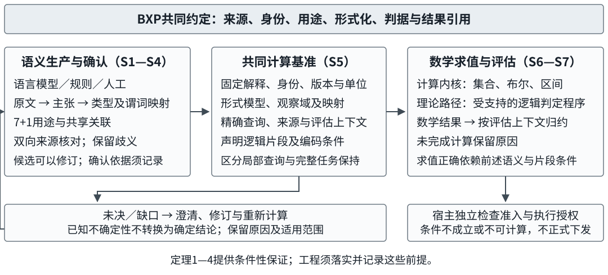
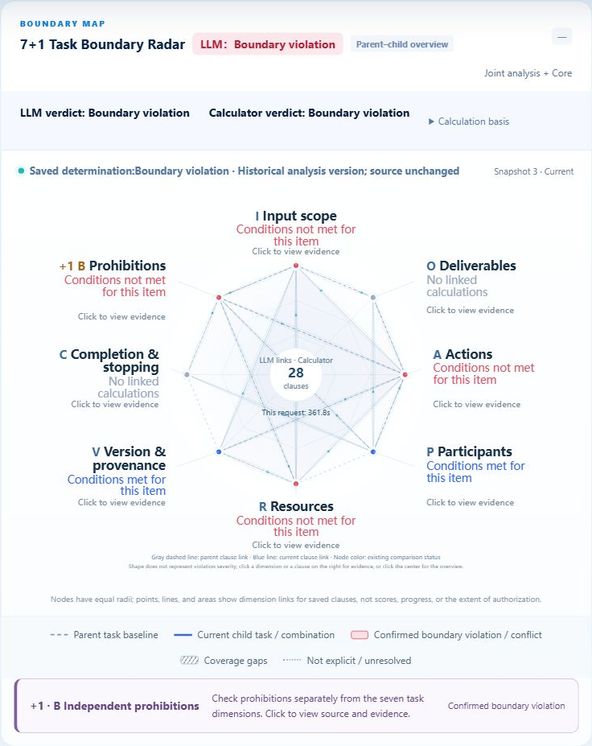
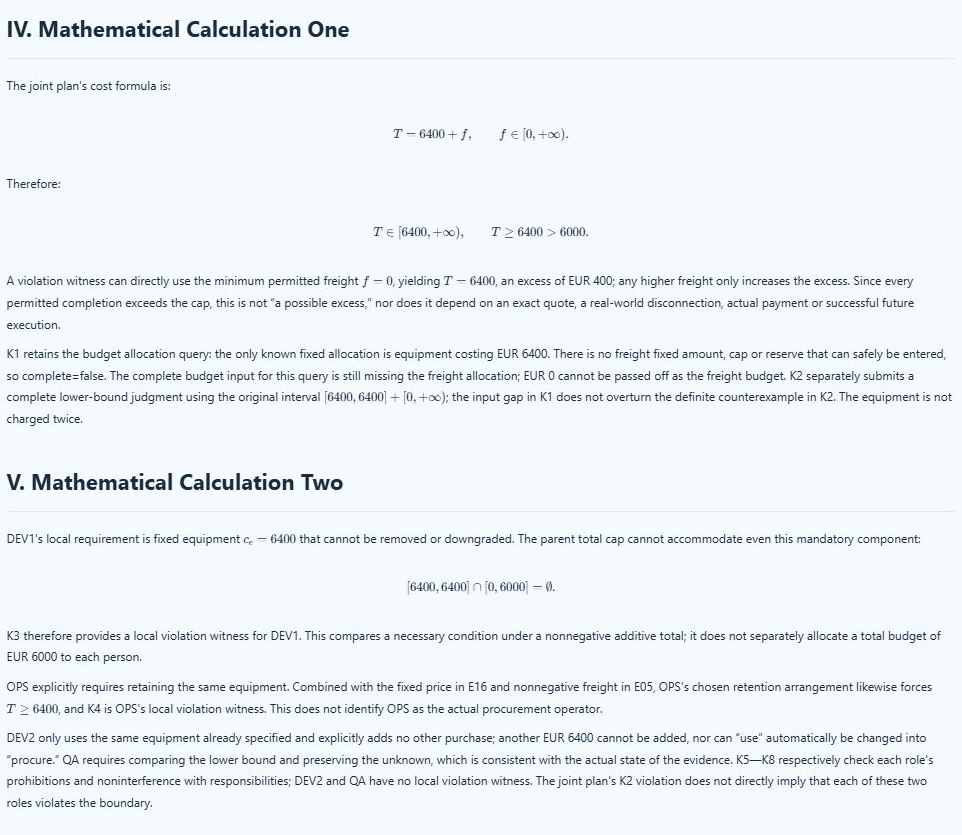
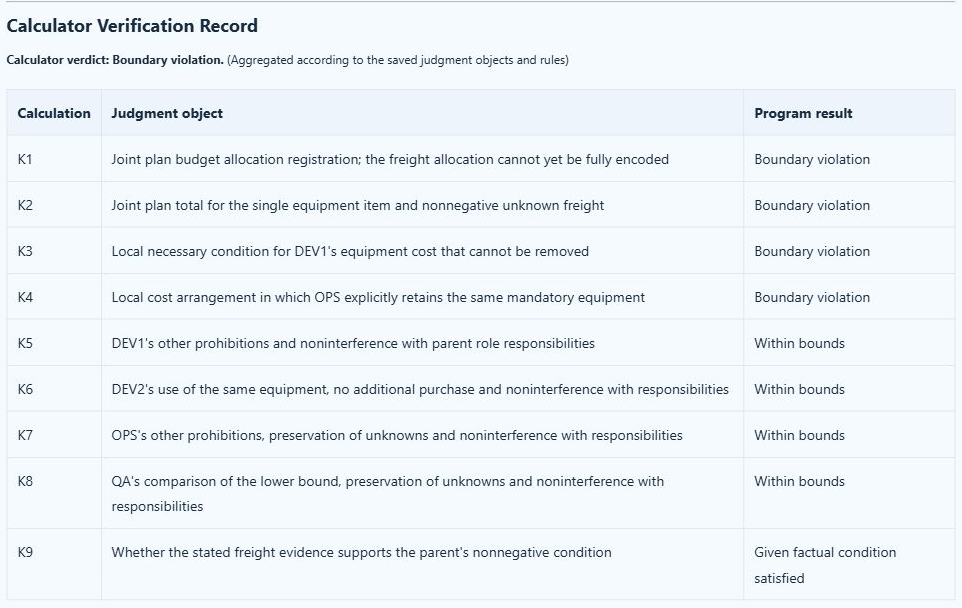

# BXP：基于7+1关联表示的人工智能任务边界判定方法

**朱卫**  
独立研究者 · joinwell52@gmail.com

统一研究稿 r23 · 2026-11-06

## 摘要

人工智能将自然语言任务分解为子任务或形成执行方案时，需要判断其动作、交付、资源及条件是否突破原任务边界。本文提出基于7+1关联表示的任务边界判定方法，并以边界分析协议（Boundary Xplain Protocol，BXP）规定共同的语义解释、形式转换、数学求值和结果复核约定。7+1组织输入、交付、动作、责任与分工、资源、版本依据、完成停止及独立禁止要求，共享结构保存同一对象、作用域、条件、顺序和交接，使主任务与子任务能够在共同数学基准上比较。在来源对应健全且完整、用途及关联覆盖、结构恢复、原子解释一致与查询编码精确等条件下，证明表示能够有效转换为与既定语义一致的形式模型，并在受支持片段内完成相容性、成员、等价及蕴含判定；进一步给出包含父环境范围、逐情境覆盖、分支激活和共享约束的分解保持判据。界痕工具实现该方法，625组用例、3219个任务节点作为测试依据。现行标注与语言模型最终答案、语言模型与计算器整体答案均为625/625一致；3469项计算另有9项差异及3项未完成。具体案例展示了单项费用未超限而共同预算超限、部分数值未知但费用下界已确定越界，以及费用提案越界与继承后规格不可满足的区别。一般性结论由形式论证承担，测试支持方法在所列任务上的实现与应用；整体答案一致不代表所有局部计算一致，也不构成任意自然语言任务的准确率保证。

**关键词：** 任务边界；7+1关联表示；BXP；形式化方法；数学判定；多智能体

## 1 引言

人工智能系统在制定计划或向多个智能体分配任务时，需要判断方案是否超出了原任务允许的范围，或遗漏了必须完成的事项。不同参与者若采用不同的对象身份、条件方向或计算依据，即使分别给出看似合理的结果，也无法共同确认方案是否满足原要求。本研究提出边界分析协议（Boundary Xplain Protocol，BXP），从任务边界的定义、判定对象和共同数学约定出发，建立语义表示、形式转换、数学判定及结果复核的方法。本文采用0.4.0-draft.2／2026-10-27-r2基线展开论证；BXP是这套方法的原理与共同约定，7+1及共享关联是将自然语言要求组织成判定对象的表示层。

该问题首先涉及判定对象：检查一次已明确的实现，与检查一份允许多种实现的方案，具有不同的量化范围。其次涉及语义保留：解析和委派可能遗漏交付义务、把建议误作操作，或忽略整体约束。例如，两个顺序执行的子任务各自满足局部时限，其合计耗时仍可能超过整个任务的期限。共同协议固定比较依据，形式方法则须明确比较哪些实现、采用什么条件及结论。

本文以数学判定作为AI任务边界检查的共同基础：自然语言用于表达要求，集合、数量、逻辑和依赖关系用于检验这些要求及其组合。本文用“任务边界”描述约束共同限定的范围：在既定解释下，所有满足任务要求的实现构成可接受实现集合。一个实现记录相关行为、交付、资源使用及其关系。给定实现是否落在该集合内，以及候选方案所允许的实现是否都落在父任务的集合内，分别形成符合性与保持性问题。两类问题可以转化为数学判定，但判定首先需要忠于原要求的形式对象。若交付义务没有进入公式，或生成与提交被绑定到不同报告，运算正确也不足以保证对原任务的判断正确。本文由此研究：哪些语义区别及关联必须保留，怎样构造相应表示，以及在什么条件下能够进行可靠、可终止且可复核的边界判定。

7+1是BXP的任务语义表示层。“7”对应输入范围（I）、交付（O）、动作（A）、责任主体与角色分工（P）、资源（R）、版本依据（V）、完成与停止（C）；“+1”是独立的禁止边界（B）。本文沿用这些名称，R的解释包含已明示的预算、期限等执行量化限制。各类组织将要接受数学判断的要求：O区分交付与生成，A区分建议内容与实际操作，R与C区分期限与完成条件，B保留独立禁令。draft.2规定完整载体还包括共享结构和来源；同一报告的生成、复核、提交及先后关系据此进入统一模型，共享结构不构成第九类视图。7+1也不意味着每个视图各自计算一次：同一条件可以涉及多个用途，一次数学查询可以联合多个视图及共享关系。例如，比较共同预算须同时确定资源数值、参与子任务、同一对象和聚合范围。

7+1据此将不同任务的要求组织为统一、可比的语义对象，同时提供分类核查责任；共享关联是完整表示的一部分。研究据此区分两个问题：真实任务中的条件能否被这套表示完整容纳，以及表示确定后能否正确计算。前者需要从原文统计覆盖和余项；后者由保真转换和判定条件回答。图一旦完整且解释明确，后端证明不依赖视图数必须为八，也不能反过来证明任意自然语言任务均被覆盖。将某个词归入一个视图，还不足以确定其真值条件或取得计算保证；第3.9节区分用途归属、解释确定及计算支持。若进一步主张分类审核相对于其他流程的收益，则须采用相同任务与数学基准作比较；这一比较不作为本文提出并论证判定方法的前提。

论文提出方法及其形式依据，工程实现该方法，实验检验具体实现。本文的用途覆盖、关联恢复和查询构造将draft.2的共同约定落实为数学条件；第2.4节给出条款对应，附录F收录同版英文全文并提供中文译本。文本识别可由语言模型、规则或人工完成。当前界痕工作台实现采用语言模型联合生成语义和操作数，传统分词或规则抽取不是该实现的必经步骤；更换生产者仍不能改变已固定的边界含义和数学判据。

政策表示、目标精化和假设／保证合同研究也涉及规范要求与上下层约束之间的关系。开放数字权利语言（ODRL）表达许可、禁止、义务及参与关系；目标精化检查子目标的一致性及对父目标的联合蕴含；合同精化区分环境假设与输出保证的变化方向。[3](https://www.w3.org/TR/2018/REC-odrl-model-20180215/)[1](https://doi.org/10.1109/ISRE.2001.948567)[2](https://arxiv.org/html/2103.13743v1) 本研究从多智能体任务协作中的越界问题出发，独立形成BXP、7+1关联表示及数学判定方法。上述文献用于对照相近问题及处理范围；第7节通过同一任务的编码和检查责任比较，明确本文方法的特点。

这一方法承担任务正式下发前的边界检查职责。调用该方法并管理任务生命周期的系统，本文称为“宿主”。BXP要求将已识别、且可能改变边界的歧义或绑定缺口保留为未决；宿主在准入条件不成立或无法计算时不得正式下发任务，业务裁决和执行授权也由宿主负责。[BXP-0001，§7—8](protocol-r14/BXP-0001.md) 这一守门机制阻止已知不确定性被转成确定结论，其价值须依据问题是否被正确识别与保留来评价。这项约定不保证所有未被识别的遗漏或误解都会被发现；表示与原文的来源对应仍须另有确认依据。

图1区分语义生产、共同计算基准和数学求值的责任。前端可以使用概率模型、确定性规则或人工判断，并允许候选反复修订；后端在固定基准和受支持片段内进行数学计算。定理1—4给出这些环节衔接时的条件性保证，工程实现承担建立、检查和记录前提的责任。



**图1 BXP共同约定下的语义生产、计算基准与数学判定责任**

图中S1—S7对应第3.1节的方法步骤。逻辑判定程序须适用于已声明的形式语言，本文实际核验的计算内核能力见第5.4节。结果及局部反例可以在修订过程中返回，但不能替代宿主的完整准入检查。

图中的宿主准入表示draft.2规定的职责。625组测试检验工作台对提交对象的边界判定，完整准入还需要覆盖、环境及版本条件；原文条件是否完整进入表示，须由来源对应的证据确认。

本文的核心贡献是提出一种有理论依据、由共同协议规范、能够实现并接受实验检验的任务边界判定方法。具体包含三个相互衔接的结果。（1）以BXP界定边界对象及共同语义和计算约定，通过7+1及共享关联将主任务要求与子任务安排组织为可比较的形式对象，形成从原文主张到数学操作数及结果复核的明确过程。（2）建立该过程的形式依据：以来源对应、UseCover、RelCover、根覆盖、恢复及精确编码证明表示到计算的条件性保证，进而给出包含沉默语义、父环境范围、分支及共享约束的越界判据，使结论能够定位到具体约束及违反方式。（3）实现界痕工具，通过有限数学实例、Core计算、定向案例及625组完整运行记录，检验方法在具体对象上的计算与应用；整体答案、3469项计算与引用诊断分别统计，逐例分类把测试结果与逻辑、数量、集合身份及依赖判据对应，形成可复核的方法检验。一般性结论由形式论证承担，案例与工具结果支持各自受测范围；原文解释的正确建立及相对效果另需对应证据。

全文沿这一依赖关系展开。第2节定义任务边界及共同约定，第3节构造表示并证明其形式性质，第4节推导多智能体任务的组合保持，第5节连接抽象协议、计算基准与实际实现，第6节报告数学及工程证据，第7节讨论相关研究、适用范围和进一步评价，第8节回答中心研究问题。一般性结论由证明承担，工程核验检验具体实现是否维持相应条件。

## 2 任务边界语义与BXP共同约定

### 2.1 从任务要求到可接受实现集合

任务边界需要同时容纳“可以做什么”“必须达到什么”和“不得发生什么”。三者不能统一为一个允许元素集合：若只检验实际交付集合是否是父允许集合的子集，空交付也会通过，从而遗漏交付义务。本文采用共同的实现空间承载这些不同类型的要求。

设 $S_T$ 为任务原文，$\theta$ 为已明确的语义解释，$\Sigma$ 记录对象身份、单位、版本、观察阶段和背景假设。这些约定确定比较中观察什么，以及哪些记录构成合法的实现；所有此类实现组成空间 $\mathcal X_\Sigma$。一个实现记录相关事件、主体与对象关系、产物状态、资源量及有限顺序。例如，交付义务应在约定到期点检查，尚未到期的执行片段不能直接视为交付遗漏。任务的形式模型采用BXP抽象记法

$$
\mathcal M_T=(E,\Sigma,Q,F,K,\mathcal R,\mathcal D,\Phi),
\qquad
\chi_T=Q\land\neg F\land K\land\Phi.
\tag{1}
$$

其中 $E$ 保存已识别的实体与产物，$Q$ 表达必需义务，$F$ 表达被禁止的行为或状态，$K$ 表达完成与停止条件，$\mathcal R,\mathcal D$ 保存角色及依赖关系，$\Phi$ 包含范围与资源等约束。谓词 $\chi_T$ 对一个实现取真，当且仅当它满足适用义务、没有发生禁止事项，并符合完成停止及其他约束。角色和依赖关系通过后文的解释函数进入这些谓词，因此其端点与方向必须与关系名称一同保留。

**定义1（任务边界）。** 给定 $\theta,\Sigma$，任务边界为

$$
\Omega_T=\{x\in\mathcal X_\Sigma:\chi_T(x)=1\}.
\tag{2}
$$

此定义将边界确定与执行方式唯一分开：一个确定的边界可以包含多个实现。$\Omega_T=\varnothing$ 表示当前要求不相容；它不构成一个可执行的安全方案。自然语言原文可以容许多个解释，因而原文不必直接确定一个 $\Omega_T$；解释未决的情形留待第4.5节处理。

**贯穿实例（环境核查）。** 采用随附材料中的ADM-001任务。本例以PM标识任务负责人，OPS标识检查执行者，QA标识报告复核者，ADMIN标识报告接收者；这些代号按原文明示分工解释。任务原文为：

> PM 负责本次系统环境核查，安排 OPS 检查测试机的操作系统、磁盘余量和服务进程。OPS 必须生成 environment-check.md，QA 复核报告后由 PM 提交给 ADMIN。整个任务须在 40 分钟内完成，不得修改系统配置。

在本例的既定解释中，$r$ 指本次生成并传递的同一报告产物版本，$t$ 为整个任务的分钟耗时，$m$ 表示实际修改系统配置。以下主张分别进入7+1用途视图，并保留相同主体、对象及作用域；事件原子均包含所述角色和对象，复核或提交还要求该报告版本当时可用：

- PM组织并安排OPS：A/P，形成 $o\land a$。
- OPS检查操作系统、磁盘余量和服务进程：I/A/P，形成 $i_1\land i_2\land i_3$。
- OPS生成报告，PM将其提交给ADMIN：O/A/P，形成 $g_r\land d_r$。
- QA复核同一报告，且复核先于提交：A/P及共享顺序关联，形成 $v_r\land(v_r\prec d_r)$。
- 整个任务在40分钟内：R，形成 $t\le40$。
- 不得修改系统配置：B，形成 $\neg m$。

以上合取即式（27）的父谓词。本例在完整阅读原文并检查相应覆盖后，确认未明示版本依据或独立完成停止规则，故V、C标为absent；若存在相关解析缺口，则不能作此标记。义务评价点另由 $\Sigma$ 明示为“整体任务结束时检查，允许的总耗时至多40分钟”，这是本例的观察约定；40分钟仍属于R，不据此生成C的完成等价式。取一个完成全部正向要求、35分钟结束且顺序正确的候选实现，若 $m=1$，其唯一失败项即“不得修改系统配置”；报告中的修改建议不使 $m$ 为真。此为规格允许的实现，非实际执行记录。第6.1—6.2节给出来源、良构域、候选及映射。

### 2.2 边界判别等价与表示充分性

判断一种表示是否充分，需要先明确它必须区分哪些任务。在同一 $\mathcal X_\Sigma$ 上，若两个任务对每个实现都给出相同的接受或拒绝结果，就称它们边界判别等价，记为

$$
T\equiv_\partial T'
\quad\Longleftrightarrow\quad
\forall x\in\mathcal X_\Sigma,\ \chi_T(x)=\chi_{T'}(x).
\tag{3}
$$

**定义2（判别充分性）。** 编码 $\mathsf E$ 对任务类 $\mathcal T$ 判别充分，当且仅当

$$
\mathsf E(T)=\mathsf E(T')\ \Longrightarrow\ T\equiv_\partial T'.
\tag{4}
$$

**命题1（判别因子化）。** 固定 $\Sigma$，设任务类 $\mathcal T$ 中每个 $\chi_T$ 均为共同实现域 $\mathcal X_\Sigma$ 上的全函数，且 $\mathsf E:\mathcal T\to Y$。式（4）成立，当且仅当存在函数 $f:\mathsf E(\mathcal T)\times\mathcal X_\Sigma\to\{0,1\}$，使 $\chi_T(x)=f(\mathsf E(T),x)$ 对所有 $T\in\mathcal T$、$x\in\mathcal X_\Sigma$ 成立。

**证明。** 若 $f$ 存在，相同编码在任一共同实现上取得相同值，故式（4）成立。反之，对任意 $e\in\mathsf E(\mathcal T)$，至少存在一个满足 $\mathsf E(T)=e$ 的任务；对每个 $x\in\mathcal X_\Sigma$，式（4）保证所有此类任务的 $\chi_T(x)$ 相同。以这个唯一真值定义 $f(e,x)$，即得到所述定义域上的全函数，并满足因子化等式。证毕。

命题不要求为 $Y\setminus\mathsf E(\mathcal T)$ 中未使用的编码赋予任务语义。若程序接口使用更大的编码域，应将这些输入判为无效对象，而不据此给出边界结论。比较观察上下文不同的任务时，须先建立共同观察域及映射，或分别使用带上下文标记的编码 $(\Sigma,\mathsf E_\Sigma(T))$；式（4）不把不同上下文中的相同字符串当作同一语义对象。

命题1是定义2的因子化表征，用于规定后续证明目标，本身不提供新的编码或算法。具体编码是否满足这一要求，以及相应函数 $f$ 是否可计算，仍须分别证明。贯穿实例给出一个直接障碍：若编码遗漏禁止修改这一项，就无法区分其余要求相同、但允许实际修改的任务。第2.3节据此确定不可忽略的语义区别，第3节再构造能够保留这些区别的表示。

### 2.3 八类语义区别与关联的必要性

本文考虑任务类 $\mathcal T_{\mathrm{fin}}$：对象与角色域有限，或已给出保持本文观察语义的有限抽象；事件过程有界；数量约束限于第3.6节的语言。任务中的模态（必须、允许或禁止）、条件方向、作用域及来源层级均有明确解释。开放类别若尚不能确定成员或给出保真的有限抽象，不进入本节的二值判定范围；相关UNKNOWN诊断须保留。表1列出分类核查需要注意的区别及见证，其中V通过解析出的规范内容影响边界。

**表1 判别见证与表示要求**

| 类别 | 两个明确要求的差别 | 区分实现 |
|---|---|---|
| I 输入范围 | 仅可检查文件a／仅可检查a和b | 检查b |
| O 交付 | 必须交付报告／必须交付报告及日志 | 仅交付报告 |
| A 动作 | 仅允许读取／允许读取和写入 | 写入同一对象 |
| P 责任主体与角色分工 | QA复核／OPS复核 | 只有OPS完成复核 |
| R 资源 | 总耗时至多40／至多30分钟 | 总耗时35分钟 |
| V 依据解析 | 明示依据v1／v2；解析后限额分别为40／30 | 总耗时35分钟；差异经解析后的R约束体现 |
| C 完成停止 | 交付是完成的必要条件／充分条件 | 已交付而尚未宣告完成 |
| B 禁止边界 | 正向要求相同，另有／没有禁止修改 | 完成交付且发生修改 |

表中“仅”显式给出封闭范围；B行不预设正向动作域已经封闭。V行说明忽略依据解析可能遗漏实际约束，不将版本名差异当作独立的行为区别：若两版本解析为相同谓词，仍可边界等价，但计算基准不同，见第5.1节。P行的差别来自明示分工，不来自岗位高低。

**命题2（信息删除的不充分性）。** 对包含表1任务对的任务类，任何使其中一对任务在删除相应语义后编码相同的表示，均不满足式（4）。

**证明。** 对每一行，表中实现使两个边界谓词取值不同，而删除后的编码相同，直接违反式（4）。证毕。

命题2要求编码保留这些能够改变判断的区别。7+1以七类任务要素组织范围、义务及执行条件，并单独保存禁止边界；其中“+1”使禁止事项在组织和核查时具有明确位置。义务满足与禁止事项未发生须分别检查，正如完成报告不能替代“不得修改配置”的要求。命题证明的是语义区别不可无条件删除，未证明字段数必须恰好为八；采用其他分类，只要完整保留同样的区别，仍可能满足式（4）。

这些视图允许重叠，不构成互斥的概念分类。B的独立位置规定禁止主张的表示与核查责任，不增加逻辑表达能力。在本文的守卫语言中，$\operatorname{Forbid}(g,p)$ 与 $\operatorname{Require}(g,\neg p)$ 都可解释为 $g\Rightarrow\neg p$；这一等价要求相同的守卫、作用域和原子解释。转换可使用该等价，表示仍保留原文的禁止模态和来源，便于检查是否遗漏或错误撤销禁令。因此，本文不以“禁止不能编码为义务”论证7+1，也不将这项局部等价推广为所有义务逻辑或ODRL规则的通用等价。

分类本身仍不足以满足式（4）。另以DEV标识开发执行者，QA标识复核者，a、b标识两个文件；设允许的主体—文件配对分别为

$$
L_1=\{(\mathrm{DEV},a),(\mathrm{QA},b)\},\qquad
L_2=\{(\mathrm{DEV},b),(\mathrm{QA},a)\}.
\tag{5}
$$

若分别只保存主体集合和文件集合，两种配对会得到相同记录，但DEV操作a只属于 $L_1$。类似地，$g\Rightarrow q$ 与 $q\Rightarrow g$ 使用相同命题，却规定相反的条件方向。因此，类别之外还须保留“谁对什么执行何种操作”、条件指向、共享对象、作用域及表达式结构。第3节将这些要求落实为关联构造，并证明该构造在明确条件下具有判别充分性。

### 2.4 共同约定与判定对象

任务原文给出要求，7+1与共享结构组织已识别语义，形式模型把它们表达为数学约束。BXP 0.4.0-draft.2区分数学求值内容与固定评估上下文下的整体边界结果，并规定结果引用及正式准入条件。[BXP-0001，§2—11](protocol-r14/BXP-0001.zh-CN.md) 表2说明协议责任与本文构造的对应。协议规定必须满足什么，本文说明这些条件怎样形成可证明的判定方法；实现是否做到，则由第5—6节的具体证据回答。

**表2 协议条款与本文构造的对应**

| 协议条款 | 论文对象 | 共同要求 | 本文的具体化 |
|---|---|---|---|
| §2、§5 | $\mathcal M_T$、$\chi_T$ | 完整载体及边界谓词 | 共同观察域与判别等价 |
| §3—5 | 八类用途、$S_G$、来源 | 共享结构及来源问责，保留身份、关系与顺序 | UseCover、RelCover、投影及恢复证明 |
| §6，OPR-001至004 | 有限布尔、算术查询 | 精确查询、编码和证据合同 | 表7支持范围及可判定性；不声称已注册完整SMT Profile |
| §2.2、§7，SEM-001/002 | 规范化与解释集合 | 固定解释范围及其充分依据，保持边界语义 | 第5.2节的健全性条件 |
| §11，CMP-001至005 | 具体实现、部分观察、规格保持 | 绑定父环境范围，区分逐情境覆盖与因果策略 | 第4节的反例判据及组合构造 |
| §6，EVA-001/002 | 数学内容与整体评估 | 精确查询固定数学问题；整体结论另依赖评估上下文 | 第5节的共同基准及结果分层 |
| §8—9，ADM-002/003 | 发布与修订 | 正式委派／精化须包含保持义务；修订重建准入绑定 | 第5.3节的发布条件 |
| §3、§7 | absent与覆盖缺口 | 覆盖问责未完成时省略聚合状态，保存归约依据及诊断 | 第3.1节的表示核查 |

方法首先回答“任务边界是否已确定、确定的边界是什么”。在解释范围、身份、作用域、相容性与规范化条件满足后，才能取得一个有明确依据的边界基准。方法随后可以回答“给定实现是否属于该边界”或“候选允许的全部实现是否保持该边界”。例如，一个明确禁止修改配置的父任务可以具有确定且相容的边界，而包含实际修改的候选仍然违反它。边界确定状态与候选符合状态不能压缩为一个布尔值。

结构有效、引文位置吻合、模型有解和原文解释正确也不互相等价。BXP的作用是固定这些条件之间的责任关系；第3节将其落实为方法步骤和证明前提，第5节再考察现有实现覆盖到了哪些条件。

## 3 7+1关联表示的构造与数学判定

### 3.1 方法过程与前提的建立

一次判定首先明确所问的问题，例如“这些要求能否同时满足”或“候选是否允许违反父要求的实现”。将所问问题记为q，完整来源记为S。参与者共同采用的类型、谓词含义、单位与版本规则组成解释合同 $\Lambda$；这里的合同指语义约定。方法还接收背景 $\Sigma$；保持查询另需候选分解及第4节的组合信息。表3的步骤依次产生关联表示、形式模型、数学查询和可复核结果。

下文将对范围、交付、行为或条件等作出的一项陈述称为“主张”，将生成候选主张的规则、模型或人员统称为“生产者”。主张的守卫是限定其何时生效的条件，例如“发现高危问题”是报告义务的触发条件。步骤之间存在证据依赖：局部信息足够时可以先计算相应查询，但整体结论仍须满足全部适用前提。

**表3 方法步骤、产物与责任**

| 步骤 | 输入与处理 | 产物 | 建立条件的责任 |
|---|---|---|---|
| S1 固定问题与依据 | 固定完整原文、版本、解释合同、观察域与查询类型 | 本次计算基准 | 来源提供方确认原文；宿主记录版本和问题范围 |
| S2 识别边界主张 | 抽取带来源的模态、对象、条件、角色、数量与作用域；区分要求和引用内容 | 候选主张及歧义记录 | 生产者提出解释；语义复核提供确认依据 |
| S3 映射与汇集 | 映射到版本化类型及谓词；分配7+1用途；连接共享实体、守卫和关系 | 关联图与7+1视图 | 生产者保留身份和关联，结构检查器检验引用与类型 |
| S4 核查表示条件 | 双向核对来源与约束，检查用途覆盖、恢复条件和未决项 | 已确认表示或问题清单 | 结构检查可自动化；语义确认须有独立于结果标签的依据 |
| S5 构造数学对象 | 应用声明转换；加入良构域、映射和组合；统一形成查询与辅助定义 | 形式模型、查询及实际操作数 | 形式化器遵守转换合同；计算内核检查算子适用条件 |
| S6 数学判定 | 求值、求解或穷举受支持查询；保存完成或未完成状态 | 结论、见证或不可满足依据 | 确定性计算组件执行数学规则 |
| S7 返回与复核 | 绑定来源、表示、模型、算子、结果及见证，支持同基准复算 | 可追溯结果 | 宿主保存记录；复核者核对来源与计算；业务决定另行作出 |

S2—S3把文本理解落实为“候选主张抽取—语义库映射—关联汇集”。方法所需的语义库包含有版本的类型、谓词解释、单位及转换规则；工程中的词项与动作框架为其提供候选识别资源，尚不能单独满足完整解释合同。例如，“复核”须保留复核关系，不能因属于同一通用动作类而变成批准；“报告中的修改建议”保留内容层，不生成实际修改事件。候选存在多个合法指代时，应保存候选及歧义，而不是按文本距离任选其一。模型、规则或人工可以承担候选生成，但最终表示都接受相同检查。第3.8节给出条目责任、版本与库外处理规则，附录A给出实际资源结构及贯穿实例的原子解释。

S4分别检查结构和语义。引用是否存在、类型和单位是否一致、所需关联能否恢复及表达式是否受支持，属于可直接执行的结构检查。来源对应则要求核对原文是否被遗漏或无据增强、建议是否被误作操作、作用范围是否改变。因此，来源复核须同时记录“每项原要求保存在哪里”和“每项约束依据什么”，不能用引文位置匹配代替语义确认。第3.5节将这两个方向形式化为完整性与健全性。

draft.2第3节规定resolved、unresolved和absent三个归约状态；覆盖问责尚未完成的部分载体省略视图聚合status，保留归约元数据和诊断。只有相应来源范围已经核对、没有相关覆盖缺口且确未提出该类要求时，才可声明absent。解析失败不等于原文未提及，省略聚合状态也不增加第四态。历史五态记录和当前工作台诊断须各按原合同解释，不能直接改名为协议符合性结果。

S5—S6另行处理数学问题。约束有共同解不证明原文解释正确；反过来，来源明确也不保证该查询属于支持的逻辑片段。方法以q选择式（15）的查询，保持问题再使用式（19）及情境覆盖检查。计算未完成时保留未完成原因；只有完整执行了相应判据，才能给出该判据所支持的结论。

守门职责落实为S4—S7之间的结论约束：影响所问边界的已知未决项不能被置信度阈值或局部通过结果消去。语义未决应保留待澄清对象；结构无效、模型矛盾和计算未完成则保留各自原因。受测工作台将未决归约为UNRESOLVED状态，须按第5.5节结合诊断解释。真实歧义下保留未决符合方法要求，本应可确定却因实现缺口未决仍属于能力限制，二者在评价中分别计数。

下文依次建立用途覆盖、结构恢复、语义保真和可判定性。来源对应是这些结果连接原任务的前提；本文未给出对任意自然语言自动建立这一前提的方法。贯穿实例中的报告身份、复核顺序及禁止范围须先得到明确解释，随后才能证明它们经过表示与形式转换仍保持相同含义。

### 3.2 关联表示的抽象构造

本节在 $\mathcal T_{\mathrm{fin}}$ 上建立用途分类、关联恢复与形式解释之间的联系。固定解释合同 $\Lambda$，其中包含共同观察语义、原子谓词解释、类型及用途规则、单位规则和版本解析规则。两个任务可以选择不同的依据版本，但版本的解释规则须共同固定，选择差异须在模型中保留。来源命题的身份、模态和关联在这一合同下解释。

令 $G$ 为有限、有类型的关联图。它包含实体、主张、表达式、关联及来源对象。表达式引用构成有向无环图；实体共享可以形成一般关联。下表规定其解释所需的最小内容。

**表4 关联对象及解释义务**

| 对象 | 数学内容 | 不得丢失的区别 |
|---|---|---|
| 实体 $e$ | 唯一身份、类型、作用域 | 同名异物、异名同物、不同版本产物 |
| 主张 $c$ | 谓词、模态、带角色论元、守卫、作用域、解释状态 | 必须／允许／禁止；当前要求／引用或内容 |
| 表达式 $z$ | 算子、有序参数、结果类型 | 与／或／非、必要／充分、数量及单位 |
| 关联 $r$ | 类型化端点与方向 | 谁复核何物、谁向谁提交、何条件约束何事件 |
| 来源 $s$ | 原文身份、精确位置、引用内容及语义层级 | 源要求与推导假设、报告内容与实际操作 |

表达式的参数采用有序元组保存。对算子节点 $z$，载荷包含算子、结果类型及 $\operatorname{args}(z)=(\operatorname{id}(v_1),\ldots,\operatorname{id}(v_k))$；等价的边表示为带位置的三元组 $(\operatorname{id}(z),j,\operatorname{id}(v_j))$，其中 $1\le j\le k$。位置属于图结构，不能仅保存无序端点集合；重复引用同一节点时，各参数位置仍分别保留。带角色的论元另保存角色名，守卫和作用域引用亦随节点保留。共享结构 $S_G$ 使用这一载荷与位置约定，八个用途视图只持有主张引用，不重建或重排参数。

以影响边界的主张为起点，递归保留它们引用的主体和对象、守卫、表达式、关系端点及来源，直到不再出现新的引用，得到闭包 $G_\partial$；这些起点称为根。纯展示信息可不进入闭包，任何影响式（2）的主张或支撑关系均须保留。闭包只收集图中已有内容；图是否完整、忠实地表达原任务，另由第3.5节的来源对应条件约束。

协议§3保持中间表示（intermediate representation，IR）的八元组定义，并将共享结构及来源纳入完整载体。本文采用以下具体编码，在八个引用视图之外显式保存共享结构；后续Project和Recover均针对该构造：

$$
\mathsf E_{7+1}(G)
=\bigl((I,O,A,P,R,V,C,B),S_G\bigr).
\tag{6}
$$

$S_G$ 是式（6）的语义组成部分，保存共享对象及有约束作用的关系根，包括顺序、交接、身份和守卫连接。“7+1”计数的是用途视图，不是所有信息的互斥分区；共享结构不是新增用途类别。提交报告涉及A、O、P，三个引用仍指向同一主张和报告；“复核后提交”可以作为共享关系根单独存在。形式化时，共享实体进入 $E$，责任关系进入 $\mathcal R$，顺序、交接和依赖进入 $\mathcal D$；其模态与守卫决定相应约束进入Q、F、K或 $\Phi$。关系容器本身不替代真值条件。RelCover检查这些有来源的关系是否完整进入可恢复表示并继续进入形式模型，不能在§5的形式化阶段补造IR未表达的事实。

每条受支持的基本边界主张须具有合法用途；共享结构保存这些用途涉及的关系及支撑对象。用途归属与关联完整性分别接受检查，不能以保存全部图节点替代前者。

式（4）比较的是编码后的语义内容，包括类型、模态、层级、守卫和关联。原文的内容摘要及位置用于追溯来源；判别函数 $f$ 须依据已经表示的语义作出判断。如果仍要求 $f$ 重新解析原文，就尚未建立表示本身的判别充分性。

### 3.3 基本语言与用途覆盖

定义 $\mathcal A_\Lambda$ 为合同支持的基本边界主张形式。每条主张均保留来源层级、模态、守卫和作用域。其基本形式按语义作用列于表5；同一主张内部若还明确承担其他用途，应同时满足对应的表示责任。

**表5 基本主张形式、用途及解释责任**

| 基本形式 | 主用途 | 对形式解释的约束 |
|---|---|---|
| 范围主张：对象域、适用操作及是否封闭 | I | 保留对象域与作用范围；只有明确封闭时才排除域外对象 |
| 产物／交付主张：产物、用途、接收关系及模态 | O | 区分必需交付与允许交付，保留产物身份和到期条件 |
| 当前操作主张：事件、主体、效果、对象及正向模态 | A | 区分要求与许可；内容引用不产生实际事件 |
| 分工主张：参与者、角色与所关联的事件 | P | 保留角色端点；复核、批准、接收采用不同谓词 |
| 数量主张：指标、比较关系、计量范围及单位 | R | 保留量纲、聚合范围与确切比较方向 |
| 依据主张：被约束对象与所引用的规则／版本 | V | 使用固定解析规则，保留选择及适用关系 |
| 完成／停止主张：触发、方向及适用义务 | C | 区分必要、充分及义务切换；免除义务不生成禁止 |
| 禁止主张：禁止事件或状态、守卫与作用域 | B | 解释为明确禁止谓词，不以正向未提及代替 |

表5规定基本主张可以采用的形式，用途由主张在任务中的语义作用确定。例如，明确包含产物和接收人的提交操作同时具有A、O、P用途；“不得超过40分钟”表达数量上限，归入R，其否定措辞不另产生一项行为禁止。禁止动作中的主体和对象仍由关联结构保存，但记录这些对象并不赋予执行许可。

**定义3（用途归属与覆盖）。** 令 $\mathcal V_8=\{I,O,A,P,R,V,C,B\}$，$U_{v,\Lambda}(c)$ 表示基本主张c满足表5中用途v的语义条件，定义

$$
\begin{aligned}
\kappa_\Lambda(c)&=\{v\in\mathcal V_8:U_{v,\Lambda}(c)\},\\
\operatorname{UseCover}_\Lambda(IR,G_\partial)
\iff{}&\forall c\in\operatorname{Base}_\Lambda(G_\partial):\\
&\Bigl[\kappa_\Lambda(c)\ne\varnothing\ \land\
\{v:\operatorname{id}(c)\in IR_v\}=\kappa_\Lambda(c)\Bigr].
\end{aligned}
\tag{7}
$$

表5的主用途保证每种支持形式至少有一个合法归属；其他归属由同一主张的明确用途决定。集合相等要求保留全部成立的用途，也排除无依据的归属。视图的多重引用不复制主张，其谓词只按共享身份解释。

复合主张由这些基本形式、合同列明的关联构造、布尔组合、守卫和有限域量词生成。关联构造限于已解释的同一性、角色端点、产物使用及有限先后等关系；守卫中的状态词项和报告中的引用词项属于其支撑表达式，不自动成为当前执行主张。它们以及组合算子的方向、参数次序和绑定作用域均保留在共享结构中。无法匹配支持形式的独立主张保持未决，不能借用一个空用途标签进入已确定模型。

用途覆盖还须与关联覆盖配合。令 $\operatorname{Rel}_\Lambda(G_\partial)$ 为闭包内有语义作用的关系记录，$\operatorname{RelRoots}_\Lambda(G_\partial)$ 为其中独立承担边界要求的关系根；关系载荷包括类型、带角色及位置的端点、方向、模态、守卫、作用域和来源。定义

$$
\begin{aligned}
\operatorname{RelCover}_\Lambda(IR,G_\partial)\iff{}&
\operatorname{RelRoots}_\Lambda(G_\partial)\subseteq\operatorname{Roots}(S_G)\\
&\land\ \forall r\in\operatorname{Rel}_\Lambda(G_\partial):\quad
\operatorname{Read}_{S_G}(\operatorname{id}(r))=\operatorname{payload}_\Lambda(r).
\end{aligned}
$$

Read须找到唯一完整记录，否则覆盖失败。这里按原身份写等式；一致重命名时使用同一身份映射比较端点。全部边界根还须进入视图引用或共享根清单，即根覆盖。独立关系根没有用途标签不等于可以删除：环境核查的c09“复核后提交”由共享根保存，删除它会违反RelCover，即使所有基本主张仍满足UseCover。原文中的关系若在形成图之前就已遗漏，则由第3.5节的来源审核检查。

**命题3（用途与关联覆盖的构造）。** 对由表5基本形式及所列关联、复合构造生成的有限、类型正确图，按合法用途生成视图引用，并保留全部关系载荷和边界根清单，可以同时满足UseCover、RelCover和根覆盖。

**证明。** 每种基本形式有表5规定的至少一个用途，逐项加入且只加入成立的用途即满足式（7）。关系记录按身份完整保存，其独立根加入共享根清单，满足RelCover。增加逻辑组合、守卫或有限量词时保留有序引用和作用域，不删除已有基本主张与关系；每个新增边界根加入相应清单。有限构造归纳给出三项覆盖。证毕。

该命题说明覆盖规则可共同实现，并不把按定义分类的事实作为表达能力创新。7+1的审核同时检查“应有的是否遗漏”与“收进来的是否有该用途”：提交不等于生成；内容中的修改建议不生成实际动作；期限归入R而不自动生成C；原文未提及不产生禁止。B的专门核查责任独立于交付是否已经满足。模态、用途和真假解释仍是不同对象，同一主张的多视图引用不能重复生成相互冲突的谓词。

若只把一个用途标签改错，而完整语义载荷和转换保持不变，UseCover会失败，边界谓词却可能不变。即使误用Require与Forbid两条规则，在守卫恒假的情境下也同为真；其他约束还可能遮蔽局部差异。因此，“归错视图必然改变最终边界”不是一般成立的命题。本文把用途合法性作为可审核表示的要求，把语义是否改变交给来源对应与数学比较判定，不让视图标签覆盖原文模态来制造必要性。

### 3.4 投影、恢复与覆盖不变量

投影操作 $\operatorname{Project}$ 将关联图组织为7+1视图。它首先保留 $G_\partial$ 中的对象身份及语义属性，包括类型、模态、参数、守卫和作用域；随后按表5及式（7）生成视图引用；最后将独立依赖、条件关联及未决主张列入共享覆盖记录。每个根均须记录保存位置和状态；基本主张检查UseCover，关系检查RelCover，全部根检查根覆盖。未决项仍作为待处理对象保留。

**表6 投影中的特殊处置**

| 对象 | 保留方式 |
|---|---|
| 报告中的引用或建议 | 保留内容层及所属产物，不生成实际执行主张 |
| 已解释的独立关联 | 保留为共享根，记录类型化端点、方向及来源 |
| 未决主张或无支持绑定 | 保留状态、候选解释与来源，等待其语义条件满足 |

恢复操作 $\operatorname{Recover}$ 从全部视图引用和保留根出发，按身份查找共享对象并递归追踪引用，重建带类型、方向及有序参数的图。若引用指向不存在的对象、同一身份有冲突定义，或某个根没有保存记录，恢复检查即失败。恢复前后须比较节点的语义属性（下文称载荷）、关联端点、参数次序及根清单；身份被一致重命名时，要求两图存在保留这些属性的一一对应，即图同构。

**引理1（构造恢复性）。** 若 $G_\partial$ 有限、引用完整、身份无冲突，且Project执行上述根覆盖和闭包保留规则，包括原样保存第3.2节的参数位置与重复引用，则

$$
\operatorname{Recover}\bigl(\operatorname{Project}(G_\partial)\bigr)
\cong G_\partial.
\tag{8}
$$

**证明。** 每个边界根由视图引用或保留根进入恢复起点。对于距任一根的最短引用距离为 $k$ 的节点，以 $k$ 归纳：距离0的根已恢复；若距离至多 $k$ 的节点已恢复，闭包保留规则保证其全部引用端点及原载荷存在且唯一，故距离 $k+1$ 的节点也被恢复。恢复按身份记录已访问节点，故有限图上的共享或关联回路不会引起无限遍历。恢复不新增节点，身份对应给出节点的一一映射。对每个表达式节点及每个位置 $j$，共享结构保存唯一的位置记录 $(\operatorname{id}(z),j,\operatorname{id}(v_j))$，恢复后第 $j$ 项仍指向对应的 $v_j$；不同位置即使引用同一节点也不合并。因此参数元组逐位置相等，非对称算子不会因端点相同而交换参数。其他类型、模态、角色、方向、守卫及作用域由原载荷保留，根清单也相同，故该一一映射保持全部所述结构，得到图同构。证毕。

引理1依赖根覆盖和载荷保留，命题3给出用途、关系与根清单的审核条件。恢复性并不要求视图数恰好为八；用途分类规定前端检查对象，结构恢复保证确认后的语义不在编码中丢失。对贯穿实例，O、A、P引用同一报告r，RelCover还须保存QA复核先于PM提交的有向要求；只保留“报告、复核、提交”三个词项不足以恢复它。

### 3.5 形式化映射与保真性

为使恢复的结构进入式（2），定义受限语言 $\mathcal L_\partial$。其原子包括有类型的事件及角色关系、有限集合隶属、同一性、有限顺序和线性数量比较；复合式使用 $\neg,\land,\lor,\Rightarrow$ 及有限域量词。完成、停止和分支条件采用这些算子组合。资源聚合可使用已给定有限项的和、min或max。

解释函数 $\llbracket\cdot\rrbracket_\Sigma$ 规定每个原子在一个实现上何时取真，转换 $\tau$ 据此将已确定图写为形式表达。记Require和Forbid分别为带守卫g的必需主张与禁止主张，All和Any分别表示全部子主张成立及至少一个子主张成立。主要转换规则为

$$
\begin{aligned}
\tau(\operatorname{Require}(g,p))&=\tau(g)\Rightarrow\tau(p),\\
\tau(\operatorname{Forbid}(g,p))&=\tau(g)\Rightarrow\neg\tau(p),\\
\tau(\operatorname{All}(c_1,\ldots,c_k))&=\bigwedge_{j=1}^{k}\tau(c_j),\\
\tau(\operatorname{Any}(c_1,\ldots,c_k))&=\bigvee_{j=1}^{k}\tau(c_j).
\end{aligned}
\tag{9}
$$

在这一构造中，解释合同固定语义库所采用的类型、原子含义和转换规则。文本抽取得到有来源的候选主张；映射须同时确定类型、论元、模态、用途和解释依据，关联汇集再形成图。只有满足上述条件的图才进入形式转换。词语相近、落入同一动作框架或语言模型给出同一标签，均不构成两个谓词具有相同解释的证明；资源条目通过Schema检查也不自动建立式（10）的来源对应。

一个被允许的动作不因“允许”而必须发生。对于明确封闭的允许域 $U$，转换的是“适用实际行为属于 $U$”的约束；对于仅声明正向许可而未封闭的域，不补造对所有其他动作的禁止。对于“不必”、否定义务及互相冲突的模态，必须先依据所声明语义合同确定其作用；没有规则的组合不进入式（9）的已支持范围。

必要条件、充分条件和当且仅当分别转换为对应方向的蕴含或等价。单位转换使用明确且精确的比例；版本依据先解析为固定的规范对象；主体、对象及作用域作为原子解释的一部分保留。贯穿实例的候选可以“生成一份含有修改建议的报告”；该主张只产生报告及内容关系，其内容子图不产生实际修改事件m。

**来源对应。** 固定任务解释 $\theta$、背景 $\Sigma$ 和合同 $\Lambda$。完整性要求既定解释中的边界主张及其守卫、作用域和组合关系均在图中保留，使图接受的实现满足原要求；健全性要求图中的约束作用均有该解释或已声明背景依据，使原要求接受的实现也被图接受。推导约束可以加入，但须为这些固定依据的逻辑后果；不能通过事后增加背景假设为新约束补造依据。该要求针对带守卫及组合位置的约束，不要求一个析取式的各分项分别成立。于是，完整性与健全性共同给出

$$
\forall x\in\mathcal X_\Sigma,\qquad
\llbracket G_\partial\rrbracket_\Sigma(x)=\chi_T(x).
\tag{10}
$$

本文将这两项语义性质合称来源对应，将核对其依据的活动称为来源审核；下文的局部来源对应指原子及其组合位置上的对应条件。它允许等价展开、共享节点和冗余推导，不要求一句原文对应一个节点。例如，原任务仅要求p，图却合取无依据的q，虽未遗漏p，仍在 $p=1,q=0$ 时错误拒绝合法实现。来源位置可供追溯，但位置匹配本身不证明来源对应成立。

整体来源对应可以分解为局部审核义务。记 $\Theta_T$ 为在既定解释 $\theta$ 下列出的有限边界表达结构，其叶项、逻辑连接及根组合逐项附原文或固定背景依据，且 $\llbracket\Theta_T\rrbracket_\Sigma=\chi_T$。它是待确认解释的显式记录，不是由算法自动获得的原文真值。审核先固定这份记录，再与候选图逐项比对，避免用候选输出反过来定义参考解释。

**引理2（局部来源对应的组合充分条件）。** 在共同 $\Sigma,\Lambda$ 下，若：（a）$\Theta_T$ 的每个原子在图中有对应表达，二者的谓词解释、角色论元、身份、单位、版本和作用域一致；（b）展开共享表达式后，二者的逻辑、模态和数量构造逐项对应，守卫方向、有序参数、量词域和绑定保持，允许一致的绑定变量重命名；（c）全部边界根，包括独立关系要求，按相同方式组合，无额外约束根，或额外根为固定依据的逻辑后果，则式（10）成立。

**证明。** 对 $\Theta_T$ 的有限表达式结构归纳。叶项由（a）在每个合法实现上取相同值。归纳假设对子项成立时，（b）中的相同运算保持复合值；有限量词在相同域及绑定下展开，守卫和模态使用相同解释。共享表达式展开不改变值。由（c），全部根以相同方式组合，故整图与 $\Theta_T$ 等值；逻辑后果作为额外合取不改变其模型。再由既定解释记录的语义得到式（10）。证毕。

S4据此分别核对原子依据、组合依据和根清单。7+1为基本主张分配核查责任，RelCover使顺序与交接等要求不因没有用途标签而逃过审核；两者均须回到 $\Theta_T$ 的来源清单确认未遗漏原要求。引理2给出逐项审核足以支持整体对应的条件，不提供自动判断局部自然语言解释正确的方法。若参考解释本身尚未确认，检查通过仍只能支持相对于该解释的结论。

**定理1（关联表示的语义保真与判别充分性）。** 固定共同解释合同 $\Lambda$，包括观察语义、原子谓词解释、单位及版本规则。对该合同下 $\mathcal T_{\mathrm{fin}}$ 中语义已确定的任务，若：（i）$G_\partial$ 与既定任务解释满足式（10），例如由引理2建立；（ii）引理1的条件成立；（iii）每种原子转换与 $\Lambda$ 中对应解释一致；（iv）复合结构采用式（9）及对应的逻辑、数量规则，则

$$
\begin{aligned}
\forall x\in\mathcal X_\Sigma,\quad
\chi_T(x)&=\llbracket G_\partial\rrbracket_\Sigma(x)\\
&=\llbracket\tau(\operatorname{Recover}(\mathsf E_{7+1}(G)))\rrbracket_\Sigma(x).
\end{aligned}
\tag{11}
$$

因此，式（6）的表示在这些条件下满足式（4）。

**证明。** 引理1先恢复保留全部语义载荷的同构图。对其表达式结构归纳。原子情形由条件（iii）成立；否定、合取、析取和蕴含由相同真值函数保持；有限量词展开为同一域上的合取或析取；数量项由相同有类型操作数及精确运算保持其值。由结构归纳，根主张的真值及其组合真值均保持；再由条件（i）及式（10），将图语义连接到 $\chi_T$，得到式（11）。若两个任务具有相同表示，在共同解释合同下得到相同形式表达及边界谓词，由式（3）判别等价。证毕。

命题2给出可能影响判定的信息区别，命题3组织用途和关联审核，引理2连接局部与整体来源对应；引理1及定理1保证已确认图经过表示和转换仍保持语义。定理1的数学结论同样适用于其他无损编码。7+1的前端审核价值与图的后端保真性质由此分开陈述，后续再给出查询可终止的条件。

### 3.6 可判定范围与中心结果

保真性回答转换前后的边界是否相同，可判定性还要求存在能够终止并给出正确结论的算法。因此，所得公式以及第4节将父约束改写到候选变量上的公式，都须属于明确支持的形式语言。本文将这样的语言子集称为逻辑片段。有限对象可编码为枚举常量，有限量词可以展开；线性整数和线性实数约束分别进入相应的无量词算术片段。[4](https://smt-lib.org/logics-all.shtml) 下文用SAT表示公式存在满足赋值，用UNSAT表示不存在满足赋值。布尔公式使用可满足性判定；包含算术约束时，可采用相应理论下的可满足性判定（satisfiability modulo theories，SMT）。表7的QF_LIA和QF_LRA分别表示无量词线性整数算术与无量词线性实数算术。

**表7 形式片段与判定范围**

| 表达对象 | 采用的片段 | 进入片段的条件 |
|---|---|---|
| 有限身份、模态、条件和集合 | 有限布尔编码／SAT | 域枚举完整，身份相等关系已确定 |
| 有限事件顺序、次数、整数预算 | QF_LIA | 无变量乘变量，界与单位已知 |
| 有理系数的连续量和预算 | QF_LRA | 采用精确数值语义，无非线性项 |
| 有限项min/max | 在线性片段中引入辅助量与析取 | 如 $z=\max(x,y)$ 等价于 $z\ge x\land z\ge y\land(z=x\lor z=y)$ |
| 有限外部情境覆盖 | 每个情境一个可满足性问题 | 情境域是事先声明的完整有限集合 |

表7分别列出整数与实数片段，不意味着可将混合类型表达式直接交给任一片段。混合算术还须固定类型、转换规则及支持该组合的算子合同；未声明时不在本表保证范围内。

**算子配置与支持范围。** draft.2的BXP-OPR-001至004规定算子语义、精确查询、证据和编码责任，§12的算子族不是封闭清单。表7给出理论支持范围，尚不是已注册或受测的完整SMT Profile。实现这些查询时须声明逻辑片段、类型与单位、辅助定义、精确版本、求解器与检查器、完成／未知／超时，以及见证和不可满足结果的复核办法。第6节实际使用有限枚举及Core运算，不虚列未运行的SMT求解器版本。

可满足查询的见证须代回完整查询及定义背景核对。不可满足结果可以由适用的证明检查器核验证明，或在完整有限域上独立重算；仅记录求解器名称和版本有助于复现，并不构成不可满足证书，不可满足核心也仍需核验。协议原文要求“machine-testable output”，没有统一规定证明格式；本文建议由算子配置明确验证等级及信任依据。未随附证明的求解器回答，应按其实际复核方式标注，不能称为已经过独立证书检查。

**观察域与辅助定义。** 下文以x兼记原观察变量的赋值及其表示的实现。在约定的有效编码下，$D_\Sigma$ 的模型恰好对应 $\mathcal X_\Sigma$ 中的合法实现，既不遗漏合法实现，也不引入伪实现。边界公式 $\varphi_T(x)$ 始终以这些观察变量为语义对象。

对min/max等有限函数项，先在原观察变量上形成完整查询，再统一引入新鲜辅助变量z。按无环依赖次序建立定义合取 $\Delta_Q(x,z)$；将查询中的函数项替换后得到 $\widehat\psi_Q(x,z)$。本文采用满足以下条件的定义扩展：

$$
\begin{aligned}
&\forall x,\quad D_\Sigma(x)\Rightarrow\exists!z\,\Delta_Q(x,z),\\
&D_\Sigma(x)\land\Delta_Q(x,z)\Rightarrow
\bigl(\widehat\psi_Q(x,z)\leftrightarrow\psi_Q(x)\bigr).
\end{aligned}
\tag{12}
$$

有限个已解释的全函数定义按依赖序逐一确定辅助值，给出第一项；逐项替换并保留逻辑连接给出第二项。求解时使用 $D_\Sigma\land\Delta_Q\land\widehat\psi_Q$。等价或蕴含查询涉及两任务时，将双方所需定义合并为共同背景，避免变量捕获；否定和异或仅作用于替换后的边界条件，不能作用于其附带定义约束。若采用其他仅保可满足性的编码，须在完整查询形成后使用，不能把其输出当作可任意取否定的边界谓词。

例如，$\chi_T(t)=\top$ 与 $\chi_{T'}(t)=[\max(t,0)\ge0]$ 对所有实数t等价。令

$$
\begin{aligned}
D_{\max}(t,z)&=(z\ge t)\land(z\ge0)\land(z=t\lor z=0),\\
\Psi_{\mathrm{wrong}}(t,z)&=\neg\bigl(D_{\max}(t,z)\land(z\ge0)\bigr),\\
\Psi_{\mathrm{correct}}(t,z)&=D_{\max}(t,z)\land\neg(z\ge0).
\end{aligned}
\tag{13}
$$

错误查询接受 $t=0,z=-1$，但该赋值违反辅助定义；正确查询由 $D_{\max}\Rightarrow z\ge0$ 直接判为不可满足。辅助变量上的伪赋值因此不会成为任务边界反例。

对于有限域，枚举给出终止的判定过程；对于所列线性片段，可采用其判定程序。无界事件、任意自然语言谓词、非线性资源组合以及未限定的量词交替均不在该结论内。特别是第4节的 $\forall e\exists u$ 不能因内部约束线性而直接称为无量词SMT问题；外部域无限时需要另外声明且证明适用的量词处理方法。

**定理2（关联边界表示的有效形式化与可判定性）。** 固定解释合同 $\Lambda$。设有限关联表示满足定理1的全部条件；身份与引用可有效查找，原子和单位转换具有终止的明确规则。再设 $D_\Sigma$ 可有效表达并精确表征合法实现域，所得公式使用表7的受支持原语，且下述各查询按式（12）的定义扩展统一编码后属于所声明的可判定片段。则存在有效构造 $\operatorname{Compile}_\Lambda$，生成公式 $\varphi_T$，满足

$$
\begin{aligned}
\operatorname{Compile}_\Lambda(IR)&=\varphi_T,\\
\forall x\in\mathcal X_\Sigma,\qquad
\varphi_T(x)&=\chi_T(x).
\end{aligned}
\tag{14}
$$

在相同观察空间及合同下，可以终止判定模型相容性、给定有效编码实现的成员关系，以及两任务的边界等价与蕴含。对应查询为

$$
\begin{aligned}
\operatorname{Consistent}(T)&\iff\operatorname{SAT}(D_\Sigma\land\varphi_T),\\
x\in\Omega_T&\iff D_\Sigma(x)\land\varphi_T(x),\\
T\equiv_\partial T'&\iff\operatorname{UNSAT}
\bigl(D_\Sigma\land(\varphi_T\mathbin{\oplus}\varphi_{T'})\bigr),\\
\Omega_T\subseteq\Omega_{T'}&\iff\operatorname{UNSAT}
\bigl(D_\Sigma\land\varphi_T\land\neg\varphi_{T'}\bigr).
\end{aligned}
\tag{15}
$$

其中 $\oplus$ 表示异或。上述公式均先在原观察变量上解释；实际求解应用式（12）的共同定义背景。成员查询可直接有效求值，或固定原观察赋值、保留全部辅助定义后作可满足性判定。

**证明。** 有限图及有效查找使Project和Recover终止，引理1保证得到相同的边界承载结构。按终止的原子规则及有限表达式结构执行 $\tau$，生成原观察变量上的有限公式。来源对应给出 $\chi_T=\llbracket G_\partial\rrbracket_\Sigma$，定理1再给出图到公式的等价，故式（14）成立。由 $D_\Sigma$ 的精确性及各查询的集合定义得到式（15）。若引入辅助变量，式（12）保证每个合法观察赋值具有定义扩展，且扩展前后的查询真值相同；反之，任一满足编码查询的赋值投影到x后仍为原查询的模型。因此两种查询等可满足，包含否定和异或的情形也成立。编码有限且有效，编码后的查询属于可判定片段，故其判定程序终止。证毕。

**说明。** 定理2建立既定语义到可计算边界的条件性连接。它依赖来源对应、关联恢复、保真转换、精确实现域与受支持查询。本文的7+1构造另以用途、关联及根覆盖规定可审核表示的合法性，这些分类检查不能代替原子解释和来源对应。定理不提供判定任意原文解释正确的自动方法。第3.7节分析语义前提被违反的后果，第4节加入分解关系和候选框架语义。

第4节情境覆盖的有限求解路径要求事先声明完整的有限情境集合。将每个情境代入后，执行变量留作可满足性查询的自由常量；所得查询仍须属于表7的QF片段。若用有限划分抽象无限情境域，还须证明同一单元内各具体情境具有相同的可实现性与反例存在性判定，且单元编码保持这两项结果，才能逐单元求解；仅选一个代表情境不足以覆盖该单元。该要求限定具体形式化路径，不将任意含量词任务自动归入无量词求解。

有限抽象若被采用，须随查询提供划分及其依据：各单元覆盖完整承诺域且互不重叠，单元内上述两项判定保持，抽象反例可还原为合法具体见证。本文没有给出自动构造这种划分的算法，也未以工程实验验证无限情境的抽象求解。建立满足这些义务的抽象，是对无限情境扩展时尚需解决的问题；现有有限情境结论不依赖该扩展。

连续外部参数尤其不能仅以区间端点代替。取 $E_{\mathrm{adm}}=[0,1]$、$u\in\{0,1\}$、$H(e,u)\equiv(u=e)$，两个端点均有执行选择，$e=1/2$ 却没有，故端点检查不能证明 $\forall e\exists u:H(e,u)$。这类未经证明的连续情境抽象不属于本文有限归约的保证范围。线性实数的带量词问题可以另行采用量词消去，但那是不同的算法与实现责任；超出QF路径不等于该理论一般不可判定。连续数量作为固定情境内的执行变量仍可进入QF_LRA，这与对连续外部情境作全称覆盖是两个问题。

### 3.7 语义误差、保持变换与计算代价

来源对应的两个方向具有不同的错误后果。在共同观察域上，设 $\chi=p\land q$。遗漏顶层合取要求q，得到 $\widehat\chi=p$，则 $\Omega_\chi\subseteq\Omega_{\widehat\chi}$；加入没有依据的r，得到 $\widetilde\chi=\chi\land r$，则 $\Omega_{\widetilde\chi}\subseteq\Omega_\chi$。两项包含由合取的真值条件直接成立；当相应差集非空时，前者可能错误接受本应拒绝的实现，后者可能错误拒绝本应接受的实现。它们不是相同的“抽取不准”。

上述方向限定于固定域上的顶层合取变换。删除否定、析取或条件内部的片段可能产生其他效果；改变背景假设或观察域也不属于这一推导。工程错误分析因而需要记录被改变主张的模态、作用位置和作用域，不能只数缺失关键词。

定理1也给出检验实现的依据。对主体、对象及全部引用作一致的一一重命名，并使原子解释按同一对应变化，边界判断应保持；使用逻辑等价的表达式替换，结论也应保持。纯展示信息未进入边界闭包时，其变化不影响边界。反转条件方向、替换交接产物或删除禁止则可能改变判断。语义相同是否还得到相同结果摘要，取决于第5.2节规定的规范化规则。

定理2证明查询在声明片段内可终止，不给出统一的低计算成本保证。若有限布尔编码包含n个独立命题，直接枚举最坏需要考察 $2^n$ 个赋值；共享图能够避免重复存储子表达式，但不据此消除求解复杂性。工程评价需同时记录任务节点数、主张和关系规模、查询规模、求值耗时及未完成状态。第6节分别报告固定操作数核验与历史耗时，避免将可判定性当作运行时间承诺。

### 3.8 语义库条目、版本与库外处理

语义库使解释合同具有可检查的内容，但需要区分词项识别、语义解释和形式转换。词项识别记录哪些表达可能指向同一动作框架；语义解释规定一个有类型、有角色论元的原子在什么实现上取真；形式转换规定该原子怎样进入受支持查询。第一层的命中仅产生候选，不能替代后两层。例如，现有通用资源将“检查”和“审核”收在PROCESS类中；该分类不能把检查、复核与批准合并成一个边界谓词。

能够支撑定理1的原子条目至少须确定：稳定标识与版本、有序的角色—类型签名、适用作用域、在共同实现域上的真值条件、向形式语言的转换，以及定义依据。模态、守卫和原文层级随具体主张保存，不由动作名称预设；同一动作可以被要求、许可或禁止。识别别名与例句只用于提出映射候选。数量条目还须明确量纲、单位和转换规则；版本条目须规定引用如何解析。条目字段分布在一个文件或多个依赖对象中均可，关键是能够共同恢复上述含义。

附录A.1将这一责任实例化为环境核查中的Inspect、Generate、Review、Submit和ModifyConfig。检查执行者、报告复核者、提交人与接收者均由原文固定，同一报告版本贯穿生成、复核及提交；Review不蕴含批准，Generate不蕴含已提交。它们分别解释为第6.1节的检查、生成、复核、交付及实际修改原子。将“必须提交”转换为 $d_r$，需要提交主张及其论元已有依据；仅检索到“提交”一词不足以完成转换。这个实例给出既定解释的具体内容，来源与该解释是否对应仍由式（10）约束。

语义资源通过结构化条目保存领域词义、角色签名、单位及规则，并以版本和内容摘要固定。领域资源与组织约定只能为解释提供依据；岗位、名称和资源加载不自行建立业务权限。实验保留每例实际采用的资源身份，不能仅因名称相同就认定两个解释合同相同。完整解释合同还须明确原子谓词的真值条件与转换规则；结构校验只负责条目、类型及引用一致性。

库外处理按缺口对查询的影响确定。影响边界的动作没有对应解释、论元类型不明、指代存在多个候选或单位规则缺失时，保存原文、候选和缺口原因，不把缺失谓词解释为假，也不从近义词补造限制。语义未决与算子不支持分别记录；独立的局部必要条件可以继续检查，但其结论须限于该项，不能替代整体确定。第5.5节规定受测状态的解释；采用BXP draft.2准入约定的宿主，应阻止这些缺口所影响的正式任务放行，本文未验证该草案的完整宿主网关。

本方法不允许生产者在一次判定中静默注册新含义并沿用原计算基准。库的初建和扩充从声明任务范围出发：整理带来源的表达与区别，提出类型、角色签名及真值条件，给出转换和反例，再检查结构、依赖及受影响的来源对应。语义责任方依据原文或明示领域约定确认解释；无法确认的条目保留为候选。获确认的变更形成新版本和摘要，涉及它的任务重新映射、形式化与求值，旧结论保留旧基准身份。此为扩充必须满足的条件；现有包校验和装配只落实其中的结构与版本检查，尚不构成通用自动建库、语义审定或运行时自动迁移方法。

### 3.9 约束归属与判定的支持边界

用途覆盖是在声明语言上的构造性质，真实任务的表示覆盖则需要从原文逐条件核对。对一个条件，须分别回答它承担什么用途、按什么解释取真，以及该解释能否进入受支持查询。前一问题有答案，不推出后两项成立。以下情形说明这三层责任如何区分，不作为已经测得的真实任务覆盖结果。

**时序窗口。** 对固定身份的有限事件，诸如“复核后5至10分钟内提交”可以由R保存量化窗口、共享结构保存复核与提交的端点及方向，并以 $5\le t_{\mathrm{submit}}-t_{\mathrm{review}}\le10$ 表达；单位、时钟及事件存在条件须已确定。只有原文另行规定完成或停止时才增加C用途。无界过程上的反复响应或复杂时序算子没有在本文给出转换，不能因标成C或关联而视为已支持。

**质量及度量。** “交付报告且误差至多0.01”涉及O中的产物要求、R中的量化比较及二者的共享身份。该比较需要明确误差函数、测量对象、参照值和适用范围；若它还决定何时宣告完成，才同时承担C用途。“达到高质量”若没有可确认的解释，不能由系统自行补一个阈值。即使某次测量数值已给定，数学比较也只对该测量语义有效，不证明度量本身充分反映质量。

**认知状态。** “已阅读记录”或“已确认收到”在原文明示为可观察事件时，可以保留动作、参与者及对象关系；“知晓”“相信”不能直接改写为这些事件。当前观察域和语言没有给出一般知识、信念及其嵌套的语义。若任务确实要求这种认知性质，相关主张保留来源和缺口，不能以P标签或一个无解释的布尔变量消除问题。

**概率约束。** “失败概率不超过1%”可以识别为量化限制，但计算它需要事件、样本空间、概率模型和条件化规则。本文没有给出这些对象的通用构造及概率约束编译；将“概率”当作普通数值变量只得到形式上的不等式，不能建立其与任务风险的对应。语言模型对解析结果的置信度也不是这里的任务失败概率。

**动态角色及权限。** 角色变化需要在P及共享结构中保留主体、有效时段、事件与权限来源；明确引用的规则版本另由V记录。对有限、已声明的分配与时段，相关关系可以进入有限事件模型，但须逐项确认角色变化的语义。岗位名称或新任角色本身不授予权限。无界角色演化、未声明的继承或撤权规则，均不由当前构造补全。

这些条件若解释不明，应保留语义未决；若含义明确而缺少当前语言、转换或算子支持，应保留表示或计算缺口。已有来源不能被删除，也不能把缺口解释为假或不可满足；受测状态仍按第5.5节结合原因解释。第7.5节和附录E据此分别统计可表示、解释未决、无法表示及待审条件。共享关联容纳独立顺序和交接要求，但“有地方保存”仍不等于“所有真实任务均已覆盖”或“当前实现均可计算”。

## 4 多智能体任务分解的边界保持

BXP draft.2第11节区分具体实现、部分观察和候选规格，并规定环境范围、逐情境覆盖及保持关系。本节在共同语义下构造候选实现集合、激活守卫和组合约束，推导反例与局部—组合判据。保持、未保证和必然违反对应协议的关系层结果；数学定义与证明说明这些结果在何种前提下成立。

### 4.1 带外部情境和分支的保持关系

在定理2的条件下，单个任务的边界可以进行数学判定。应用到任务分解时，还须区分外部情境 $e$ 与执行选择 $u$：前者是任务必须面对的输入或事件，后者是候选可以选择的实现方式。例如，检查中是否发现高危问题属于外部情境，如何组织报告和交接属于执行选择。令 $E_{\mathrm{req}}$ 为父任务在本次比较范围要求覆盖的环境，$E_{\mathrm{adm}}$ 为候选承诺处理的非空环境集合。按BXP-CMP-004，委派／精化比较必须先绑定父环境的来源、版本及适用守卫，并在共同环境域或保义映射下建立 $E_{\mathrm{req}}\subseteq E_{\mathrm{adm}}$。候选不得自行缩小父环境后取得保持结论。式（18）判定固定承诺域上的关系保持；对父任务的完整声明还包含上述环境范围前提。

**实现与规格。** 对作用域及记录完整性已确定的具体实现x，检查的是 $x\in\Omega_p$；禁止动作交集为空，只表明该实现没有被列出的禁止动作。协议§11的交集式本身不规定“自然语言没写的动作都不会发生”。不完整日志也不能据缺失记录证明未发生。候选规格则描述多个可能实现；其中的未提及变量须由另外声明的框架语义处理。

**候选未提及内容的语义。** 比较前须固定候选是自足规格、完整行动清单，还是继承父约束的细化。本文默认自足规格的开放语义：未提及的观察变量不因此取假，也不自动继承父要求；候选谓词保留这些变量的合法取值。封闭清单只有在来源明确声明穷尽及相应框架约束时，才排除未列行为。继承模式则将明确继承的父项 $I_p$ 并入候选 $C\land I_p$，保留继承来源并检查相容性与情境覆盖。三种模式形成不同的比较对象，不能根据计算结果事后切换。未确定采用哪一种模式时，应先保留解释未决。

开放默认也是draft.2中BXP-CMP-002的明示比较规则，不是对所有自然语言省略意图的断言。一次比较须记录模式、作用域、原文或合同依据、加入的框架／继承项，以及确认者或尚待确认的状态；该记录与来源及合同版本共同绑定。原文未声明穷尽性或继承时，不据沉默补造这两项。如果多个有依据的解释仍未解决，应保留各自结果及分歧，不能靠默认规则宣布原意已经确定。

以环境核查为例，令W表示式（28）中已完成检查、生成、复核、提交及总耗时35分钟的正向部分，m表示实际修改配置。第6.2节的GOOD原文明示“不实际修改系统配置”，故其否定项有直接来源；本段另外考察只写W而省略该声明的候选。共同观察域同时容许 $m=0,1$；在满足W的实现上，父要求等价于 $\neg m$。候选只写W时，开放语义下有见证 $W\land m$，说明该规格尚不足以保证父禁令；这不等于某次实际执行已经修改了配置。若来源明确给出“清单之外不执行其他动作”，相应框架项 $\neg m$ 可以排除该见证；若明示继承禁令，比较对象同样成为 $W\land\neg m$，但不能据此说候选原文自行重述了禁令。候选明示 $W\land m$ 时，再继承 $\neg m$ 会导致无解，不能作为保持通过。这里不要求变量全部定值：例如耗时限定在 $[0,40]$ 已足以满足40分钟上限。

候选分解 $\Pi$ 包含协调者及若干子任务。以 $u_i$ 记录第i个子任务的执行选择，$a_i$ 表示该子任务是否激活，$\chi_i$ 表达激活时须履行的要求；$Z_i$ 规定未激活分支的事件和资源贡献为空或零。$D_{\mathrm{ctx}}$ 给出当前上下文和实现的良构条件，$\Gamma_\Pi$ 保存跨任务的组合关系。由此得到组合谓词为

$$
\begin{aligned}
H_\Pi(e,u)={}&D_{\mathrm{ctx}}(e,u)\land\Gamma_\Pi(e,u)\\
&\land\bigwedge_i(a_i(e,u)\Rightarrow\chi_i(e,u_i))\\
&\land\bigwedge_i(\neg a_i(e,u)\Rightarrow Z_i(e,u_i)).
\end{aligned}
\tag{16}
$$

$\Gamma_\Pi$ 明确分支选择、交接及共享约束。互斥且必须二选一时，它包含 $(a_1\lor a_2)\land\neg(a_1\land a_2)$；若允许无分支激活，则不能擅自增加覆盖选择。$Z_i$ 仅清零分支贡献，不把其他分支或外部已存在的共享报告强制设为不存在。例如，两个分支分别要求交付 $q_1,q_2$ 时，式（16）要求的是 $(a_1\Rightarrow q_1)\land(a_2\Rightarrow q_2)$，不是无守卫的 $q_1\land q_2$。

组合前先对各分支的局部变量作一致重命名；只有声明为共享的变量才使用共同身份。随后区分分支导出的事件／资源贡献与私有中间值。未激活分支可以保留未约束的私有值，但须满足观察中立条件：两赋值若仅在未激活分支的私有值上不同，而情境、激活模式、共享对象、导出贡献及激活分支变量均相同，则 $H_\Pi$ 的真值相同；当它们满足 $H_\Pi$ 时，$\rho_e$ 的结果也相同。影响后续分支、共享约束或父任务观察的值不属于可隐藏的私有值。

一种满足该条件的构造是为每个贡献 $c_i$ 定义 $\bar c_i=\operatorname{ite}(a_i,c_i,0_i)$，其中 $0_i$ 为相应类型的空事件、空集合或零量；组合约束和观察映射只读取导出值 $\bar c_i$，私有要求保留在激活守卫内。外部或其他分支的对象另有身份和贡献。例如，$a_i=0$ 时，私有布尔值 $b_i$ 可取1；若错误地以 $m=b_i$ 表示实际修改，就会产生伪反例，而 $m=a_i\land b_i$ 始终为0。因而 $Z_i$ 不必固定每个局部变量，却必须与组合约束及观察映射一起消除未激活私有值的可观察影响。该条件属于映射保留观察语义的构造要求，不由求解器自动保证。

父任务与候选分解可能采用不同变量。例如，候选记录各阶段耗时，父任务观察总耗时。映射 $\rho(e,u)=(e,\rho_e(u))$ 将候选实现改写为父任务所观察的形式，并保留同一外部情境。在固定e下，候选实现集合为 $\Omega_\Pi(e)=\{u:H_\Pi(e,u)\}$，父任务接受集合为 $\Omega_p(e)=\{x:\chi_p(e,x)\}$；下文将这类固定情境下的集合称为纤维。

映射还须满足合法域条件：对每个待比较情境，$\rho_e:\mathcal X_{\Pi,e}\to\mathcal X_{p,e}$ 在所检查的候选实现上有定义，并将其映入同一情境下父任务的合法观察域。其中，$C_E(e)$精确表达$e\in E_{\mathrm{adm}}$。采用约束编码时，须建立 $C_E(e)\land H_\Pi(e,u)\Rightarrow D_{\Sigma_p}(e,\rho_e(u))$；未建立这一条件，不能仅因父任务谓词取真就认定保持。定义4—5及定理3—4均在此合法域条件下使用。

**定义4（固定情境保持）。** 对已固定情境 $e$ 和可实现父要求，

$$
\operatorname{Preserve}_e(\Pi,p)
\iff \Omega_\Pi(e)\ne\varnothing
\ \land\ \rho_e(\Omega_\Pi(e))\subseteq\Omega_p(e).
\tag{17}
$$

**定义5（承诺情境上的保持）。** 对明示的 $E_{\mathrm{adm}}$，

$$
\begin{aligned}
\operatorname{Preserve}_{E_{\mathrm{adm}}}(\Pi,p)
\iff{}&\bigl[\forall e\in E_{\mathrm{adm}},\ \exists u:H_\Pi(e,u)\bigr]\\
&\land\bigl[\forall e\in E_{\mathrm{adm}},\forall u,\
H_\Pi(e,u)\Rightarrow\chi_p(e,\rho_e(u))\bigr].
\end{aligned}
\tag{18}
$$

第一项是情境覆盖，第二项是边界包含。父要求如果在某个承诺情境中本身无解，应先报告父模型不可实现；不能把问题转移为候选的通过。内部执行选择可以合理收窄，式（18）不要求保留父任务的全部执行方式。

**反例1（仅有非空包含仍不足）。** 设 $g$ 为外部发生的高危发现，$q$ 为报告动作，父约束为 $g\Rightarrow q$，$E_{\mathrm{adm}}=\{0,1\}$。候选增加 $\neg g$，得到非空集合 $\{(0,0),(0,1)\}$，它是父集合 $\{(0,0),(0,1),(1,1)\}$ 的子集，却在 $g=1$ 时没有实现。故忽略外部情境的非空包含不能推出式（18）。情境覆盖要求与假设／保证精化中不得通过加强环境假设减轻保证的要求一致。[2](https://arxiv.org/html/2103.13743v1)

式（18）只建立声明情境下的关系可实现性与包含性。BXP-CMP-005进一步区分逐情境存在解与运行中的因果可实现性：逐情境见证不能让较早动作使用尚未观察到的未来信息。若声明或发布政策要求因果能力，还须固定决策时点、可用信息和能力合同，并提供策略存在性依据。例如，每个未来比特e分别可取u=e，不代表在观察e之前能选择一个统一的u。本文不从式（18）推出该策略保证。

### 4.2 总体判定过程与正确性

边界保持判定先核对来源对应与关联覆盖，再通过 $\rho$ 对齐父子任务中的对象和观察量。分支与共享关系必须明确，全部父约束都须进入待检查公式。将 $\rho$ 代入父谓词，得到在候选变量上表达的父要求，称为父谓词的拉回；它仍须属于受支持片段。随后检查父模型及候选可实现性、承诺情境覆盖，并求解反例公式

$$
\Psi(e,u)=H_\Pi(e,u)\land\neg\chi_p(e,\rho_e(u)).
\tag{19}
$$

**定理3（保持的反例判据）。** 在定理2及上述映射、片段条件成立，候选沉默语义已固定并具有来源依据，父要求与声明上下文的来源对应已确认，且委派／精化比较已经建立 $E_{\mathrm{req}}\subseteq E_{\mathrm{adm}}$ 时：（a）固定 $e$ 的式（17）成立，当且仅当 $H_\Pi(e,\cdot)$ 可满足且 $\Psi(e,\cdot)$ 不可满足；（b）有限非空 $E_{\mathrm{adm}}$ 上的式（18）成立，当且仅当每个候选纤维可满足且 $\bigvee_{e\in E_{\mathrm{adm}}}\Psi(e,u)$ 不可满足。

**证明。** 固定情境下，$\Psi$ 可满足等价于存在 $u\in\Omega_\Pi(e)$，使 $\rho_e(u)\notin\Omega_p(e)$，即包含关系不成立。另行要求候选非空，恰好得到式（17）。对有限情境逐一应用该等价关系，再对所有情境合取非空性、析取反例存在性，得到（b）。证毕。

定理3（b）的实现可显式枚举 $E_{\mathrm{adm}}=\{e_1,\ldots,e_m\}$，依次求解 $\operatorname{SAT}(H_\Pi(e_j,u))$ 和 $\operatorname{SAT}(\Psi(e_j,u))$，要求前一类全部可满足、后一类全部不可满足。在第3.6节的片段条件下，这至多是2m个无量词子查询；各情境可有不同的执行见证，不要求同一个u应对全部情境。有限析取也可合成一次反例查询。对无限域的有限抽象，只有在上述保持条件得到证明后才可采用同样过程。

该判据采用既有的逻辑蕴含反例方法；本文的表示和映射条件决定了它是否在检验原任务的边界。一个可满足反例足以否定保持，但尚不能区分候选有些实现越界，还是全部实现越界。为此，在父模型可实现、候选语义已定、每个承诺情境均有实现且查询完成的前提下，令 $C_E(e)$ 精确表达 $e\in E_{\mathrm{adm}}$，分别构造违反与符合查询：

$$
\begin{aligned}
\Psi^-(e,u)&=C_E(e)\land H_\Pi(e,u)\land\neg\chi_p(e,\rho_e(u)),\\
\Psi^+(e,u)&=C_E(e)\land H_\Pi(e,u)\land\chi_p(e,\rho_e(u)).
\end{aligned}
$$

- **保持：** $\Psi^-$ 不可满足。结合已确认的情境覆盖，得到式（18）。
- **未保证：** $\Psi^-$ 与 $\Psi^+$ 均可满足。候选既允许越界实现，也允许符合实现；这是已算出的混合情况，不是语义未决。
- **必然违反：** $\Psi^-$ 可满足而 $\Psi^+$ 不可满足。候选在全部承诺情境中允许的每个实现均违反父边界。

候选的每个合法实现恰好满足父谓词或其否定。情境覆盖和非空承诺域保证至少存在一个实现，故两查询不可能同时不可满足，上述三种结果互斥且穷尽。这个分类对整个承诺域作汇总，不代替逐情境的覆盖检查；不同情境可分别得到不同的局部分类。候选无解、情境覆盖失败、父要求不可实现、语义未决及计算未完成均另行报告，不纳入这三个结果。有限情境可逐一代入两个查询，满足第3.6节条件时仍可终止判定。

贯穿实例中，候选只要求W而对m开放时，$W\land\neg m$ 与 $W\land m$ 分别提供符合和违反见证，故结果为未保证；要求 $W\land\neg m$ 时保持；明示 $W\land m$ 时必然违反。再同时加入 $\neg m$ 则候选无解，不是保持。第6.2节的BAD明示实际修改，属于第三种情形；结果标签须结合候选可实现性和见证解释，不能仅凭VIOLATED标签认定“必然违反”。

### 4.3 映射与组合分解的充分条件

一个已经选定的映射仍可能错误地隐藏行为。本文将 $\rho$ 限定为声明合同内的身份对应、有限关系映射和受支持聚合。文件别名必须有明确同一性依据；中间报告通过生成、使用及交付关系对齐；被父允许域或禁止谓词观察的候选动作必须出现在映射覆盖记录中。候选新增的修改行为不能仅因父主张中没有该动作实例而作为“内部细节”删除。只有已证明不影响任何父谓词及资源贡献的细节才可隐藏。

对这些映射还必须检查公式闭合性：

$$
D_{\mathrm{ctx}},\ \Gamma_\Pi,\ a_i\Rightarrow\chi_i,\
\neg a_i\Rightarrow Z_i,\ \chi_p\circ\rho
\ \in\mathcal L_{\mathrm{supported}}.
\tag{20}
$$

映射中的聚合如果引入变量乘积或不受限量词，不能沿用原来的线性判定保证。对同一文件身份或操作效果的未决映射，应保留多个解释或未决状态。

局部检查与组合检查的划分必须覆盖全部父要求。为此，只将 $\chi_p\circ\rho$ 最外层的合取拆成各项，保留每项内部的逻辑结构。记录每项实际引用的变量集合，即变量支持集：只涉及一个子任务局部变量的项归入 $L_i$；跨任务关系、共享量、联合交付、分支关系及纯环境项归入组合项 $G$；常量项也保留。每条父主张都记录其对应检查项，不能因无法分配到单一子任务而被删除。由此构造

$$
\chi_p\circ\rho\ \equiv\ \left(\bigwedge_i L_i\right)\land G.
\tag{21}
$$

该构造保留跨任务耦合，不保证可以独立分布式求解。例如，父项 $A_1\lor(B_2\land t<30)$ 同时引用两个任务，应整体放入 $G$；不能分别要求 $A_1$ 和 $B_2\land t<30$。只有这一父项时，可取 $L_1=L_2=\top$，而 $G$ 就是原项。任意受支持公式至少可以整体保留为一个组合项；顶层合取拆分只是保守组织检查的办法，不保证得到非平凡的局部项，也不保证降低求解成本。

**定理4（顶层合取的组合检查判据）。** 在定理3的解释、来源及映射前提下，候选沉默语义保持同一合同或显式声明，采用上述构造，固定承诺情境集合 $E_{\mathrm{adm}}$，且该集合上的候选相容及情境覆盖已经成立。令 $C_E(e)$ 表示 $e\in E_{\mathrm{adm}}$，要求该范围约束及以下查询属于支持片段，则式（18）的边界保持等价于

$$
\begin{aligned}
&\forall i,\quad\operatorname{UNSAT}(C_E\land H_\Pi\land\neg L_i),\\
&\operatorname{UNSAT}(C_E\land H_\Pi\land\neg G).
\end{aligned}
\tag{22}
$$

**证明。** 构造只对顶层合取做结合及重排，不改变任何项内部的析取、蕴含和量词，且覆盖记录保证无遗漏，故式（21）成立。对其否定应用德摩根律，并保留情境约束，$C_E\land\Psi$ 等价于各 $C_E\land H_\Pi\land\neg L_i$ 与 $C_E\land H_\Pi\land\neg G$ 的析取。该析取不可满足当且仅当各项均不可满足，再由定义5及逐情境的反例等价关系得结论。证毕。

情境限定不可省略。取 $E_{\mathrm{adm}}=\{0\}$、$e\in\{0,1\}$、$H_\Pi=\top$、$\chi_p=\neg e$，在承诺情境内保持成立；去掉 $C_E$ 后，$e=1$ 却使反例公式可满足。有限情境也可以逐个检查，从而与式（22）一致。

式（22）虽然分别检查各项，仍使用承诺情境内的完整候选上下文 $C_E\land H_\Pi$。若只检查孤立子任务 $\chi_i\Rightarrow L_i$，在相应条件下可得到更强的充分条件，却不能代替等价的组合判据。共享预算说明了其中的区别：两个子任务各消耗60，都低于父总额100，合计120仍构成反例。在环境核查实例中，整体40分钟期限和同一报告的跨角色交接也须进入组合检查。

**推论1（层级传递）。** 若相邻两层的整体规格在同一承诺情境集上分别满足式（18），后一比较中的中间层父规格恰为前一比较中的完整候选规格，映射保持情境身份且复合仍属于支持合同，则复合映射下保持关系传递。中间规格的同一性包括组合约束、分支激活、未激活贡献及继承／封闭约定，不能仅以同一任务名称代替。

**证明。** 固定任意情境，下层映射的像属于中间层完整候选的实现集合；由该集合在上一比较中的包含关系，再映射后属于最上层父集合。最下层的非空性由其覆盖条件给出。对所有承诺情境成立，得到式（18）。证毕。此结论针对各层整体组合，不以每条委派边孤立通过替代整层组合检查。

### 4.4 允许、义务及过程约束的统一实例化

定理3对不同约束给出同一类反例问题，但其操作数的方向不同。表8列出常用实例；有限集合及数值必须先满足身份、单位和封闭性条件。各见证公式均限制在承诺情境及相应良构实现域内。

**表8 由反例判据导出的检查规则**

| 约束 | 保持所需关系 | 违反见证 |
|---|---|---|
| 封闭允许范围 | 候选实际范围 $S_c\subseteq U_p$ | $S_c\setminus U_p$ 中的元素 |
| 明示禁止 | 候选实际行为不满足禁止谓词 | $H_\Pi\land F_p$ 的赋值 |
| 必需交付 | 候选保证的交付覆盖父必需交付 | $H_\Pi\land\neg Q_p$ 的赋值 |
| 完成的必要条件 $d\Rightarrow r$ | 完成时满足r | $d\land\neg r$ |
| 完成的充分条件 $r\Rightarrow d$ | r成立时不能继续否认完成 | $r\land\neg d$ |
| 共享资源限额 | 聚合量不超过父限额 | 超限总量及各项贡献 |
| 交接／顺序 | 对应产物与前后关系得到保持 | 缺少所需产物或逆序赋值 |

以交付为例，若父要求 $D_p=\{\mathrm{report},\mathrm{logs}\}$，候选仅保证report，则缺口为 $D_p\setminus D_c$。写成 $D_c\subseteq D_p$ 只说明候选没有超出一个允许域，无法证明必需义务；空集合反例直接暴露这一方向错误。这一差别来自义务谓词的逻辑角色，而非交付槽位的名称。

资源聚合由任务结构给出：串行耗时为和，并行完工时间在相同起点及已声明依赖下可为max；共享费用仍可能求和。独立区间 $[40,60]$ 与 $[30,50]$ 的和为 $[70,110]$，但若两个取值受相关约束，端点和未必可达，应保留联合公式求见证。使用min/max不免除组合结构的来源要求。

完成与异常停止同样需要带守卫义务。考虑以下**独立构造的有限过程要求**：正常情况下先检查、在终点交付；检查时发现高危情况则立即停止检查，免除正常交付，并在终点报告高危情况。“免除正常交付”在此例中是明确规则，不从“停止”一词推断。

设过程长为4，每个步骤记录一个事件集合，允许报告与交付同时发生。本例共同过程条件固定第1步发生检查，高危检测若发生则位于第2步；正常轨迹可为“检查、空集、空集、交付”，异常轨迹可为“检查、发现高危、停止、报告”。令 $h$ 表示高危情境，$d,r$ 分别表示第4步的正常交付及高危报告，则

$$
\begin{aligned}
Q&=(\neg h\Rightarrow d)\land(h\Rightarrow r),\\
K&=h\Rightarrow
\left[\operatorname{StopAt}(3)\land
\bigwedge_{k=3}^{4}\neg\operatorname{InspectAt}(k)\right].
\end{aligned}
\tag{23}
$$

式（23）仅列正常与异常分支的交付及停止约束；它与共同过程条件合取才构成本例模型。例如，检查存在性由 $W_{\mathrm{proc}}=\operatorname{InspectAt}(1)$ 固定，相关完整条件为 $W_{\mathrm{proc}}\land Q\land K$；没有检查而仅交付的轨迹不满足该条件。

本例把“立即”定义为高危检测后的下一个离散步骤，停止范围只包括检查。异常轨迹的第4步既可以仅含高危报告，也可以同时包含高危报告与已有正常报告的自愿交付；两者均满足式（23）。增加正常交付禁止会错误排除后一种实现，恢复无条件正常交付义务则会错误排除前一种实现。两种强化均没有来源依据。有限模型给出了本例中“立即”的含义，真实时间延迟须另行规定。

### 4.5 未决解释能够支持的结论

设 $\mathcal E_{\mathrm{int}}$ 为声明范围内有来源依据的解释集合。对每个解释先应用相同的表示与判据。只有范围覆盖依据明确、相关解释都已处理且得到同一结论时，才能在该范围内提升结论。若两个解释分别允许和禁止同一候选，则整体保持未决，不能按多数票或最高概率确定边界。

信息不完整仍可支持某些稳健违反。一个共同见证要求存在同一实现 $u$，对所有相关解释都保持可实现且违反父约束；“每个解释各有某个不同反例”不是这个命题。例如，在所有允许补全中，某已知步骤实际耗时均为70，父总上限为60，且所有适用聚合量均不小于该步骤，则无论其余非负贡献如何补全，都有总量大于60。这由下界不等式证明，不由有限抽样证明。相反，已知部分未超限无法推出整体保持。

### 4.6 委派、反例定位与候选修订

多智能体委派的检查对象是任务规格及其组合。在环境核查案例中，负责人向检查者和复核者分配工作，各子任务只承担被分配的局部要求；共同交付、共享预算和跨任务顺序保留在 $\Gamma_\Pi$ 及组合检查项中。定理4的覆盖记录据此检查每项父要求由哪个查询承担。缺少对应查询表示检查尚不完整，不能得出没有违反的结论。

本方法在四个时点调用：委派前检查要求分配；交接前核对共享对象、版本和顺序；候选集合形成后检查共同资源及分支；候选修订后重新检查受影响的完整组合。对应的问题分别是义务遗漏、关联丢失、共享限制被局部化和条件处理错误。一次实际运行的成员判断另需运行事实；仅检查候选规格时，结论止于候选允许实现的保持关系。

给定一个可实现且覆盖承诺情境的候选，若式（19）有解，满足该式的赋值就给出一个违反见证。结果须同时指出它涉及的父主张、候选主张、映射及操作数，使参与者能够依据具体冲突修订方案。修订过程为：

1. 固定父基准和候选版本，检查候选相容性与情境覆盖。
2. 求反例并保留其作用的父约束、候选约束及组合关系。
3. 由参与者修订候选或补充解释依据；若父要求本身改变，建立新的父基准。
4. 对新版本重新进行来源、形式化及组合检查，保留此前失败与新结论。

第6.2节给出环境核查的形式化演示。违反候选（材料记为BAD）完成报告和顺序要求，总耗时35分钟，并明示实际修改配置；见证因此指向禁止修改的主张c11。将该动作改为报告中的建议，并在修正候选GOOD中明示不实际修改配置，再检查完整组合。这展示了判据对定位与修订的作用；方法不保证任意修订过程均能终止或最终得到保持候选。语义未决时，结果先返回待确认对象及不同解释的影响。

因此，应用评价需要两种完成标准：一是有充分依据地发现问题并完成新候选复核，二是在不能确定身份、情境或支持范围时正确保留问题。第6节将数学演示、工作台记录和实际工具调用分别标明，避免将脚本中的角色名称当作已经运行的自主多智能体系统。

## 5 BXP计算基准与方法实现

### 5.1 数学求值、整体评估与共同基准

定理2的查询依赖明确的解释、观察域、形式模型和算子。draft.2进一步要求数学求值与整体边界评估分开：相同的数学答案未必对应相同的来源覆盖和边界确定状态。写出已选解释 $\theta$ 及完整载体 $\mathcal C=(IR_{7+1},S_G,\mathrm{Prov})$ 后，处理链为

$$
S,\theta\ \longrightarrow\ \mathcal C
\ \longrightarrow\ \mathcal M
\ \xrightarrow{O_v,Q_{\mathrm{eval}}}\ \mathcal E
\ \xrightarrow{\operatorname{Assess}_{\Theta}}\ \mathcal B.
\tag{24}
$$

这里 $Q_{\mathrm{eval}}$ 固定本次精确查询的操作数、参数、观察域、依赖及必需性；$\mathcal E$ 记录完成状态、数学结论和见证。评估上下文 $\Theta$ 另固定解释范围、覆盖依据、相关性、证据及归约政策，整体结果 $\mathcal B$ 据此形成。一次SAT答案只能证明该查询有解，不能单独证明原文已解释完整或全部候选语义相同。

本次计算基准 $J$ 保存来源、解释合同、完整载体、形式模型、观察域、Profile、算子、精确查询及评估上下文的身份与版本。父子比较再绑定父任务、候选、沉默语义、组合关系、观察映射、$E_{\mathrm{req}}$、$E_{\mathrm{adm}}$及范围依据。这样的共同基准使求值方知道计算了什么，评估方知道该计算能够支持什么结论。

共同基准同一性强于边界等价。来源或版本改变但约束等价时，数学接受集合可能相同，旧准入绑定仍不能沿用。式（6）的 $S_G$ 是draft.2完整载体中共享结构的一种具体编码：投影保留身份、有序参数和关系，形式化将这些内容映射到 $\mathcal R,\mathcal D$ 及边界谓词。其他编码只要满足相同覆盖与恢复责任，也可接受本文的判据。

主张、形式项、查询和见证保持连续引用。贯穿实例中的违反见证须同时指向“不得修改系统配置”的来源、实际修改变量m及保留该变量的映射。结果引用既保存给定操作数的计算依据，也保存来源及评估范围，不能用计算摘要替代来源对应证明。

### 5.2 语义唯一、规范唯一与解释范围

同一边界可以用不同公式或数据结构表示。因此，判断解释是否得到同一边界，与判断规范化后的对象是否相同，是两个问题。设 $\mathcal E_{\mathrm{int}}$ 为第4.5节中声明的解释集合，$\Omega_\iota$ 为其中解释 $\iota$ 确定的边界。语义唯一性是

$$
\forall\iota,\iota'\in\mathcal E_{\mathrm{int}},\quad\Omega_\iota=\Omega_{\iota'}.
\tag{25}
$$

draft.2的BXP-SEM-002要求规范化保持边界语义。设规范化为 $N_v$，其健全性保证不会把不同边界合并为同一规范对象，因此

$$
N_v(\mathcal M_\iota)=N_v(\mathcal M_{\iota'})
\quad\Longrightarrow\quad\Omega_\iota=\Omega_{\iota'}.
\tag{26}
$$

反向蕴含需要规范化对该语言完备。$p$ 与 $p\land(p\lor q)$在所有布尔赋值上等价；未实现吸收律的结构规范化可以得到不同对象。故规范对象不同不能单独证明边界不同。受支持的等价性查询可另行证明语义相同；Profile须声明适用语言、规则版本及语义保持依据，并区分式（26）的健全性和反向完备性。

对显式有限的解释集合，可用定理2逐对检查共同观察域上的边界等价，从而判定式（25）。这一结论相对于已声明集合成立；没有解释覆盖依据时，不能推广到原文的全部可能解释。判别充分性只要求相同表示不掩盖边界差异；反过来把所有等价边界合并成同一表示，需要额外的规范化完备性。

BXP-SEM-001要求每项determined结论声明解释范围、该范围对来源及上下文的覆盖和充分依据。式（25）支持已声明解释集内的边界一致；候选一致本身不能证明范围充分，也不能为得到唯一结果丢弃有来源的备选解释。受支持的无歧义语法、可问责来源审核或权威澄清可以提供范围依据，但不能替代仍保留候选之间的等价性验证。模型有效、身份与作用域已确定、约束相容及规范边界唯一等条件还须分别满足。JSON规范化方案（JCS）固定序列化及属性排序，不提供逻辑等价判定。[5](https://www.rfc-editor.org/rfc/rfc8785.html)

其余状态也分别对应明确的理论障碍：invalid表示未形成有效的协议对象；inconsistent表示已有足够确定的约束证明无共同实现；underdetermined表示身份、范围或解释未决足以改变边界。状态判断的对象是所提交的任务边界，不能与“某候选是否违反已确定父边界”混成同一个真假值。

解释范围本身还需依据。受限语法的完整解析、必要身份及模态的确认、原文边界命题覆盖，可以支持关于一个明确解释域的结论；人工列举两个候选并得到相同结果，只支持这两个候选。本文要求来源记录能够指出结论相对于哪一个解释范围、依据何种覆盖或确认而成立。没有这种依据时，不从“所有已试候选一致”推广为原文边界已经唯一。

### 5.3 结果一致性与正式委派的发布条件

**命题4（共同合同下的一致复核）。** 若两个求值方使用同一完整基准 $J$，包括相同精确查询和评估上下文，并正确实现同一确定性求值、规范化、诊断归约及见证选择合同，则正常完成时产生相同规范结果。

**证明。** 相同输入经同一验证与原子操作得到相同中间值；同一组合及归约函数得到相同状态和发现；规范化与见证选择相同，故结果相同。证毕。

该命题分别对应BXP-EVA-001的数学内容一致性与BXP-EVA-002的整体评估一致性。求解器允许任选有效见证时，可满足性答案相同不要求见证字节相同；字节级复核需要共同见证选择规则。内容摘要核对对象身份，不证明自然语言解释正确。对不可满足结果，证据合同须区分可检查证明、可信求解器重放及尚未检查；仅记录求解器版本不是不可满足证书。

BXP-ADM-002要求，以父边界的委派或精化形式正式发布任务时，ReleaseConditions必须包含声明的父边界保持义务。对该适用范围，可写为

$$
\operatorname{ReleaseConditions}_{\mathrm{cmp}}
=\operatorname{ReleaseConditions}_{\mathrm{base}}
\land [E_{\mathrm{req}}\subseteq E_{\mathrm{adm}}]
\land\operatorname{Preserve}_{E_{\mathrm{adm}}}(\Pi,p).
$$

比较绑定父任务、候选、沉默语义、组合、映射及环境合同。“未保证”表示存在违反实现，保持条件为假；“必然违反”、候选无解和覆盖失败同样不能满足该义务。解释未决、算子不支持或求解未完成，则尚未建立所需结论，按保守拒绝准入原则处理。因果策略证据只在相应声明或发布政策要求时附加；具体且观察充分的实现检查不承担候选规格的全情境证明责任。

补充有来源的继承或穷尽声明后，应生成新版本并重新判定，不能事后添加限制以获得通过。draft.2的澄清与修订要求由宿主组织有权确认者响应，保留旧输入及结论，并重新核对受影响的基准。该规范不保证协作终止，也不授权自动放松业务要求。保持、determined及admitted均不等于业务批准或执行许可。

### 5.4 界痕中的方法实现

界痕（BoundaryXP）以JOINT_SEVEN_STEP_V1实现上述过程：语言模型在同一任务树及语义资源上下文中联合形成7+1、来源、关联、形式操作数、未知项及分析，Core依照声明算子计算，汇总器依据实际数学结果和评估合同组织结论。S2—S5是方法责任，不要求分成四次模型调用或先运行传统分词程序。数学求值的对象是操作数，标注答案及LLM答案用于结果对照。

**表9 方法步骤与实现责任**

| 方法责任 | 实现对象 | 应检查的内容 |
|---|---|---|
| S1来源与版本 | 完整任务树、节点版本、资源及程序身份 | 固定本次比较依据 |
| S2—S5语义组织与形式化 | 7+1主张、共享关联、引用、操作数及未知项 | 保留原文模态、对象及作用范围 |
| S6数学求值 | 共享Core与声明算子 | 根据固定输入形成结果及见证 |
| S7整体评估 | 类型化问题、相关性与归约规则 | 区分规格、事实及父要求相容性 |
| 来源诊断 | 引文、位置、节点、类型与单位 | 暴露缺口；引用匹配不替代语义对应 |
| 结果复核 | 查询、见证、来源及版本绑定 | 可定位并复算同一数学对象 |

第6节使用625组当前项目和完整保存结果，逐例保留实际运行与计算身份。全树比较表示全部节点及已形成关联进入比较入口，不能仅由节点齐全推出原文语义完整、全局可实现或环境已覆盖。语义未决、数值缺失、父约束矛盾及引用错误必须分别解释。[测试材料](evidence-r18/README.md)提供具体输入与结果，第6.8节展开其中一个英文案例。

论文采用BXP 0.4.0-draft.2作为方法规范。625份保存生成结果记录的协议资源均为BXP 0.4.0-draft.1中文文本，摘要为`15c13c5c…bd7e50`。本稿形式论证以draft.2为规范基线；这些实验用于分析保存对象中的方法应用与计算结果，不构成draft.2完整工作流的符合性评价，也不据资源名称推断程序完整实现了draft.1。业务裁决与执行授权保持外部责任。

保存项目的请求模型配置均为gpt-6.1-sol，推理配置为583份medium、42份xhigh；生成指标中的actual_model均为null，故本文不将请求名称写成已独立确认的服务端模型身份。所供配置及回执未记录温度，不事后补写为0。生成结果涉及10种提示摘要；历史整理曾找回9种同摘要原件，另21份结果对应的原件未找到。生产提示模板由工程实现单独管理，不随论文附件分发；附件保留全部摘要、请求配置及历史查找状态。逐例版本、配置与记录范围见[运行资源索引](evidence-r22/run-resources.json)和[提示索引](evidence-r22/prompt-index.json)。固定操作数复算与历史自然语言生成过程的重建范围分别说明。

### 5.5 判定结果与复核

BXP规定边界语义及数学责任，界痕保存本次输入、查询和结果身份。复核者据此确定比较对象、检查操作数与来源，并重算相同数学问题。本文625组测试取自界痕工作台，接口形式不改变边界谓词及判据。

结果解释应同时读取问题类型、数学状态、原因及见证。可实现候选具有违反见证时，能够定位越界；候选或父约束自身无解时，应报告相容性问题，不能编造一个实际越界行为。局部查询通过只确认该项，整体判断还取决于联合约束及未完成检查。工具调用成功、计算完成、边界确定和执行授权分别承担不同责任。

## 6 数学核验与工程评价

第2—4节给出表示与判定的形式依据。本节以625组用例作为测试依据，先用数学实例展示原文怎样形成约束，再按数学机制、跨视图关联及未知信息的作用分析实际结果。第6.1—6.3节给出构造和有限核验；第6.4节报告总体结果；第6.5—6.7节分类分析；第6.8节展示真实界面中的完整计算链。全部分类对应到具体案例、查询与来源，避免只用整体答案一致率代替方法分析。

### 6.1 关联表示与形式化的数学实例

本节展开第2.1节的ADM-001环境核查实例，逐项核对来源、7+1关联和形式谓词。沿用同一解释：PM组织并安排工作，OPS检查三个对象并生成报告，QA复核该报告，PM随后提交给ADMIN；“整个任务”给出共同期限，“不得修改”作用于任务内的配置修改。表10将前文的主张落实到固定来源身份；精确来源位置见[材料说明](repro-v0.8/README.md)。

**表10 从原文主张到关联视图及形式项**

| 主张 | 来源内容 | 关联与视图 | 形式项 |
|---|---|---|---|
| c01—c02 | PM负责、安排OPS | 组织与安排，A/P | $o\land a$ |
| c03—c05 | 检查操作系统、磁盘余量、服务进程 | OPS分别作用于三个对象，I/A/P | $i_1\land i_2\land i_3$ |
| c06 | OPS必须生成报告 | 生成事件及报告实体r，O/A/P | $g_r$ |
| c07 | QA复核报告 | QA、复核、同一r，A/P | $v_r$ |
| c08 | PM提交给ADMIN | PM、r、ADMIN，O/A/P | $d_r$ |
| c09 | 复核后提交 | c07先于c08，共享关联 | $v_r\prec d_r$ |
| c10 | 整个任务40分钟内 | 共同计量范围，R | $t\le40$ |
| c11 | 不得修改系统配置 | 配置实体及修改效果，B | $\neg m$ |

报告r在生成、复核和提交中保持同一身份，QA仅承担原文明示的复核职责。原文没有指定依据版本，也没有给出独立的完成或异常停止规则，故V、C保持未明示（absent）。共同期限进入R；配置作为禁止修改的对象保存，不据此增加操作配置的许可。

本例将r解释为本次任务所生成并传递的同一报告产物版本，文件路径是其名称而非充分的身份条件；同路径的其他内容版本不能自动替代r。复核或提交r要求该版本在相应使用时刻可用；这是依据本例的产物身份、生成／使用解释所作的背景推导，须与来源对应一起审核，不能仅因写入实现域就免于语义核对。若其他任务允许使用既有报告，就不能据此补造生成义务。原文明示的“复核后提交”另作为c09进入任务约束。本例的有限观察域只含本次待核查的一次正式提交，记其事件身份为 $d^*$；$v^*$ 为对同一报告版本的对应复核事件，$v_r\prec d_r$ 表示二者均存在且 $t(v^*)<t(d^*)$。事件身份在求值前固定，不能在多次提交后选择一个有利的后续提交来掩盖提前提交。这个单次交付模型不包含草稿流转。若另一任务的原文要求每次正式提交均先复核，则应对其正式提交集合 $D_r$ 使用 $\forall s\in D_r,\ \exists v\in V_r:t(v)<t(s)$，其中 $V_r$ 只含同一版本的有效复核事件；有限事件域可展开为有限合取和析取。是否约束每次提交，应由原文及解释合同确定。本例没有增加“三项检查必须全部完成才可开始生成报告”等顺序，也没有把所有工作限定为串行；下一节的串行方式由候选自行选择。

在这些已解释原子及良构实现域上，任务谓词如下；下文比较时将该任务记为父任务p：

$$
\chi_p=o\land a\land i_1\land i_2\land i_3
\land g_r\land v_r\land d_r
\land(v_r\prec d_r)\land(t\le40)\land\neg m.
\tag{27}
$$

每个事件原子包括表10中的主体、对象及可用性条件。例如 $v_r$ 表示QA对可用版本r的复核，不能以OPS对另一版本的复核使它为真。同一性、角色和良构条件共同固定这一谓词的解释。

### 6.2 同一父任务下的保持、违反及未决

为考察同一任务下的不同判定，本文构造保持候选[GOOD](repro-v0.8/sources/good.md)与违反候选[BAD](repro-v0.8/sources/bad.md)。两者均安排检查者用20分钟检查并生成报告，复核者用10分钟复核，负责人用5分钟提交；组织安排计入上述阶段，候选自行选择串行执行。GOOD在报告中提出配置修改建议，并明示不实际修改系统配置；BAD还安排实际修改配置。以下计算针对这些候选允许的实现，不是已发生的执行记录。为明确否定项的来源，GOOD的任务正文完整列示如下：

> PM 负责并安排 OPS 检查测试机的操作系统、磁盘余量和服务进程；OPS 生成 environment-check.md，在报告内容中提出修改系统配置的建议，不实际修改系统配置。QA 复核同一报告后，PM 将该报告提交给 ADMIN。OPS 阶段20分钟，QA 阶段10分钟，PM 提交阶段5分钟，三阶段依次完成，组织与安排包含在所列阶段内。本分解的实际操作限定为上述步骤。

“不实际修改系统配置”直接对应候选来源记录中的good:delta，末句进一步限定本分解实际操作的范围。因此式（28）的$\neg m$来自候选的明示限制，不由“提出修改建议”推得，也不依赖未声明的父禁令继承。[候选来源记录](repro-v0.8/candidate-source-ledger.json)保存原文位置及摘要。

在上述良构域内，令 $\boldsymbol b=(o,a,i_1,i_2,i_3,g_r,v_r,d_r)$，这些变量以及 $m,n,\sigma$ 均取布尔值。n表示报告内容中有修改建议，m表示实际配置修改；$\sigma=1$ 表示复核先于提交。候选的三个阶段时长 $t_O,t_Q,t_P$ 取非负有理数，串行阶段覆盖整个任务，组织安排计入相应阶段。定义共同部分

$$
\begin{aligned}
F_0&=o\land a\land i_1\land i_2\land i_3
\land g_r\land v_r\land d_r,\\
W&=F_0\land n\land\sigma
\land(t_O=20)\land(t_Q=10)\land(t_P=5),\\
H_{\mathrm{GOOD}}&=W\land\neg m,\qquad
H_{\mathrm{BAD}}=W\land m.
\end{aligned}
\tag{28}
$$

这两个规格均非空。例如，OPS阶段为0至20分钟，报告版本r在该阶段结束时可用；QA在20至30分钟复核r，PM在30至35分钟提交r。令 $\boldsymbol b$ 的各分量及 $n,\sigma$ 为真，分别令m为假或真，即得到两个良构实现。生成与三项检查在OPS阶段内部的进一步顺序不作额外要求。

映射保持表10的事件及角色身份，并定义

$$
\rho(\boldsymbol b,\sigma,n,m,t_O,t_Q,t_P)
=(\boldsymbol b,\sigma,t=t_O+t_Q+t_P,m).
\tag{29}
$$

内容变量n被省略，因为父谓词不观察建议内容；实际修改变量m保留。对共同部分W，父要求的组织、安排、检查、报告、顺序和期限均成立，且总耗时为35。因此，在上述域内有

$$
\begin{aligned}
H_{\mathrm{GOOD}}\land\neg(\chi_p\circ\rho)&\equiv\bot,\\
H_{\mathrm{BAD}}\land\neg(\chi_p\circ\rho)&\equiv H_{\mathrm{BAD}}.
\end{aligned}
\tag{30}
$$

BAD的一个完整父空间见证是：组织、安排、三项检查、生成、复核和提交均为真，顺序正确，总耗时35，$m=1$。其唯一不满足的父合取项为c11。这个定位由实际修改主张、配置身份、映射和 $\neg m$ 共同得到；若把报告建议错误提升为执行事件，GOOD会产生伪反例；若把BAD的新增动作投影掉，则违反会被遗漏。

正文中的时长模型允许非负有理数；随附程序只枚举其中一个声明的有限取值域。具体为上述11个二值维度，另令$t_O=20$、$t_Q\in\{10,20\}$、$t_P=5$，故原始笛卡尔积有$2^{11}\times1\times2\times1=4096$个赋值。该数量包含尚未满足候选约束的赋值；共同候选部分筛得4行，GOOD和BAD各保留1行。变量、程序字段及筛选口径见附录C，不将有限枚举当作有理数全域的穷举；式（30）的结论仍由前述代入和逻辑推导建立。

另外两种规格展示了不同的理论障碍。“随后修改它”保留报告／配置两种指代解释，分别产生保持和违反，因而该解释范围内仍未决；同时要求实际修改且不发生任何配置修改的规格无解，因而不相容。二者不能因缺少一个被接受的全局反例而归为保持。

### 6.3 有限核验的覆盖范围

有限核验检查运算结果、关联与模态的影响、见证的来源定位，以及前提未满足时的状态处理。其作用是核对理论构造的具体实例。

原有16项核验覆盖动作差集、禁止交集、交付缺口、配对损失、共享预算、串并行耗时、布尔条件、完成方向、交接、非空性及路径顺序。补充实例覆盖环境范围、互斥激活、停止语义、用途归属及规范化与逻辑等价；输入与结果集中在附录C所列材料中。

其中，交换A/B视图标签而不改共享图，恢复性仍可成立，用途覆盖却失败，说明两项条件具有独立的检查责任。停止实例同时核对仅报告和报告加自愿交付，情境实例比较限定与未限定承诺域的查询。这些针对性反例分别检验语义强化与适用范围错误，而非以枚举数量支撑理论充分性。

这些实例还分别展示了必要条件被省略时的后果：反例1中候选排除了必须处理的情境；无激活守卫时互斥分支被要求同时履行；式（23）的义务切换防止把免除交付误写为禁止交付；等价式实例则区分规范对象不同与边界不同。它们提供具体反例，不能替代定理1—4的一般证明。

以上实例均采用明确声明的人工解释。下文在同一方法框架内考察保存记录、固定语义运算和工具连接，使表示条件与实现责任分别接受检查。

### 6.4 625组完整运行的整体与计算项对照

截至2026年11月5日，按625个原项目的当前保存结果逐例统计，共3219个任务节点，最新评估作业均为COMPLETED。626个项目中的一个I40D2-001固定复核历史项目被排除，复测替换原项目当前结果而不增加用例数。各批采用现行标注，包含已授权的修订；运行跨多个历史构建，不能将本次统计写成625次B-334新模型运行。此次整理读取保存结果，没有新增模型或Core计算。[统计报告及逐例材料](evidence-r18/README.md)保留清单、原项目和完整保存结果。

**表11 625组当前保存结果的整体答案对照**

| 批次 | 用例数 | 标注＝LLM | LLM＝计算器整体 | 越界 | 未越界 | 信息不足 |
|---|---:|---:|---:|---:|---:|---:|
| R389 | 389 | 389 | 389 | 165 | 155 | 69 |
| I40D2 | 40 | 40 | 40 | 21 | 15 | 4 |
| MP40 | 40 | 40 | 40 | 16 | 18 | 6 |
| 真实任务REAL10 | 10 | 10 | 10 | 3 | 4 | 3 |
| 算法ALG40 | 40 | 40 | 40 | 16 | 16 | 8 |
| 英文EN20 | 20 | 20 | 20 | 8 | 8 | 4 |
| 英文图计算ENG20 | 20 | 20 | 20 | 8 | 8 | 4 |
| 手动标注MT30 | 30 | 30 | 30 | 10 | 10 | 10 |
| 汽车租赁CAR36 | 36 | 36 | 36 | 12 | 12 | 12 |
| 合计 | 625 | 625 | 625 | 259 | 246 | 120 |

625/625描述整组最终答案一致，包括120组整体信息不足。中文案例为主，两个英文批次合计40组；英文案例检验同一表示及数学约定在这些输入上的应用，不据此推断任意语言上的效果。当前标注及输出经历过修订和复测，因此本表报告现行结果一致性，不作为独立首次盲测准确率。

计算项采用另一统计单位：3469项中3466项完成，3457项与LLM该项答案一致、9项不同；另3项未完成，输入无效为0。9项差异中的6项来自R389-149、150、151、312、330、331的标签编码：逻辑不相容与越界的编码区别不能计作六次算术错误。其余3项为R389-389 K5、EN20-007 K1、ENG20-016 K4的实际判断差异，既有逐例复核支持计算器的越界结果。三例均具有超过允许上限的固定费用下界，其他未知非负费用或尚未完整分配不能消除已经成立的超限；LLM将该计算项判断为信息不足不当，而其整组最终结论本来就是越界，故整体答案仍一致。

这3项形成一个共同的数学解释：若合法补全满足总量不低于已知下界，且该下界已经超过上限，则无需补齐所有数值即可判定越界。第6.8节以EN20-007展示原文、7+1关联、具体操作数及真实计算结果。该实例检验未知项如何影响当前查询，而不把未知一律归为计算失败。

未完成的3项分别为MT30-002（材料ID JH-MT-002）的K6、CAR36-019的K6及CAR36-021的K2，前两项缺题面规定的固定汇率，后一项缺固定税率。它们不能在缺少指定输入时补造数值。其余能够在合法补全集合上算出信息不足的查询仍属于已完成计算，因此3项未完成与120组整体信息不足不是同一口径。

CAR36-025的同一个E17节点引用编号错误影响K2、K5、K7三项；这些项已包含在3469项中，引用错误数与计算完成数不互斥，不能再次加减。CAR36局部角色答案为177/180一致，其他批次保留各自局部记录，整体625/625不推广为全部角色、操作数或解释一致。以上差异、未完成与引用问题均保留原结果。逐例绑定文件与离线统计核验见[evidence-r18](evidence-r18/README.md)；本次材料核对不新增全量语义复审或全量数学重算。

### 6.5 按数学机制归类625组用例

分类依据是每组实际提交的operation.kind，不根据判定结果倒推类别。逻辑运算常同时承担许可、禁止和职责检查，故以非逻辑算子区分主类：没有其他算子时归为逻辑型；只有数量、集合身份或依赖一种非逻辑机制时归入相应类；包含两种及以上非逻辑机制时归为复合型。表12五类互斥且合计625组，逻辑辅助检查可以出现在其他四类中。

**表12 625组用例的数学机制与整体结果**

| 数学主类 | 组数 | 越界 | 未越界 | 信息不足 | 主要检查对象 |
|---|---:|---:|---:|---:|---|
| 逻辑型 | 269 | 113 | 74 | 82 | 条件、义务、禁止与职责关系 |
| 数量型 | 156 | 60 | 67 | 29 | 区间、预算、串并行及共同限额 |
| 集合与身份型 | 114 | 53 | 56 | 5 | 允许范围、交付集合及版本同一性 |
| 依赖型 | 41 | 18 | 22 | 1 | 强制前置、顺序与可执行性 |
| 复合型 | 45 | 15 | 27 | 3 | 两类以上非逻辑机制的联合约束 |
| 合计 | 625 | 259 | 246 | 120 | — |

3469项查询中，布尔蕴含2649项，集合包含193项，值相等94项，区间包含189项，预算88项，区间组合148项，依赖图108项。分别涉及619、94、55、93、70、81、61组；一组可调用多个算子，因此后一组数不能相加作为样本总数。数量类共有425项查询；其中预算与区间组合包含134项相加、73项串行、26项并行和3项互斥组合，具体规则由操作数中的组合声明固定。

这些分布说明，本批测试将自然语言中的不同要求组织为七种具体算子，而非为每类视图固定一个运算。它们检验所声明数学片段的应用；算子分布本身不证明所有原文条件已被识别，也不构成分类最优性的比较。逐例主类、算子、查询及原始文件索引见[分类清单](analysis625/README.md)。

625是不同当前项目的测试记录数。按节点原文、父节点原文、上下文模式及父关系依据作精确归组，可得到518个来源结构组，其中57组各含多个项目。同项目的复测不重复计数，不代表不同项目必有不同原文；本稿保留625条结果，并公开来源分组，不将625解释为625种独立任务或独立抽样。

### 6.6 共同关联与比较对象

3257项查询同时关联两个或更多7+1视图，212项只关联一个视图；900项查询绑定多个目标节点。前者表示已提交的用途关联，后者表示查询目标范围，二者不是同一统计指标，也不能自动推出原文关联无遗漏。

**表13 按显式比较对象统计的数学查询**

| 比较对象 | 查询数 | 涉及组数 | 判定责任 |
|---|---:|---:|---|
| 子任务方案 | 2119 | 549 | 当前子规格相对适用父要求 |
| 联合方案 | 794 | 492 | 多节点共同限制与关系 |
| 已报告状态 | 453 | 279 | 给定事实范围能支持什么结论 |
| 标记为实际执行的对象 | 14 | 11 | 依赖已提供执行事实的符合性 |
| 父要求相容性 | 26 | 26 | 父约束是否有共同实现 |
| 诊断 | 63 | 48 | 支持范围、继承或缺口等检查 |
| 合计 | 3469 | 不作列和 | 同一组可涉及多个对象 |

该表依据保存的assessment_target字段，统计测试实际提出了什么问题。标记为实际执行不等于本研究另行观测了现实执行；方案比较和已报告事实仍是主要对象。父约束相容性也不能与子任务越界混同。R389-150和R389-330即由父要求不可满足导致整体不能确定执行安排，而不是因为unknowns列表必须出现一个未知数。

同一资源身份、版本及动作实例决定数学运算的对象。EN20-007中两个角色使用同一设备，只计一次设备费用；ENG20-004中两个相同ID表示同一个动作，严格前置中的自环因而不可执行。R389-114则比较同一交付属性的rc31版本是否相等，相等不推出已经批准发布。这些例子分别连接共享身份、依赖语义与版本比较，具体查询见附录B的证据索引。

**共同预算的组合实例。** 当前625组中的R389-081保留四个任务节点，父任务原文为：“迁移工作包总毛支出上限4000元，按实际购买金额累计；任何返款单独记账，不抵减此上限。”组件采购子任务写明“采购组件花费2500元”；迁移服务子任务写明“采购迁移服务花费1700元，收到300元返款，拟按净额3900元继续全部采购”；核对节点确认“两笔采购都属于同一工作包，返款已确认”。这里采购与运维分别承担两笔费用，角色名称不改变共同计量范围。

R视图保存4000元总上限和2500元、1700元两笔费用，B单列不得以返款抵减的规则；共享结构保存两笔采购的不同实例及其同属一个迁移工作包的关系。来源E1规定限额及计量口径，E2、E3给出购买金额，E5保留全部采购的安排，E6确认共同归属，故费用提案的比较为

$$
2500\le4000,\qquad1700\le4000,
\qquad T=2500+1700=4200>4000.
$$

两笔金额各自未超过4000元，只能说明逐笔上限比较未发现超限，不能把共同预算复制为各子任务独享的预算。按同一工作包相加后，提案超额200元；$2500+1700-300=3900$虽算术正确，却使用了父要求明确禁止的抵减口径。保存的K4查询以JOINT_PLAN为比较对象、ADDITIVE为组合规则，返回总额4200、上限4000和VIOLATED。这一结果由费用、对象归属、组合范围及禁止抵减共同决定，不能只从其中任一视图取得。该实例检验第4.3节的组合检查责任，不推断实际付款已经发生，也不将其加入625组之外重复计数。完整原文、操作数及保存结果见[本例来源](evidence-r18/results/R389-081.json)。

### 6.7 未知信息、数学见证与问题定位

185组保存了显式unknowns条目，其中118组整体信息不足、49组越界、18组未越界。120组整体信息不足中另外两组为R389-150及R389-330，均有父要求不相容的计算依据。unknowns是否非空是记录结构，不能代替对未知内容及其相关性的判断。

EN20-011的报告把一个实际温度限定在29至31摄氏度，父要求不超过30摄氏度。29是符合的合法补全，31是违反的合法补全；在没有更窄事实时，不能确定该次测量是否符合。这里的区间描述一个事实值的不确定性，不是允许方案自由采用整个区间。

相反，R389-389 K5、EN20-007 K1和ENG20-016 K4分别具有8000元、6400欧元、8500美元的固定费用，下界已超过7500元、6000欧元、8200美元的父上限，其他贡献均须非负且不得抵扣。因此任何合法补全仍超限，最少分别超出500元、400欧元、300美元。三个LLM单项答案保留信息不足，计算器返回越界；整组最终答案均为越界。这些差异具体检验“未知是否影响当前结论”，不能被整体一致率掩盖。

本次对上述三项下界、温度双向见证、动作自环和版本相等六项查询使用精确有理数及基本关系独立复核，得到相同数学结论；所依赖的来源含义仍按明示解释审查。[复核脚本与结果](analysis625/README.md)保留操作数及依据。固定汇率／税率缺失的三项则仍未完成，CAR36-025的E17引用错误影响三项，均不改写原记录。由此可以区分已知违反、事实未决、指定输入缺失、父要求矛盾及来源绑定错误，而非用单一“失败”标签概括。

### 6.8 英文案例的真实界面与数学判定

EN20-007（Mandatory equipment and freight）是界痕58618工作台实际运行的英文研究用例。其保留标注明示为助手编制的预标注，不是独立人工Gold；标注时间早于记录中的测试时间。该例于2026年11月4日在B-333完成一次联合分析及9项计算。本文将其作为定向机制展示，不据此声称来自自然发生的业务部署；该例已包含在第6.4节625组的EN20批次中，截图展示不再增加样本数。图2—4直接截取11月5日B-334英文界面对该保存结果的展示；完整英文报告是此前保存的译文，原始分析和计算对象均保留。本次没有重新请求分析或翻译。五节点英文原文见附录H，原始结果、双语报告、截图原图及复算入口见[英文案例材料](case-r17/README.md)。

父任务由任务发起者（ADMIN）交给项目负责人（PM），后者分配给两个开发角色（DEV1、DEV2）、运维角色（OPS）和复核角色（QA）。父任务规定共同预算，开发角色提出必需设备，运维保留该设备和未知运费，复核角色负责比较下界。关键原文如下：

> 父任务：“The total planned cost must not exceed EUR 6000. All components are additive in EUR. Refunds, credits and subsidies are prohibited; freight cannot be negative.”

> DEV1：“Require fixed equipment costing EUR 6400; it cannot be removed or downgraded.”

> DEV2：“Use that same equipment, without adding another purchase.”

> OPS：“Freight is not yet quoted and is known only to be at least EUR 0. Retain the mandatory equipment.”

7+1将这些要求组织为可比较对象：I保留同一设备及运费对象，A保留必需设备不可删减、共享使用和保留设备等不同动作，R保存6000欧元上限、6400欧元固定值与非负运费域，B单列退款、抵扣、补贴和负运费禁令。共享身份使DEV2的“that same equipment”与原设备相同，不能再加一次6400欧元。O、P、V仍保留角色交付、责任及来源；C没有明示独立完成停止条件，不能为了填满视图补造条件。来源E03—E05、E16、E22、E28—E30将上述主张与K2联合费用查询连接。



图2 EN20-007的真实7+1界面。父子总览保留28条主张，LLM与计算器的整体结论均为Boundary violation。颜色汇总关联计算项，多个红色维度不代表多个独立业务冲突；O、C的“No linked calculations”表示没有关联计算，不是已证明通过。页面注明历史分析版本及原文未变。

令同一设备的计划费用为$c_e=6400$欧元，运费为$f\in[0,+\infty)$，父总额上限为$L=6000$欧元。相加关系、同一设备仅计一次以及禁止抵扣共同给出

$$
T=c_e+f=6400+f\ge6400>6000,
\qquad T-L=400+f\ge400.
$$

实际K2查询使用区间相加，并与父允许区间比较：

$$
\{6400\}+[0,+\infty)=[6400,+\infty),
\qquad [6400,+\infty)\cap[0,6000]=\varnothing.
$$

因此，未知运费的每个合法补全都使计划超额至少400欧元。取$f=0$得到最低超额见证，并不把真实报价填成零。6400欧元来自子任务的必需设备安排，不是父任务预先给定的采购事实；本例比较该安排的费用参数及合法补全，不声称采购或付款已经发生。父文本仅给出6000欧元预算时，其抽象费用约束存在解；这不证明当前设备必需且不可降配的具体方案存在替代解。

该例区分两个数学对象。先以 $H_{\mathrm{plan}}=(c_e=6400)\land(f\ge0)\land(T=c_e+f)$ 表示待比较的费用提案，以 $P_{\mathrm{budget}}=(T\le6000)$ 表示父预算。$H_{\mathrm{plan}}$ 非空，且所有模型均违反 $P_{\mathrm{budget}}$，所以该费用提案必然超限。若将父预算作为继承义务合取进完整费用规格，则 $H_{\mathrm{inherited}}=H_{\mathrm{plan}}\land P_{\mathrm{budget}}$ 无解。前一结论定位提案的越界原因，后一结论定位提案与继承要求的不相容；不能把无解规格按空集包含判成保持，也不能为它声称存在可执行的违反见证。设备、费用和预算的来源均保持不变，改变的是所问问题及其待评估集合。



图3 保存的英文报告中的数学推导。上半部分计算联合总额，下半部分检查固定设备对共同预算的必要条件，并保留同一设备不能重复计费、局部责任不能由整体违反直接分摊的区别。截图是原报告展示，原有措辞与单项判断保留。

图4显示实际程序结果。K1—K4返回VIOLATED，K5—K9返回VERIFIED；K2与K4的原生原因是ALL_FACT_COMPLETIONS_VIOLATE。K3定位DEV1不可删减设备的局部冲突，K4定位OPS明示保留同一设备的安排；它们是同一预算冲突的不同检查，不是四项独立业务问题。DEV2只使用同一设备、不新增采购，QA只比较下界并保留未知，不能因联合方案超额而自动将二者判为局部违规。



图4 EN20-007的真实计算器结果表。K1—K4违反预算相关条件；K5—K8满足各自检查条件，K9确认给定非负运费条件得到支持。表中结果针对各行声明的判断对象，不能相互替代。

该例还保留一项有解释力的差异：LLM对K1预算查询的单项答案是UNRESOLVED，理由是运费分配尚不完整；计算器依据已知固定下界6400欧元已大于6000欧元，返回VIOLATED。完整分配未给出，不妨碍利用已知下界证明超限。标注、LLM最终答案与计算器汇总答案均为VIOLATED，运费未知U1继续保留。此前B-333固定版本重放的记录作为历史证据保留；当前论文附件仅提供9项独立数学复算及原结果，不包含工程源码或运行依赖。截图使用B-334展示这一结果，运行与展示身份分别绑定。625组中的中文R389-389及英文ENG20-016具有同类下界结构，其具体数值与比较见第6.7节。

## 7 相关研究与讨论

### 7.1 目标精化、合同理论与政策表示

目标精化研究关注子要求如何共同满足上层目标。以KAOS为代表的目标导向需求方法，要求子要求、环境假设及领域知识彼此相容，并联合蕴含父目标；反例行为用于定位要求中的缺陷。[1](https://doi.org/10.1109/ISRE.2001.948567) 假设／保证合同则区分对环境的输入假设与系统承担的输出保证，精化时不能通过加强环境假设来逃避原保证。[2](https://arxiv.org/html/2103.13743v1) 这些研究与本文在相容性、反例查询及环境范围方面存在问题交集。本文的判定对象由任务身份、用途、来源及组合关系共同确定，并在声明条件下进行数学比较。

开放数字权利语言（ODRL）以参与者、资产、动作和约束表达许可、禁止及义务，并规定政策继承和领域配置扩展。[3](https://www.w3.org/TR/2018/REC-odrl-model-20180215/) 这些关系也直接涉及任务边界。本文围绕任务的观察域和7+1用途组织表示，要求同一对象跨视图保持身份，并将条件与任务组合关系纳入保真及保持证明。

### 7.2 同一任务的表示对照

表14以第6节任务为共同对象，对照各方法的编码方式及语义条件，属于表示层分析。

**表14 对同一环境核查要求的理论编码对照**

| 方法 | 可以如何表达该任务 | 为本文所检验结论还须明确的内容 |
|---|---|---|
| 目标精化 | 以检查、生成、复核及提交为子目标，加入禁止与期限，检查联合蕴含父要求 | 从原文到目标、角色与对象的对应；本次候选新增修改如何进入行为域 |
| 假设／保证合同 | 把外部情境写成假设，把报告、顺序及禁改写成保证 | 自然语言身份与模态的解释、外部输入和内部选择的划分 |
| ODRL | 以报告／配置为资产，表达义务、修改禁止及参与关系 | 生成／复核／提交等领域动作及任务顺序、总期限的具体语义；所需扩展须显式声明 |
| 本文构造 | 同一r连接O/A/P，独立B保存配置禁改，R保存共同期限，再转换式（27） | 来源对应、原子解释、映射可观察性和片段条件 |

这些方法都可以针对该任务建立约束。在同一已确认语义、观察域及原子解释下，本文具体增加的是表示到查询的核查约定，分别作用于不同的制品：UseCover核对视图引用与已确认用途是否相等；RelCover核对独立关系根及完整载荷；根覆盖和Recover核对所有边界根、可达记录、有序参数与共享身份是否恢复；式（21）的覆盖记录再核对每条父约束进入哪个局部或组合查询。例如，删除“复核后提交”而保留两项动作会破坏关联覆盖，将该顺序反转会改变有序关系，将跨任务期限遗漏在局部检查之外则破坏父约束覆盖。

这些检查不承担相同的证明责任。引用存在、载荷相等、参数顺序和查询项清单可以在固定有限对象上机械核对；合法用途的语义条件、原子解释及原文是否遗漏，仍需来源依据。图间恢复通过不能证明形成图之前的抽取正确。相同检查可以附加到目标模型、合同或政策编码上；本文没有证明其他方法不能提供这些检查，也没有据此得到相对效果优势。所给增量是将它们连成具有明确输入、失败条件和复核对象的任务边界构造过程。

### 7.3 自然语言形式化与智能体边界研究

Logic-LM由语言模型将自然语言问题转换为符号形式，再交给确定性符号求解器推理，并使用求解器错误信息辅助修订形式化结果。[13](https://aclanthology.org/2023.findings-emnlp.248/) 这项研究同样涉及自然语言与符号计算之间的连接。本文研究任务要求如何按7+1及共享关联形成比较对象、父子任务如何共享边界基准，以及反例怎样对应来源、对象和版本。二者的对照集中于所处理的问题、形式对象及检查责任。语法修复或求解器接受输入不能单独确认来源对应成立；本文的覆盖、身份和组合约定正是针对进入数学判定之前及判定之后的任务语义责任。

LLM-Modulo在语言模型与外部验证器协作方面与本文具有相近研究方向。Kambhampati等提出由语言模型生成候选、外部验证器检查，并将反馈用于下一轮修订的双向框架；模型和规格也可由语言模型辅助建立，再由领域专家或用户确认。其正确性依据来自相应验证器及其模型。[12](https://proceedings.mlr.press/v235/kambhampati24a.html) 这类工作表明，候选生成与外部验证也是相关研究关注的问题。本文的研究对象是任务边界的表示、共同数学基准及主子任务比较约定。

具体差异在于交给验证器的对象及必须保留的责任。第一，原文主张按7+1用途组织，并通过共享身份、守卫、作用域和有序关系进入同一计算对象；来源对应、UseCover、RelCover与根覆盖分别核查内容依据、用途和关系，而非仅检查输出格式。第二，主子任务比较显式区分候选规格、具体实现及部分观察，将委派映射、共享资源和父要求的外部情境纳入查询；候选不可通过缩小情境或隐藏动作取得保持结论。第三，语义解释未决、数值尚未知、候选不可行和计算未完成具有不同含义，依据其对具体查询的影响保留结果。例如，EN20-007的运费尚未知，而已知费用下界仍足以证明超额。第四，BXP绑定本次查询、操作数、观察域、见证、来源与版本，使不同参与者能够复核同一个数学结论。

这些约定规定本方法应接收什么、检查什么以及返回什么。本文受测联合工作流采用一次语义请求后由Core计算，人工或研究助手参与的修订另有记录；不将其写成已经实现自动反馈迭代的规划系统。本文的比较对象是边界判定过程及其条件，未据此得到相对LLM-Modulo的性能优势。

自然语言政策生成也已有本体指导与纠错机制。Mustafa等以ODRL本体、语法语义说明及示例引导政策知识图生成，再以源自ODRL规范的规则纠正不一致。[6](https://vldb.org/workshops/2024/proceedings/LLM%2BKG/LLM%2BKG-15.pdf) 与这类方法比较，本文着重规定主张的来源责任、跨视图同一对象、任务组合及查询结果的对应。仅有合法本体类型或正确语法，不能确认原文义务完整保留；同样，BXP的引用和覆盖检查通过，也不自动证明自然语言解释正确。此处对照的是具体语义责任与检查过程。

智能体研究还从执行约束和规划约束处理相关问题。AgentSpec研究运行时约束执行，SentinelAgent关注委派链中的意图约束，Agent Behavioral Contracts以行为合同约束智能体行为。[7](https://doi.org/10.1145/3744916.3764546)[8](https://arxiv.org/abs/2604.02767v1)[9](https://arxiv.org/abs/2602.22302v1) 多约束协作规划研究及CaStL分别考察多约束规划，以及自然语言约束向规划规格的转换。[10](https://aclanthology.org/2025.coling-main.672/)[11](https://doi.org/10.1109/ICRA55743.2025.11127555) 本文将所研究任务的要求组织为具有共同语义和数学判据的边界对象，重点检查主任务与子任务安排之间的关系及其证据。系统效果比较仍须采用共同任务、参考依据和实现配置。

### 7.4 方法增量、证据与适用范围

本文提出的任务边界判定方法以共同数学约定比较自然语言主任务与子任务。研究增量在于将BXP的边界原理、7+1表示责任、共享关联和来源条件落实为可操作的构造及判定过程，使已有集合、逻辑和组合验证方法能够作用于明确的任务对象，并返回可复核的越界依据。BXP使各参与者对输入、计算及结果的含义采用共同约定，7+1为所研究语言规定用途责任，关联结构使同一对象和条件跨视图保持一致。形式模型与判据说明该方法在什么条件下成立，工具及计算实验检验这些条件和运算在具体对象上的实现。分类覆盖与审核收益属于另需实证比较的主张，不由视图数量或工具通过率推出。

625组测试将方法责任落实为具体比较对象和运算。七种算子共同处理逻辑、集合身份、数量及依赖问题，多视图与多节点查询保存组合关系；下界超限和事实区间双向见证表明，同为未知信息，其对结论的作用可以不同。测试也保留父要求不相容、指定数值缺失和引用错误，使问题定位能够指向具体环节。

当前标注与输出包含修订、复测及同来源的多个项目，因此整体一致性不作为独立首次盲测准确率。按算子、目标和视图字段得到的分类是对已提交计算对象的分析，不是另行完成的自然语言覆盖标注。可靠建立来源对应、为无限情境构造保持判定的有限抽象及完整协议符合性，仍须对应证据；本稿的测试结论限于保存的对象、操作数与声明范围。

### 7.5 进一步检验

后续研究可区分语义覆盖、解析正确性及分类审核的增益。覆盖评价应从原文独立识别边界条件，再核对用途、关联及余项；不能把现有7+1输出直接作为全部条件的分母。审核对照则固定候选、模型、预算及共同数学后端，比较有无分类审核时的遗漏、无依据增加与关系错误。测试集合须按来源族隔离，避免同文项目跨越开发与评价集合。独立执行或自主修订的效果，需要相应过程证据。附录E给出可采用的计数规则。

## 8 结论

本文提出以统一数学方法作为AI任务边界检查的共同基础。BXP 0.4.0-draft.2首先规定边界对象、语义解释、形式转换和数学判断的共同约定；7+1及共享关联据此组织主任务要求与子任务安排，形成可比较的集合、数量、逻辑和依赖约束。对单个子任务及其组合的计算判定，使允许范围突破、禁止事项触发、义务遗漏及共同限制违反能够被定位到具体数学依据。在来源对应、用途及关联覆盖、结构恢复、原子解释一致和精确查询编码等条件成立时，表示有效转换为与既定语义一致的形式模型，并在受支持片段中完成所列查询。固定沉默语义、父环境范围、激活守卫和组合关系后，可以判定规格保持、未保证及必然违反；逐情境解不自动构成因果策略。

界痕工具将该方法实现为LLM生成候选7+1及操作数、程序依照共同数学约定求值并组织结果的过程。625组、3219个任务节点的最新运行全部完成，复测去重后整体答案均与现行标注一致，LLM与计算器整体答案也全部一致。3469项计算中3457项一致、9项不同、3项缺指定数值而未完成；3项实际判断差异的复核支持计算器，说明已知超限可以在其他数值仍未知时成立。引用错误及局部角色差异另行保留。数学机制分类、跨视图查询及六项代表查询的独立复核，将测试结果与判据相连接；当前625组统计与局部数学复核各有明确范围。以上结果支持方法在这些任务上的计算与应用，不以整体一致性替代来源对应或独立语义正确性评价。规范基线、测试运行和后续实现按版本分别记录，进一步效果主张须由对应证据支持。

## 参考文献

1. van Lamsweerde A. [Goal-Oriented Requirements Engineering: A Guided Tour](https://doi.org/10.1109/ISRE.2001.948567). Proceedings of the Fifth IEEE International Symposium on Requirements Engineering (RE 2001). IEEE, 2001. DOI: 10.1109/ISRE.2001.948567.
2. Sharf M, Besselink B, Johansson K H. [Verifying Compositional Refinement of Assume/Guarantee Contracts using Linear Programming](https://arxiv.org/abs/2103.13743v1). arXiv:2103.13743v1, 2021.
3. Iannella R, Villata S, eds. [ODRL Information Model 2.2](https://www.w3.org/TR/2018/REC-odrl-model-20180215/). World Wide Web Consortium (W3C), Recommendation, 2018-02-15.
4. SMT-LIB Initiative. [SMT-LIB Logics: QF_LIA and QF_LRA](https://smt-lib.org/logics-all.shtml). SMT-LIB 2.7, release 2024-07-21. Accessed 2026-10-27.
5. Rundgren A, Jordan B, Erdtman S. [JSON Canonicalization Scheme (JCS)](https://www.rfc-editor.org/info/rfc8785/). RFC 8785, Informational. RFC Editor, 2020. DOI: 10.17487/RFC8785.
6. Mustafa D M, Nadgeri A, Collarana D, Arnold B T, Quix C, Lange C, Decker S. [From Instructions to ODRL Usage Policies: An Ontology Guided Approach](https://vldb.org/workshops/2024/proceedings/LLM%2BKG/LLM%2BKG-15.pdf). VLDB 2024 Workshop: LLM+KG, 2024, 7 pp.
7. Wang H, Poskitt C M, Sun J. [AgentSpec: Customizable Runtime Enforcement for Safe and Reliable LLM Agents](https://doi.org/10.1145/3744916.3764546). Proceedings of the IEEE/ACM 48th International Conference on Software Engineering (ICSE 2026). Rio de Janeiro, Brazil, 2026-04-12–18. ACM, 2026: 2938–2950. DOI: 10.1145/3744916.3764546.
8. Patil K. [SentinelAgent: Intent-Verified Delegation Chains for Securing Federal Multi-Agent AI Systems](https://arxiv.org/abs/2604.02767v1). arXiv:2604.02767v1, 2026.
9. Bhardwaj V P. [Agent Behavioral Contracts: Formal Specification and Runtime Enforcement for Reliable Autonomous AI Agents](https://arxiv.org/abs/2602.22302v1). arXiv:2602.22302v1, 2026.
10. Zhang C, Goh X D, Li D, Zhang H, Liu Y. [Planning with Multi-Constraints via Collaborative Language Agents](https://aclanthology.org/2025.coling-main.672/). Proceedings of the 31st International Conference on Computational Linguistics. Abu Dhabi, UAE. Association for Computational Linguistics, 2025: 10054–10082.
11. Guo W, Kingston Z, Kavraki L E. [CaStL: Constraints as Specifications through LLM Translation for Long-Horizon Task and Motion Planning](https://doi.org/10.1109/ICRA55743.2025.11127555). IEEE International Conference on Robotics and Automation (ICRA 2025). IEEE, 2025: 11957–11964. DOI: 10.1109/ICRA55743.2025.11127555. 本文原核对版本为[arXiv:2410.22225v1](https://arxiv.org/abs/2410.22225v1)。

12. Kambhampati S, Valmeekam K, Guan L, Verma M, Stechly K, Bhambri S, Saldyt L P, Murthy A B. [Position: LLMs Can’t Plan, But Can Help Planning in LLM-Modulo Frameworks](https://proceedings.mlr.press/v235/kambhampati24a.html). Proceedings of the 41st International Conference on Machine Learning. Proceedings of Machine Learning Research, 235, 2024: 22895–22907.

13. Pan L, Albalak A, Wang X, Wang W. [Logic-LM: Empowering Large Language Models with Symbolic Solvers for Faithful Logical Reasoning](https://aclanthology.org/2023.findings-emnlp.248/). Findings of the Association for Computational Linguistics: EMNLP 2023. Singapore. Association for Computational Linguistics, 2023: 3806–3824. DOI: 10.18653/v1/2023.findings-emnlp.248.

## 附录A 理论对象与材料对应

本附录提供核对入口，材料规模不作为定理成立的依据。正文中的图、投影、恢复和形式语言是抽象构造；复现文件是其一个有限编码。

| 研究对象 | 材料 | 证据责任 |
|---|---|---|
| 原文、来源主张与共享图 | [完整实例](repro-v0.8/README.md) | 核对人工声明解释及来源位置 |
| 投影恢复、有限父子模型及映射 | [实例模型](repro-v0.8/models.json) | 核对构造的一个具体实例 |
| 原16项运算 | [原脚本](repro-v0.8/legacy/verification-v0.3.py)及[结果](repro-v0.8/legacy/verification-v0.3.json) | 检查给定操作数，不证明一般命题 |
| 抽象协议 | 附录F全文；[BXP 0.4草案原文件](protocol-r14/BXP-0001.md) | 固定论文采用的协议语义范围 |
| 语义用途与关联解释 | [7+1说明v0.4快照](repro-v0.8/contracts/7plus1-description-v0.4.md) | 区分原文用途、内容层和实际操作 |

边界结果须包含足以重建谓词的信息：必需项（Required）对应 $Q$，禁止项（Forbidden）对应 $F$，完成项（Completion）对应 $K$，关系与依赖（Relations、Dependencies）对应角色及依赖谓词，限制项（Limits）及其完整模型引用对应数量与取值域约束。封闭的输入或动作允许域，在本文有限编码中保存为带作用域的集合限制。具体配置规范若未规定这些内容如何保存或由引用恢复，就尚未满足重建要求。上述名称说明抽象对应关系，不新增协议字段。

### A.1 环境核查的最小原子解释

下表具体化第2.1节和第6.1节已经声明的解释，不新增任务要求。Actor为参与者，Artifact为具体产物版本，InspectionTarget为本例的三个检查对象，Configuration为受禁止修改的配置对象。它们是本例解释域的类型名称；工程资源中的`actor`、`artifact`等元类型只提供分类依据，不能自动确定这些对象身份。

固定 $x$ 为到约定检查点的完整有限实现记录。每个事件保存唯一身份、种类、执行者、对象、适用的接收者及任务作用域；报告可用性和顺序按第6.1节的良构域解释。以下谓词为真，当且仅当 $x$ 中存在种类、角色论元及作用域均匹配的事件；Review和Submit另要求当时可用的是同一报告版本。本例仅有一次预先确定身份的正式提交和对应复核，顺序谓词按第6.1节解释；若存在重复事件，不能只用“存在一对先后正确的事件”替代原要求的量化范围。有限事件上的存在判断可以展开为有限析取。不完整日志中“没有记录”不等于“没有发生”，本例不将这类日志直接当作完整实现。

| 原子签名（论元顺序固定） | 本例的取真条件与形式项 | 不允许的推断 |
|---|---|---|
| Inspect(Actor, InspectionTarget) | OPS检查指定对象；三个对象依次对应 $i_1,i_2,i_3$ | 检查不产生修改许可 |
| Generate(Actor, Artifact) | OPS生成本次报告版本r，对应 $g_r$ | 生成不意味着已复核、已提交 |
| Review(Actor, Artifact) | QA复核可用的r，对应 $v_r$ | 复核不意味着批准 |
| Submit(Actor, Artifact, Actor) | PM向ADMIN提交可用的r，对应 $d_r$ | 同路径的其他版本不替代r |
| ModifyConfig(Actor, Configuration) | 任务内任一参与者实际修改配置时，$m$ 为真 | 报告中的修改建议不属于该事件 |

这些名称是本论文实例的解释项，不是声称产品内置了同名谓词注册表。形式项省略的角色和对象已经固定在签名实例中；若比较对象或角色改变，须保留相应差异。原子存在也不自动形成义务：只有来源主张中的“必须”或本例的既定要求才形成正向合取项；明确禁止修改形成 $\neg m$；“复核后提交”另形成 $v_r\prec d_r$。因此，类型、事件解释、模态和关联共同得到式（27），单独的动作词典不能得到该式。

## 附录B 625组分类与证据索引

[逐例分类与分析](analysis625/README.md)提供625行主类清单、3469行查询清单、完整分类规则、来源结构分组和六项数学复核。原始项目及结果见[evidence-r18](evidence-r18/README.md)。[标注来源与重建材料](evidence-r22/README.md)另附统计实际读取的七份来源原件、R389记录的五个标注版本、其他已取得的标注与修订依据，以及625行当前标注到任务、结果和作业的绑定。摘要能核对所附字节，不能证明标注独立或正确。

这些参考标注具有不同来源。R389、I40D2及MP40包含助手编制、复核及已记录的用户裁决；ALG40、EN20和ENG20保留助手预标注身份；REAL10保留运行后授权修订记录。MT30、CAR36的“手动”指用户提供或录入的标注材料，不据此推断独立人工盲判。已知修订前后值、理由及参与方式按原记录保留；未记录的制定时间、裁决者或输出暴露情况保持未记录，不能据当前标签追认先验独立性。CAR36原始节点标注、180项逐角色对照及177项一致结果均可从新增入口重建。

主类先识别非逻辑机制：quantity对应预算、区间包含和区间组合；identity_set对应集合包含和值相等；dependency对应依赖图。不存在这些机制则为logic_only，同时存在两种及以上则为mixed。辅助布尔检查不改变非逻辑主类；统计算子调用时每个查询只计一次，统计覆盖某算子的用例时允许一组进入多类。此规则不宣称语义分类唯一。

精确来源分组对每个节点保留去除首尾空白的原文、父节点原文或外部标识、上下文模式及父关系依据，再排序并计算摘要。该比较不做同义改写，不证明语义等价或统计独立；625条项目结果与518个此类来源组分别报告。

## 附录C 数学辅助材料与复核范围

[数学辅助材料](repro-v0.8/README.md)保存完整实例原文、来源位置、人工声明关联图、7+1引用、形式模型、映射、预期与实际结果，以及协议和语义参考快照。统一补充材料目录说明见[材料总入口](supplement/README.md)。在Python 3.10及以上环境中进入repro-v0.8目录执行 `python verify.py`，即可使用标准库只读复算。

材料包含16项基础数学核验和16组补充核验。补充核验中的来源对应实例区分遗漏、无依据增强与合法冗余推导；辅助定义实例在有限取值域内核对错误编码的伪反例，以及保留共同定义背景后的真实反例。一般的定义扩展性质由式（12）及定理2证明承担。

贯穿实例的4096个赋值来自冻结的[models.json](repro-v0.8/models.json)中domains字段，具体变量域见表C1。表中布尔值0、1对应程序的false、true；顺序变量以两个字符串枚举，再由映射转为布尔量$\sigma$。

**表C1 环境核查实例的实际有限枚举域**

| 正文变量 | 程序字段 | 实际取值 | 赋值数量因子 |
|---|---|---|---:|
| $o,a,i_1,i_2,i_3,g_r,v_r,d_r$ | org、assign、os、disk、process、generate、review、submit | 各为$\{0,1\}$ | $2^8$ |
| $m,n$ | modify_config、suggest_in_content | 各为$\{0,1\}$ | $2^2$ |
| $\sigma$ | order | review_then_submit或submit_then_review，分别映射为1或0 | $2$ |
| $t_O$ | ops_minutes | $\{20\}$分钟 | $1$ |
| $t_Q$ | qa_minutes | $\{10,20\}$分钟 | $2$ |
| $t_P$ | pm_minutes | $\{5\}$分钟 | $1$ |

因此原始笛卡尔积为$2^8\times2^2\times2\times1\times2\times1=4096$。这是谓词求值的原始赋值域，不是4096条任务或4096个良构执行。冻结脚本未对该笛卡尔积另行施加独立的全局事件良构筛选，因此不存在一项已执行、可报告的“良构筛选后数量”。脚本实际先检查candidate_common：八个事件为真、复核耗时10分钟且复核先于提交，得到4行；此时$m,n$尚可各自取0或1。再与candidate_delta合取，GOOD、BAD、报告指代解释及配置指代解释各剩1行，矛盾候选剩0行。入选行的共同身份与串行时序按第6.1—6.2节的解释建立；GOOD和BAD的明确良构见证及蕴含推导见正文。

这个有限域是非负有理数时长模型的特定有限实例，未枚举其他有理时长，也未声称构成保全所有时长性质的有限抽象。复核耗时的第二个值20分钟使总耗时为45分钟，但被GOOD／BAD共同要求$t_Q=10$排除，不能把它计为这两个候选的可行实现。按此口径，GOOD保持、BAD唯一违反c11，两个指代解释产生不同结论，矛盾候选无解。解释由人工声明，来源位置及恢复检查不自动证明自然语言解释正确。[枚举与来源核验](supplement/verify_r17_clarifications.py)及[核验结果](supplement/r17-clarifications.json)从冻结文件重新计算上述数量并核对GOOD的否定来源，原v0.8材料保持原字节。

r9另附[接口反例核验脚本](supplement/verify_r9.py)及[冻结结果](supplement/r9-math-checks.json)，核对参数交换、未激活私有变量、跨任务析取和连续情境端点抽样的有限反例。运行 `python supplement/verify_r9.py` 可只读复算。它们由研究助手根据正文构造，属于数学实例检查，不是新增产品实验、独立语义Oracle或一般证明；前述16项、16组及4096赋值材料保持原字节。

## 附录D 测试材料与复核范围

下载包包含625份项目与625份完整保存结果、逐例统计、标注来源、英文案例原文、真实截图、协议及独立数学核验脚本，不包含58618工程源码、运行依赖或生产提示模板。运行`python -B evidence-r18/verify.py`核对原文件摘要及结果统计；运行`python -B analysis625/analyze.py`重算分类，运行`python -B analysis625/witness_checks.py`复核六项代表查询。英文案例的9项操作数可用`python -B case-r17/verify_math.py`独立复算；这不是原产品的重放。截图用`python -B case-r17/verify_screenshots.py`逐像素核对。入口见[补充材料说明](supplement/README.md)。

运行`node evidence-r22/rebuild_statistics.mjs`从随附标注来源重新建立annotation列，从保存proposal提取LLM终局，核对保留的计算器整体汇总记录及其结果摘要，再重建625组计数及CAR36角色对照。该入口不调用模型，不重新执行产品归约，也不逐项执行全部3469个数学运算；计算器整体记录仍属于已有工程结果，不能据此声称完成了产品重放。七份输入原件、直接标注依据、保存汇总和研究核验范围分别说明。

统计复核、数学复算和原文语义审查承担不同责任。固定输入的复算不能独立证明抽取完整或解释正确；局部查询成立不能自动推出完整任务保持。随附研究包提供本文所列原始项目、结果、标注来源、协议和独立数学核验材料，文件范围由PACKAGE-MANIFEST.json固定；工程源码、运行依赖与生产提示模板单独管理，不在论文附件内。材料通过GitHub论文Release按仓库权限提供，尚未登记DOI。原始任务数据的分发与使用须依据作者实际发布安排；工程代码许可不自动授权研究数据。已提供文件、历史身份和研究复核范围，统一见[材料可用性与访问说明](MATERIAL-ACCESS.md)；未获附件的读者可联系作者。论文公开与全部原始数据开放不混为同一声明。

## 附录E 进一步评价的计数规则

下列设计用于后续评价，不计入第6节已完成结果。参考解释须独立于被测输出确认，争议项保留待审；同一案例族的修复前后记录作为配对观察，不跨开发与评价集合重复累计。直接判断基线以语义结论和错误为共同评分对象，不因缺少BXP格式而直接判错。

表示覆盖以原文中独立识别、去重并经复核的边界条件为单位，一条条件可以同时需要用途与关联。逐条件记录原文位置、模态、对象、守卫、作用域、用途集合、关系类型及处置。互斥计数分为：已完整表示、可识别但解释未决、超出当前表示语言、尚未复核；只有第一类进入覆盖分子，后三类分别公开，不能把缺口改标为“未提及”。另报告仅靠视图即可表达、必须借助共享关联两类构造数量，但不将重复归属累计为多个条件。“复核后提交”若顺序及同一产物关系已完整保存，就属于完整7+1表示的覆盖；把两项动作分别列出而遗漏顺序不算覆盖。该口径评价样本适用范围，不提供普遍完备性证明。

审核对照进一步按独立参考统计遗漏与误收。遗漏包括应有主张或关联未被保留；误收包括无依据新增、建议变操作、条件方向反转和未提及变禁止。比较前冻结每案的初始候选、来源、模型／提示、预算、审核条件及共同后端，并将确认偏差、待审项和处理成本一并报告。已按7+1生成的候选参考不能直接作为评估7+1优势的标准答案。

**表15 正式评价的判据与分母**

| 指标 | 分母与成功条件 |
|---|---|
| 判定正确率 | 参考结论已确认的评价案例；实际结论与该参考一致 |
| 有效违反检出率 | 已确认违反案例；结论正确且操作数、数学依据和见证有效 |
| 错误放行率 | 已确认违反案例；被判为可接受的比例 |
| 误报率 | 已确认可接受案例；被判为违反的比例 |
| 正确确定判断比例 | 参考可确定案例；系统给出正确且有依据的确定结论 |
| 未决处理 | 分开统计真实歧义被正确保留、本可确定但未处理，以及无依据确定 |
| 证据有效性 | 按声明规则选择的结果；见证满足查询且来源、身份和版本对应成立 |
| 运行完成情况 | 全部计划运行；分别列出完成、超时、异常、未运行和预期待审 |

运行前冻结任务族划分、独立参考及分歧处理、实现与模型、协议与算子、计分分母和停止规则，另记缺项；变更须另立版本。保留超时、失败、未运行及待审结果，开发案例不兼作独立测试。修订评价须保存前后候选、修改依据、完整组合结果及实际参与者身份。

## 附录F BXP协议正文（0.4.0-draft.2）

本附录完整收录BXP-0001 0.4.0-draft.2／2026-10-27-r2的英文规范正文，包括摘要、第1—15条和40条规范编号。以下保留条款措辞及公式，调整标题层级、数学定界符和相对链接；未随附的仓库历史链接改为路径文字。中文译本与英文同版，下载包同时提供两份原字节独立文件。

英文原文件见[独立协议正文](protocol-r14/BXP-0001.md)，SHA-256为 `8b05d9d4e1d28abbb87497496d2c82971540a4f098b58578f935c24096e5c742`。下载包根目录的BXP-0001-0.4.0-draft.2.md与其原字节相同。已评审文件中的DRAFT_FOR_REVIEW及NOT_IMPLEMENTED元信息原样保留，评审接受记录独立管理；本轮受测实现范围见第5.4节。

另附[同版中文非规范译本](protocol-r14/BXP-0001.zh-CN.md)，SHA-256为 `63a94f5dfd36a55bf568bbbb1f858bc700e457b08a9b89d894fac48a3586d394`。下载包根目录的BXP-0001-0.4.0-draft.2.zh-CN.md为同一副本。完整配套合同、来源原稿和核验脚本见protocol-r14目录。

**中文条款导航**

- 第1—2条：协议地位、规范用语、边界的数学定义及职责划分。
- 第3—5条：7+1语义载体、原文证据与身份，以及形式边界模型。
- 第6—7条：确定性求值、边界结果、确定／未决／矛盾／无效状态。
- 第8条：正式任务的准入条件、修订失效、版本绑定与宿主责任。
- 第9—11条：边界结果的引用、交换、冻结与重放，生产者独立性及下游符合性。
- 第12—15条：算子族、权限边界、版本迁移与协议核心。

**原文件版本元信息**

```yaml
id: BXP-0001
title: Boundary Xplain Protocol
version: 0.4.0-draft.2
previous_version: 0.4.0-draft.1
document_revision: 2026-10-27-r2
date: 2026-10-27
status: DRAFT_FOR_REVIEW
implementation_status: NOT_IMPLEMENTED
normative_language: en
chinese_sync_status: SYNCHRONIZED
publication_authorized: false
standard_claim_authorized: false
certification_authorized: false
```

<!-- BXP-0001-COMPLETE-TEXT-BEGIN -->

**BXP-0001: Boundary Xplain Protocol**

### Abstract

The Boundary Xplain Protocol (BXP) specifies a common contract for representing task requirements, preserving their relationships and uncertainty, constructing formal boundary models, computing boundary results and admitting exact task versions into a formal downstream lifecycle. BoundaryXP is a product implementation; BXP is the protocol.

This update uses the preceding 0.4.0-draft.2 text as its baseline. It retains the meanings of I/O/A/P/R/V/C and the independent forbidden-boundary view B, together with shared semantic structure, layered statuses, interpretation dependencies and exact-version admission. It further separates mathematical evaluation content from overall boundary assessment, specifies partial-carrier status representation, and delimits environment coverage, local and joint checks, and claims of causal realizability.

The eight views organize requirements. Their shared structure retains identity, conditions, scope, ordering and handoffs. Mathematical evaluation operates on a formal model of that complete semantic carrier. A populated carrier, a structurally valid document, a determined boundary and a successful admission are distinct results.

Drafts may contain partial results and unresolved information. Formal release requires successful admission for the exact version and declared release scope. BXP does not grant business approval or execution authority, and does not promise correct automatic interpretation of arbitrary natural language.

### 1. Status, normative scope and conformance

MUST, MUST NOT, REQUIRED, SHOULD, SHOULD NOT and MAY express requirements of this draft. This is a repository review draft, not an adopted external standard, certification or publication authorization. English is normative; the accompanying Chinese text is synchronized as a non-normative translation. At the user's direction, this content updates the existing 0.4.0-draft.2, with document revision 2026-10-27-r2. The preceding text and the user-supplied originals are separately preserved.

**BXP-VER-001** An implementation claim MUST identify the exact protocol version, capability stage, Profile and Operator Profile revisions, schemas, implementation snapshot and validation evidence. This revision does not upgrade an existing implementation by changing its label. No implementation conformance to draft.2 is established by this document bundle.

The normative body prevails over companion documents. Profiles MAY specialize supported languages, object kinds, required information and release policies; they MUST NOT redefine the eight view meanings, hide uncertainty or create authority. A Profile identifier without its exact revision and content identity is insufficient to fix a calculation contract.

The capability stages are semantic carrier, formal model, boundary evaluation, admission and downstream conformance. Passing a stage's structural tests does not establish the later stages. A carrier-only implementation is legitimate when its claim is explicitly limited to that stage.

### 2. Protocol objects and boundary semantics

Let W be a fixed source bundle and Λ a declared interpretation contract. A Producer proposes source-linked interpretations; this proposal relation may be non-deterministic. After an interpretation has been selected or its remaining alternatives explicitly retained, representation and formalization operate under the pinned contract:

$$
W \xrightarrow{Producer} \operatorname{Candidates}(W,\Lambda),
\qquad
\mathcal C \xrightarrow{Formalize_{\Lambda}} \mathcal M
\xrightarrow{Evaluate_{O_v,\mathcal Q_{eval}}} \mathcal E
\xrightarrow{Assess_{\Theta}} \mathcal B
\longrightarrow Admission.
$$

Here $\mathcal C$ is the complete semantic carrier defined in §3, $\mathcal M$ the Formal Boundary Model, $\mathcal E$ canonical mathematical evaluation content, $\mathcal B$ the overall Boundary Result formed with the fixed assessment context Θ, and O_v the Operator Profile. The first arrow denotes candidate production, not a guarantee of a unique translation. Producers may be rules, language models, other NLP systems, humans or combinations.

$\mathcal Q_{eval}$ is the fixed query inventory for this evaluation. It MUST preserve, or immutably bind, each exact query's kind, operands, parameters, observation domain, premises, mappings and actual dependencies, and identify whether that query is required for the claimed result. The Operator Profile declares supported query kinds; the inventory fixes the actual queries in this evaluation. Required queries MUST NOT be silently omitted or downgraded to optional to obtain a passing result. The inventory MAY be embedded or referenced; a separate file is not required.

Θ MUST include, or immutably bind, every input to boundary-state reduction: protocol version; state-reduction rules and their revision identity; source, carrier and model identities; input validity and entry interpretation states; interpretation scope and alternatives; the bases for interpretation adequacy, source coverage and relevance; required-information policy, applicable Profiles and semantic dependencies; this query inventory and its coverage of the queries required for the claimed result; and required-query completion, mathematical evidence classes, and evidence verification/acceptance decisions. Material not used MUST NOT be listed as a basis of the result.

Mathematical evaluation answers formal queries. Boundary assessment uses fixed mathematical results, context and reduction rules to determine the overall state. Review or authoritative clarification MUST first become source-linked, versioned context inputs. During assessment, an implementation MUST NOT call a model to reinterpret the source, obtain mutable network content, add authority facts or silently alter the interpretation contract. This separation does not require separately deployed components and does not make fixed context an automatic proof of evidence authenticity.

#### 2.1. Boundary as an admissible realization set

Fix the observation domain X_Σ, including types, units, time interpretation, scope and well-formedness conditions. The abstract model and its boundary are:

$$
\mathcal M=(E,\Sigma,Q,F,K,\mathcal R,D,\Phi),
\qquad
\chi_{\mathcal M}(x)=Q(x)\land\neg F(x)\land K(x)\land\Phi(x),
\qquad
\Omega_{\mathcal M}=\{x\in\mathcal X_\Sigma\mid\chi_{\mathcal M}(x)\}.
$$

E contains identified entities; Q obligations and required outcomes; F forbidden states or effects; K completion and stopping conditions; ℛ participant and other relations; D dependency, handoff and version relations; Φ the remaining constraints. These components MAY be represented by typed collections with shared references. Relations and dependencies that constrain acceptability MUST contribute to the predicate, not remain decorative metadata.

$\Omega_{\mathcal M}$ is the realization set defined by a model under a fixed interpretation. Once the overall result $\mathcal B$ has been established and binds unique boundary semantics, write $\Omega_{\mathcal B}=\Omega_{\mathcal M}$; any model preserving the common semantics may represent multiple equivalent candidates. An underdetermined result MUST NOT present one candidate boundary as the established unique boundary.

A boundary need not enumerate its realizations. Its result MUST permit reconstruction or verification of the defining constraints under the declared contract. An empty realization set means inconsistent requirements under that model; an empty candidate specification MUST NOT pass a preservation check by vacuous implication.

#### 2.2. Interpretation scope and semantic uniqueness

**BXP-SEM-001** Every boundary determination MUST identify the interpretation scope, its source and context coverage, and the basis for treating that scope as adequate. Bases may include a supported unambiguous grammar, an accountable source review, or an authoritative clarification or selection. Candidate agreement alone is not evidence that all relevant interpretations have been covered. Known source-backed alternatives MUST NOT be discarded to obtain uniqueness.

For the declared admissible interpretation set:

$$
\mathfrak B_\Lambda(W)
=\{\Omega_{\mathcal M_I}\mid I\in\mathfrak I_\Lambda(W),
\ \mathcal M_I=Formalize_\Lambda(I)\}.
$$

Members are distinguished by the boundary semantics defined by their models, not by query labels such as SAT and UNSAT. Semantic uniqueness means that every admissible interpretation in the declared scope defines the same realization set; satisfiability of two models does not establish equal boundaries. This is a semantic definition, not a requirement to enumerate all interpretations of arbitrary natural language. If multiple interpretations are retained, their boundary equivalence MUST be established by a supported equivalence procedure, semantic normalization satisfying BXP-SEM-002, or mathematical proof evidence meeting the declared evidence contract. Source review or authoritative selection may establish, confirm or revise interpretation scope and the interpretation contract, but cannot replace boundary-equivalence verification between retained candidates.

The interpretation set MUST be nonempty. A merely sampled or otherwise unclosed candidate set permits a relative-uniqueness finding, not an unrestricted `determined` state. When adequacy is unestablished, this limitation MUST remain explicit and formal release MUST remain blocked. Authoritative selection changes or confirms the declared interpretation contract; it is not a mathematical proof that the original wording was unambiguous.

**BXP-SEM-002** Canonicalization MUST preserve boundary semantics under the same observation and interpretation contract:

$$
SemCanon_\Lambda(b_1)=SemCanon_\Lambda(b_2)
\;\Longrightarrow\;
\Omega_{b_1}=\Omega_{b_2}.
$$

Here b is a boundary-semantic object under a fixed interpretation and Ω_b its realization set. SemCanon is used for boundary-semantic comparison and is declared separately from CanonObj, the object normalization used for content digests in §9.

A Profile MUST identify its canonicalization rules and evidence for this soundness condition. It MUST separately state whether normalization is complete for semantic equivalence. Different canonical objects do not establish different boundaries when completeness is absent. A supported equivalence procedure may resolve that case; otherwise uniqueness is unestablished. Deterministic JSON serialization alone does not establish logical equivalence.

#### 2.3. Responsibility boundaries

**BXP-SEM-003** Producers are responsible for candidate claims and their provenance. Formalizers are responsible for semantic preservation under declared interpretations. Evaluators are responsible for the mathematical queries they execute. Hosts are responsible for trustworthy context, clarification, release policy and enforcement. Authority to perform work remains external. A traceable quote or schema-valid object MUST NOT be presented as proof of correct or complete interpretation.

### 3. Semantic carrier: eight views and shared structure

#### 3.1. Stable view meanings

$$
IR_{7+1}=(I,O,A,P,R,V,C,B),
\qquad
\mathcal C=(IR_{7+1},G_s,\Pi,\Lambda).
$$

| ID | Name | Normative meaning |
|---|---|---|
| I | Input | Objects, data, systems, populations or other task inputs and in-scope subjects. |
| O | Output | Declared deliverables or externally observable results. |
| A | Actions | Required, permitted or otherwise task-relevant operations, preserving actor, effect, target and modality where known. |
| P | Participants | Humans, Agents, systems and services participating in execution, approval, observation, review, receipt or collaboration. |
| R | Resources | Quantitative limits, budgets, capacities, deadlines, durations and thresholds. |
| V | Version / Provenance | Controlling versions, policies, evidence sources and temporal baselines. |
| C | Completion | Completion, stop, acceptance and escalation conditions. |
| B | Forbidden Boundary | Prohibited effects, targets, actions or combinations, including guards and exceptions. |

This update preserves the view meanings in the preceding draft.2; the English definitions above also remain verbatim those of draft.1. G_s is the shared identity, relation, expression, condition and scope structure. Π contains provenance, coverage accounting, diagnostics and repair references. Λ fixes semantic interpretation dependencies. These are supporting components of the complete carrier, not additional semantic views.

**BXP-IR-001** A complete carrier MUST preserve, or immutably reference, all its boundary-bearing shared structure. References MUST resolve within the submitted bundle or explicitly pinned local dependencies. Receivers MUST NOT invent missing relationships or fetch mutable network content to complete evaluation.

Every normative root and its referenced closure MUST be accounted for. Shared identities MUST NOT change across views. Directed relation endpoints and ordered expression arguments MUST retain their roles and positions. A wire format MAY use arrays, positional edges or equivalent encodings; treating ordered arguments as an unordered set is nonconforming. The carrier MUST retain conditions, exceptions, temporal scope and cross-view links through projection and formalization.

#### 3.2. Entry, view and result states

**BXP-STA-001** An entry's interpretation state, a view's aggregate state, formal consistency, boundary determination and admission MUST be distinguishable. An interpreted claim may conflict with another interpreted claim; `resolved` does not mean that their conjunction is satisfiable.

The public view states remain `resolved`, `unresolved`, `absent`. Profiles MUST preserve finer entry distinctions such as unresolved, deferred, unsupported and ambiguous assignment when present. They MUST preserve contradiction groups without silently choosing a winning claim. Inapplicability and missing-required diagnostics MUST NOT be conflated with textual absence.

**BXP-STA-002** Let Open(S) and Resolved(S) be the explicitly attributable entries of view S. Accounted(S) means that the declared projection input has a complete disposition ledger for S, including potentially relevant gaps. The canonical reduction is:

$$
Status(S)=
\begin{cases}
unresolved,&Accounted(S)\land Open(S)\ne\varnothing,\\
resolved,&Accounted(S)\land Open(S)=\varnothing\land Resolved(S)\ne\varnothing,\\
absent,&Accounted(S)\land Open(S)=\varnothing\land Resolved(S)=\varnothing.
\end{cases}
$$

When accountability is incomplete, the reduction precondition is not met and the aggregate view state is undefined. Concrete coverage diagnostics MUST be retained instead of fabricating a fourth public state or an `absent` value. An ambiguous assignment propagates only to explicitly evidenced candidate views; it does not license arbitrary duplication.

**BXP-STA-003** A partial carrier MUST retain structural positions for all eight views, along with established entries, relations and diagnostics. A view that has not satisfied Accounted(S) MUST omit its canonical aggregate state and record incomplete reduction, coverage diagnostics and their basis in separate reduction metadata. A representation using a `status` field MUST omit that field; it MUST NOT substitute `null`, a fourth enumerated value or one of the three states without a completed reduction. Equivalent encodings MUST explicitly represent “no view state has yet been produced”, with a mapping fixed by a versioned Schema.

A Schema supporting partial objects MUST distinguish a partial carrier with incomplete reduction from one whose views have all completed canonical reduction. This clause does not freeze the remaining field layout. Each view MAY complete reduction independently; established results in other views need not be discarded. Incomplete reduction is processing/coverage information. An unresolved entry interpretation with an established assignment and complete accountability may cause the view to reduce to `unresolved`. Completion of reduction for every view does not imply that every entry is interpreted, the model is consistent or the boundary is determined.

`absent` means no relevant entry was found within the declared, accounted input. It does not mean prohibition, permission, inapplicability or proof of complete natural-language extraction. A projection ledger alone cannot establish that the upstream Producer recognized every source requirement. A known extraction or unsupported-content gap MUST remain visible at the source-to-carrier stage even when projection accounting itself is complete.

An empty `resolved` view is invalid. An explicit source-backed “none” MUST remain an actual interpreted entry; it MUST NOT be synthesized from silence. Resolved entries MUST NOT hide open entries.

#### 3.3. Structural presence and required information

**BXP-PRO-001** The canonical carrier MUST structurally expose all eight views. This does not require all views to be resolved or nonempty. The base carrier Profile has `structural_elements=[I,O,A,P,R,V,C,B]` and `required_elements=[]`. It is not a release policy. “Complete semantic carrier” means that the eight views and their boundary-bearing shared structure are preserved together, not that reduction, interpretation disambiguation or evaluation has completed. Partial-carrier state representation MUST follow BXP-STA-003.

Specialized Profiles or explicit task requirements MUST establish any required-resolved information, with its applicability conditions and provenance. There is no universal Core default that V, or every view, is required. A required but absent item is a determination or release deficit, not permission to invent a value. An unresolved requirement-bearing item cannot be ignored merely because its view is not on a required-elements list.

#### 3.4. Interpretation safeguards

**BXP-IR-002** View assignment MUST preserve purpose and modality. In particular:

- producing an artifact does not by itself establish a delivery obligation or recipient;
- a suggestion inside a report is not an instruction to execute that suggestion;
- a participant or grammatical subject does not by itself establish execution authority;
- a generic prerequisite is not necessarily a completion or stopping condition;
- quantitative constraints retain the resource dimension, unit and constrained activity; a number alone is not a resource limit;
- compiler provenance is not automatically the task's controlling version basis;
- an explicit prohibition MUST remain in B or in an explicit unresolved/diagnostic record, with its guards and exceptions.

An operation MAY have shared references from A and B when their distinct purposes are preserved. A prohibited operation MUST NOT become a positive permission or obligation through that reference. Satisfying a positive obligation never cancels an unrelated prohibition. B's independent audit responsibility does not assert that prohibition adds logical expressive power beyond a negated obligation.

### 4. Sources, semantic dependencies and repair evidence

#### 4.1. Source accountability

**BXP-SRC-001** Every boundary-bearing entry, relation, condition and derived constraint MUST carry an identity and source or derivation references. Source locators MUST bind the source revision and content identity and declare their position convention. Text profiles using character offsets MUST use zero-based Unicode code-point intervals `[start,end)` with the end excluded, preserving the original text.

The disposition of each recognized boundary-bearing source item MUST be recorded: represented, unresolved, unsupported or otherwise explicitly justified. Exclusion as an example, quotation or non-normative content requires an accountable source-level reason. A correct character range proves location, not interpretation.

**BXP-SRC-002** Formalization MUST neither omit requirements nor add unsupported requirements under the fixed interpretation. Derived constraints require derivation from submitted claims and the already-declared background. An implementation MUST NOT add background assumptions retrospectively to justify a preferred output. Eliminating an obligation does not introduce a prohibition; freezing one set of parameters does not establish the absence of all training.

#### 4.2. Interpretation contract and semantic packages

**BXP-DEP-001** Λ MUST identify every semantic dependency actually used: observation types, entity and predicate signatures, argument roles, modality meanings, unit and time conversions, scope rules, admissible inference and formalization rules, silence policies and applicable authority facts. Dependencies MUST be versioned and content-bound. A package descriptor MUST distinguish semantic definitions from extraction heuristics and deployment metadata.

Selecting a package, validating its schema or matching a word does not authorize any operation or establish the truth of its facts. Applicability and authority MUST have explicit provenance. Job seniority, similarity scores, model preference and default world knowledge MUST NOT manufacture an authority fact or an entity binding.

**BXP-DEP-002** An unmapped predicate, unsupported construct or unresolved identity MUST retain its source and a concrete gap diagnostic. It MUST NOT be silently dropped, mapped by nearest-word similarity or assigned a convenient default. A new entry or rule requires a new dependency identity, an accountable acceptance decision under the applicable policy, and reevaluation of affected results. This contract does not prescribe L1/L2/L3 file formats, a parser architecture or a universal ontology.

#### 4.3. Clarification and versioned repair

**BXP-REP-001** A repair request MUST identify affected sources, claims or relations, the blocking question, current interpretation alternatives where known, and the versions on which the request is based. A response MUST identify its source and authority for the change. The evaluator MAY diagnose and request clarification; it MUST NOT supply missing authorization, discard constraints merely to obtain satisfiability or silently select a convenient interpretation.

A repair MUST produce a new task or interpretation version. The old source, carrier, diagnostics and result MUST remain recoverable. Affected projections, models and comparisons MUST be reevaluated; reuse of an unaffected result requires an explicit dependency check. No automatic constraint-relaxation rule is introduced by this revision.

### 5. Formalization and semantic preservation

#### 5.1. Mapping the complete carrier

**BXP-FOR-001** Formalization consumes C, not eight detached lists. It MUST map shared entity and participant identities to $E$ and $\mathcal R$, handoff/dependency/version links to D, and applicable guards, ordering and scope constraints to Q, F, K or Φ. Every boundary-bearing input MUST have a translation, a justified equivalent reduction or an explicit unsupported/unresolved disposition. Untranslated boundary-bearing content precludes an unrestricted determined result.

For a fixed interpretation S under Λ, the preservation obligation is:

$$
\forall x\in\mathcal X_\Sigma,\qquad
\chi_S(x)=\llbracket\mathcal C\rrbracket_\Lambda(x)
=\chi_{Formalize_\Lambda(\mathcal C)}(x).
$$

Source correspondence establishes the first equality; representation and formalization preservation establish the second. Provenance and schema validation do not, on their own, discharge either obligation. An implementation MUST identify which checks, declarations, reviews or proofs support the obligation, and their limits.

#### 5.2. Conditions, branches and observations

**BXP-FOR-002** A specification Profile MUST fix branch activation, conditional obligations and inactive-branch behavior. An inactive branch's private contributions MAY be set to their neutral values, but shared entities or facts MUST NOT be erased merely because one branch is inactive. Private inactive variables MAY remain free only if changing them cannot change parent-observable behavior or a comparison verdict. Otherwise they MUST be constrained or the formalization remains unresolved.

Mappings to a parent observation domain MUST preserve all parent-observable actions, effects, identity, timing and resource contributions. Hiding a newly introduced prohibited action as an internal detail is nonconforming. The Profile MUST declare the supported identity maps and aggregations and ensure that the pulled-back query remains in its supported language.

#### 5.3. Coverage and composition

**BXP-FOR-003** Local checks and joint checks MUST together cover the compared parent predicate. A top-level conjunct supported by one child MAY be checked locally. Cross-child disjunctions, handoffs, shared budgets, branch constraints and other coupled terms MUST remain joint unless a semantics-preserving decomposition is established. This is not a general promise of independent distributed verification for arbitrary formulas.

Local checks of a child task SHOULD address its source-backed allocated obligations and applicable inherited constraints. Joint checking of the complete decomposition MUST also cover remaining parent obligations and cross-task coupling. The evaluator MUST NOT narrow local responsibility merely to obtain a pass, nor indiscriminately assign every parent delivery obligation to every child.

**Illustrative example (non-normative):** A parent task requires the total resource consumption of two children not to exceed 10 units. The candidate specifies only:

$$
0\le r_1\le6,\qquad 0\le r_2\le6.
$$

Each local constraint is satisfiable, but they do not guarantee the parent's joint constraint $r_1+r_2\le10$: $r_1=r_2=6$ is a counterexample, whereas $r_1=r_2=4$ conforms. With the other validity and coverage preconditions satisfied, the result is `not_guaranteed`; local passes alone cannot establish overall preservation. Declaring outputs and inputs likewise cannot replace joint handoff checks of the same artifact identity, version, applicable guards and order.

A syntactically complete task-tree submission is not proof of source completeness, candidate per-context satisfiability or environment coverage. Each MUST have its own evidence or query. Claims of runtime causal realizability additionally require §11.3.

### 6. Deterministic evaluation and operator contracts

#### 6.1. Mathematical result and run outcome

**BXP-EVA-001** For identical formal inputs and a fixed evaluation contract, completed evaluation MUST yield the same canonical mathematical evaluation content $\mathcal E$. Undeclared network state, model responses, random sampling and current time MUST NOT change that content. The Core MUST NOT call a model, fetch policies or reinterpret raw natural language during mathematical evaluation.

$$
\mathcal M_1=\mathcal M_2\land O_{v1}=O_{v2}
\land\mathcal Q_{eval,1}=\mathcal Q_{eval,2}
\land Complete_1\land Complete_2
\Longrightarrow\mathcal E_1=\mathcal E_2,\qquad
\mathcal E_i=Evaluate(\mathcal M_i,O_{vi},\mathcal Q_{eval,i}).
$$

This equality compares canonical content $\mathcal E$ of completed evaluation, including exact query identities, mathematical conclusions, and model and computation-dependency bindings. It does not compare overall boundary state, source envelopes or separately attached replay evidence. The actual contract MUST fix all background semantics, interpretation dependencies and the exact query inventory affecting evaluation. Complete MUST be assessed against that inventory and the required-query coverage for the claimed result; identical query kinds do not imply identical exact queries.

An incomplete run MAY preserve mathematical conclusions already obtained but MUST NOT present them as completion of all required queries. Run completion, timeout, cancellation, unsupported input, internal error and mathematical verdict MUST be reported separately. Timeout or `unknown` MUST NOT be relabeled `unsatisfiable`, `consistent`, `preserved` or `determined`. Timing and transient process diagnostics are not canonical mathematical content. The determinism equality does not require an incomplete run and a completed run to have the same completion state.

If witnesses have multiple valid forms, a Profile MUST specify deterministic selection/canonicalization for any witness included in a canonical result digest. Alternatively, witness bytes remain separately bound replay evidence; the canonical semantic result MUST still be stable.

**BXP-EVA-002** For identical canonical mathematical content and identical fixed assessment context, boundary assessment MUST produce the same canonical Boundary Result:

$$
\mathcal E_1=\mathcal E_2\land\Theta_1=\Theta_2
\Longrightarrow Assess(\mathcal E_1,\Theta_1)=Assess(\mathcal E_2,\Theta_2).
$$

This equality excludes timing, transient process diagnostics and non-normative display information. Identical formal constraints and mathematical results may yield different overall boundary states when interpretation scope, source coverage or other assessment bases differ; this does not change mathematical determinism. Assessment of partial results MUST bind the available conclusions and missing queries and preserve incomplete information under §7. It MUST NOT meet determination conditions by omitting missing queries.

#### 6.2. Operator Profile requirements

**BXP-OPR-001** An Operator Profile MUST declare: its exact identity; supported types, syntax and query kinds; background semantics; bounds and precision; normalization and compilation rules; input/output contracts; failure and unsupported behavior; and evidence checking and replay requirements. A Profile identifier is not an instruction to fetch or execute remote code.

**BXP-OPR-002** Mathematical evidence MUST distinguish a checked witness, a checked proof/certificate, a solver result reproducible only within a declared trusted computing base, and unchecked evidence. A solver name and version alone are not a proof certificate. An UNSAT core alone is not proof of unsatisfiability. A replay claim MUST supply the exact query, dependencies, solver/version/options and a runnable local procedure; an independently checkable-proof claim additionally requires a supported certificate and checker. Release policy MUST explicitly state the accepted evidence class. There is no default acceptance of an unverified label.

#### 6.3. Query encoding

**BXP-OPR-003** The domain encoding MUST represent exactly the declared legal observations. Auxiliary variables MUST be introduced for the complete query, with definition constraints outside any negated or exclusive-or operand. At minimum:

$$
D_\Sigma(x)\Rightarrow\exists z\,\Delta_Q(x,z),
\qquad
D_\Sigma(x)\land\Delta_Q(x,z)
\Rightarrow(\widehat\psi_Q(x,z)\leftrightarrow\psi_Q(x)).
$$

These conditions require truth preservation for every legal extension; a total functional definition is a sufficient implementation choice. Mere equisatisfiability of separately encoded operands does not license their use under negation. All witness projections MUST be checked against the original query semantics.

#### 6.4. Supported decision scope

**BXP-OPR-004** Profiles MUST distinguish a decidable query language from practical resource bounds. Finite propositional, typed-set, bounded-graph and supported linear arithmetic profiles MAY be provided independently. This draft does not register a complete SMT implementation or assert support for arbitrary quantified, temporal, probabilistic or nonlinear constraints.

Explicitly finite environments permit enumeration as specified in §11.4. A finite partition of an infinite environment is sufficient only with a checkable argument preserving both per-context satisfiability and counterexample existence over every cell. Representative sampling alone is insufficient. An exact quantified procedure MAY be used only under a separately declared supported Profile. Otherwise the relevant coverage query is unsupported or unresolved, not passed.

### 7. Boundary Result and layered determination

#### 7.1. Result content

The abstract Boundary Result retains:

$$
\mathcal B=(State,Required,Forbidden,Limits,Completion,
Relations,Dependencies,Provenance,Findings).
$$

Here $\mathcal B=Assess(\mathcal E,\Theta)$. Mathematical content $\mathcal E$ and assessment context Θ MAY be embedded or immutably referenced; this does not require an additional service or mandatory separate digest fields. `State` is an overall boundary state formed with fixed evidence and rules, not something obtained solely from labels such as SAT and UNSAT.

**BXP-RES-001** The result MUST bind its source, complete carrier, formal model, interpretation scope, Profiles, executed queries, canonical mathematical content and fixed assessment context. It MUST distinguish structural validation, source/coverage assessment, formal consistency, boundary determination and run completion. A preliminary or partial artifact MUST NOT masquerade as a completed Boundary Result. Receivers MUST be able to distinguish mathematical conclusions, source/review bases and overall-state reduction; interpretation-scope and coverage review MUST NOT be described as a solver proof of correct natural-language understanding.

#### 7.2. Boundary states

The public boundary states remain:

| State | Meaning |
|---|---|
| `invalid` | Protocol data violates the declared structural or semantic input contract. |
| `inconsistent` | The model has a justified contradiction among requirements under the declared interpretation. |
| `underdetermined` | Relevant interpretation, identity, scope, applicability, coverage, support or evaluation remains insufficient to determine the boundary. |
| `determined` | Required conditions are established, the model is consistent, and the boundary is semantically unique under the adequately established interpretation contract. |

**BXP-RES-002** Invalid input takes precedence over a semantic verdict. A contradiction in a fully established subset MUST remain visible despite unrelated uncertainty; an overall `inconsistent` state requires that its proof apply throughout the admissible interpretation scope. Otherwise retain the conditional finding and `underdetermined`. When no such contradiction is established, unresolved relevant obligations preclude `determined`.

The determination condition is:

$$
Determined(\mathcal B)=Valid\land InterpretationScopeEstablished
\land RequiredResolved\land RelevantCoverageEstablished
\land UniqueSemanticBoundary\land Consistent\land EvaluationComplete.
$$

These are boundary-assessment requirements under fixed context, not properties a purely mathematical evaluator can all establish from formal constraints alone. They are evidence and semantic requirements, not an algorithm proving arbitrary natural-language understanding. A declaration of coverage MUST retain its basis and cannot erase known gaps.

#### 7.3. Partial results and relevance

**BXP-RES-003** Reliable partial facts MUST be retained when other facts are unresolved. An unresolved diagnostic MAY be non-blocking only if its irrelevance to the requested boundary or release conditions is established under the declared contract. Such a finding MUST record its scope and justification. A confidence score, an empty required-elements list or a user's acknowledgement is not an irrelevance proof. Unknown relevance is blocking for unrestricted determination and formal release.

Ignoring a requirement by narrowing scope changes the task being released. It requires an explicit revised task and new admission, not a silent partial pass for the original task.

### 8. Mandatory admission and repair lifecycle

#### 8.1. Admission predicate

**BXP-ADM-001** A Host MAY retain incomplete or inconsistent drafts for analysis and repair. It MUST NOT release a formal task unless:

$$
Admit(T_v)=ProtocolValid(T_v)\land BoundaryDetermined(T_v)
\land ReleaseConditions(T_v)\land VersionBound(T_v).
$$

False, missing, stale or uncomputed admission conditions MUST block formal release. Carrier validity and `required_elements=[]` are not default release permission. The applicable release Profile and its conditions MUST be explicit and fixed.

#### 8.2. Delegation and refinement obligations

**BXP-ADM-002** When a task is formally released as a delegation or refinement of a parent boundary, ReleaseConditions MUST include its declared parent-preservation obligation. The comparison MUST bind the parent and candidate versions, mapping, environment contract and comparison policy. `not_guaranteed`, `necessarily_violating`, failed realizability or environment coverage, and incomplete comparison MUST NOT satisfy that obligation.

A task with no declared parent-refinement relationship need not invent one. A Host MUST NOT omit an actual delegation relationship to bypass its required check. How task relationships are authoritatively established belongs to the declared Host policy, not to inference from role labels.

#### 8.3. Revision and enforcement

**BXP-ADM-003** Any change to a task source, interpretation selection, semantic dependency, Profile, model, comparison baseline or release evidence invalidates reuse of the affected admission binding. Even a semantically equivalent task revision requires a new admission record. A Host MUST recheck the current binding before release and prevent stale or concurrent writes from bypassing that check.

Draft → analysis → clarification → revision → reevaluation → admission is a permitted lifecycle. No automatic approval, deadline-based relaxation or deletion of blocking requirements follows from it. Partial results remain available during repair.

#### 8.4. Authority separation

Admission permits entry into the formal task lifecycle under BXP. It does not grant permission to execute an operation. The Host remains responsible for external business approval, credentials, actor authority and runtime controls.

### 9. Identity, exchange and replay

**BXP-ID-001** Semantic dependencies, formalization inputs and shared structure MUST be included in identity binding, not merely the eight displayed views. At least the following identities, or an equivalent unambiguous dependency structure, are required:

$$
D_S=Hash(SourceBundle),\quad
D_C=Hash(CanonObj_C(\mathcal C)),\quad
D_M=Hash(CanonObj_M(\mathcal M)),\quad
D_B=Hash(CanonObj_B(\mathcal B)),
$$

$$
D_A=Hash(ProtocolVersion,ProfileIdentities,D_S,D_C,D_M,O_v,D_B,
ComparisonBindings,ReleaseEvidence).
$$

CanonObj is the canonical projection of each protocol object for content identity. It MUST specify encoding, ordering, numeric precision and inclusion/exclusion of metadata. It differs from SemCanon in §2.2. An object's own digest field MUST NOT participate in computing that digest.

CanonObj_B MUST include every normative field affecting boundary state, constraint meaning and applicability, together with the complete content or immutable identity bindings of $\mathcal E$ and Θ. These bindings MUST cover the exact query inventory and its completion information. Excluding display metadata MUST NOT also exclude interpretation selection, coverage bases, relevance determinations, evidence-acceptance decisions or required-query completion. Run timing, transient process diagnostics and display information that does not affect normative conclusions are outside this projection. A versioned Profile MUST specify references to separately attached replay evidence and whether they participate in object identity. Replaceable evidence from a new run MUST NOT overwrite a frozen object in place.

Content-addressed references MUST be verified before evaluation. Identical mathematical content under different source or assessment contexts may produce different D_B values. Semantically equivalent boundaries need not have the same digest when provenance or normalization rules differ. D_B identifies a source-bound canonical boundary object; it is not a universal digest of arbitrary semantic-equivalence classes. Hash equality identifies fixed content under the declared scheme; it does not prove authenticity, authority, correct interpretation or completeness of semantic normalization.

**BXP-ID-002** Exchange MUST carry enough dependency information for a receiver to validate and replay the claimed capability without the original Producer. Missing dependencies yield an explicit gap. Runtime software versions and options MUST be bound in the replay evidence; where they affect semantics or canonicalization they also belong to the evaluation/admission contract. Replaying an old version does not admit a new one. Mathematical replay MUST reproduce the claimed canonical mathematical content. Boundary-result replay MUST also reproduce its canonical state and result content under the original fixed assessment context. New-run timing, transient diagnostics or separately attached evidence bytes may differ, but their bindings and applicable evidence contract MUST be checked. A new review or changed context MUST NOT masquerade as replay of the same result.

### 10. Producer independence

**BXP-PRD-001** Producer choice MUST NOT change view meanings, status reduction, mathematical semantics or authority boundaries. Repeated recognition of the same raw source may produce different candidates; those differences MUST remain traceable. This does not relax deterministic evaluation of a fixed formal input.

$$
Formalize_\Lambda(\mathcal C_a)=Formalize_\Lambda(\mathcal C_b)
\Longrightarrow Evaluate(Formalize_\Lambda(\mathcal C_a),O_v,\mathcal Q_{eval})
=Evaluate(Formalize_\Lambda(\mathcal C_b),O_v,\mathcal Q_{eval}).
$$

This equality concerns canonical mathematical content $\mathcal E$ under the same complete evaluation contract when all required queries have completed. It does not require overall Boundary Results or D_B to match across different sources or assessment contexts. Equality of complete Boundary Results additionally requires the same Θ under BXP-EVA-002. Different source or Producer provenance may still give different source-bound result identities. BXP-EXTRACT remains reserved; this revision creates no extraction certification or new protocol number.

### 11. Downstream conformance and specification preservation

#### 11.1. Comparison object and evidence

**BXP-CMP-001** A comparison MUST declare whether its object is a concrete realization, partial observations or a candidate specification/decomposition. It MUST declare the observation scope, identity mapping, completeness assumptions and boundary baseline. An absent event in an incomplete log MUST NOT be treated as evidence that the event did not occur.

For a baseline $\mathcal B$ with established unique boundary semantics and a concrete, sufficiently observed realization:

$$
Conform(x,\mathcal B)\iff x\in\Omega_{\mathcal B}
\iff\chi_{\mathcal M}(x).
$$

Set differences and forbidden-action intersections are diagnostics only when the relevant sets, identities, guards and observation coverage are established. A recorded dependency edge does not itself prove that runtime events occurred in the required order.

For partial observations O, let X(O) be their nonempty set of legal completions. A universal conformance claim needs conformance of every completion. A definite violation needs sufficient observed facts or proof of violation throughout those completions. Otherwise return insufficient evidence. Contradictory observations do not establish conformance by an empty-completion argument. Unsupported completion reasoning remains explicitly unsupported.

#### 11.2. Silence, composition and environment

**BXP-CMP-002** Candidate silence MUST have a declared interpretation. In the absence of a source-backed exhaustive declaration or inheritance rule, an omitted observation variable remains unconstrained. Closed-domain or inherited constraints require explicit scope, source and version binding. The evaluator MUST NOT select a silence policy merely to obtain a preferred verdict.

For a candidate decomposition Π, write:

$$
H_\Pi(e,u)=D_{ctx}(e,u)\land\Gamma_\Pi(e,u)
\land\bigwedge_i\left[(a_i(e,u)\Rightarrow\chi_i(e,u_i))
\land(\neg a_i(e,u)\Rightarrow Z_i(e,u_i))\right].
$$

Γ contains shared constraints; a_i is branch activation; Z_i obeys the inactive-observation rule in §5.2. Variables have qualified identities and declared scopes; combining formulas MUST avoid variable capture. Parent-observation mapping ρ MUST be explicit and preserve relevant behavior. Let E_adm be the nonempty set of external contexts the candidate commits to handling. A candidate MUST NOT narrow that set by turning an external event into an unsupported assumption.

**BXP-CMP-004** A delegation or refinement comparison MUST fix E_req, the environment set that the parent requires to be covered within this comparison's scope, and bind its source, version and applicable guards. In a common environment observation domain or under a declared semantics-preserving environment mapping, it MUST establish:

$$
E_{req}\subseteq E_{adm}.
$$

E_req MUST NOT be determined solely by the candidate's declaration. A conditional delegation MAY use applicability guards already present in the parent requirements to delimit scope; new candidate restrictions MUST NOT narrow parent requirements. If the inclusion cannot be established, the comparison gap MUST remain explicit. Reducing the parent's required environment scope is a task or delegation revision requiring appropriate change authority and source evidence, followed by reevaluation and admission. Environment-set inclusion does not replace the per-context existence check in §11.3.

**Illustrative example (non-normative):** A parent requires handling both normal and fault contexts, while a candidate declares only normal contexts. The comparison must retain both contexts required by the parent within this delegation's scope. It cannot check only the candidate's declared normal context and announce overall preservation. If an explicit parent guard delegates only the normal branch to this child, that local scope may be valid, but the complete decomposition must still cover the parent's required fault branch.

#### 11.3. Separate per-context satisfiability from the preservation verdict

**BXP-CMP-003** Within the declared static-specification/complete-trace relation scope, full preservation requires a realization satisfying the candidate constraints in each committed context, and satisfaction of the parent boundary by every such realization:

$$
Coverage(\Pi)\iff\forall e\in E_{adm}\;\exists u:H_\Pi(e,u),
$$

$$
Preserved(\Pi,p)\iff Coverage(\Pi)
\land\forall e\in E_{adm}\;\forall u:
H_\Pi(e,u)\Rightarrow\chi_p(e,\rho_e(u)).
$$

**BXP-CMP-005** Coverage in this section means per-context relational satisfiability. It does not by itself prove the existence of a single execution strategy that makes decisions using the information available at the time. Finding a realization separately for each context MUST NOT be interpreted as allowing an earlier action to depend on future information not yet available.

A comparison Profile MUST declare whether its conclusion covers relational preservation alone or additionally runtime causal realizability. A claim of the latter MUST fix a contract for decisions, information visibility and relevant action capabilities and provide supported evidence of strategy existence. This may check that relevant environmental information is available before decisions and provide corresponding decision evidence, or use a separately declared causal-strategy verification method. Merely exchanging the quantifiers in Coverage MUST NOT substitute for this check.

When causal realizability is unestablished, a relational comparison result MAY be retained, but its scope MUST be explicit. `preserved` MUST NOT be described as proof that an executable runtime strategy exists. If applicable release conditions require causal realizability, that gap MUST block the corresponding release. The Core is not thereby required to implement a general strategy solver.

Define the complete queries, retaining the environment restriction:

$$
J(e,u)=(e\in E_{adm})\land H_\Pi(e,u),\quad
Bad=J\land\neg\chi_p(e,\rho_e(u)),\quad
Good=J\land\chi_p(e,\rho_e(u)).
$$

After validity, the BXP-CMP-004 environment inclusion applicable to delegation/refinement, and this section's per-context coverage have been established, the relation has three semantic outcomes:

| Outcome | Mathematical condition | Meaning |
|---|---|---|
| `preserved` | Bad is unsatisfiable | All candidate realizations in the committed contexts satisfy the parent. |
| `not_guaranteed` | Bad and Good are both satisfiable | Both conforming and violating realizations are permitted by the candidate. |
| `necessarily_violating` | Good is unsatisfiable | No candidate realization in those contexts satisfies the parent. |

These conditions assume J is nonempty, as guaranteed by coverage over nonempty E_adm. If J is empty, report candidate inconsistency, not a violating realization. If some committed context has no realization, report coverage failure and withhold the full preservation verdict. A valid counterexample MAY still be retained as a scoped finding. If interpretation, mapping or a required query is unresolved, report incomplete comparison; this is distinct from the computed result `not_guaranteed`.

Wire vocabularies MAY differ only with an explicit versioned mapping. A legacy `VIOLATED` plus `CHILD_CONDITION_INCONSISTENT` MUST map to candidate infeasibility, not to an observed or witnessed forbidden behavior. A local `VERIFIED` result MUST NOT be promoted to whole-task preservation.

#### 11.4. Finite context evaluation

When the committed contexts are explicitly enumerated:

$$
E_{adm}=\{e_1,\ldots,e_m\},\quad m\ge1,
$$

coverage and universal preservation reduce to the following two queries per context:

$$
\operatorname{SAT}(H_\Pi(e_j,u)),\qquad
\operatorname{UNSAT}(H_\Pi(e_j,u)\land\neg\chi_p(e_j,\rho_{e_j}(u))).
$$

They are quantifier-free solver queries only when substitution and compilation leave them in a supported quantifier-free language. They do not turn a real interval into finitely many contexts automatically. Abstract partitions and infinite contexts MUST satisfy §6.4. A zero-context enumeration is not a valid vacuous preservation certificate. Enumerated per-context witnesses still establish only the declared relational conclusion. If runtime causal realizability is also required, BXP-CMP-005 MUST be satisfied separately.

### 12. Operator families and their limits

The base protocol does not fix a solver or a closed list of algorithms. Existing families remain admissible mechanisms under §6:

| Family | Required interpretation and limit |
|---|---|
| Required-information checks | Compare an explicit applicable policy with established entries; do not infer a universal all-eight requirement. |
| Interval and quantity checks | Fix unit, dimension, domain and constrained activity; distinguish totals, per-task limits and deadlines. |
| Typed sets | Fix identity, membership and closure; omission is not automatically non-membership. |
| Handoff checks | Match the same artifact identity/version, producer and recipient under the applicable guards. |
| Dependency checks | A cycle is inconsistent for strict mandatory precedence; cycles in other relation kinds need their own semantics. |
| Boolean and linear constraints | Fix atomic meanings, legal domains and complete-query compilation; SAT and UNSAT are mathematical outcomes, not authority. |
| Specification comparison | Require explicit mapping, silence policy, branch behavior, parent-environment binding, per-context coverage and shared constraints; causal-realizability claims additionally require the corresponding contract and evidence. |

An Operator Profile extending this list MUST give its own supported language, evidence contract and unresolved behavior. A list entry does not establish implemented support, mathematical completeness or measured performance.

### 13. Authority boundary

**BXP-AUT-001** Results, diagnostics, repair suggestions and admission records MUST NOT create business decisions or execution authority. Every conforming wire object exposing the following fields MUST retain:

```json
{
  "business_decision": null,
  "execution_authorization": null
}
```

A source may state an external approval fact and the model MAY use it as a condition. BXP does not authenticate that fact merely by parsing it. Evidence trust, credential checks and external approval are Host responsibilities. A conformance stage MUST NOT redefine `determined`, `preserved` or `admitted` as an execution permission.

### 14. Versioning, companion assets and migration

**BXP-VER-002** Draft.1, the preceding draft.2, their historical companion revisions, historical 0.3 artifacts, source tasks and evidence MUST retain their original bytes and identities. This update creates document revision 2026-10-27-r2 within draft.2, with synchronized English and Chinese texts. Exact references MUST bind both document revision and content identity; the same version string alone does not permit reuse of an old result. Old objects MUST NOT be migrated by replacing only `protocol_version` or filling missing semantic fields with defaults.

This delivery includes synchronized English and Chinese protocol texts, bilingual change notes, migration and provenance records, base-carrier and stage descriptors, status-reduction and evaluation/assessment contract descriptors, verification and a downloadable bundle. Companion descriptors fix the review requirements; they are not product runtime registration. Complete task/result wire Schemas, executable reference Profiles and specialized release policies still require separate design and validation. This update does not claim runtime migration. Old Schemas, companion files and conformance assets remain bound to their original content identities and do not automatically become compatible merely because a version string matches.

Before an implementation claims draft.2 conformance at a capability stage, it MUST version the affected schemas and Profiles, implement and test that stage's invariants, retain the exact code/dependency snapshot and identify supported and unsupported operations. Admission claims additionally require Host enforcement and exact release binding. Natural-language coverage and accuracy require separately scoped evaluation; historical development records and structural vectors do not establish them.

Migration MUST examine relation preservation, entry/view reduction and partial representation, source-accountability gaps, semantic dependencies, the separation of mathematical content and assessment context, run/result separation, object-digest projections, comparison object kinds, parent-environment scope, causal-capability claims and release bindings. Unsupported mappings MUST remain explicit migration gaps. Revalidation does not rewrite historical results or retrospectively certify them.

See the [change notes](protocol-r14/CHANGELOG.md), [migration record](protocol-r14/MIGRATION.zh-CN.md) and [provenance record](protocol-r14/DEVELOPMENT-TRACE.zh-CN.md). The preceding text and companions are in the historical archive (repository historical path: `../../archive/0.4.0-draft.2-20261027-r1/README.md`), interpreted under their original identities. Historical material is not implementation evidence for this update.

### 15. Stable protocol core

$$
\boxed{\mathcal C\longrightarrow\mathcal M\longrightarrow\mathcal E
\xrightarrow{Assess_\Theta}\mathcal B\longrightarrow Admission}
$$

BXP's stable core is the preservation and common interpretation of task-boundary information across representation, formalization, deterministic mathematical evaluation, fixed-context assessment and exact-version admission. Separating mathematical content $\mathcal E$ from the overall result $\mathcal B$ makes computation and evidence-reduction responsibilities explicit; it does not require separate deployments. Seven task views and an independent prohibition view organize the information; shared structure preserves their relationships. Profiles delimit supported operations without replacing that contract. Hosts enforce release while retaining authority outside the evaluator.

Development may improve recognition, compilers and solvers independently. Such improvements do not change the protocol's meanings without an explicit versioned revision.

<!-- BXP-0001-COMPLETE-TEXT-END -->

## 附录G 两个预算案例的完整原文

中英文版均收录以下两个案例的同一组原始节点。G.1是共同预算组合案例，G.2是未知物流费下的下界案例。案例已计入625组，不因附录展示重复计数。原文保留中文；正文英文释义不替换来源。

### G.1 R389-081

[原始保存结果](evidence-r18/results/R389-081.json)

#### ADMIN-PM (父节点：无)

```text
迁移工作包总毛支出上限4000元，按实际购买金额累计；任何返款单独记账，不抵减此上限。
```

#### PM-DEV (父节点：ADMIN-PM)

```text
采购组件花费2500元。
```

#### PM-OPS (父节点：ADMIN-PM)

```text
采购迁移服务花费1700元，收到300元返款，拟按净额3900元继续全部采购。
```

#### PM-QA (父节点：ADMIN-PM)

```text
两笔采购都属于同一工作包，返款已确认。
```

### G.2 R389-389

[原始保存结果](evidence-r18/results/R389-389.json)

#### p (父节点：无)

```text
任务编号 RT050。完成“微光协作产品”本轮候选的验收交接，形成唯一可追溯的最终报告。DEV 提供候选与运行材料，OPS 核对工件、环境及执行记录，QA 独立审查，PM 验收必要子任务后统一向 ADMIN 交付。报告中要分别说明交付完成、产品质量、已发现问题和未验证范围。

证据必须能对应本轮输入、候选和实际尝试，失败记录不能因为随后重跑成功而消失。既有归档保持原样，新版本、新运行另建记录；不能把旧候选的通过结论直接贴到新文件上。文件存在、报告提交和工具调用成功都是具体事实，不自动证明全部验收要求已满足。

最终报告应包括产出清单、来源版本、核对结果、尚存限制和明确后续动作。仅提出修复或发布建议不等于实施授权，QA 与 OPS 不能越过本轮分工替 PM 验收或替 ADMIN 决策。若已明确找到越界条件，应清楚给出该证据；尚未确定的另一事实可以继续保留未知。

本轮全部执行费用上限为 7500 元，所有附加费用必须非负，不存在退款、补贴或其他抵扣。固定执行项目必须保留；物流到达时间暂未确定，根任务未对到达时间设置硬性截止。

PM 负责把当前安排整理为一份可执行的任务计划，验收各角色交付后向 ADMIN 汇报。下级没有重复书写的上级要求继续适用；具体安排若改变上级条件，必须有本任务中明确给出的有效变更依据。报告应区分计划、已知事实、待确认信息与执行结果，不能把尚未运行的步骤写成已经成功。
```

#### dev (父节点：p)

```text
提交本轮候选内容与完整尝试记录，说明每次改动如何影响工件身份和已有验证。测试结果、候选说明和交接清单保持一致，已知失败及修正过程不从交付包中移除。仅对自己真实执行过的检查报告结果。

交付依赖的固定执行项目费用为 8000 元，已列入必须采用的方案，不允许取消或降配。除此之外的输入、候选及验收范围不变，待定物流不影响这笔确定费用。

交付时给出本阶段使用的输入、产出清单、具体操作安排和交接条件。把重要决定写进正文，让后续角色能根据同一份材料继续工作；没有改变的根任务要求照常执行。若发现安排之间不一致，原样说明，不自行替其他角色批准。
```

#### ops (父节点：p)

```text
核对接收工件与验证对象，保存目录清单、内容标识和运行条件。版本标签相似不能代替对象相同的证据；如果新增候选改变了运行内容，应明确哪些旧结论不能直接复用。按实际分工交付本角色报告。

物流费尚待报价，已知至少为 0 元；到达具体时刻未确认。保留两个未知字段，仍按固定项目加物流费组织方案，不把物流费猜成负数，也没有另一个可抵扣费用的安排。

运维或资源安排须能与 DEV 的实际交付对应。报告保留对象、时间、环境或场地、数量和计量口径，说明哪些资料由上游提供、哪些由本角色核实；条件未满足时明确停在哪一步，不把准备完成等同于整个任务完成。
```

#### qa (父节点：p)

```text
以当前任务的有效验收条件审查整体材料，必要时独立复算。区分一个业务冲突的多份证明和多个独立业务冲突，不用报错条数代替判断。只对已有证据支持的范围下结论，复核报告仍由 PM 决定是否接受。

分别处理费用与排期。对已有数字能够支持的结论给出明确依据，同时在报告中保留物流价格与到达时刻未知，不要求所有字段都先补全才能审查已知预算。

请基于本轮完整材料独立复核，逐项写出支持结论的原文和可复算依据。既不要因单条工具提示否定已有业务证据，也不要因为主要目标看起来完成就忽略另一条明确限制。向 PM 交付复核报告和剩余未知项，最终验收与对 ADMIN 的汇总由 PM 负责。
```


## 附录H EN20-007的完整英文任务原文

以下保留五个任务节点的英文原文与显式父编号。图2—4显示同一项目的保存结果；节点名称中的角色缩写在第6.8节定义。原文是研究输入，不是执行授权。机器可读输入见[完整原文与关系](case-r17/source.json)。

### H.1 ADMIN → PM（EN20-007-N0）

Task ID: EN20-007-ROOT
Task Name: Mandatory equipment and freight

The total planned cost must not exceed EUR 6000. All components are additive in EUR. Refunds, credits and subsidies are prohibited; freight cannot be negative.

This document describes parent and child task plans and any explicitly reported facts. A plan is not a claim of execution. Applicable parent restrictions remain in force unless a child explicitly changes them; an explicit conflicting arrangement must be preserved as written, not silently corrected. Role assignment does not authorize approval on behalf of another person. Do not invent missing facts. PM coordinates handoff and reporting; final business approval belongs to ADMIN. The present exercise analyzes this text only and performs no business action.

### H.2 PM → DEV(1/2)（EN20-007-N1）

Task ID: EN20-007-DEV1
Parent Task ID: EN20-007-ROOT

Require fixed equipment costing EUR 6400; it cannot be removed or downgraded.

Deliver this role's records and results to PM. Preserve original objects, versions, failures and unknowns. Do not fabricate completion or approval.

### H.3 PM → DEV(2/2)（EN20-007-N2）

Task ID: EN20-007-DEV2
Parent Task ID: EN20-007-ROOT

Use that same equipment, without adding another purchase.

Deliver this role's records and results to PM. Preserve original objects, versions, failures and unknowns. Do not fabricate completion or approval.

### H.4 PM → OPS（EN20-007-N3）

Task ID: EN20-007-OPS
Parent Task ID: EN20-007-ROOT

Freight is not yet quoted and is known only to be at least EUR 0. Retain the mandatory equipment.

Deliver this role's records and results to PM. Preserve original objects, versions, failures and unknowns. Do not fabricate completion or approval.

### H.5 PM → QA（EN20-007-N4）

Task ID: EN20-007-QA
Parent Task ID: EN20-007-ROOT

Compare the total lower bound with the cap and keep the unknown freight quote unknown.

Deliver this role's records and results to PM. Preserve original objects, versions, failures and unknowns. Do not fabricate completion or approval.

