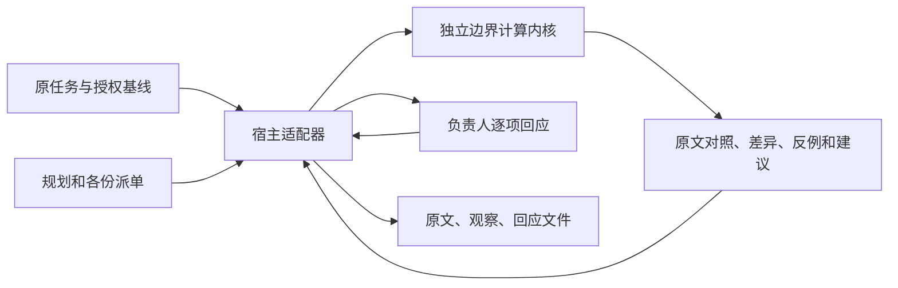

# 当“检查”被变成“修复”：如何用数学计算 Agent 的任务边界

界痕 · BoundX（BoundX）原理、实现与测试依据 · 2026-09-10 · 1.0.0 工程初版

一个负责人收到任务：“检查系统，组织团队完成检查，最后提交报告。”他发现问题后，又安排修复，并决定修复和复测通过之前不交报告。这个决定可能出于认真负责，却改变了委托方要求的结果：原来要的是检查结论，现在变成了修好的系统。

用户提供的 CodeFlowMu 复盘提出过这个问题。CodeFlowMu 是一个本地多 Agent 协作系统，任务负责人会将总任务拆分给多个执行者。本轮开发没有重新核验该历史事故的全部因果，而是把“检查→修复→新增交付前提”做成了可重跑的测试输入。

问题不只属于 CodeFlowMu。任何能理解、规划、拆分任务的 Agent，都可能在这些过程中补入自己的判断。我们需要一种方法，把这些变化明确地列出来，给出修改建议，要求负责人回应，同时让业务决定仍由有权主体作出。

**任务边界顾问的核心，是将任务解释转化为有原文依据的有限约束，再计算约束之间的差异。它计算的是表达出来的边界，不是对人的意图或模型理解能力作完整证明。**

## 一、先分开“理解文本”和“计算差异”

设原任务文本为 \(T\)，结构化边界为 \(B\)。从文本到边界的转换记为：

\[
\pi(T)=B
\]

这个 \(\pi\) 是语义映射：例如，把“核查产品”映射成“负责人—检查—产品”这一动作，把“提交报告”映射成一个完成条件。它可以由人完成，也可以由模型辅助完成，但不能因为输出了 JSON 就认为映射正确。

计算器接收到两个映射结果，才开始确定性计算：

\[
\Delta(B_0,B_1)
\]

其中 \(B_0\) 是任务授权方确认的基线，\(B_1\) 是负责人规划或派单表达的边界。同一份结构化输入，在同一版本算法下得到相同的差异；同一份自然语言经过不同模型解释，仍可能得到不同的结构化输入。

这解释了数学方法能改善哪里：它把“哪里不同”变成可以逐项复核的结果，并没有消除语义映射阶段的不稳定。

相同边界也允许多个不同的合法结果。例如，两份报告可以组织方式不同，却都满足证据、范围和交付要求。因此，边界精确不意味着所有模型最后输出相同；它应缩小可接受结果的范围，并使偏离可以解释。

本版会检查引用是否实际出现在任务原文中，但这只是必要条件。假如模型把一句原文同时放进七个字段，引用可能全部合法，含义却未必合理。因此所有审阅结果都保留“需要语义核查”的状态，不把“没发现差异”输出成“理解正确”。实现入口见 [独立计算内核](../src/index.ts)。

## 二、七参数是约束容器，不是能力评分

本版使用：

\[
B=\langle I,O,A,P,R,V,C\rangle
\]

| 参数 | 表达的边界 | 典型问题 |
|---|---|---|
| \(I\) | 输入和检查对象 | 检查哪个目录、实例、时间范围？ |
| \(O\) | 产出物 | 交什么，交给谁？ |
| \(A\) | 动作范围 | 检查、提出建议，还是修改和发布？ |
| \(P\) | 责任关系 | 谁负责执行、确认，谁独立观察？ |
| \(R\) | 资源约束 | 时间、费用、调用量和人工介入上限是什么？ |
| \(V\) | 版本与来源 | 以哪版任务、代码和证据为准？ |
| \(C\) | 完成与停止条件 | 什么证据足以交付，什么时候应停下或申请澄清？ |

这些字段与“目标、范围、验证深度、复杂度、资源、组织、停止”一类任务质量分析维度有联系，但不是同一套量表。当前工具没有把它们加权成“PM理解分”。

设已经提供原文映射的字段集合为 \(K\)，只能得出：

\[
M=\{I,O,A,P,R,V,C\}\setminus K
\]

\(M\) 是“尚未映射”的字段集合，不能直接称为“原文缺失的要求”。完整率 \(|K|/7\) 即使为1，也只代表填全，不代表正确。当前实现输出逐项缺口，不用完整率替代验收。

例如，没有资源映射时，建议是“请补充时间、调用量或费用上限；具体数值由任务授权方决定”。程序可以提出候选条款，但不会自己填一个两小时预算并把它变成授权。

## 三、动作集合差：把新增工作具体列出来

将一项动作表示成三元组：

\[
a=(\text{执行角色},\text{动作},\text{对象})
\]

设基线动作集合为 \(A_0\)，规划与子任务中表达的动作集合为 \(A_1\)。新增动作是：

\[
\Delta_A^+=A_1\setminus A_0
\]

在“检查变修复”的测试里，基线包含：

\[
A_0=\{(taskOwner,inspect,product)\}
\]

规划又增加了：

\[
(developer,repair,product)
\]

集合差会准确指出这个新增元组。工具同时保留它对应的“修复产品”原文，给出影响和建议：解释它与原任务的必要关系；如果原任务仅要求检查，建议改为核验问题、提交证据和修复建议；确需修复时另向任务授权方申请。

**新增元组不等于已证明越权。** “负责人检查”细化成“测试人员检查”，也可能产生元组差异；“核查”和“检查”可能是同义标签。工具因而把结果称为观察，允许负责人说明合理细化或标签对应关系。

本版对规划和各子任务逐份检查，所以根规划写得正确，不会掩盖某张派单中的新增动作。但如果调用方漏映射了一项动作，集合差就无法发现那一项；这仍是语义映射的覆盖限制。

## 四、完成条件：用反例证明“交付前提变了”

动作变化容易看见，完成条件变化往往更隐蔽。

设 \(r\) 表示“报告已提交”，\(f\) 表示“产品已修复并复测通过”。原来的完成条件是：

\[
C_0=r
\]

负责人增加修复前提后，变为：

\[
C_1=r\land f
\]

取一个赋值：

\[
r=1,\quad f=0
\]

便有：

\[
C_0=1,\quad C_1=0
\]

这就是一个反例：存在“原条件允许交付，新条件不允许交付”的状态。它证明符号层面的交付条件被收紧，不依赖“感觉这个规划有点过度”的判断。

一般形式为：

\[
\exists s:\ C_0(s)\land\neg C_1(s)
\]

反过来，如果存在：

\[
\exists s:\ C_1(s)\land\neg C_0(s)
\]

则能找到新条件放宽原条件的反例。一份规划可能同时新增条件并删掉另一条件，所以收紧和放宽反例可以同时存在，不能强行压成一个方向或一个分数。

### 本版采用的有限算法

当前只把明确列出的完成条件按逻辑“与”解释。设条件标识集合为 \(S_0,S_1\)：

\[
C_i(s)=\bigwedge_{x\in S_i}s(x)
\]

如果存在 \(x\in S_1\setminus S_0\)，让 \(x\) 为假、其余条件为真，就能构造收紧反例。若存在 \(y\in S_0\setminus S_1\)，令 \(y\) 为假、其余为真，就能构造放宽反例。独立接口 `compareBoundaryConditions` 实现的就是这件事。

这个推导有明确前提：条件标识的含义一致，条件可以按当前赋值解释，且采用合取语义。如果领域规则规定“报告只能在修复之后生成”，上面的赋值可能在现实中不可达。更完整的判断需要加入领域约束 \(D\)：

\[
\exists s:\ D(s)\land C_0(s)\land\neg C_1(s)
\]

**当前版本尚未实现一般领域约束求解、任意布尔表达式或SAT求解器。** 返回结果明确标注为符号反例及其假设。相同条件标识的原文改变时，工具只报告文本差异，不假装已经证明两个自然语言谓词之间的蕴含关系。

## 五、依赖图：检查等待关系怎样放大问题

负责人拆任务时，还会建立依赖。本文定义有向边 \((v,u)\) 表示“任务 \(v\) 等待任务 \(u\)”：

\[
G=(N,E)
\]

例如，“汇报等待复测，复测等待修复”，就把一个新增修复动作接到了汇报之前。仅看每份任务的名称，容易漏掉这个影响。

本版检查两类图结构问题：

- 被引用的依赖节点不在本次图中：要求补充任务标识、责任人和完成证据，或说明它是外部依赖。
- 依赖图出现有向环：要求核查哪些边是真正的完成前置条件，哪些只是信息参考。

有向环检测采用深度优先搜索，记录正在访问的节点和已经完成检查的节点；再次遇到正在访问的节点时给出一条环路径。图检测部分的时间复杂度为 \(O(|N|+|E|)\)。

如果环上的每条边都表示“必须等对方完成”，又没有已有满足条件，循环等待就值得处理。不过，图上有环不等于真实系统已经死锁。工具也没有接管轨道机的启动或完成状态。

当前版本还没有完成跨任务的全部产出覆盖、资源累计预算、依赖语义传递和历史图增量分析。不能把有向环检查写成“已证明整个协作系统无死锁”。

## 六、不裁决，但必须回应：另一项集合计算

提醒如果发出后没有人处理，就难以形成可审计的协作。我们把回应义务表示成一个简单集合关系。

设本轮发现集合为 \(F\)，已经提交结构完整回复的发现标识集合为 \(R\)，则待回应集合是：

\[
U=F\setminus R
\]

只要 \(U\ne\varnothing\)，状态就保持 `awaiting_response`，即待回应。全部回应后变为 `responded`，即已回应。

负责人可以采纳、部分采纳、不采纳，或者请求授权方澄清，但每一项都必须有理由以及原文、修改位置或澄清请求的引用。只说“收到”而没有处理立场和引用，不能构成接口要求的完整回复。

这一层只计算“哪些项有完整回应”。它不计算理由是否令人信服，也不把回复自动升级成问题已解决。实现始终保留：

```json
{
  "resolution_status": "not_adjudicated",
  "business_decision": null
}
```

因此，不采纳不会被算法强制改成采纳，尚未回应也不会自动导致业务任务被取消。当前适配层提供持久待回应清单供负责人和授权方查询，没有实现自动催办或超时升级；是否真实收到提醒、是否认真回答，仍要靠宿主交付与后续观察验证。

## 七、独立插件与 CodeFlowMu 适配的边界

通用工具放在仓库独立目录 `boundx/`，运行只依赖 Node.js，不导入 CodeFlowMu 运行时。它提供三种使用方式：函数接口、命令行接口，以及用于 Agent 调用工具的MCP标准输入输出入口。



通用层使用“任务授权方”和“任务负责人”两个职责概念。CodeFlowMu 可以把它们对应为ADMIN和PM，其他平台可以映射为用户和规划Agent，或委托方和承包团队。

建议文案目前支持简体中文和英文，通过 `locale` 显式选择。语言转换放在计算之后：观察标识、原文引用、源摘要和布尔赋值保持不变，只替换解释与建议。测试对同一输入分别请求两种语言，逐项核对这些字段。这样，切换语言不会把同一条观察误当成新的回应义务；但跨语言的“检查/inspect”等标签是否等价仍需要确认，不能由展示翻译代替语义核查。

| 通用插件负责 | 宿主适配负责 |
|---|---|
| 校验输入结构和原文引用 | 确认身份与基线授权来源 |
| 计算有限集合、条件和图差异 | 获取任务、规划、派单及对应版本 |
| 生成具体建议和符号反例 | 保存原文、输出和回应，交付提醒 |
| 核对逐项回应是否完整 | 启停、授权申请与已有强约束执行 |

通用MCP是无状态的。提交一个名为baseline的对象，不足以证明它已经获得授权；这必须由宿主适配层保证。CodeFlowMu适配层设置了独立的本地ADMIN确认入口，PM工具没有确认基线或启停插件的方法。该本地入口信任操作系统操作者，不声称能够隔离同样拥有文件系统权限的恶意进程，也不会把一个引用字符串当成已验证的线上签名。

当前CodeFlowMu适配还提供默认关闭开关、不可覆盖的审阅与回复记录、接班查询和重试冲突检查。记录用原文摘要绑定内容，重复操作不能覆盖另一份内容。但摘要是完整性依据，不是作者身份或授权真伪的证明。

## 八、实际实现过程：先分离计算，再接入宿主

本轮开发从一份修改前协议开始，冻结产品基线 `882e1eecc3687617c42f191c2249febb83af8e8a`，记录目标、验收条件和预定测试。起初按CodeFlowMu可选工具实现；用户明确要求通用独立插件后，追加范围协议，将计算内核和测试移动至独立目录，保留宿主兼容导出。

这不是重新复制一份产品。仓库仍只有原产品根，独立目录是一个可单独运行的组件。通用计算内核只有任务数据和计算结果；宿主的文件存储、角色工具挂载和构建接入留在适配层。

主要路径为：

- [计算内核](../src/index.ts)：七参数映射校验、集合差、条件反例、图环和回应集合。
- [数据接口模式](../src/schemas.ts)：任务、规划和回复的字段约定。
- [独立MCP入口](../mcp.mjs)与[独立CLI入口](../cli.mjs)：无CodeFlowMu运行依赖。
- [CodeFlowMu适配说明](../../docs/engineering/BOUNDX.md)：身份、启停、记录和使用限制。

这里保留了一个工程上的保守选择：没有把“检查”“修复”等关键词匹配当成自然语言理解，也没有给所有异常计算统一风险总分。先输出可以解释的变化，再由负责人回应，比一个缺乏校准依据的分数更适合本轮证据范围。

## 九、测试实际支持了什么

本轮使用Windows、Node.js 24.16.0、现有TypeScript工具链，测试在临时目录或进程中运行，没有调用付费模型，没有操作线上协作实例。全部命令、退出码和原始输出保存在[标准变更证据包](../../research/evidence/changes/TASK-20260910-BOUNDARY-ADVISOR-001/)。

### 1. 数学和输入边界：10项测试

独立内核的10项测试全部通过，其中包括原文引用校验、检查变修复、子任务扩张、完成条件遗漏、依赖环、未知依赖和逐项回应。[源码](../src/__tests__/boundx.test.ts)与[原始输出](../../research/evidence/changes/TASK-20260910-BOUNDARY-ADVISOR-001/runs/language-core-tests.log)可以直接对照。

其中一项固定三个布尔条件，枚举原、新条件集合的全部组合：

\[
2^3\times2^3=64
\]

对每组输入，测试重新代入布尔值核算返回的反例是否确实使原、新完成结果不同，也检查有无新增/删除条件与反例存在性是否一致。64组都满足预期。

**64是有限集合组合数量，不是64次Agent实验。** 它支持当前合取条件算法在这个穷举域中的实现正确性，不是对开放自然语言的准确率统计。

### 2. 宿主适配与既有工具回归：18项测试

受影响适配和既有PM/MCP回归共18项测试通过，覆盖默认关闭、角色挂载、同ID重试、不同内容冲突、持久恢复、PM更换、损坏配置及既有工具授权过滤。[原始输出](../../research/evidence/changes/TASK-20260910-BOUNDARY-ADVISOR-001/runs/language-shell-tests.log)。

这些测试里的“Codex/Cursor/Claude挂载”指工具配置工厂产生了预期配置，不代表三个真实平台已经在线调用并认可建议。

### 3. 真实本地进程入口：8个场景

另外运行了独立CLI、独立MCP，以及打包后的CodeFlowMu适配进程，而不只是在测试进程内直接调用函数。结果如下：

| 场景 | 实际观察 |
|---|---|
| 独立CLI比较检查与修复规划 | 返回动作差异、完成条件差异及原真新假的符号反例 |
| 独立MCP与CLI对照 | 同输入摘要一致，伪造原文引用被拒绝 |
| 本地ADMIN适配入口 | 默认关闭，经显式启用后登记基线 |
| 中英文参数传递 | CLI/MCP及宿主适配返回英文建议，原文引用不变 |
| PM提交规划审阅 | 新进程可读到待回应记录 |
| 只回复“收到”且无引用 | 回复接口返回错误，未算作完整回应 |
| 更换为另一个PM进程 | 逐项回复后变为已回应，仍未裁决 |
| 停用适配插件 | 新审阅被拒绝，旧记录仍可读取 |

场景脚本、进程输出和逐项检查结果见[测试脚本](../../research/evidence/changes/TASK-20260910-BOUNDARY-ADVISOR-001/runs/smoke_interfaces_final.py)、[运行日志](../../research/evidence/changes/TASK-20260910-BOUNDARY-ADVISOR-001/runs/interface-final-smoke.log)与[原始进程观察](../../research/evidence/changes/TASK-20260910-BOUNDARY-ADVISOR-001/runs/interface-observations-final.json)。

其中PM回复是脚本提供的受控输入，**不能据此声称模型收到提醒后一定会自主纠正**。测试证明接口不把简单确认误算为完整回复，并保留换人后的回应记录。

此外，规则核验、运行时类型检查、Shell类型检查及构建、辅助进程打包均有通过日志。这是开发验证，不是安装包发布或线上验收。早期和后续轮次均保留；本轮没有用删除失败日志来制造全绿结果，负面输入被预期拒绝也不能当作发生了真实越权事故。

提交阶段又遇到远端已更新，需要合并上游代码。合并无冲突，之后一次与编译并行的回归出现既有MCP响应超时（17/18），在原阈值和原断言下串行复核为18/18，8个进程场景也再次通过。失败及复验保存在[独立集成证据包](../../research/evidence/changes/TASK-20260910-BOUNDARY-ADVISOR-INTEGRATION-001/)。资源争用是可能解释，尚未证明唯一根因；原始超时不能从报告里删除。

## 十、下一轮实验应该如何检验“顾问是否有用”

现有证据支持：在明确映射的有限输入内，差异和回应状态能够重算，工具可以独立运行，CodeFlowMu能够作为宿主适配。

下一步若要判断它是否改善真实PM表现，需要另一份预先登记的模型实验协议：固定任务和事实基线，分别比较无提醒、一般提醒、带具体差异与反例的提醒；每轮保留初始理解、完整拆分、每份派单、反馈后的修改以及最终任务结果。

关键指标应分开统计：映射覆盖与误映射、范围扩张、原要求遗漏、误提醒、逐项回应、无依据的不采纳，以及修正后是否又增加新的边界变化。模型与重复轮次也应分层，不能把同一模型连续回答当作彼此独立的稳定样本。未经授权的新费用或线上操作不属于本轮工作。

目前还缺自动语义提取、真实模型提醒效果、自动催办升级、一般约束求解和图形开关。它们可以逐项研究，但不应被初版测试通过一并宣称为已有能力。

这套方法最终要保留的是一条可追问的链：**原文表达了什么，映射成了什么，规划改了什么，反例是什么，建议谁来确认，负责人怎样回应。** 数学让链上的变化更精确；责任和授权让这些变化得到正确处理。
